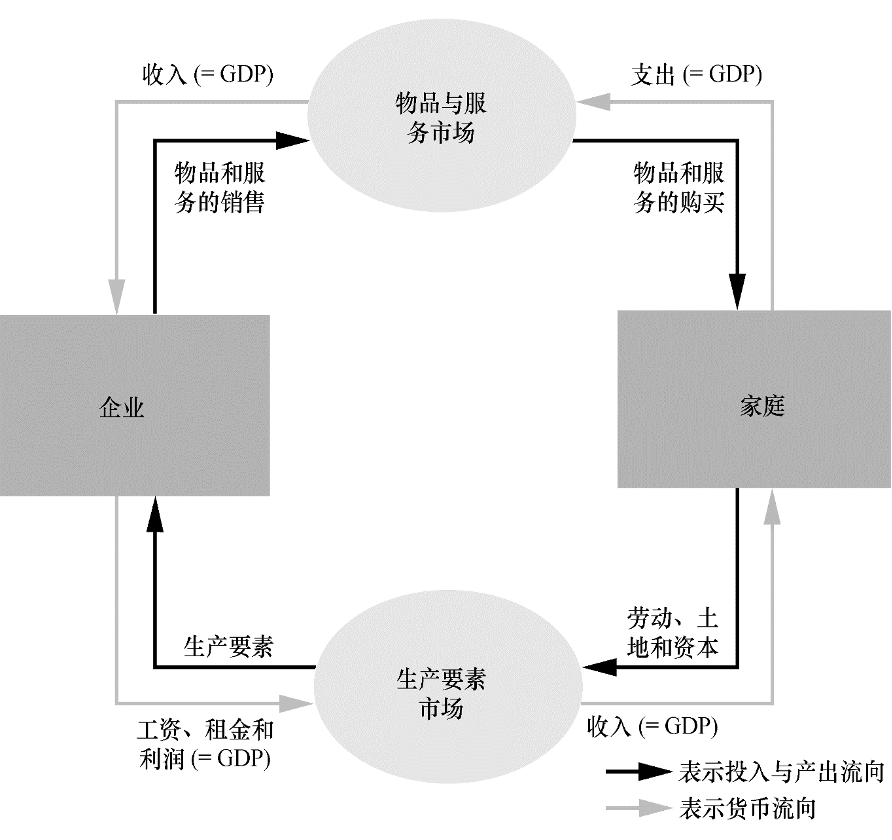

# chapter23&amp;24宏观经济学的数据 —— 一国收入的衡量与生活费用的衡量

---

## 目录

- [1. 背景与问题定义](#1-背景与问题定义)
- [2. 收入、支出与循环流量图](#2-收入支出与循环流量图)
- [3. 国内生产总值（GDP）的定义](#3-国内生产总值gdp的定义)
- [4. GDP 的组成部分：Y = C + I + G + NX](#4-gdp-的组成部分y--c--i--g--nx)
- [5. 真实 GDP 与名义 GDP](#5-真实-gdp-与名义-gdp)
- [6. GDP 平减指数与通货膨胀率](#6-gdp-平减指数与通货膨胀率)
- [7. GDP 作为福利指标的局限](#7-gdp-作为福利指标的局限)
- [8. 消费物价指数（CPI）](#8-消费物价指数cpi)
- [9. 衡量生活费用的三个问题](#9-衡量生活费用的三个问题)
- [10. GDP 平减指数与 CPI 的对比](#10-gdp-平减指数与-cpi-的对比)
- [11. 生活费用的地区差别](#11-生活费用的地区差别)
- [12. 易错点与对比](#12-易错点与对比)
- [13. 总结](#13-总结)
- [作业 / 自测题](#作业--自测题)

---

## 1. 背景与问题定义

宏观经济学（macroeconomics）研究**整体经济现象**：通货膨胀、失业、经济增长。它和微观经济学的分工是：

| 学科        | 研究对象                | 典型问题              |
| --------- | ------------------- | ----------------- |
| **微观经济学** | 家庭、企业如何做决策、如何在市场上交易 | 某商品价格如何决定、某企业如何定价 |
| **宏观经济学** | 整体经济的总量行为           | 总产出多少、物价总水平、总就业   |

要做宏观分析，必须先有可观测的总量数据。本篇要回答两个基本问题：

1. **一国在一段时期内生产了多少？收入了多少？** → 第 23 章，答案是 GDP。
2. **这段时期的生活费用涨了多少？** → 第 24 章，答案是 CPI 与 GDP 平减指数。

这两个数据是后面所有模型（长期增长、AD-AS、货币政策）的输入，所以必须先把定义、核算口径和测度陷阱讲清楚。

---

## 2. 收入、支出与循环流量图

### 2.1 一个关键直觉：收入 ≡ 支出

对一个**封闭**经济体而言，每一笔交易都同时是某人的支出和另一人的收入。你花 10 元买面包，这 10 元既是你的支出，也是面包店的收入（再拆成工资、租金、利润）。因此从总体上看：

$$
\text{经济的总收入} = \text{经济的总支出}
$$

⭐ 这就是 GDP 可以**既从收入侧、又从支出侧**来核算的理论基础——两种口径在概念上必然相等（统计上存在“统计误差”，但概念上是恒等）。

### 2.2 循环流量图（Circular Flow）

循环流量图用一个简化的两部门模型直观说明上述恒等关系。

**假设**：

- 经济中只有两类主体：**家庭**（households）和**企业**（firms）。
- 两类市场：
  - **物品与服务市场**（goods &amp; services）：家庭买、企业卖。
  - **生产要素市场**（factors of production）：企业买劳动/土地/资本、家庭卖。
- 家庭花掉所有收入，买下所有物品与服务；企业把销售收入全部支付给要素所有者（工资、租金、利润）。

**流向**：

- 物品与服务市场：货币从家庭流向企业（支出）。
- 生产要素市场：货币从企业流向家庭（收入：工资、租金、利润）。

在这张图里，**GDP 同时等于**：

- 家庭在物品与服务市场上为物品与服务支付的总额（**支出法**）；
- 企业在生产要素市场上为生产要素支付的工资、租金、利润总额（**收入法**）。

💡 宏观里“总支出 = 总收入”不是巧合，因为每一笔钱都有去向也有来源。

---

## 3. 国内生产总值（GDP）的定义

### 3.1 标准定义

> **国内生产总值（Gross Domestic Product, GDP）**：一个国家或经济体在**一个既定的时期内**生产的**所有最终产品与服务**的**市场价值**。

这个定义看起来一句话，但每个限定词都对应一个口径规则。讲义把定义拆成六个修饰短语来逐条解释，下面照此展开。

### 3.2 逐词拆解（讲义顺序）

| 修饰短语          | 含义                               | 由此得到的口径规则                            |
| ------------- | -------------------------------- | ------------------------------------ |
| **“市场价值”**    | 用市场价格计价                          | 价格反映商品被社会赋予的价值；不进入市场的东西难以计价          |
| **“所有的”**     | 在该经济体内生产、并在市场上合法销售的所有商品          | **排除**：非法生产销售品、家庭内生产并自用的活动           |
| **“最终的”**     | 只算最终产品                           | 中间产品的价值已包含在最终产品价格里，再算会重复计算           |
| **“物品和服务”**   | 既包括有形物品（goods），也包括无形服务（services） | 教育、医疗等服务同样计入                         |
| **“生产的”**     | 只算**现期生产**的物品与服务                 | 二手商品交易不计入（不是本期生产）；金融资产交易不计入          |
| **“一个国家内”**   | 按地理口径，不论生产者国籍                    | 外资在华工厂产出计入中国 GDP；本国公民海外工作产出不计入本国 GDP |
| **“一个既定的时期”** | 通常为一年或一个季度                       | 是**流量**概念，不是存量                       |

### 3.3 三个高频陷阱

1. **中间产品不计入**。一斤面粉被面包厂做成面包，面粉的价值已经包含在面包售价里，面粉不能再单独计一次。
   - 区分关键：**是否被再次加工/转售**。若被再次加工就是中间产品；若卖给最终消费者就是最终产品。
2. **二手商品不计入**。一辆二手车卖出 5 万元，这 5 万元不计入本期 GDP——该车在生产当年已经计过一次。二手车交易中，**经纪人的服务费**是本期新生产的服务，可计入。
3. **金融交易不计入**。买卖股票、债券只是资产所有权转移，没有创造新产出，不计入 GDP。

### 3.4 GDP vs GNP（地理口径 vs 国籍口径）

| 指标      | 口径                             | 例子                   |
| ------- | ------------------------------ | -------------------- |
| **GDP** | 一国**境内**生产的最终产品与服务市场价值，不论生产者国籍 | 美资企业在华产出 → 中国 GDP    |
| **GNP** | 一国**国民**生产的最终产品与服务市场价值，不论身在何处  | 中国公民在海外工作产出 → 中国 GNP |

二者关系：

$$
\text{GNP} = \text{GDP} + \text{国外净要素收入（NFP）}
$$

其中 NFP = 本国要素在境外所得 − 外国要素在本国所得。

---

## 4. GDP 的组成部分：Y = C + I + G + NX

### 4.1 国民收入恒等式

⭐ 核心恒等式（支出法）：

$$
Y = C + I + G + NX
$$

| 符号   | 名称                         | 含义                 |
| ---- | -------------------------- | ------------------ |
| $Y$  | GDP                        | 总产出 / 总收入 / 总支出    |
| $C$  | 消费（consumption）            | 家庭在物品与服务上的支出（除去住房） |
| $I$  | 投资（investment）             | 购买将来用于生产其他物品与服务的产品 |
| $G$  | 政府购买（government purchases） | 政府消费支出与总投资         |
| $NX$ | 净出口（net exports）           | 出口 − 进口            |

下面逐项展开口径，每一项都对应讲义一节。

### 4.2 消费 $C$

**定义**：家庭在物品与服务上的支出。分两大类：

- **物品**：
  - **耐用品**（durable goods）：汽车、家电等使用寿命长。
  - **非耐用品**（nondurable goods）：食品、衣服等。
- **服务**：无形资产、教育支出、医疗等。

⚠️ **例外**：**购买新住房**不算在 $C$ 里，而是算在 $I$（投资）的住宅资本项下。这是一处容易记错的口径边界。

### 4.3 投资 $I$

**定义**：购买将来用于生产其他物品与服务的产品（投入资本池）。讲义列出三类：

1. **商业资本**：商业结构、设备、知识产权产品。
2. **住宅资本**：房东的公寓楼；**房主的私人住宅**（这就是为什么新住房算 $I$ 不算 $C$）。
3. **存货积累**：本期生产但未售出的产品作为存货投资计入。

⚠️ 宏观里的“投资”和日常用语不同：

- 日常“投资”常指买股票、买基金——宏观里这叫**金融投资**，**不计入 GDP 的** $I$。
- 宏观 $I$ 只指**实体资本形成**：资本品购置 + 存货增加。

### 4.4 政府购买 $G$

**定义**：政府消费支出（$G_C$）和总投资（$G_I$）之和，即地方和中央政府在物品与服务上的支出。

⚠️ **不包括转移支付**。转移支付（社保、失业救济、扶贫款）只是收入从政府转移到家庭，没有换取物品与服务，不计入 $G$。它的影响是通过改变家庭的可支配收入 $Y-T$ 间接体现到 $C$ 上。

### 4.5 税收 $T$、可支配收入与储蓄

- **税收** $T$：用于维持政府购买。
  - $T = G$：**平衡的财政预算**。
  - $T > G$：**财政盈余**。
  - $T < G$：**财政赤字**。
- **可支配收入**：$Y - T$（家庭交完税后能拿来花或存的钱）。
- **储蓄**：

$$
S = (Y - T) - C
$$

即：可支配收入中没被消费掉的部分。

> 这条储蓄定义在后面第 26 章“储蓄、投资和金融体系”会反复用到，这里先把口径立住。

### 4.6 净出口 $NX$

$$
NX = \text{出口} - \text{进口}
$$

- **出口**：外国人用于**本国生产**的物品和服务的支出。
- **进口**：本国居民用于**外国生产**的物品和服务的支出。

🎯 为什么要把 $NX$ 加进恒等式？因为 $C, I, G$ 里都**包含了对外国产品的支出**（进口），而 GDP 只衡量本国境内生产。所以要先把进口从 $C+I+G$ 里“扣除”，再加上出口，净效果就是加 $NX = \text{出口} - \text{进口}$。

| 情形       | 含义               |
| -------- | ---------------- |
| $NX > 0$ | 贸易盈余（出口 &gt; 进口） |
| $NX < 0$ | 贸易赤字（进口 &gt; 出口） |
| $NX = 0$ | 贸易平衡             |

### 4.7 问答

> [!question] 投资包括股票和债券购买吗？为什么？
> 因为交易是一种资产的购买，不是**现期生产**的资本品的购买。

> [!question] 政府购买包括用于失业补助的政府支出吗？为什么？
> 不包括。因为失业补助是政府不以**得到物品或服务**为回报的支出。

> [!note]
> 欠发达国家中非市场产出的比例更高

---

## 5. 真实 GDP 与名义 GDP

### 5.1 为什么名义 GDP 会虚增

下一年总支出比上一年上升，可能来自两个原因（或两者兼有）：

1. 经济**生产出更多**的物品和服务（数量上升）；
2. 物品和服务**以更高的价格**出售（价格上升）。

如果直接把当年价格乘以当年产量加总，这两种原因被混在一起，无法区分“我们到底生产了多少”。于是需要拆开。

### 5.2 名义 GDP

> **名义 GDP（nominal GDP）**：用**现期价格**对物品和服务的产量计价。

$$
\text{名义 GDP}_t = \sum_i P_{it} \cdot Q_{it}
$$

其中 $P_{it}$ 是商品 $i$ 在 $t$ 期的价格，$Q_{it}$ 是商品 $i$ 在 $t$ 期的产量。

### 5.3 真实 GDP

> **真实 GDP（real GDP）**：用**不变价格**（选定一年的价格作为**基期**）衡量物品和服务的生产。

$$
\text{真实 GDP}_t = \sum_i P_{i,\text{base}} \cdot Q_{it}
$$

把基期价格 $P_{i,\text{base}}$ 固定后，真实 GDP 的变动只反映**产量**变动，不受价格变化影响。

⭐ **基期性质**：在基期那一年，名义 GDP = 真实 GDP（因为基期价格就是当年价格）。

### 5.4 一个对比直觉

| 指标     | 数量变化驱动 | 价格变化驱动 |
| ------ | ------ | ------ |
| 名义 GDP | ✔ 计入   | ✔ 计入   |
| 真实 GDP | ✔ 计入   | ✘ 剔除   |

🎯 因此衡量“经济实际生产了多少”、做跨年比较时，**用真实 GDP 而非名义 GDP**。

> 如果我们观察到名义GDP从一年到下一年增加了，我们无法判断是物品与服务增加了，还是物品和服务的价格上升了。但是如果我们观察到真实GDP上升了，我们就可以肯定是物品与服务增加了。

---

## 6. GDP 平减指数与通货膨胀率

### 6.1 GDP 平减指数的定义

> **GDP 平减指数（GDP deflator）**：名义 GDP 与真实 GDP 之比乘以 100。

$$
\text{GDP 平减指数} = \frac{\text{名义 GDP}}{\text{真实 GDP}} \times 100
$$

- 在**基年**该指数为 100；
- 衡量的是**相对于基年的总价格水平**。

💡 直觉：把“名义/真实”理解为“价格对数量的整体放大倍数”。真实 GDP 把价格钉死在基期，剩下的差异就只能由价格水平解释——所以这个比值就是价格指数。

### 6.2 通货膨胀

> **通货膨胀（inflation）**：经济的总价格水平上升。
> **通货膨胀率（inflation rate）**：相邻两期总价格水平的变化百分比。

用 GDP 平减指数表示：

$$
\pi_t = \frac{\text{GDP 平减指数}_t - \text{GDP 平减指数}_{t-1}}{\text{GDP 平减指数}_{t-1}} \times 100\%
$$

 inflation 率也可以用 CPI 来算（见第 8 节），两者通常是同向变动的。

> [!question] 名义GDP的上升主要由于真实生产增加还是物价提升？
> 先计算通货膨胀率（GDP平减指数），在计算名义GDP上升率。
> 比如，一个国家的通货膨胀率为 7%，名义GDP上升了 10%，所以名义GDP的上升主要由于物价提升。

---

## 7. GDP 作为福利指标的局限

### 7.1 GDP 为什么“有用”

讲义引用一句常见评价：GDP 是“衡量经济社会福利最好的指标”。理由是它同时衡量经济的总收入和总支出——更高的 GDP 通常意味着更好的医疗、更好的教育系统，衡量了我们获得“过上更有意义生活”的许多投入的能力。

### 7.2 GDP 不是完美的指标

⚠️ 讲义明确列出 GDP 忽略的维度：

1. **闲暇**：GDP 不衡量人们享受的休息时间。如果大家加班把产出提高 10%，GDP 上升，但福利未必上升。
2. **市场之外的活动价值**：自己做饭、带孩子、家务劳动不进入市场，不计入 GDP，但显然有福利意义。
3. **环境质量**：污染越严重、清理污染的支出越多，GDP 反而可能越高（清理污染是市场活动），但福利下降。
4. **与收入分配无关**：GDP 只看总量，不告诉你谁拿到了这些收入；同样 GDP 下贫富悬殊与共同富裕福利差距巨大。

🎯 考试常见问法：用 GDP 衡量福利的四个缺陷，要能逐条说出**为什么该缺陷不被 GDP 捕捉到**。

---

## 8. 消费物价指数（CPI）

### 8.1 CPI 的定义

> **消费物价指数（Consumer Price Index, CPI）**：衡量**典型消费者**购买一篮子物品和服务的费用的总价格水平，由统计局计算并上报。

CPI 与 GDP 平减指数的最大区别在于“**篮子**”的概念：CPI 固定一个典型消费者的消费篮子，长期跟踪这一篮子的购买费用。

### 8.2 计算 CPI 的五步法

讲义给出计算 CPI 的标准流程：

1. **固定篮子**：确定哪些商品的价格对典型消费者重要，并为不同商品赋予不同权重（即确定篮子内每种商品的数量 $C_i$）。
2. **找出价格**：在每一个时点调查篮子内各项商品的价格。
3. **计算购买这一篮子的费用**：篮子内的物品和服务相同（数量固定），所以费用变动**只反映价格变动**。
4. **选择一个基年**：以基年价格为基准。
5. **计算 CPI**：

$$
\text{CPI}_t = \frac{\text{基期篮子在 } t \text{ 期价格下的费用}}{\text{基期篮子在基期价格下的费用}} \times 100 = \frac{E_t}{E_b} \times 100
$$

其中：

- $E_t = \sum_i P_{it} \cdot C_i$：在 $t$ 期价格下买一篮子的总花费；
- $E_b = \sum_i P_{ib} \cdot C_i$：在基期价格下买同一篮子的总花费；
- $C_i$：商品 $i$ 在 CPI 篮子中的数量，由统计局设置，**固定不变**。

### 8.3 通货膨胀率（用 CPI）

$$
\pi_t = \frac{\text{CPI}_t - \text{CPI}_{t-1}}{\text{CPI}_{t-1}} \times 100\%
$$

### 8.4 其他物价指数

| 指标                   | 衡量对象                       | 说明                                |
| -------------------- | -------------------------- | --------------------------------- |
| **核心 CPI（core CPI）** | 除**食品和能源**之外的消费品购买成本       | 剔除波动大的食品与能源，更稳定地反映趋势性通胀           |
| **生产物价指数（PPI）**      | 厂商购买的一篮子物品和服务的费用，**含中间产品** | PPI 的变化常被用来**预测未来 CPI** 的变化（先行指标） |

🎯 PPI 作为先行指标的逻辑链：厂商的投入品价格上升 → 成本上升 → 迟早传导到消费者面对的最终价格 → CPI 跟着上升。

---

## 9. 衡量生活费用的三个问题

CPI 用固定篮子衡量生活费用，但这种“固定”本身带来了三个系统性偏差。⭐ 

### 9.1 替代偏向（substitution bias）

**问题**：价格不是同比例变动。当某商品相对变贵时，消费者倾向于用相对便宜的物品和服务来**替代**。但 CPI 篮子的数量 $C_i$ 是固定的，仍然按原来的权重算，**高估**了生活费用的实际上升幅度。

> 例子：苹果涨价、香蕉不涨，消费者会多吃香蕉少吃苹果。固定篮子假设他们还在吃原来那么多苹果，于是算出来的 CPI 比实际生活费用上升得更多。

### 9.2 新物品和服务的引入

**问题**：更多种类的物品和服务出现时，消费者每一元钱能买到的“选择范围”扩大了，等于每一元钱的实际价值上升（同样金额能获得更多福利）。但固定篮子无法反映这种因新品种带来的购买力提升，因此**高估**生活费用。

### 9.3 无法衡量质量变动

**问题**：商品质量改变（改进或退化）时，价格变化里有一部分是对质量变化的补偿，而不是纯粹的物价上涨。固定篮子的 CPI **难以剔除质量变动的影响**，于是把“花更多钱买到更好东西”也算成“物价上升”，同样造成偏差。

⚠️ 三个问题的方向要记清：**替代偏向、新物品引入、质量变动**——前两者使 CPI **高估**生活费用上升；质量变动若不调整也使 CPI 高估（因为把质量改进带来的涨价误当成纯通胀）。

---

## 10. GDP 平减指数与 CPI 的对比

这是本篇最核心的对比，几乎必考。

### 10.1 覆盖范围

| 指标           | 反映哪些物品的价格变动                  |
| ------------ | ---------------------------- |
| **GDP 平减指数** | 国内**所有生产出的**物品和服务的价格变动       |
| **CPI**      | 消费者**购买的**物品和服务的价格变动（含进口消费品） |

注意两点口径差异：

- GDP 平减指数**只含本国生产的**，**不含进口品**；
- CPI 篮子里**包含进口消费品**（消费者买的进口商品也算）。

### 10.2 权重方式

📐 这是两者最本质的区别：

| 指标           | 权重                          | 是否随时间变化           |
| ------------ | --------------------------- | ----------------- |
| **GDP 平减指数** | 以**产量** $Q_{it}$ 为权重        | **随时间变化**（各期产量不同） |
| **CPI**      | 以统计局设定的**固定篮子数量** $C_i$ 为权重 | **固定不变**          |

### 10.3 用三商品例子看清两者

讲义用 3 商品（$i=1,2,3$）的例子把两者写成“加权平均价格”形式，便于对比：

**GDP 平减指数**：

- $P_{it}$：商品 $i$ 在 $t$ 期价格；
- $Q_{it}$：商品 $i$ 在 $t$ 期产量；
- $\text{NGDP}_t = \sum_i P_{it} Q_{it}$，$\text{RGDP}_t$ 用基期价格算。
- 平减指数 = 各类商品价格的“加权平均”，**权重 = 该商品在 GDP 中的相对重要性，即其产量**，**权重随时间变化**。

**CPI（PPI 类似）**：

- $C_i$：商品 $i$ 在 CPI 篮子中的数量，由统计局设置；
- $E_t = \sum_i P_{it} C_i$，$E_b = \sum_i P_{ib} C_i$；
- CPI 也是各类商品价格的“加权平均”，**权重 = 该商品在 CPI 篮子中的相对重要性，即统计局设定的数量**，**权重固定**。

### 10.4 一张总对比表

| 维度       | GDP 平减指数            | CPI                 |
| -------- | ------------------- | ------------------- |
| 覆盖商品     | 国内所有生产出的物品与服务       | 消费者购买的物品与服务（含进口）    |
| 权重       | 当期产量                | 固定篮子数量              |
| 权重是否变动   | 是                   | 否                   |
| 是否含进口品   | 否                   | 是                   |
| 是否反映替代行为 | 间接反映（产量随相对价格变化）     | 不反映（固定篮子）→ 替代偏向     |
| 基期取值     | 基年 = 100            | 基年 = 100            |
| 典型用途     | 衡量整体经济价格水平、平减名义 GDP | 衡量典型消费者生活费用、调整社保/合同 |

⭐ **方向性结论**：因 CPI 固定篮子，存在替代偏向、新品引入、质量变动三类问题，**通常比 GDP 平减指数更多地反映为“偏高”**；但两者总体上同向变动——讲义图 2 显示 1965 年以来两者衡量的通货膨胀率一般同时变动。

---

## 11. 生活费用的地区差别

### 11.1 不只是时间，还有地理

生活费用不仅在时间维度上变化，也在**地理维度**上不同。讲义引入：

> **地区价格等价**：衡量各州生活成本的变化。

讲义图 3 展示了美国 50 个州及哥伦比亚特区相对全国平均的生活费用差异。

### 11.2 地区差异由什么驱动

讲义把地区生活费用差异归因到三类价格：

| 价格类别     | 占地区差异的份额   |
| -------- | ---------- |
| **商品价格** | 小部分        |
| **服务价格** | 大部分        |
| **住房服务** | 持续增长，是主要推手 |

🎯 结论：**地区生活费用差异主要由服务（尤其住房）价格驱动**，而不是商品价格。这与直觉吻合——商品可贸易、跨区套利缩小价差；服务和住房不可贸易，地区价差能长期存在。

---

## 12. 易错点与对比

把全篇容易混淆的点集中列一遍，便于复习。

### 12.1 GDP 口径边界

| 项目         | 是否计入 GDP  | 归入哪一项                 |
| ---------- | --------- | --------------------- |
| 买新住房       | ✔         | $I$（住宅投资），**不是** $C$  |
| 买二手住房      | ✘（生产当年已计） | 仅中介服务费计入 $C$ 或 $I$ 服务 |
| 买股票、债券     | ✘         | 金融交易，非产出              |
| 政府社保转移支付   | ✘         | 不计入 $G$，间接进入 $C$      |
| 中间产品（被再加工） | ✘         | 避免重复计算                |
| 非法生产、家庭自用  | ✘         | 不在合法市场                |
| 外资企业在华产出   | ✔         | 中国 GDP                |
| 本国公民海外工作产出 | ✘（本国 GDP） | 计入 GNP                |

### 12.2 名义 vs 真实 vs 平减指数

$$
\text{GDP 平减指数} = \frac{\text{名义 GDP}}{\text{真实 GDP}} \times 100
$$

⚠️ 易混：基年时名义 GDP = 真实 GDP，所以平减指数 = 100；**不要**写成“基年平减指数 = 0”。

### 12.3 CPI vs GDP 平减指数

⚠️ 三个最容易写反的点：

1. CPI 含**进口**消费品，GDP 平减指数**不含**进口品；
2. CPI 权重**固定**，GDP 平减指数权重**随产量变动**；
3. CPI 有**替代偏向**，GDP 平减指数没有（因为权重随产量调整，间接收纳了替代）。

### 12.4 三个 CPI 问题的高估方向

替代偏向、新物品引入、质量变动——**三者都使 CPI 倾向于高估**真实生活费用上升。

### 12.5 流量 vs 存量

- GDP 是**流量**（一段时期内的产出）；
- 资本、财富、住房存量是**存量**（某时点的量）。
- $I$ 是**流量**（本期新增资本），它通过积累改变资本**存量**。

---

## 13. 总结

本篇是宏观的“数据语言”：

- 用 **GDP** 衡量一国一段时期内生产的最终产品与服务的市场价值，可从**支出法** $Y=C+I+G+NX$ 或**收入法**核算，两者概念上恒等（循环流量图直觉）。
- 区分**名义 GDP**（现期价格）与**真实 GDP**（基期不变价格），用 **GDP 平减指数** = 名义 / 真实 × 100 来衡量总体价格水平，由此定义**通货膨胀率**。
- GDP 是好的福利代理变量，但**忽略闲暇、市场外活动、环境质量、收入分配**，不是完美福利指标。
- 用 **CPI** 衡量典型消费者一篮子物品与服务的费用，**固定篮子**，但带来**替代偏向、新物品引入、质量变动**三类高估偏差。
- GDP 平减指数与 CPI 在覆盖范围、权重是否固定、是否含进口品上有系统性差别，但总体同向变动。
- 生活费用不仅在时间上变化，也在**地区**上不同，差异主要由**服务（尤其住房）价格**驱动。

这些概念在后文中将反复出现：第 25 章用真实 GDP 研究长期增长，第 30 章用 CPI/GDP 平减指数研究货币增长与通货膨胀，AD-AS 模型则以真实 GDP 与价格水平为坐标轴。把本篇口径记牢，后面所有模型的“变量”才有确定含义。

---

## 作业 / 自测题

> 以下题目围绕本篇核心口径与计算，给出题意与解题路线，不照搬完整解答。

### 题 1（GDP 定义与口径判定）

判断下列项目是否计入当年 GDP，若计入指出归入 $C/I/G/NX$ 中哪一项，并说明理由：

1. 面包厂购买的面粉（用于烤面包出售）；
2. 你买一套当年新建的商品房自住；
3. 政府发放的失业救济金；
4. 你卖出自己三年前买的二手车，得款 5 万元；
5. 在华日资企业当年生产的汽车，部分出口到日本。

**解题路线**：

1. ✘ 中间产品，价值已包含在面包售价中。
2. ✔ 计入 $I$（住宅投资，新住房不计入 $C$）。
3. ✘ 转移支付不计入 $G$；它通过提高可支配收入间接影响 $C$。
4. ✘ 二手商品不重复计入；若通过中介，中介服务费计入。
5. ✔ 计入中国 GDP。出口到日本的部分计入 $NX$（出口），国内销售部分计入 $C$。

### 题 2（支出法核算）

某经济体一年数据（单位：亿元）：消费 6000，企业固定资产投资 1800，住宅投资 700，存货增加 200，政府购买 2200，政府转移支付 800，出口 1500，进口 2000。求 GDP 与 $NX$。

**解题路线**：

- 投资 $I = 1800 + 700 + 200 = 2700$（注意存货增加也算投资）；
- 转移支付不计入 $G$，故 $G = 2200$；
- $NX = 1500 - 2000 = -500$；
- $Y = C + I + G + NX = 6000 + 2700 + 2200 + (-500) = 10400$（亿元）。

### 题 3（名义 GDP、真实 GDP、平减指数）

只生产 A、B 两种商品。基期为第 1 年。数据如下：

| 年     | $P_A$ | $Q_A$ | $P_B$ | $Q_B$ |
| ----- | ----- | ----- | ----- | ----- |
| 1（基期） | 2     | 100   | 5     | 50    |
| 2     | 3     | 120   | 6     | 60    |

求：(1) 第 1、2 年的名义 GDP；(2) 以第 1 年为基期的第 2 年真实 GDP；(3) 第 2 年 GDP 平减指数与第 1→2 年通货膨胀率。

**解题路线**：

- 名义 GDP$_1 = 2\times100 + 5\times50 = 450$；名义 GDP$_2 = 3\times120 + 6\times60 = 720$。
- 真实 GDP$_2$（基期价）$= 2\times120 + 5\times60 = 540$。
- 平减指数$_2 = 720/540 \times 100 \approx 133.3$；基期平减指数$_1 = 100$。
- 通胀率 $= (133.3 - 100)/100 \times 100\% = 33.3\%$。

### 题 4（CPI 计算与三个问题）

典型消费者篮子含 4 个 A、2 个 B。基期 $P_A=2, P_B=5$；现期 $P_A=3, P_B=6$。求现期 CPI。若消费者在 A 涨价后大量改用便宜的替代品 C，固定篮子 CPI 会偏高还是偏低？这属于哪一类问题？

**解题路线**：

- 基期篮子费用 $E_b = 2\times4 + 5\times2 = 18$；
- 现期篮子费用 $E_t = 3\times4 + 6\times2 = 24$；
- $\text{CPI}_t = 24/18 \times 100 \approx 133.3$。
- 偏高，因为消费者其实减少了 A 的消费，固定篮子仍按原数量算；属于**替代偏向**。

### 题 5（GDP 平减指数与 CPI 对比，简答）

用三句话回答：

1. GDP 平减指数和 CPI 在**商品覆盖范围**上的区别？
2. 两者的**权重**有何本质不同？
3. 哪一个**更受替代偏向**影响？为什么？

**解题路线**：

1. GDP 平减指数反映国内所有生产出的物品与服务价格（不含进口）；CPI 反映消费者购买的物品与服务价格（含进口消费品）。
2. GDP 平减指数以当期产量为权重、随时间变化；CPI 以统计局设定的固定篮子数量为权重、不随时间变化。
3. CPI 更受替代偏向影响，因为固定篮子不反映消费者因相对价格变化而做出的替代；GDP 平减指数的产量权重会随相对价格变化调整，间接吸收替代行为。

### 题 6（GDP 作为福利指标的局限，论述）

简述 GDP 作为社会福利衡量指标的四个主要缺陷，并各举一个例子说明为何 GDP 无法捕捉。

**解题路线**（四条 + 例子）：

1. **忽略闲暇**：A 国人均 GDP 高但全年无休，B 国低一些但假期充裕，GDP 看不出 B 的福利补偿。
2. **忽略市场外活动**：家务、育儿、志愿劳动不进入市场，不计入 GDP，但福利意义大。
3. **忽略环境质量**：污染治理支出反而计入 GDP，污染越重、清理越多 GDP 越高，福利却下降。
4. **忽略收入分配**：同样 GDP 下贫富分化与共同富裕福利差距巨大，GDP 总量看不出分配。

### 题 7（综合判断，易错）

判断对错并简述理由：

1. 一辆新汽车由家庭购买自用，应计入投资 $I$。
2. 在基年，GDP 平减指数等于 100。
3. CPI 含进口消费品，因此 CPI 上升一定意味着本国生产的价格水平上升。
4. 失业保险减少的同时，摩擦性失业一般会下降。

**解题路线**：

1. ✘ 新汽车对家庭是耐用品消费，计入 $C$；只有**新住房**才计入 $I$。
2. ✔ 基年名义 GDP = 真实 GDP，平减指数 = 100。
3. ✘ CPI 含进口品，CPI 上升可能只是进口消费品涨价，本国生产价格未必动；要判断本国生产价格水平应用 GDP 平减指数。
4. ✔ 失业保险降低失业者收入保障、缩短寻业时间，倾向于降低摩擦性失业（代价是就业匹配质量下降）。