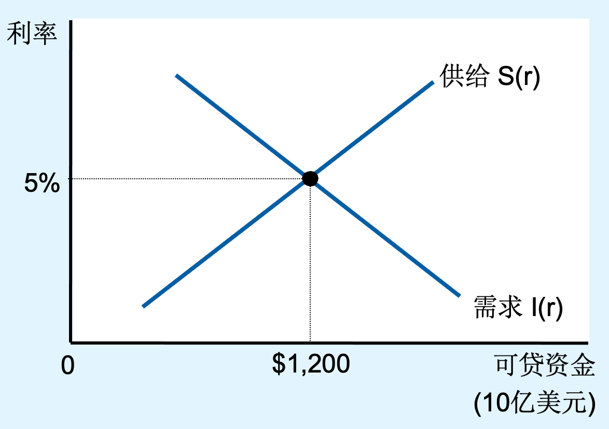
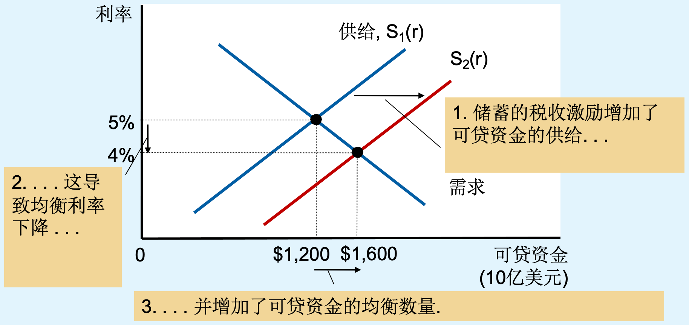
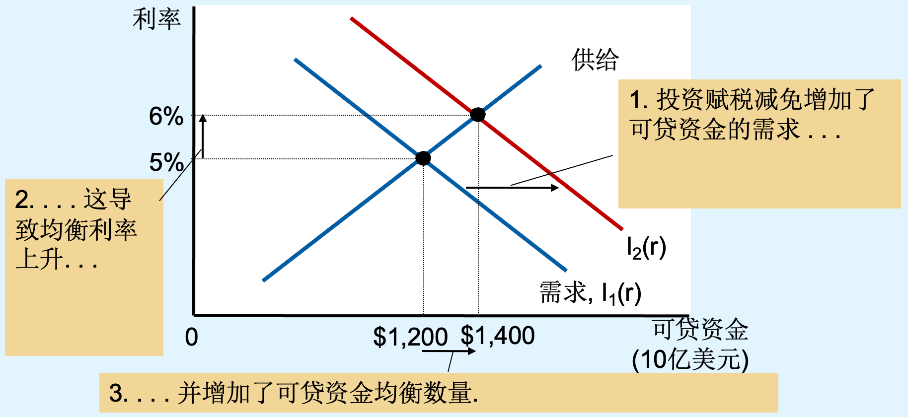

# 储蓄、投资和金融体系 —— 第 26 章

> 本章继续长期分析（承第 25 章）：经济增长需要**物质资本积累**，而资本积累来自**储蓄**。
> 本章回答三个问题：①美国经济中的**金融机构**如何把储蓄者的资金配置给投资者；②国民收入账户中**储蓄与投资**如何核算、为什么**储蓄 = 投资**；③利率与政策如何通过**可贷资金市场**影响储蓄和投资。

## 1. 美国经济中的金融机构

### 1.1 金融体系：储蓄如何流向投资

#### 1.1.1 定义与功能

**金融体系（financial system）**：经济中使一个人的**储蓄供给**与另一个人的**投资需求**相匹配的一系列机构。

它的功能是**使经济中的稀缺资源由储蓄者流向借贷者**——把家庭未消费的收入（储蓄）转化为企业购置厂房设备、家庭购置住房等**投资**支出。

#### 1.1.2 金融体系的两大组成部分

| 类别                                 | 资金流动方式                  | 例子        |
| ---------------------------------- | ----------------------- | --------- |
| **金融市场**（financial markets）        | 储蓄者**直接**提供资金给借贷者       | 债券市场、股票市场 |
| **金融中介**（financial intermediaries） | 储蓄者**间接**提供资金给借贷者（机构居中） | 银行、共同基金   |

**核心图景**：一个人的储蓄为另一个人的投资提供资金。个人既可能是资金的净供给者（储蓄者），也可能是净需求者（借贷者，如贷款买房的家庭、发债建厂的企业）；金融体系就是撮合这两类人的制度安排。

### 1.2 金融市场：债券市场与股票市场

储蓄者通过金融市场**直接**向借贷者提供资金，主要工具是**债券**与**股票**。

#### 1.2.1 债券市场

**债券（bond）**：债务证明（a certificate of indebtedness）——规定了借款人对债券持有人的债务义务。三个关键概念：

- **到期日（term）**：债务偿还的时间。债券的**期限**即到期之前的时间长度，可以是几个月、30 年，甚至永久（永续债券）。
- **利率（interest rate）**：到期日之前定期支付的利息占本金的比率。
- **本金（principal）**：还款量，即到期偿还的金额。

发行债券是**向公众借贷**的方式，**大的公司或政府**可以使用这种方式融资。

**债券之间的差异及其对利率的影响**（重点）：

1. **期限不同**
   - **长期债券比短期债券风险更大**（期限越长，未来不确定性越大）。
   - **长期债券的利率通常更高**——这是对更高风险的补偿。
2. **信用风险（credit risk）不同**
   - 信用风险 = **违约的可能性**：借贷者不能偿还利息或者本金的可能性。
   - **高的违约风险对应高的利率**（风险溢价）。
   - **中央政府债券倾向于有较低的利率**（违约风险小；美国国债被视为接近"无风险"）。
   - **垃圾债券（junk bonds）**：由财务状况不稳定的公司发行，违约风险非常高，因而**利率非常高**。

#### 1.2.2 股票市场

**股票（stock）**：**企业部分所有权的索取权**——对企业所获得**利润**的索取权。

- **有组织的股票交易**：股票在股票交易所买卖，包括**一级市场**（企业向公众发行新股票、直接融资）和**二级市场**（已发行的股票在投资者之间转手交易）。
- **股票持有者**：可以通过**销售股票**来赚钱（卖出价高于买入价时获得资本利得）。
- **股票指数（stock index）**：**一组股票的平均价格**，用于反映股市整体走势（如道琼斯工业指数、标准普尔 500 指数）。

#### 1.2.3 债券 vs 股票（对比）

| 维度    | 债券                 | 股票                         |
| ----- | ------------------ | -------------------------- |
| 性质    | **债务**证明（债权）       | 企业**部分所有权**的索取权（股权）        |
| 持有者身份 | 债权人                | 所有者（股东）                    |
| 回报    | 约定的**利息 + 本金**，较确定 | 对**利润**的索取权（股息 + 资本利得），不确定 |
| 风险    | 较低（尤其政府债券）         | 较高（企业亏损则股票跌价）              |
| 对发行企业 | 负债，需还本付息           | 出让所有权，无还本义务                |

### 1.3 金融中介机构

储蓄者通过金融中介**间接**向借贷者提供资金。

#### 1.3.1 银行

银行是最典型的金融中介：

- **吸收存款**：从储蓄者手中获得资金，**银行支付利息**给储户；
- **向借贷者提供贷款**：把资金借给企业和家庭，**银行收取利息**；
- 银行从**存贷款利差**中获利，并同时为双方提供服务（储户获得流动性与安全保管，借款人获得融资渠道）。

银行还有一层特殊作用：它们创造的**可获得的流动性**（如活期存款）方便了交换，使支付体系得以运转。

#### 1.3.2 共同基金（补充）

**共同基金（mutual fund）**：向公众出售股份，并用所得收入购买多样化股票或债券组合的机构。

- 两个优点：①**多元化**（"不把鸡蛋放在一个篮子里"），分散了风险；②**专业化管理**，为小额储蓄者提供了普通个人难以负担的分散化服务。
- 缺点：收取管理费；即使是指数基金（按股票指数购买一篮子股票），费率也可能侵蚀长期收益。

*注：共同基金是教材正文内容，课件在"金融中介"处以银行为代表举例。*

---

## 2. 国民收入账户中的储蓄与投资

### 2.1 从国民收入核算恒等式出发

国内生产总值（GDP，记作 $Y$）满足**总收入 = 总支出**：

$$
Y = C + I + G + NX
$$

| 符号   | 含义          |
| ---- | ----------- |
| $Y$  | 国内生产总值（GDP） |
| $C$  | 消费          |
| $I$  | 投资          |
| $G$  | 政府购买        |
| $NX$ | 净出口         |

- **封闭经济体**：不与其他国家交易，$NX = 0$。
- **开放经济体**：与其他国家进行交易，$NX$ 可能 $\neq 0$。

**本章为简化起见假设封闭经济体**：

$$
Y = C + I + G
$$

### 2.2 国民储蓄

**国民（总）储蓄（national saving，**$S$**）**：在用于消费和政府购买后剩下的一个经济中的总收入。

$$
S = Y - C - G
$$

由 $Y = C + I + G$ 得 $Y - C - G = I$，于是：

$$
\boxed{S = I}
$$

这就是**账户的恒等式：储蓄 = 投资**。注意两点：

1. 它说的是**经济作为一个整体**的恒等关系——一个人的储蓄可以为另一个人的投资提供资金，但在加总层面必然有 $S = I$；
2. 在可贷资金市场模型中，$S=I$ 对应**市场出清**：商品是**可贷资金**，价格是**利率**，利率调整使计划储蓄等于计划投资。

### 2.3 私人储蓄与公共储蓄

令 $T$ = **税收减去转移支付**（即政府的净税收收入）。把国民储蓄拆成两部分：
$$
S = Y - C - G = (Y - T - C) + (T - G)
$$

| 概念                       | 公式                                              | 含义                  |
| ------------------------ | ----------------------------------------------- | ------------------- |
| **私人储蓄**（private saving） | $S_{\text{私人}} = Y - T - C$                     | 家庭在支付了税收和消费之后剩下来的收入 |
| **公共储蓄**（public saving）  | $S_{\text{公共}} = T - G$                         | 政府在支付其支出后剩下的税收收入    |
| **国民储蓄**                 | $S = S_{\text{私人}} + S_{\text{公共}} = Y - C - G$ | 两者之和，等于可贷资金的总供给     |
### 2.4 预算盈余与预算赤字

公共储蓄 $T - G$ 的正负对应政府的预算状态：

- **预算盈余（budget surplus）**：$T - G > 0$，税收收入大于政府支出的余额。盈余 = 公共储蓄为正，**增加**国民储蓄。
- **预算赤字（budget deficit）**：$T - G < 0$，政府支出引起的税收收入短缺。赤字 = 公共储蓄为负，**减少**国民储蓄。

$$
\text{预算盈余} = T - G > 0, \qquad \text{预算赤字} = T - G < 0
$$

---

## 3. 可贷资金市场

可贷资金市场用真实利率联系储蓄与投资。先区分名义利率和真实利率，再分析市场均衡与政策影响。

### 3.1 名义利率与真实利率

#### 3.1.1 两种利率的定义

- **名义利率（nominal interest rate）**：通常报告的利率，**没有对通货膨胀的影响进行修正**。即存款余额的美元数量增长的百分比。
- **真实利率（real interest rate）**：经通货膨胀影响修正的利率，即**购买力**增长的百分比。

近似关系：

$$
\text{真实利率} \approx \text{名义利率} - \text{通货膨胀率}
$$

#### 3.1.2 数学证明（精确关系）

设 $M$ 代表本金，$i$ 代表**名义利率**，$r$ 代表**真实利率**，$P_1$ 代表当前物价，$P_2$ 代表未来物价，$\pi$ 代表**通货膨胀率**。

- $M$ 的本金，在**今天**的购买力是：$M / P_1$；
- $M$ 的本金，加上 $i \times M$ 的利息，在**未来**的购买力是：$(1+i)M / P_2$。

因此，购买力的变化率，即**真实利率**等于：

$$
r = \frac{(1+i)M/P_2}{M/P_1} - 1 = \frac{1+i}{P_2/P_1} - 1 = \frac{i - \pi}{1 + \pi} \approx i - \pi
$$

（其中 $P_2 / P_1 = 1 + \pi$。）

**要点**：$r = \dfrac{i-\pi}{1+\pi}$ 是精确公式，$r \approx i - \pi$ 是通胀率较小时的近似；只有当 $\pi$ 很小时近似才好。

#### 3.1.3 费雪效应（Fisher effect）

- 精确关系可改写为 $1+i=(1+r)(1+\pi)$，即 $i=r+\pi+r\pi$；忽略乘积项时，$i \approx r+\pi$，即**名义利率近似等于真实利率与通货膨胀率之和**。
- **两个经验现象**（以 1965—2016 年美国数据为例）：
  1. **名义利率与通货膨胀率在长期同向变动**——高通胀对应高名义利率。这与费雪效应一致：在其他条件相同、真实利率近似不变时，预期通胀率的上升会**近似一对一地**传导为名义利率 $i$ 的上升。
  2. **真实利率与名义利率在短期同向变动**——短期通胀变动不大，名义利率的升降主要反映真实利率的变动。
- **谁决定谁**：可贷资金市场决定的是**真实利率** $r$；长期货币量增长（第 30 章）影响**通货膨胀率** $\pi$；在真实利率给定时，预期通胀进而通过费雪效应影响**名义利率** $i$。

#### 3.1.4 事前与事后的真实利率（补充）

- **事前真实利率**：签约时**预期**的通胀率下借款人和放款人预期的真实利率；
- **事后真实利率**：按**实际**发生通胀率计算的真实利率。
- 通胀**超出预期**时，事后真实利率低于事前真实利率，财富从放款人向借款人**再分配**。

*注：本章市场分析中"利率"均指真实利率* $r$*；讨论银行挂牌利率、债券票面利率等"通常报告的利率"时指的是名义利率* $i$*。*

### 3.2 可贷资金的供求和均衡

储蓄 = 投资的恒等式告诉我们**结果**上二者相等，但没有解释**是什么使它们相等**。回答这个问题的是**可贷资金市场**模型。

#### 3.2.1 市场设定

**可贷资金市场（market for loanable funds）**：想**储蓄**的人借以提供资金、想**借钱投资**的人借以借贷资金的市场。

- **假设**：政府支出 $G$ 和税收 $T$ 是**外生给定**的。
- **价格 = （真实）利率** $r$：
  - 对**借贷者**：利率是**借贷的成本**；
  - 对**储蓄者**（借出者）：利率是**对他们储蓄的回报**。
- **消费函数的关键性质**：在单一金融市场上，消费 $C(r)$ 关于 $r$ **单调递减**——利率是储蓄的回报、消费的机会成本，利率越高，家庭越倾向于少消费、多储蓄。

这里 $C(r)$ 是给定收入 $Y$ 和净税收 $T$ 时的简写；分析税收变化时，还要考虑可支配收入 $Y-T$ 对消费的影响。

#### 3.2.2 可贷资金的供给与需求

- **可贷资金的供给**来自**储蓄**：
  $$
  S(r) = Y - C(r) - G
  $$
  因为 $C(r)$ 关于 $r$ 递减，所以 $S(r)$ 的**斜率为正**：利率上升 → 储蓄（供给量）上升。
- **可贷资金的需求**来自**投资** $I(r)$：企业为新设备、新厂房筹资，家庭为新住房融资。$I(r)$ 的**斜率为负**：利率是借贷成本，利率上升 → 投资需求量下降。

**总结**：当利率上升时，**需求的数量下降，供给的数量上升**。

| 曲线          | 方向       | 原因                            |
| ----------- | -------- | ----------------------------- |
| 供给曲线 $S(r)$ | **向上倾斜** | $S(r)=Y-C(r)-G$，而 $C(r)$ 斜率为负 |
| 需求曲线 $I(r)$ | **向下倾斜** | 利率是借贷成本，$I(r)$ 斜率为负           |

#### 3.2.3 均衡（图 1）

**经济中的利率调整使可贷资金供求平衡。**

- 可贷资金的**供给**来自**国民储蓄**，包括**私人储蓄**和**公共储蓄**；
- 可贷资金的**需求**来自想为**投资**而借款的**企业与家庭**；
- 课件图 1 中：**均衡利率为 5%**，可贷资金的供给量与需求量（即储蓄与投资量）为 **1.2 万亿美元**。

若利率高于均衡水平，供给量 &gt; 需求量，资金过剩会**压低**利率；若低于均衡水平，需求量 &gt; 供给量，资金短缺会**推高**利率。均衡时，**储蓄量 = 投资量**，这正是恒等式 $S = I$ 的市场机制解释。

### 3.3 政策分析：可贷资金市场中的三类政策

政府政策可以影响**储蓄与投资**，主要有三类：**储蓄激励、投资激励、政府预算赤字和盈余**。

#### 3.3.1 政策 1：储蓄激励（移动供给曲线）

**做法**：改变税法以**鼓励储蓄**（或**抑制消费** $C(r)$）——例如降低利息、股息的税率，设立免税的个人储蓄账户（401(k)、IRA 等）。

**传导**：影响可贷资金的**供给** → 储蓄增加，**供给曲线向右移动** $S_1(r) \to S_2(r)$。

**新均衡**：

- **更低的利率**；
- **更多的可贷资金**（均衡数量上升）；
- **更多的投资**（低利率刺激投资）。

**图 2 的数值**：均衡利率从 **5% 下降到 4%**，储蓄和投资的可贷资金均衡数量从 **1.2 万亿美元增加到 1.6 万亿美元**。

#### 3.3.2 政策 2：投资激励（移动需求曲线）

**做法**：**投资赋税减免**（investment tax credit）——对企业购置新资本（设备、厂房）给予税收优惠。

**传导**：影响可贷资金的**需求** → 企业更愿意投资，**需求曲线向右移动** $I_1(r) \to I_2(r)$。

**新均衡**：

- **更高的利率**；
- **更多的可贷资金数量**；
- **更多的储蓄**（更高的利率又会刺激储蓄）。

**图 3 的数值**：需求曲线从 $I_1(r)$ 移动到 $I_2(r)$ 时，均衡利率从 **5% 上升到 6%**，储蓄和投资的可贷资金均衡数量从 **1.2 万亿美元增加到 1.4 万亿美元**。

#### 3.3.3 政策 3：政府预算赤字与预算盈余（移动供给曲线）

**政府预算** $T - G$：

- 预算赤字**扩大**或盈余**降低**：源于 $G$ **增加或** $T$ **降低**；
- 预算赤字**缩小**或盈余**增加**：源于 $G$ **降低或** $T$ **增加**。

**两种情况的分解**（课件重点，注意区别）：先固定利率和收入，考察供给曲线如何移动；新均衡利率变化后的调整另行考虑。

**情况 1：**$G$ **增加**

- $S_{\text{私人}} = Y - T - C(r)$ **不变**（$Y$、$T$ 未变）；
- $S_{\text{公共}} = T - G$ **降低**；
- 国民储蓄下降，$S(r)$ **向左平移**。

**情况 2：**$T$ **降低（减税）**

- $S_{\text{私人}} = Y - T - C(r)$ **增加**（可支配收入 $Y-T$ 上升）；
- $S_{\text{公共}} = T - G$ **降低**；
- 但 $S(r)$ **仍然向左平移**，因为 $S_{\text{私人}}$ **的增加;** $S_{\text{公共}}$ **的减少**。

**背后的原因是边际消费倾向**：家庭只把减税所得的一部分存起来，另一部分消费掉。设边际消费倾向 $c$ 为常数，且 $0<c<1$；在利率不变时，若减税额为 $\Delta>0$，消费增加 $c\Delta$，私人储蓄增加 $(1-c)\Delta$，公共储蓄减少 $\Delta$，国民储蓄因此减少 $c\Delta$。课件用两期消费模型 $C(r) = \dfrac{Y - T}{1 + r}$ 说明这一机制：在 $r>0$ 时，$c=1/(1+r)$ 介于 0 与 1 之间。供给曲线移动后，新的均衡利率也会影响私人储蓄，因此固定利率下的变化不一定等于最终变化。

**图 4 的数值（预算赤字的影响）**：

- 预算赤字的增加**降低了国民储蓄**，可贷资金的**供给下降**（$S_1(r) \to S_2(r)$），**均衡利率上升**；
- 当政府借款为预算赤字筹资时，有些原本要借款用于投资的家庭和企业就被**挤出**；
- 图中：供给从 $S_1(r)$ 移到 $S_2(r)$ 时，均衡利率从 **5% 上升到 6%**，储蓄和投资的可贷资金均衡数量从 **1.2 万亿美元降至 0.8 万亿美元**。

**一般结论**：

| 政策                             | 曲线移动     | 利率    | 投资（可贷资金量） |
| ------------------------------ | -------- | ----- | --------- |
| 赤字扩大 / 盈余降低（$(T-G)\downarrow$） | 供给**左**移 | **↑** | **↓**（挤出） |
| 赤字缩小 / 盈余增加（$(T-G)\uparrow$）   | 供给**右**移 | **↓** | **↑**     |

**挤出效应（crowding out）与挤入效应（补充讨论：公共投资** $G_I$**）**：

- **挤出效应**：传统上，公共投资 $G_I$ 的增加会**扩大赤字** → 国民储蓄下降、利率上升 → 私人投资 $I$ 降低，即**政府投资挤出了私人投资**。
- **挤入效应**：若公共投资**使用得当**（例如修路、通信等基础设施），可以提高私人资本的生产率/需求，使 $I(r)$ **右移**；
- **综合的均衡结果**：课件展示的情形是需求右移恰好抵消供给左移对投资量的影响，均衡投资量恢复，但**利率变得更高**。一般情况下，投资量是否恢复取决于两条曲线移动的幅度；它可能上升、下降或保持不变。

### 3.4 专家看法：财政政策与储蓄

**主题**：财政政策与储蓄。课件引述经济学家对以下观点的看法：

> "持续的减税和各种通过降低储蓄率来刺激消费的政策可能会降低长期生活水平。"

**调查结果（饼图）**：

| 态度  | 比例      |
| --- | ------- |
| 同意  | **79%** |
| 不确定 | **21%** |
| 不同意 | **0%**  |

**解读**（与本章模型一致）：

1. 通过本章的可贷资金市场：减税（$T\downarrow$）→ 预算赤字扩大（公共储蓄下降的幅度大于私人储蓄上升的幅度）→ 国民储蓄下降 → 供给曲线左移 → **利率上升、投资下降**（挤出）。
2. 而第 25 章告诉我们：**投资（物质资本积累）是长期生产率和生活水平的关键决定因素**。因此降低储蓄率的政策在**长期**会压低资本存量与生活水平。
3. 减税政策**或许会刺激经济的短期增长**（总需求渠道，见第 33—34 章），但**长期发展取决于利率的变化**——取决于它对储蓄、利率与投资的最终影响。这也是"短期权衡 vs 长期增长"的又一处体现。

---

### 全章复习与自测

以下内容综合复习本章三个部分。

#### 易错点与对比

1. **私人储蓄 vs 公共储蓄 vs 国民储蓄**
   - 私人储蓄 $= Y - T - C$（家庭）；公共储蓄 $= T - G$（政府）；国民储蓄 $=$ 两者之和 $= Y - C - G$。
   - 易错：把 $T$ 理解为"总税收"——应为**税收减去转移支付**（转移支付是政府的支出，会减少公共储蓄）。
2. **恒等式** $S = I$ **vs 可贷资金市场的均衡** $S = I$
   - 在本章的封闭经济设定下，恒等式是**国民收入核算**的事后恒等关系，甚至在经济衰退时也成立；
   - 可贷资金模型是**事前**的行为模型：它解释**利率调整**如何使计划储蓄等于计划投资。
   - 易错：认为"储蓄多就一定投资多"——核算上 $S=I$ 恒成立，但**均衡水平**可以高可以低，政策改变的正是这个**均衡水平**。
3. **债券 vs 股票**：债券是**债务**证明（有到期日、约定利率、先于股东受偿），股票是**所有权**索取权（无到期日、回报不确定）。两者都属于**金融市场**的**直接融资**。
4. **金融市场 vs 金融中介**：前者储蓄者**直接**给借贷者资金（买债券、买股票）；后者**间接**（存银行、买共同基金）。
5. **可贷资金的"供求"不是普通商品供求**：
   - 供给 = 储蓄（$S(r)$），**向上倾斜**（利率高 → 储蓄多）；
   - 需求 = 投资（$I(r)$），**向下倾斜**（利率高 → 借款少）；
   - 易错：误以为"利率高人们才借钱"——恰恰相反，利率是**借贷的成本**。
6. **三类政策的曲线移动方向（必考）**：
   
   | 政策                                | 移动     | 利率  | 储蓄/投资量 |
   | --------------------------------- | ------ | --- | ------ |
   | 储蓄激励                              | $S$ 右移 | ↓   | ↑      |
   | 投资激励                              | $I$ 右移 | ↑   | ↑      |
   | 赤字扩大（$G\uparrow$ 或 $T\downarrow$） | $S$ 左移 | ↑   | ↓      |
   

    注意前两类都**增加**均衡数量，而赤字**减少**均衡数量；三类都**改变利率**。
7. **减税为何仍减少国民储蓄**：$S_{\text{私人}}$ 增加 &lt; $S_{\text{公共}}$ 减少——因为家庭把减税所得的**一部分**用于消费（边际消费倾向）。易错：以为"减税 → 私人储蓄增加 → 总储蓄增加"。
8. **挤出效应**：赤字 → 利率上升 → **私人投资减少**。挤出的是"原本要借款用于投资的家庭和企业"，而不是消费。政府购买 $G$（公共投资）的挤出与"挤入"要区分：挤入使 $I(r)$ 右移，但均衡利率仍更高。
9. **名义利率 vs 真实利率**：$r \approx i - \pi$，精确式 $r = \dfrac{i-\pi}{1+\pi}$。易错：用名义利率衡量投资/储蓄的真实回报；或忽略当通胀率较高时近似式失真。
10. **费雪效应不是"通胀提高真实利率"**：通胀上升推高的是**名义利率**（$i$ 上升），可贷资金市场决定的**真实利率** $r$ 由实际储蓄与投资的实质因素决定。易错：把"名义利率随通胀上升"读成"资金变贵、投资下降"。

#### 总结

1. **金融体系**由**金融市场**（债券、股票——直接融资）和**金融中介**（银行、共同基金——间接融资）构成，功能是把**储蓄**配置为**投资**。
2. 封闭经济的国民收入核算给出恒等式 $S = I$：国民储蓄 $S = Y - C - G = (Y - T - C) + (T - G)$ = 私人储蓄 + 公共储蓄；$T - G > 0$ 是预算盈余，$T - G < 0$ 是预算赤字。
3. **可贷资金市场**用利率调整解释 $S = I$ 如何实现：供给是储蓄 $S(r)$（向上倾斜），需求是投资 $I(r)$（向下倾斜），均衡**真实利率**使供求平衡。
4. **三类政策**：储蓄激励使供给右移（利率↓、投资↑）；投资激励使需求右移（利率↑、投资↑）；赤字扩大使供给左移（利率↑、投资↓，产生**挤出效应**）。减税之所以降低总储蓄，是因为私人储蓄的增加小于公共储蓄的减少（边际消费倾向）。
5. **名义利率** $i$ **与真实利率** $r$：$r = \dfrac{i-\pi}{1+\pi} \approx i - \pi$。可贷资金市场中的利率是 $r$；在真实利率近似不变时，预期通胀通过**费雪效应**使名义利率近似同幅度变化，$i \approx r + \pi$。
6. 与第 25 章的联系：储蓄 → 投资 → 物质资本 → 生产率 → 生活水平。压低储蓄的财政政策可能通过抬高利率、挤出投资，损害**长期**生活水平。对于此类政策可能降低长期生活水平的观点，79% 的受访经济学家表示同意。

#### 自测题

1. 什么是金融体系？它由哪两大部分组成？各举两例，并说明储蓄者的资金分别以何种方式到达借贷者手中。
2. 债券的**期限**和**信用风险**分别如何影响其利率？为什么中央政府债券利率较低，而"垃圾债券"利率很高？
3. 股票与债券的本质区别是什么？什么是一级市场、二级市场？股票指数是什么？
4. 写出封闭经济下国民储蓄的定义式，并把它拆成私人储蓄与公共储蓄。什么是预算盈余、预算赤字？
5. 从 $Y = C + I + G$ 出发，逐步推导恒等式 $S = I$，并说明这个恒等式与"可贷资金市场出清"的关系。
6. 在可贷资金市场模型中：供给和需求分别来自什么？各条曲线为什么向该方向倾斜？"贷款的价格"指什么，它对借贷者和储蓄者分别意味着什么？
7. 用可贷资金市场图分别分析：(a) 免税储蓄账户的引入；(b) 投资赋税减免；(c) 政府预算赤字扩大。指出曲线移动方向、利率的变动方向以及均衡储蓄/投资量的变动方向，并写出课件图中的数值变化。
8. 政府支出 $G$ 增加与减税（$T$ 降低）都扩大赤字。分别说明它们如何影响私人储蓄、公共储蓄与国民储蓄；为什么减税后国民储蓄仍然下降？（提示：边际消费倾向与 $C(r) = (Y-T)/(1+r)$）
9. 什么是挤出效应？什么是公共投资可能带来的"挤入效应"？两者的综合均衡结果如何？
10. 定义名义利率与真实利率，推导 $r = \dfrac{i-\pi}{1+\pi}$，并说明何时可近似为 $r \approx i - \pi$。
11. 什么是费雪效应？美国 1965—2016 年的数据中哪两个典型事实支持它？"通胀上升使真实利率上升"这句话对吗？
12. 为什么"持续的减税和各种通过降低储蓄率来刺激消费的政策可能会降低长期生活水平"？请结合本章模型与第 25 章的增长理论作答。

---

*来源：`assets/宏观经济学/课件/4-Chapter 26 储蓄、投资和金融体系.pptx`（曼昆《经济学原理（第 8 版）》第 26 章配套课件，共 31 页）。*