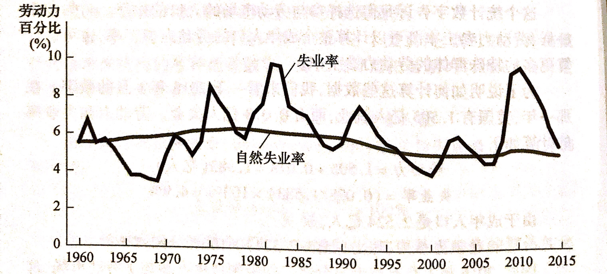
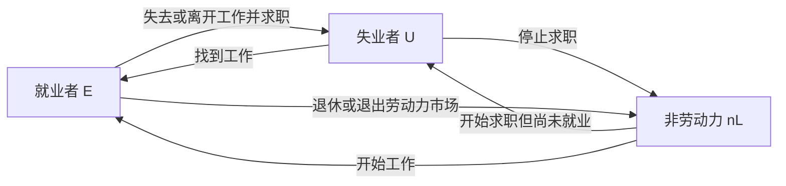

> 本章研究失业的统计口径，以及经济即使不处于衰退之中，为什么仍存在失业。相关章节：[[assets/宏观经济学/货币制度 —— 第29章|第29章 货币制度]]。

---

## 1. 失业的确认

### 1.1 就业者、失业者与非劳动力（第2—5页）

以课件采用的成年人口口径为例，令成年人口为 $N$：

| 类别 | 符号 | 判断标准与例子 |
| --- | --- | --- |
| 就业者 | $E$ | 有工作，包括领取报酬者、自营者、在家族企业中无薪工作者；全职和兼职均可计入，休假或生病而暂时未工作者也可能属于就业者 |
| 失业者 | $U$ | 没有工作、能够工作，而且正在努力寻找工作 |
| 非劳动力 | $nL$ | 不属于上述两类；课件举例包括全日制学生、家务劳动者和退休人员 |

分类依据是**实际就业与求职状态**。学生或退休人员如果有工作，不能仅凭身份归入非劳动力。同样，没有工作的人若未求职，也不必然属于统计中的失业者。

课件第3页以领取失业保险提示“需要认定标准”。应区分失业统计与保险资格：**领取失业保险不是失业者定义的必要条件**，具体调查与福利制度各有标准。

### 1.2 劳动力、失业率和劳动参与率

$$
L=E+U,\qquad N=E+U+nL.
$$

$$
\text{失业率}=\frac{U}{L}\times100\%=\frac{U}{E+U}\times100\%.
$$

$$
\text{劳动参与率}=\frac{L}{N}\times100\%.
$$

失业率衡量参与劳动力市场的人中有多少尚未就业；劳动参与率衡量成年人口中有多少参与劳动力市场。二者的分母不同。

**补充算例。** 成年人口为 1,000 人，就业者 570 人，失业者 30 人，则：

$$
L=570+30=600,\qquad nL=1000-600=400,
$$

$$
u=\frac{30}{600}=5\%,\qquad \text{劳动参与率}=\frac{600}{1000}=60\%.
$$

不能以 $30/1000=3\%$ 作为失业率。课件也提到工作时长口径，这提示按人数衡量的失业率并未完整反映劳动时间利用情况；本章计算沿用上述人数口径。

### 1.3 自然失业与周期性失业（第6—7页）

**自然失业率**是失业率围绕其上下波动的正常水平。它受到劳动力市场匹配效率和制度等因素影响，并非永远不变，更不意味着失业是最优或无法改善的。

**周期性失业**是实际失业率对自然失业率的偏离。用失业率表示：

$$
u=u_n+u_c,\qquad u_c=u-u_n.
$$

经济衰退时，$u_c$ 通常为正；实际失业率低于自然失业率时，$u_c$ 可为负。自然失业率不等于零，所以充分就业并不意味着每个人任何时刻都有工作。

*来源：课件第7页，图示约为1960—2015年历史情况，用于观察波动与正常水平的区别，不用于读取当前失业率。*

本章重点解释自然失业的来源：寻找合适工作需要时间，以及工资高于市场出清水平时出现岗位不足。

### 1.4 失业率为什么是不完美的指标？（第8—11页）

#### 1.4.1 劳动力市场存在持续流动

课件提到，超过三分之一的失业者最近刚进入劳动力市场，超过一半的失业者最终退出劳动力市场。这些是教材背景中的经验描述，说明失业人数变化不仅来自就业与失业之间的转移。

#### 1.4.2 失去信心的工人与统计偏差

**失去信心的工人**想工作，但已放弃找工作。在课件口径下，他们进入非劳动力，既不计入 $U$，也不计入 $L$。

延续前例，若 10 名失业者停止求职，就业人数仍为 570：

$$
U'=20,\qquad L'=590,\qquad u'=\frac{20}{590}\approx3.39\%.
$$

失业率由 $5\%$ 降至约 $3.39\%$，劳动参与率由 $60\%$ 降至 $59\%$，但没有新增就业。因此，失业率下降是否意味着就业改善，要结合就业人数与劳动参与率判断。

其他局限包括：部分受访者可能没有真实求职却报告失业，存在未被准确识别的工作或收入；希望全职却只能兼职的人仍被计为就业者。不同因素的偏差方向不完全一致，不能笼统地说官方失业率必然高估或低估所有就业困难。

#### 1.4.3 短期失业多，为什么长期失业仍重要？

“多数失业经历持续较短”与“长期失业者承担较多失业时间”可以同时成立，因为前者按失业经历计数，后者按持续时间衡量。

**补充示例。** 9 人各失业 1 个月，1 人失业 12 个月。十段经历中九段是短期失业，但长期失业贡献：

$$
\frac{12}{9\times1+12}=\frac{12}{21}\approx57.1\%
$$

的失业人月。某时点观察失业人口时，持续时间长的人也更容易被观察到。

---

## 2. 寻找工作

### 2.1 摩擦性失业与工作搜寻（第12—15页）

#### 2.1.1 为什么岗位空缺与失业会同时存在？

**摩擦性失业**是工人寻找最适合其偏好与技能的工作需要时间而产生的失业。

工人的技能、居住地与偏好不同，岗位要求和工作条件也不同。职位信息传播和双方筛选需要时间，因此即使存在空缺，失业者也不一定立即找到合适岗位。企业、行业和地区之间的劳动需求变化，以及国际贸易格局改变，会推动劳动者转岗，产生新的搜寻过程。

课件把这一过程中的部门转移放在摩擦性失业下讨论。判断时应看具体机制：暂时搜寻与匹配属于本节重点；不能只看到“行业变化”就机械分类。

#### 2.1.2 稳态失业率的推导

课件第12页给出：找到工作的概率为 $f$，失去工作的概率为 $d$，稳态满足 $fU=dE$。

**推导假设：** 劳动力总量 $L$ 固定，只考虑就业与失业两种状态之间的转移，$f,d$ 使用相同时间单位，且 $f+d>0$。忽略进入和退出劳动力市场的流量。

每期新增失业为 $dE_t$，离开失业的数量为 $fU_t$：

$$
U_{t+1}-U_t=dE_t-fU_t.
$$

稳态下失业人数不再变化，但人员仍持续流动：

$$
fU=dE=d(L-U).
$$

移项得到：

$$
(f+d)U=dL,\qquad \boxed{u^*=\frac{U}{L}=\frac{d}{d+f}}.
$$

当另一参数不变时，找到工作的概率提高会降低稳态失业率，失去工作的概率提高会提高稳态失业率。对内部参数值：

$$
\frac{\partial u^*}{\partial f}=-\frac{d}{(d+f)^2},\qquad
\frac{\partial u^*}{\partial d}=\frac{f}{(d+f)^2}.
$$

**补充算例。** 每月 $d=0.02$，$f=0.38$，则：

$$
u^*=\frac{0.02}{0.02+0.38}=5\%.
$$

若 $L=1000$，稳态为 $U=50,E=950$，每月两方向流量均为 19 人。若就业服务使 $f$ 升至 $0.48$，而 $d$ 不变，新稳态失业率为 $4\%$。

这一模型说明流入与流出的平衡，不能把它当作包含所有现实制度与人口流动的完整自然失业率估计。

#### 2.1.3 政府怎样缩短搜寻时间？

政府就业机构提供岗位信息，公共培训计划改善技能匹配。若这些措施提高 $f$，可降低稳态失业率。它们的效果依赖信息和培训是否真正改善匹配，不能只由项目存在就断言有效。

### 2.2 失业保险的保障与激励（第16—17页）

失业保险在失业期间部分保障工人收入。课件以被原雇主解雇者获得补助的制度为背景，具体资格规定不宜外推为各国通则。

| 作用 | 机制 | 可能结果 |
| --- | --- | --- |
| 缓冲收入损失 | 失业期间获得部分收入 | 减轻生活压力 |
| 改善工作匹配 | 不必立即接受缺乏吸引力的工作 | 有时间寻找更合适岗位 |
| 改变求职激励 | 就业后停止领取补助，短期失业成本下降 | 求职努力可能下降，失业持续时间可能延长 |

因此，失业保险可能增加摩擦性失业，同时改善收入保障与就业质量。评价政策时，不能仅以失业率是否下降作为唯一标准。

---

## 3. 最低工资法

### 3.1 结构性失业与高于均衡的工资（第18—20页）

课件在本章把**结构性失业**解释为可提供的岗位数量不足以满足所有求职者，重点分析工资维持在市场均衡水平之上的情况，常用于解释较长期的失业。

设竞争性劳动市场的均衡工资为 $W_E$，均衡就业量为 $L_E$：

$$
L_S(W_E)=L_D(W_E)=L_E.
$$

若工资被维持在 $\bar W>W_E$，在通常向上倾斜的供给与向下倾斜的需求曲线下：

$$
L_S(\bar W)>L_D(\bar W),\qquad
\text{劳动过剩}=L_S(\bar W)-L_D(\bar W).
$$

此时愿意工作的人增加，而企业愿意雇用的人减少。该模型中的实际就业量由劳动需求 $L_D(\bar W)$ 决定。

### 3.2 最低工资的约束条件

**最低工资只有高于均衡工资、形成约束时，才通过上述机制产生劳动过剩。** 若最低工资低于均衡工资，原均衡不受约束。本结论依赖课件采用的竞争性劳动市场模型，不能脱离市场结构直接视为所有现实情形的无条件结论。

> 课件勘误：第19页“在这一均衡工资之上，劳动力的供给量与需求量等于 $L_E$”应理解为“在这一均衡工资水平上”。均衡之上恰恰会出现供求不等。

---

## 4. 工会和集体谈判

**工会**是代表工人与雇主谈判工资、津贴及工作条件的工人协会。**集体谈判**是双方就就业条件达成一致的过程。谈判未果时，工会可能组织罢工，通过停止劳动影响企业生产、销售和利润。

若工会把工资提高到竞争性均衡水平以上，在本章模型中会减少该部门劳动需求：保住工作的“局内人”获得较高工资；未能获得工作的“局外人”可能继续失业，或到非工会部门求职。后者也可能增加非工会部门劳动供给，压低该部门工资，这是由供求分析得到的补充推论。

| 立场 | 主要理由 |
| --- | --- |
| 批评者 | 工会限制劳动供给、提高工资可能使就业低于竞争水平；部分工人获益以另一些工人失去就业机会为代价 |
| 支持者 | 工会能够对抗雇主市场势力，改善工资与工作条件；集体表达有助于企业了解工人利益，维护稳定且有生产率的劳动队伍 |

课件提到美国工会覆盖约 $11\%$、20世纪40—50年代约 $33\%$，以及工会工人工资高约 $10\%$—$20\%$。这些是教材中的背景数字，不是当前统计，也不能单凭工资差距识别工会的因果效应。

> 课件勘误：第24页“就业降低到有效率的竞争水平之上”应为“之下”，才与其竞争模型及批评者观点一致。

---

## 5. 效率工资理论

### 5.1 效率工资：企业为什么不主动降工资？（第26—28页）

**效率工资**是企业为提高工人生产率而主动支付的高于市场均衡水平的工资。即使有失业者愿意接受较低工资，企业仍可能认为降薪导致的效率损失超过工资节省。

| 机制 | 高工资怎样影响企业成本或产出？ | 理解要点 |
| --- | --- | --- |
| 工人健康 | 改善营养与健康，提高劳动生产率 | 在营养约束明显时更容易体现 |
| 工人流动率 | 降低主动离职，节省招聘与培训成本 | 应比较总用工成本，而非只看工资 |
| 工人素质 | 吸引更优秀的申请者 | 招聘时难以充分观察能力，工资影响应聘者构成 |
| 工人努力程度 | 提高失去这份工作的代价，激励努力工作 | 企业不能完全监督劳动努力 |

最低工资由法律约束形成，工会工资由集体谈判形成，效率工资则由企业主动选择。三者都可能使工资高于市场出清水平，但原因不同。
