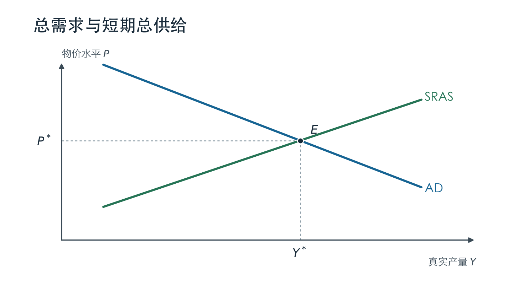
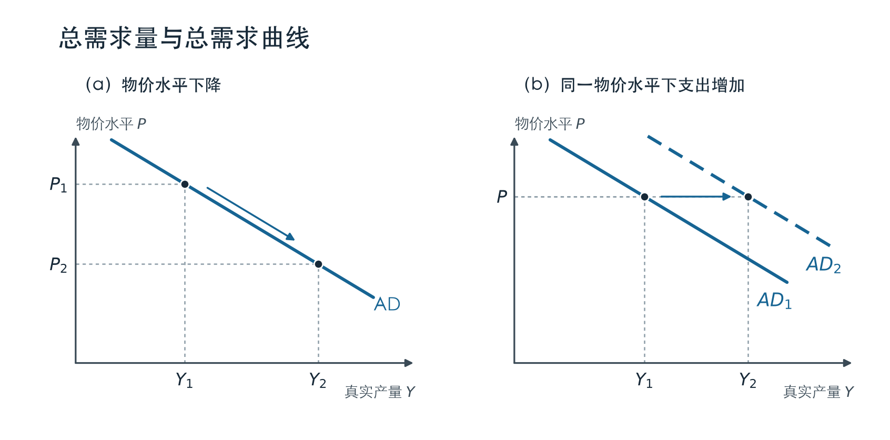
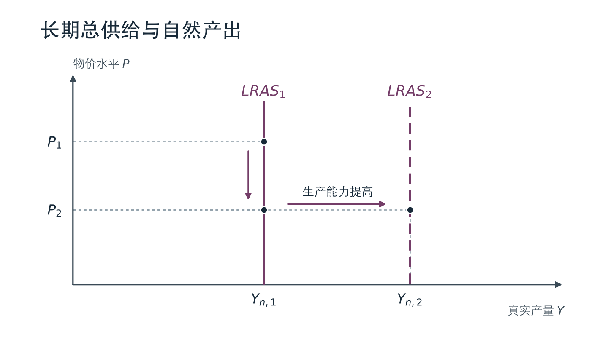
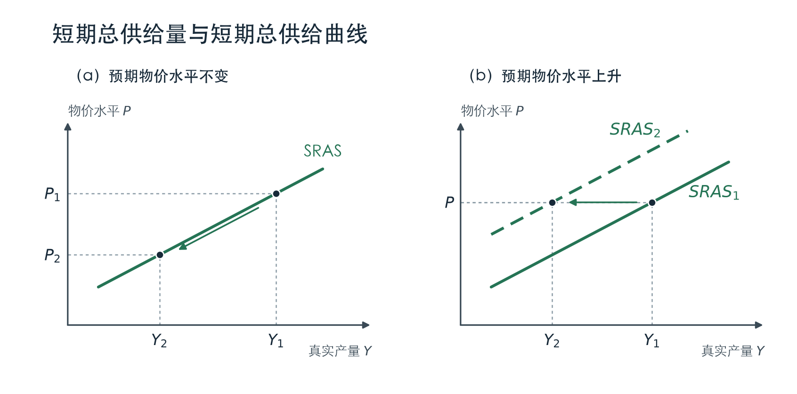
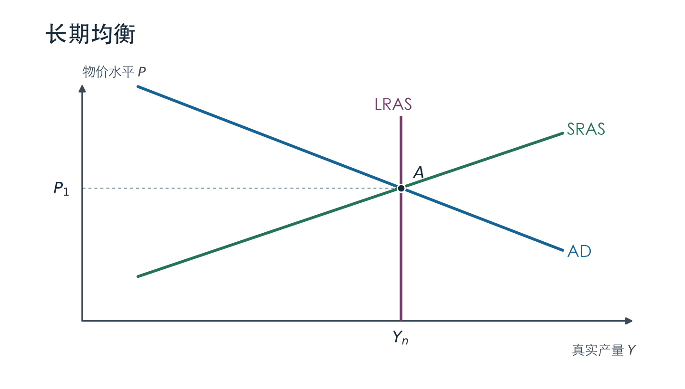
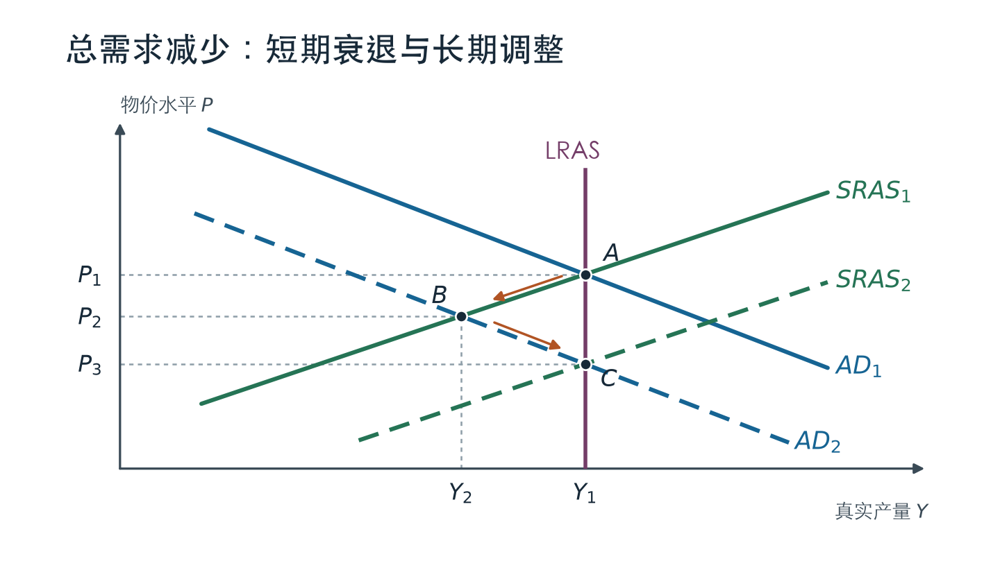
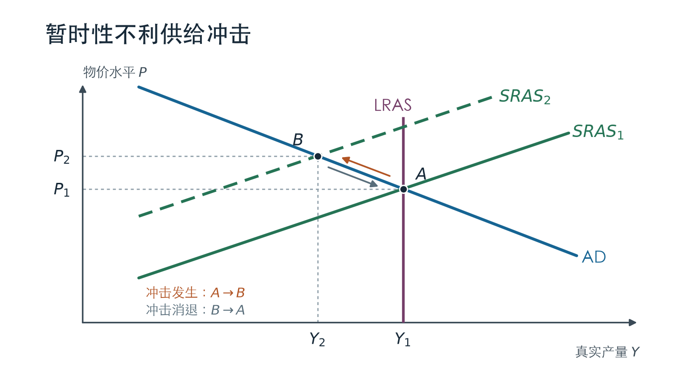
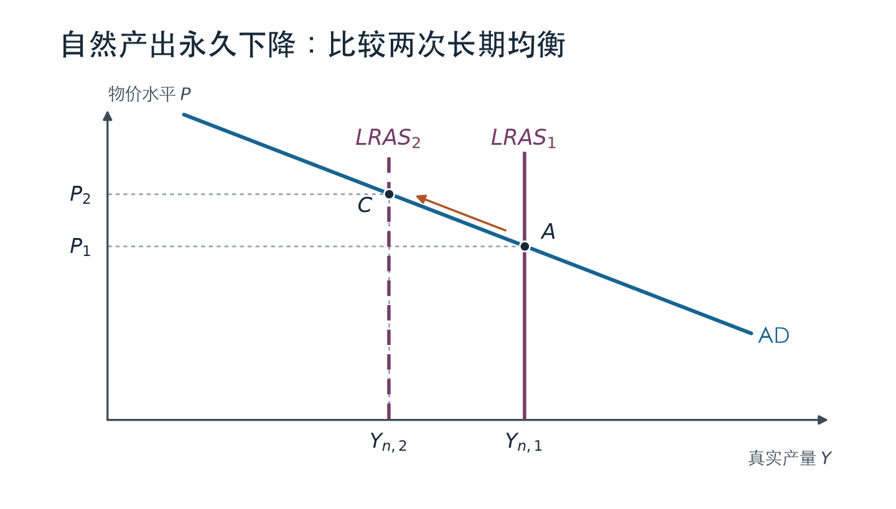

# 总需求与总供给 —— 第 33 章

> [[生产与增长 —— 第25章|第 25 章]]讨论生产要素和技术怎样决定长期产出，[[货币增长与通货膨胀 —— 第30章|第 30 章]]讨论货币怎样影响长期物价。本章把产出和物价放在同一张图上：当家庭和企业突然减少支出，或企业突然遇到能源短缺时，真实 GDP 为什么会偏离长期趋势？物价会朝哪个方向变动？经济恢复时，哪条曲线还会移动？

## 目录

- [1. 经济波动与 AD-AS 模型](#1-经济波动与-ad-as-模型)
- [2. 总需求曲线](#2-总需求曲线)
- [3. 长期总供给曲线](#3-长期总供给曲线)
- [4. 短期总供给曲线](#4-短期总供给曲线)
- [5. 用 AD-AS 模型分析经济波动](#5-用-ad-as-模型分析经济波动)
- [全章复习与综合练习](#全章复习与综合练习)

---

## 1. 经济波动与 AD-AS 模型

### 1.1 经济波动的三个特征（课件第 2—3 页）

真实 GDP 在长期中可以持续增长，但实际经济活动并不沿着平滑的趋势前进。经济活动强劲的时期称为**繁荣**；真实收入下降、失业率上升的时期称为**衰退**（recession）；特别严重的衰退称为**萧条**（depression）。

1. **经济波动没有固定规律，很难预测。** 「经济周期」指经济活动反复出现扩张和收缩，并不意味着每隔固定年数就会发生一次衰退，也不意味着每次衰退都持续同样长的时间。
2. **许多宏观经济变量会同时变动。** 衰退时，真实 GDP、收入、销售和投资通常一同走弱，但各变量的变动幅度可以不同。例如，企业发现销售不及预期时，往往会先削减新增设备投资。
3. **产出下降时，失业通常上升。** 企业减少生产时，对工时和劳动人数的需求会下降。失业率可能高于其自然水平，这部分波动与 [[失业 —— 第28章|第 28 章]] 的周期性失业相对应。课件中主管解雇员工的漫画表现的就是衰退中企业缩减用工的情形。

### 1.2 为什么短期需要另一套模型？（课件第 4—5 页）

古典二分法把名义变量与真实变量区分开。按第 30 章的长期货币中性结论，如果生产要素和技术不变，货币量的变化主要表现为总体物价等名义变量的变化。短期里，工资合同、已经公布的产品价格和人们对物价的预期都需要时间调整。货币供给改变时，利率、支出、就业和真实 GDP 就可能在调整期间发生变化。

因此，分析短期波动时，既要解释**物价水平**怎样变化，也要解释**真实产出**怎样变化。**总需求与总供给模型**（aggregate demand and aggregate supply model，简称 AD-AS 模型）用支出和生产两方面的关系来确定这两个变量。

### 1.3 坐标、曲线与短期均衡（课件第 6—8 页）

- **横轴**：真实产量 $Y$，即一国物品与服务的总产出，以真实 GDP 衡量。
- **纵轴**：总价格水平 $P$，用价格指数表示。$P$ 是物价水平，通货膨胀率是 $P$ 的变动率。
- **总需求曲线** $AD(P)$：在每一个可能的 $P$ 下，家庭、企业和政府希望购买的本国产出数量；在开放经济中还需计入国外对本国产出的需求，并扣除进口。
- **总供给曲线** $AS(P)$：在每一个可能的 $P$ 下，国内企业愿意生产和销售的产量。本章区分向右上方倾斜的短期总供给曲线 $SRAS$ 与垂直的长期总供给曲线 $LRAS$。

*图 1　总需求与短期总供给。根据课件图 2 重绘，图中 $E$ 对应短期均衡。*

在 $E$ 点，计划购买的产量等于企业愿意生产和销售的产量，交点决定短期均衡物价 $P^*$ 和产出 $Y^*$。这里只画了短期总供给，所以即使经济已经处在这个交点，$Y^*$ 也可能高于或低于自然产出。要判断它是不是长期均衡，还要加入长期总供给曲线。

## 2. 总需求曲线

### 2.1 从 GDP 的支出构成看总需求（课件第 9 页）

课件正文先使用**封闭经济**的简化口径：

$$
Y=C+I+G.
$$

其中 $C$ 是消费，$I$ 是投资，$G$ 是政府购买。分析曲线斜率时，课件把政府购买 $G$ 看作外生给定；不同的 $P$ 会通过消费和投资改变计划总支出。这里的投资指资本设备、厂房、住宅和存货等支出，单纯买卖股票或债券属于金融交易。

$Y=C+I+G$ 也可以写作事后的国民收入核算恒等式。**恒等式本身不能推出 AD 向下倾斜**；要得到斜率，还要说明在其他条件给定时，$P$ 怎样影响 $C$ 和 $I$。

### 2.2 物价水平和消费：财富效应（课件第 10 页）

设家庭持有的名义货币余额为 $M$。当 $M$ 不变而物价水平 $P$ 下降，同一笔货币能购买更多物品与服务，因此真实货币余额 $M/P$ 增加。家庭手头这部分财富的实际购买力提高，消费支出倾向于增加：

$$
P\downarrow
\quad\Longrightarrow\quad
\frac{M}{P}\uparrow
\quad\Longrightarrow\quad
C\uparrow.
$$

**补充例子。** 假定一篮子商品原来卖 100 元，后来降到 80 元。某家庭始终持有 1,000 元现金。如果用这篮子商品衡量其购买力，原来可以买 10 篮，现在可以买 12.5 篮。现金面额没有变化，增加的是它能买到的商品数量。财富效应只给出消费变化的方向；消费不会因此必然增加 $25\%$。

### 2.3 物价水平和投资：利率效应（课件第 11—12 页）

在名义货币供给给定时，物价下降意味着完成同样数量的交易所需的名义货币更少。以初始收入和利率为参照，人们愿意持有的货币减少，可能用多余余额购买债券等资产。债券价格上升，利率趋于下降。融资成本降低后，原先回报不足以覆盖融资成本的部分投资项目变得可行。

$$
P\downarrow
\quad\Longrightarrow\quad
\text{名义货币需求减少}
\quad\Longrightarrow\quad
i\downarrow
\quad\Longrightarrow\quad
I\uparrow.
$$

课件在这里简化了名义利率与真实利率的区别。若把 $i$ 理解为货币市场上的名义利率，在预期通胀给定时，名义利率下降也意味着预期真实利率下降，由此才接到投资决策。第 34 章会用流动性偏好理论说明货币市场上的利率怎样调整。

### 2.4 开放经济下的汇率效应（课件第 13 页图 3）

课件图 3 使用了包含净出口的口径：

$$
Y=C+I+G+NX,\qquad NX=\text{出口}-\text{进口}.
$$

在图 3 所描述的机制里，国内物价下降使国内利率下降。在国外利率等条件给定时，投资者转向收益相对较高的外国资产，本币趋于贬值。如果本国物品和服务因而相对外国商品变便宜，外国买家会购买更多本国产品，本国买家会减少进口，净出口 $NX$ 增加。

所以，**课件正文的封闭经济口径**用财富效应和利率效应解释 AD 的斜率；**课件图 3 的开放经济口径**还计入汇率效应。图中「汇率下降」指本币贬值；若采用每单位外币需要多少本币的报价，本币贬值反而会表现为报价上升，作答时直接写「本币贬值」即可。

### 2.5 沿 AD 移动与 AD 曲线移动（课件第 14—17 页）

物价从 $P_1$ 降到 $P_2$ 时，在货币供给、税收政策、消费习惯等条件不变的情况下，总需求量从 $Y_1$ 增加到 $Y_2$。两点都在原有 AD 上。判断**整条曲线**是否移动，则要固定某个 $P$，问家庭、企业和政府在这个价格水平上是否改变了计划支出。

*图 2　总需求量变化与总需求变化。左图根据课件图 3 重绘；右图比较同一物价水平下的两条 AD 曲线。*

| 变化来源 | 在同一个 $P$ 下发生什么？ | AD 的移动 |
| --- | --- | --- |
| 消费习惯、信心与税收 | 家庭更愿意消费，或减税提高可支配收入并带动 $C$ 增加 | 右移；消费减少时左移 |
| 投资意愿 | 技术突破使企业愿意添置更多设备，计划 $I$ 增加 | 右移；企业削减投资时左移 |
| 货币供给 | 给定 $P$，货币供给增加，使利率下降并带动 $I$ 增加 | 右移；反向变化时左移 |
| 政府购买 | 基础设施建设等新增采购提高 $G$ | 右移；削减政府购买时左移 |
| 国外需求（开放经济补充） | 国外居民在同一 $P$ 下购买更多本国产品，带动 $NX$ 增加 | 右移；国外需求减弱时左移 |

课件在政府购买部分也举了公务员工资的例子。公共雇员报酬计入政府提供公共服务的成本，属于政府购买的核算范围；这里判断 $AD$ 的移动，仍以**给定总价格水平下实际政府购买是否增加**为准。养老金、补助等转移支付并不直接计入 $G$，但会通过家庭可支配收入影响 $C$。

两个情形都可能看到「利率下降、投资增加」：如果起因是 $P$ 下降，就是沿 AD 移动；如果起因是央行增发货币，在同一个 $P$ 下投资也会比以前多，就是 AD 右移。技术突破同样要看作用渠道：使企业多买设备，会影响 AD；使经济能够生产更多，还会影响长期总供给。

## 3. 长期总供给曲线

### 3.1 自然产出与垂直的 LRAS（课件第 18—20 页）

长期中，工资、价格和预期有足够时间调整。给定劳动、资本、自然资源和技术，单纯改变总价格水平，并不会为企业增加生产要素，也不会使同样的投入长期产出更多。此时供给量为**自然产出水平**（natural level of output），用 $Y_n$ 表示：

$$
LRAS(P)=Y_n.
$$

在自然产出水平上，劳动力的失业率等于自然失业率，资本和自然资源也处在正常的利用或闲置水平。它又称潜在产出或充分就业产出。**充分就业允许摩擦性和结构性失业存在**；短期加班、增加班次或提高设备利用率，实际产出也可能暂时超过 $Y_n$。因此，$Y_n$ 衡量的是正常利用要素时的产出，不是经济一时所能达到的产量上限。

### 3.2 什么会移动 LRAS？（课件第 21 页）

沿用 [[生产与增长 —— 第25章|第 25 章]] 的生产函数 $Y=AF(L,K,H,N)$：$A$ 是技术知识，$L$ 是劳动，$K$ 是物质资本，$H$ 是人力资本，$N$ 是自然资源。要解释 $Y_n$，把这里的要素投入理解为正常就业和利用水平下可投入生产的数量。

| 自然产出的决定因素 | 使 LRAS 右移的例子 |
| --- | --- |
| 劳动 $L$ | 在其他条件给定时，劳动力增加，或自然失业率下降，使正常就业人数上升 |
| 物质资本 $K$ | 厂房、机器等可投入生产的资本存量增加 |
| 人力资本 $H$ | 教育和培训提高劳动者的生产技能 |
| 自然资源 $N$ | 发现并能开采新的矿产，增加可使用的资源 |
| 技术知识 $A$ | 工艺改进，同样数量的投入可以生产更多 |

*图 3　长期总供给。沿课件图 4 的垂直线把物价从 $P_1$ 降到 $P_2$，自然产出仍为 $Y_{n,1}$；生产能力提高才使自然产出增加到 $Y_{n,2}$。*

在其他条件不变时，要素损失或可用资源减少会使自然产出下降，LRAS 左移。**持续的经济增长**在图上表现为自然产出随时间提高，LRAS 持续右移。仅观察 LRAS 右移，不能判断现实中的物价一定下降，因为同一时期 AD 也可能在移动。

## 4. 短期总供给曲线

### 4.1 为什么 SRAS 向右上方倾斜？（课件第 22—29 页）

短期中，一些生产要素没有得到充分利用，企业可以通过改变用工、工时和设备利用率来增减产量。但企业为什么愿意这样做？三种理论从不同角度说明：当实际物价水平 $P$ 与事前预期的物价水平 $EP$ 不同时，原先设定的工资、标价或对相对价格的判断一时还没有调整过来。

#### 4.1.1 黏性工资理论

名义工资往往由事先订立的劳动合同决定，工资调整还会受到社会规范和公平观念的约束。签订合同时，企业与劳动者按当时预期的物价水平 $EP$ 约定名义工资 $W$。之后如果 $P$ 低于预期，在 $W$ 暂时不变的情况下，真实工资 $W/P$ 高于签约时所预期的水平。对企业而言，工资相对于产品售价变高，雇工和生产的收益下降，因此减少用工和产量。若 $P$ 高于预期，真实工资成本变低，企业倾向于增产。

**补充例子。** 某企业按 $EP=100$ 签下日工资 200 元的合同。假定其产品售价与总体物价同比变动，工资暂不调整。若实际价格指数只有 90，以基期购买力衡量的实际日工资为 $200/(90/100)\approx 222.22$ 元，高于合同订立时预期的 200 元。企业支付的仍是 200 元名义工资；提高的是工资相对于售价的负担。

#### 4.1.2 黏性价格理论

企业更换价目表、修改线上线下报价以及通知客户都需要成本，课件把这类调价成本称为**菜单成本**。假定一部分企业根据 $EP$ 提前定价，短期内不重新报价。如果实际物价比预期低，其他能灵活调价的企业已经降低售价，而这些企业的产品就显得相对更贵，销量减少，企业因而减产。若实际物价比预期高，原来的标价就显得相对更便宜，销量和产量可能上升。企业的售价仍然固定，投入成本却可能变化，所以增产并不保证利润上升。

#### 4.1.3 错觉理论

企业能较快观察到自己商品的售价，却未必能马上分辨整个经济的物价变化。如果 $P$ 意外上升，企业看到自己的产品涨价，可能以为是本产品的**相对价格**提高，于是增加生产。等它发现其他商品也涨价、自己的相对价格并未像原先认为的那样上升，就会重新决定产量。反过来，如果总体物价意外下降，企业可能把普遍降价误判为自己的产品相对不值钱，因而减产。

| 理论 | 短期内不能立即调整的量或判断 | 当 $P<EP$ 时为什么减产？ |
| --- | --- | --- |
| 黏性工资 | 合同约定的名义工资 | 工资相对于产品售价偏高，用工成本相对上升 |
| 黏性价格 | 部分企业已设定的产品标价 | 自家产品相对偏贵，销售减少 |
| 错觉 | 企业对总体物价与相对价格的辨别 | 企业误以为自家产品相对价格下降 |

### 4.2 数学形式：物价意外与产出缺口（课件第 30 页）

沿用课件的记号，$EP$ 表示预期物价水平，与事后实际观察到的 $P$ 采用相同的指数口径。短期总供给写成：

$$
Y-Y_n=a(P-EP),\qquad a>0.
$$

左边 $Y-Y_n$ 是**产出缺口**，右边 $P-EP$ 是**物价意外**。当 $P=EP$ 时，$Y=Y_n$；当 $P>EP$ 时，$Y>Y_n$；当 $P<EP$ 时，$Y<Y_n$。这些结论针对给定 $Y_n$、且以这条方程描述短期供给的情形。

固定 $EP$ 与 $Y_n$，若 $P$ 变动 $\Delta P$，则 $\Delta Y=a\Delta P$，所以 $a$ 越大，产量对同样的物价意外越敏感。由于图的纵轴是 $P$、横轴是 $Y$，把方程改写为：

$$
P=EP+\frac{1}{a}(Y-Y_n).
$$

**图上 SRAS 的斜率为 $1/a$。** 因此，$a$ 越大，曲线越平缓。$a$ 衡量的是产量对物价意外的敏感度，和图上的斜率互为倒数。

### 4.3 什么会移动 SRAS？（课件第 31 页）

*图 4　短期总供给量变化与短期总供给变化。左图根据课件图 6 重绘；右图固定实际物价 $P$ 比较两条曲线。*

- **实际物价 $P$ 变化，$EP$、$Y_n$ 等给定**：沿原 SRAS 移动。左图的 $P_1\to P_2$ 使供给量从 $Y_1$ 降到 $Y_2$。
- **预期物价 $EP$ 上升，$Y_n$ 等给定**：固定实际物价 $P$，$P-EP$ 变小，企业供给量减少，SRAS **左移**。换一种读法：固定同一个 $Y$，供给需要更高的 $P$，所以也可说 SRAS **上移**。$EP$ 下降则使 SRAS 右移（下移）。
- **自然产出 $Y_n$ 增加，$EP$ 等给定**：固定 $P$，$Y=Y_n+a(P-EP)$ 增加，SRAS 右移；由于长期产量也提高，LRAS 同时右移。自然失业率上升或正常闲置率提高，如果使 $Y_n$ 降低，就会使两条曲线左移。
- **短期投入成本变化**：例如暂时的能源短缺使企业在同一物价水平下生产更少，SRAS 左移。上面的简式只显式写了 $EP$ 和 $Y_n$；把短期成本变化画成额外的 SRAS 移动，不必把它硬解释为预期改变。若冲击还持久降低了生产能力，再判断 LRAS 是否移动。

## 5. 用 AD-AS 模型分析经济波动

### 5.1 初始长期均衡（课件第 32—33 页）

画冲击图时，先假定经济位于长期均衡点 $A$。AD 与 LRAS 相交，给出自然产出 $Y_n$ 和与之对应的物价 $P_1$。长期中预期已经调整到 $EP=P_1$，所以 SRAS 也经过 $A$：

$$
Y_A=Y_n,\qquad P_A=EP,\qquad AD(P_A)=Y_n.
$$

*图 5　长期均衡。根据课件图 7 重绘，三条曲线在 $A$ 点相交。*

分析冲击时，先找出**在同一个 $P$ 下首先发生改变的是支出还是生产**。移动相应的曲线，用新的 AD 与 SRAS 交点读短期物价和产出。再看预期会怎样调整、冲击会不会消退，以及自然产出是否改变。只要长期生产能力没有改变，长期产量就仍由原来的 LRAS 决定。

### 5.2 总需求减少：从 $A$ 到 $B$，再到 $C$（课件第 34—35 页）

**课件情境。** 经济起初处在长期均衡。家庭和企业突然变得悲观，在同一个物价水平下减少消费和投资。假定这种支出下降使 AD 持续停留在新位置，生产能力不受影响，也没有额外政策干预。

*图 6　总需求减少。根据课件图 8 重绘，课件中的 $AS_1$ 和 $AS_2$ 均指短期总供给，图中写作 $SRAS_1$ 和 $SRAS_2$。*

1. **冲击发生：$AD_1$ 左移到 $AD_2$。** 在任意给定的 $P$ 下，家庭和企业的计划支出都减少，所以先动的是 AD。
2. **短期：$A\to B$。** 预期物价和既有合同暂时不变，经济沿 $SRAS_1$ 到达与 $AD_2$ 的交点。产量从 $Y_1=Y_n$ 降到 $Y_2$，物价从 $P_1$ 降到 $P_2$；企业减少用工，失业通常上升。
3. **调整：$B\to C$。** 较低的物价逐步进入预期，工资与标价陆续调整。在任意给定的 $P$ 下，较低的 $EP$ 使供给量增加，$SRAS_1$ 右移到 $SRAS_2$。AD 仍在 $AD_2$，因此均衡沿 $AD_2$ 向右下方移动。
4. **长期：到达 $C$。** $AD_2$ 与原 LRAS 相交，产出回到 $Y_1=Y_n$，物价进一步降到 $P_3$，预期物价也调整到 $P_3$。

| 均衡 | 决定它的曲线 | 产出 | 物价水平 |
| --- | --- | --- | --- |
| $A$：初始 | $AD_1$、$SRAS_1$、$LRAS$ | $Y_1=Y_n$ | $P_1$ |
| $B$：冲击后短期 | $AD_2$、$SRAS_1$ | $Y_2<Y_1$ | $P_2<P_1$ |
| $C$：调整后长期 | $AD_2$、$SRAS_2$、$LRAS$ | $Y_1=Y_n$ | $P_3<P_2$ |

为什么 $B\to C$ 时产量回升，物价却继续下降？因为此时变动的是供给曲线：工资和预期调整后，企业在同一个 $P$ 下愿意生产更多；要使更多产量在给定的 $AD_2$ 上被购买，均衡物价就要下降。长期产出恢复不要求 AD 回到原位。

### 5.3 暂时性不利供给冲击：滞胀与恢复（课件第 36 页）

**课件情境。** 经济起初处在长期均衡，突然出现暂时性的能源短缺。能源成本上升，企业在同样的总价格水平下愿意生产的数量减少。假定 AD 不变，短缺最终消退，长期生产能力没有受损。

*图 7　暂时性不利供给冲击。根据课件第 36 页的文字情境补绘。*

- **冲击发生时**：$SRAS_1$ 左移到 $SRAS_2$，与原 AD 相交于 $B$。产量从 $Y_1$ 降到 $Y_2$，物价从 $P_1$ 升到 $P_2$。这种产出收缩与物价上升同时发生的情形称为**滞胀**（stagflation）。
- **冲击消退后**：如果 AD、自然产出及其他供给条件最终回到原来的状态，SRAS 回到原位置，物价和产出回到 $A$。这一过程可能需要很长时间，等待期间较低的产出和就业会带来损失。

AD-AS 图直接比较的是物价**水平**。从 $A$ 到 $B$，价格指数在这段时间内确实上升；只凭一次 SRAS 左移，不能判断其后每一期都将保持较高的通胀率。

### 5.4 如果供给冲击永久降低了生产能力

课件最后提出永久性总供给冲击。关键在于冲击有没有改变**长期可用的要素或技术**。例如，如果重要的能源产能永久退出，而且无法被其他投入替代，经济的正常生产能力下降，$Y_n$ 减少，LRAS 也会左移。

*图 8　永久性不利供给冲击。根据课件第 36 页的提示补绘，只比较 AD 不变时的两个长期均衡。*

若 AD 保持不变，新的长期交点 $C$ 对应更低的自然产出 $Y_{n,2}$ 和更高的价格水平 $P_2$。预期最终会与新物价相符，短期总供给也会通过新交点。图中省略中间的短期交点，因为要确定短期路径，还需知道投入成本、生产能力和预期分别在什么时候改变。

## 全章复习与综合练习

### 曲线移动与短期结果

以下各行从同一个长期均衡出发，比较冲击刚发生时的结果；假定短期内只移动列出的曲线。

| 初始冲击 | 首先移动的曲线 | 短期产出 | 短期物价 |
| --- | --- | --- | --- |
| 消费或投资意愿下降 | AD 左移 | 下降 | 下降 |
| 政府购买增加 | AD 右移 | 上升 | 上升 |
| 暂时能源短缺 | SRAS 左移 | 下降 | 上升 |
| 暂时生产成本下降 | SRAS 右移 | 上升 | 下降 |

作图时，先在纵轴写 $P$、横轴写 $Y$；再标出初始曲线与均衡点 $A$。画出新曲线后，用虚线把交点投到两轴，分别比较产出与物价。在长期题里，先判断 $Y_n$ 是否改变，再找最终 AD 与 LRAS 的交点，最后把调整后的 SRAS 画过该点。如果 AD 和 AS 同时移动，单独看每一行的方向并不能确定最后结果，需要比较两种变化的大小。

### 综合练习与参考解答（以下均为补充题）

#### 练习 1：区分沿曲线移动与曲线移动

**题目。** 考虑一个封闭经济。分别分析三个独立事件，每次都以同一初始状态为参照，并假定没有题目之外的冲击：

1. 名义货币供给给定，比较同一总需求关系上两个不同的物价水平：价格指数从 100 降到 95。
2. 央行提高名义货币供给。假定给定物价水平时，货币供给增加会压低利率，带动投资。
3. 一项新技术已经投入生产，使正常产出提高。它同时让企业更愿意添置设备，因此在任一给定的物价水平上，计划投资也增加。

判断每种情形中 AD 是否移动，说明原因；对第 3 种情形，进一步判断 LRAS 和 SRAS 的移动方向，并说明短期物价能否确定。

**解答。**

1. **沿原 AD 向右下方移动。** 在名义货币余额给定时，较低的 $P$ 增加真实货币余额。财富效应带动消费，利率效应带动投资，同一 AD 上的总需求量增加。题目只是在比较曲线上两个点，没有说明是哪种冲击使均衡物价变化。
2. **AD 右移。** 即使把 $P$ 固定不动，货币供给增加也会压低利率、提高计划投资，所以每一个 $P$ 对应的总需求量比原先大。
3. **AD、LRAS 均右移；在 $EP$ 和其他短期成本条件给定时，SRAS 也右移。** 设备投资增加推动 AD 右移，已投入使用的技术提高 $Y_n$，从而使 LRAS 和 SRAS 右移。两种短期移动都提高均衡产出，但 AD 右移倾向于推高物价，SRAS 右移倾向于压低物价。没有曲线的移动幅度，短期物价变化方向不能确定。

#### 练习 2：求需求收缩的三个均衡

**题目。** 某经济的自然产出为 $Y_n=100$，短期总供给为 $Y-Y_n=2(P-EP)$，初始总需求为 $AD_1(P)=150-P$。经济原来处在长期均衡。随后消费者和企业转为悲观，总需求变为 $AD_2(P)=120-P$，并保持在此水平。冲击发生时 $EP$ 来不及调整，长期中 $EP$ 调整为实际物价，$Y_n$ 始终为 100。分别求初始点 $A$、短期点 $B$、新长期点 $C$ 的 $(Y,P)$，并写出调整后的短期总供给方程。

**解答。**

在 $A$ 点，$Y_A=Y_n=100$，由 $100=150-P_A$ 得 $P_A=50$，因此初始 $EP=50$。

在 $B$ 点，$EP$ 仍为 50，初始短期供给式为 $Y=100+2(P-50)=2P$。与新总需求联立：

$$
2P_B=120-P_B
\quad\Longrightarrow\quad
P_B=40,\qquad Y_B=80.
$$

在 $C$ 点，$Y_C=Y_n=100$，由 $100=120-P_C$ 得 $P_C=20$。预期物价调整为 20，新的 SRAS 为：

$$
Y=100+2(P-20)=60+2P.
$$

因此，均衡按 $(100,50)\to(80,40)\to(100,20)$ 变化。短期内 $P_B<EP$，产出低于自然水平；长期中 $P_C=EP$，产出回到 100。固定任何一个 $P$，新的短期供给量比原来多 60，正好对应 $EP$ 下降 30、乘上系数 2。

#### 练习 3：能源冲击后的两种政策目标

**题目。** 某经济原本处在长期均衡。一场暂时性的能源短缺提高企业成本，使 SRAS 左移，但不改变自然产出。假定政策只会移动 AD，冲击后的 SRAS 短期内保持在新位置。分别回答：若政策制定者希望短期产出回到原水平，应该怎样移动 AD，物价会怎样变化？若希望物价回到冲击前的水平，又应怎样移动 AD，产出会怎样变化？

**解答。** 先画出供给冲击后的 $B$ 点：在原 AD 与新 SRAS 的交点上，产出下降、物价上升。

- **恢复产出**：把 AD 向右移动，使新交点沿冲击后的 SRAS 向右上方移动，直到产出回到 $Y_n$。由于 SRAS 向上倾斜，此时物价比 $B$ 点更高。
- **恢复物价**：把 AD 向左移动，使新交点沿冲击后的 SRAS 向左下方移动，直到物价回到原水平。此时产出比 $B$ 点更低。

原来的产出与物价组合不在冲击后的 SRAS 上。短期供给曲线给定时，单靠移动 AD，无法同时实现两个目标。

### 来源覆盖

依据 [[assets/宏观经济学/课件/8-Chapter 33 总需求与总供给.pptx|第 33 章课程课件]]（共 36 页）整理；[[wiki/sources/宏观经济学/8-Chapter-33|Wiki 来源页]]可用于查找相关概念。页码按课件播放顺序计算。

| 课件页码 | 内容 | 本笔记 |
| --- | --- | --- |
| 1—8 | 章节导入、经济波动特征、短期货币非中性、AD-AS 坐标与交点 | 第 1 节，图 1 |
| 9—17 | 封闭经济的财富和利率效应、图 3 的汇率效应、总需求移动因素 | 第 2 节，图 2 |
| 18—21 | 垂直的长期总供给、自然产出、LRAS 的移动 | 第 3 节，图 3 |
| 22—31 | 黏性工资、黏性价格、错觉理论、短期供给方程与移动 | 第 4 节，图 4 |
| 32—36 | 长期均衡、需求收缩、供给冲击与滞胀 | 第 5 节，图 5—8 |

相关章节：[[货币制度 —— 第29章|第 29 章 货币制度]] · [[货币增长与通货膨胀 —— 第30章|第 30 章 货币增长与通货膨胀]] · [[wiki/sources/宏观经济学/9-Chapter-34|第 34 章 货币政策和财政政策对总需求的影响]]
