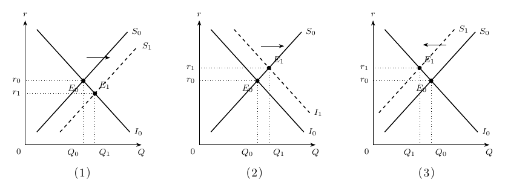
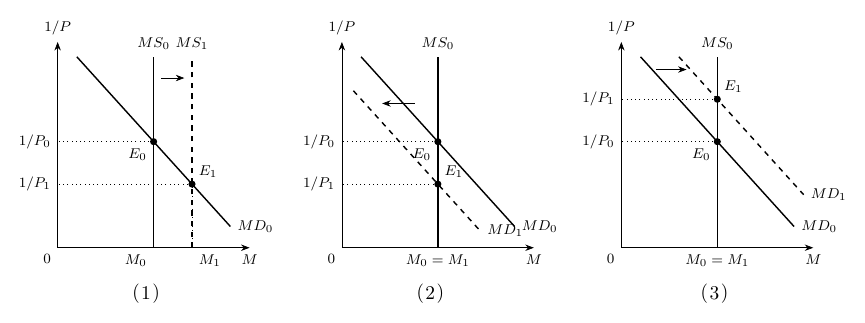

# 宏观经济学期中模拟试卷：参考答案与评分细则

本文件含完整题干、选项与解析；建议先完成两份无答案试卷，再核对本文件。每卷满分 88 分，题型与分值依据 2025 年秋季 A、B 卷。题目为自编，原材料未修改。来源与范围说明见 [[README]]。

## 模拟卷一

### 一、判断题（20 分）

| 题号 | 1 | 2 | 3 | 4 | 5 | 6 | 7 | 8 | 9 | 10 |
|---|---|---|---|---|---|---|---|---|---|---|
| 答案 | √ | √ | × | × | × | √ | × | √ | × | √ |

**1. 企业当期在境内生产、但年末尚未售出的最终产品，应作为当期存货投资计入 GDP。**

答案：正确。当期生产已经发生，未售出部分形成存货投资。是否售出不改变它属于当期产出的事实。

**2. 居民购买一件进口消费品时，消费和进口可以同时增加；在不考虑国内销售服务的情况下，这笔购买不直接增加本国 GDP。**

答案：正确。进口品计入消费，同时通过净出口中的进口项扣除，二者相抵。国内提供的销售服务应另行核算。

**3. 若 CPI 和 GDP 平减指数在同一基年都等于 100，则此后两种指数的年度涨幅必然相同。**

答案：错误。共同基年只确定指数尺度。CPI 与平减指数的商品范围及数量权重不同，后续变动可以不同。

**4. 在技术和其他投入不变时，资本边际收益递减意味着资本存量增加会使总产出下降。**

答案：错误。边际收益递减指新增一单位资本带来的产出增量变小；边际产出仍为正时，总产出仍然增加。

**5. 在教材生产函数 $Y=AF(L,K,H,N)$ 中，$N$ 表示人口数量。**

答案：错误。$N$ 表示自然资源；$L$ 是劳动，$K$ 是物质资本，$H$ 是人力资本，$A$ 是技术知识。

**6. 一个封闭经济体即使存在政府预算赤字，其国民储蓄仍然可能为正。**

答案：正确。国民储蓄等于私人储蓄与公共储蓄之和。私人储蓄大于预算赤字时，二者之和仍为正。

**7. 在竞争性劳动市场的简单模型中，只要存在法定最低工资，无论其水平高低，都会造成结构性失业。**

答案：错误。最低工资必须高于市场均衡工资、形成约束，才会在该模型中造成劳动供给超过劳动需求。

**8. 效率工资理论认为，企业有时会主动支付高于市场均衡水平的工资，以减少人员流失或提高工作努力程度。**

答案：正确。较高工资可能降低离职率、提高努力程度和应聘者质量；这些收益可能使企业愿意主动支付较高工资。

**9. 在公众不持有现金的简单银行体系中，若法定准备金率为 20%，而所有银行的实际准备金率均为 25%，则货币乘数为 5。**

答案：错误。应使用实际准备金率：$m=1/0.25=4$，不能用法定比率替代包含超额准备金的实际比率。

**10. 若货币流通速度与实际产出均不变，货币数量增加 8%，价格水平也增加 8%。**

答案：正确。由 $P=MV/Y$，在 $V,Y$ 不变时，$P$ 与 $M$ 同比例变化。这里明确给出了必要条件。

### 二、单选题（28 分）

**1. 小林以 80 万元购买一套五年前建成的旧住房，并另外支付当期房产中介服务费 2 万元。忽略其他交易，这两笔支出合计对本期 GDP 的直接贡献为多少万元？**

- A．0
- B．2
- C．80
- D．82

**答案：B。** 旧房本体是过去的产出，不重复计入当期 GDP；当期中介服务新创造了 2 万元服务产出。

**2. 某封闭经济体当年 $Y=1800$、$C=1100$、$G=400$、净税收 $T=350$。国民储蓄和投资分别为多少？**

- A．300 和 300
- B．350 和 350
- C．300 和 350
- D．350 和 300

**答案：A。** $S=Y-C-G=300$，封闭经济中 $I=S=300$。私人储蓄为 350，公共储蓄为 $-50$，不能把私人储蓄直接当成国民储蓄。

**3. 本国生产的一种工业设备全部出口，不进入本国居民消费篮子。当期只有该设备价格上涨，所有商品产量及其他价格均不变。其直接影响是：**

- A．CPI 上升，GDP 平减指数不变
- B．CPI 与 GDP 平减指数都上升
- C．CPI 不变，GDP 平减指数上升
- D．两个指数都不变

**答案：C。** 出口设备属于本国当期产出，进入 GDP 平减指数；它不属于本国居民消费篮子，不直接进入 CPI。

**4. 某国名义 GDP 从 800 增至 924，GDP 平减指数从 100 增至 110。该国实际 GDP 增长率为：**

- A．10%
- B．15.5%
- C．4.5%
- D．5%

**答案：D。** 实际 GDP 从 $800/(100/100)=800$ 增至 $924/(110/100)=840$，增长率为 $840/800-1=5\%$。不能直接用名义增长率减物价涨幅作为精确值。

**5. 一家企业组织员工学习使用已有的生产软件，社会掌握的生产方法并未因此改变。这主要增加了生产函数中的哪一项？**

- A．物质资本 $K$
- B．人力资本 $H$
- C．自然资源 $N$
- D．技术知识 $A$

**答案：B。** 培训提高劳动者掌握和应用现有知识的能力，属于人力资本积累；它与社会发现新的生产方法不同。

**6. 假设劳动力总量不变，每期就业者失去工作的比例为 $s=2\%$，失业者找到工作的比例为 $f=18\%$。稳态失业率为：**

- A．2%
- B．9%
- C．10%
- D．20%

**答案：C。** 稳态满足 $sE=fU$，所以 $u=s/(s+f)=0.02/(0.02+0.18)=10\%$。分母不是单独的求职成功率。

**7. 初始货币数量 $M=400$、流通速度 $V=5$、实际产出 $Y=1000$。之后 $M$ 增至 440，$Y$ 增至 1100，$V$ 不变。价格水平将：**

- A．保持不变
- B．上升 $10\%$
- C．下降 $10\%$
- D．上升 $21\%$

**答案：A。** 初始 $P=400\times5/1000=2$，之后 $P=440\times5/1100=2$。货币与实际产出同比增长，物价不变。

### 三、计算题（20 分）

某经济体共有 200 名成年人。初始失业率为 12%，劳动参与率为 75%。所有人数均为实际人数，无须作整数近似。

**说明：**情景 I 与情景 II 相互独立，均从初始状态出发；成年人口总数始终不变。百分比保留两位小数即可。

**（1）计算初始的劳动力、就业人口、失业人口和非劳动力人口。（6 分）**

劳动力为 $200\times75\%=150$ 人；失业人口为 $150\times12\%=18$ 人；就业人口为 $150-18=132$ 人；非劳动力人口为 $200-150=50$ 人。劳动力与非劳动力合计 2 分，失业人口 2 分，就业人口 2 分。

**（2）情景 I：12 名初始就业者失去工作，并继续积极求职；另外，15 名初始失业者停止求职并退出劳动力市场。其他人状态不变。计算新的失业率和劳动参与率。（6 分）**

12 名就业者转为失业者，15 名原失业者转为非劳动力，故 $E_1=132-12=120$，$U_1=18+12-15=15$，$L_1=135$，非劳动力为 65 人。失业率为 $15/135\times100\%\approx11.11\%$；劳动参与率为 $135/200\times100\%=67.50\%$。正确更新就业与失业人数各 1 分，两项比率各 2 分。

**（3）情景 II：30 名初始非劳动力重新进入劳动力市场，其中 12 人立即找到工作，另外 18 人积极求职但尚未找到工作。其他人状态不变。计算新的失业率和劳动参与率。（6 分）**

劳动力增至 $L_2=150+30=180$，就业增至 $E_2=132+12=144$，失业增至 $U_2=18+18=36$，非劳动力为 20 人。失业率为 $36/180\times100\%=20.00\%$；劳动参与率为 $180/200\times100\%=90.00\%$。正确更新劳动力与失业人数各 1 分，两项比率各 2 分。

**（4）分别将情景 I、II 与初始状态比较，说明为什么不能仅凭失业率升降判断就业状况是否改善。（2 分）**

情景 I 中失业率由 12% 降至 11.11%，但就业人数由 132 降至 120；失业者退出使分子、分母同时缩小。情景 II 中失业率升至 20%，但就业人数升至 144；新进入者中有较多人仍在求职。指出任一比率与就业变化的背离并说明原因得 1 分，两种情景均解释正确共 2 分。

### 四、作图分析题（20 分）

请使用封闭经济的可贷资金市场模型，分析下列三个相互独立的情景。横轴为可贷资金数量，纵轴为实际利率 $r$；国民储蓄供给曲线向右上倾斜，投资需求曲线向右下倾斜。除题目明确给出的变化外，其他条件不变，产出 $Y$ 固定。每问均须作图，标出新旧曲线、均衡点，并解释均衡利率与投资数量的变化。

实线为初始曲线，虚线为变动后的曲线，图形仅示意方向。

**（1）政府削减政府购买，净税收不变；在每一个给定利率下，私人储蓄均不变。（6 分）**

给定利率下，$S_{\text{私人}}=Y-T-C$ 不变，$S_{\text{公共}}=T-G$ 增加，因此国民储蓄增加（2 分）。供给曲线从 $S_0$ 右移至 $S_1$，投资需求曲线不变（1 分）；均衡实际利率下降，投资增加（1 分）；坐标轴、曲线方向及新旧均衡正确（2 分）。

**（2）技术革新提高了新建厂房与设备的预期回报，使每一个给定利率下的投资需求增加；储蓄供给行为不变。（6 分）**

项目回报提高使各利率下投资意愿增加，投资需求曲线从 $I_0$ 右移至 $I_1$（机制 2 分、位移 1 分）。储蓄供给曲线不变，均衡利率上升、均衡投资增加（1 分）。储蓄量增加表现为沿供给曲线移动。图形完整正确（2 分）。

**（3）净税收增加 100，政府购买增加 80；在每一个给定利率下，居民消费因增税减少 60。投资需求曲线不变。请先分别计算私人储蓄、公共储蓄与国民储蓄的变化，再作图分析。（8 分）**

在给定利率下，私人储蓄变化为 $\Delta S_{\text{私人}}=-\Delta T-\Delta C=-100-(-60)=-40$（2 分）；公共储蓄变化为 $\Delta S_{\text{公共}}=100-80=20$（2 分）；国民储蓄变化为 $-40+20=-20$（1 分）。供给曲线左移，投资需求曲线不变（1 分），均衡利率上升、投资下降（1 分），图形正确（1 分）。公共储蓄改善并不保证国民储蓄增加；20 是给定利率下的供给位移量，不必等于新均衡投资的减少量。

## 模拟卷二

### 一、判断题（20 分）

| 题号 | 1 | 2 | 3 | 4 | 5 | 6 | 7 | 8 | 9 | 10 |
|---|---|---|---|---|---|---|---|---|---|---|
| 答案 | √ | × | √ | √ | × | × | √ | × | √ | × |

**1. 政府发放养老金属于转移支付，养老金本身不计入 GDP 支出法中的政府购买。**

答案：正确。转移支付不对应政府购买当期物品或服务。领取者后来购买的当期产品另按相应支出项目核算。

**2. 只要两国人均实际 GDP 相同，就可以断定两国居民的经济福利水平相同。**

答案：错误。人均 GDP 未充分反映收入分配、闲暇、环境质量和非市场劳动等，因此不能保证福利相同。

**3. 固定消费篮子没有及时反映消费者转向相对便宜商品的行为，可能高估生活费用的上升。**

答案：正确。这就是替代偏向：价格变化后消费者可以调整购买组合，固定篮子不能充分体现这种调整。

**4. 生产函数具有规模报酬不变，与资本的边际收益递减可以同时成立。**

答案：正确。前者考察全部投入同比例变化，后者固定其他投入、只增加资本，两者考察的变化不同。

**5. 在技术不进步、其他相关条件不变的资本积累模型中，一次性提高储蓄率必然使人均实际产出的增长率永久提高。**

答案：错误。较高储蓄率可以加快过渡期增长、提高长期人均产出水平；递减收益使它不能单独维持永久更高的增长率。

**6. 公司发行债券和发行股票都使购买者成为公司的部分所有者，并享有相同的剩余利润索取权。**

答案：错误。债券持有人是债权人，股票持有人才是部分所有者；二者的收益约定和索取权不同。

**7. 在劳动力总量不变的两状态模型中，若失去工作的概率不变，而失业者找到工作的概率上升，则稳态失业率下降。**

答案：正确。稳态失业率 $u=s/(s+f)$；固定 $s$，提高 $f$ 会降低 $u$。

**8. 在成年人口总数不变时，统计失业率下降必然意味着就业人数增加。**

答案：错误。失业者停止求职会同时减少失业人数和劳动力人数，即使就业人数不变，失业率也可能下降。

**9. 居民把原来持有的纸币存入活期账户，在银行尚未据此发放新贷款的瞬间，流通中现金减少与活期存款增加相抵，货币总量不变。**

答案：正确。按现金加活期存款的简单货币口径，这一瞬间只是货币形式转换。银行后续贷款可能进一步创造存款。

**10. 仅凭数量方程 $MV=PY$，无须对 $V$ 和 $Y$ 作任何假设，就能推出货币数量增长 10% 必使价格水平增长 10%。**

答案：错误。$V$ 或 $Y$ 也可能变化。只有在二者均不变等明确条件下，才能推出 $P$ 与 $M$ 同比例变化。

### 二、单选题（28 分）

**1. 小周存入银行 1 万元，一年名义利率为 6%。同期 CPI 从 120 上升到 127.2。忽略税费，小周一年后本息的购买力相对于存款时：**

- A．提高
- B．不变
- C．降低
- D．无法判断

**答案：B。** 通胀率为 $127.2/120-1=6\%$；实际收益率为 $1.06/1.06-1=0$，购买力不变。这是实际利率计算，不涉及费雪效应。

**2. 某消费篮子固定包含 2 份食品和 3 次公交出行。基年食品单价为 5 元、公交单价为 2 元；本年分别为 6 元、4 元。以基年 CPI 为 100，本年 CPI 为：**

- A．125
- B．140
- C．150
- D．160

**答案：C。** 基年篮子费用 $2\times5+3\times2=16$ 元，本年费用 $2\times6+3\times4=24$ 元，故 CPI 为 $24/16\times100=150$。应固定数量，而非对两个价格涨幅作简单平均。

**3. 封闭经济体中，$Y=2000$、$C=1250$、$G=450$、净税收 $T=300$。私人储蓄、公共储蓄和国民储蓄依次为：**

- A．$450,\;-150,\;300$
- B．$300,\;-150,\;150$
- C．$450,\;150,\;600$
- D．$300,\;150,\;450$

**答案：A。** 私人储蓄为 $2000-300-1250=450$；公共储蓄为 $300-450=-150$；国民储蓄为 $450-150=300$。

**4. 某经济体实际 GDP 一年增长 8.12%，同期人口增长 2%。按精确公式计算，人均实际 GDP 增长率为：**

- A．8.12%
- B．6.12%
- C．4.06%
- D．6%

**答案：D。** 人均实际 GDP 增长率为 $1.0812/1.02-1=6\%$。总量除以人口，因此增长因子相除，而非简单相减。

**5. 以下哪种情况最符合摩擦性失业的含义？**

- A．约束性最低工资使部分求职者无法就业
- B．总需求下降导致企业裁员
- C．毕业生花时间寻找更匹配自身能力的职位
- D．产业转型后劳动者技能与现有岗位长期不匹配

**答案：C。** 寻找合适岗位需要时间，属于摩擦性失业；最低工资约束和持续技能不匹配偏向结构性失业，经济衰退导致的裁员偏向周期性失业。

**6. 在公众不持有现金、所有银行实际准备金率保持 20% 的简单模型中，央行向商业银行出售 20 亿元政府债券，银行以准备金支付。假定体系完成存款收缩且其他条件不变，货币供给最终变化为：**

- A．增加 100 亿元
- B．减少 100 亿元
- C．减少 20 亿元
- D．增加 20 亿元

**答案：B。** 准备金减少 20 亿元，货币乘数为 $1/0.20=5$，故最终货币供给变化为 $-20\times5=-100$ 亿元。需要题设给定的调整完成与实际准备金率不变。

**7. 某经济体 $M=600$、$V=4$、实际 GDP 为 1500。若数量方程中的 $P$ 以基期为 1，而 GDP 平减指数以基期为 100，则该平减指数为：**

- A．120
- B．150
- C．180
- D．160

**答案：D。** $P=MV/Y=600\times4/1500=1.6$，换成基期为 100 的指数后为 160。不能把价格倍数 1.6 与指数数值 160 混用。

### 三、计算题（20 分）

某商业银行初始资产负债表如下，单位均为亿元。存款为公众的活期存款，一般性债务不计入本题的货币总量。

| 资产 | 金额（亿元） | 负债和所有者权益 | 金额（亿元） |
|---|---:|---|---:|
| 存款准备金 | 80 | 存款 | 400 |
| 贷款 | 300 | 一般性债务 | 50 |
| 有价证券 | 120 | 资本（所有者权益） | 50 |
| 合计 | 500 | 合计 | 500 |

**说明：**两个情景相互独立，均从初始资产负债表出发。杠杆率定义为资产总额除以所有者权益；账面所有者权益允许为负，须与股东本金的损失比例区分。

**（1）计算该银行的实际存款准备金率和杠杆率。若所有银行均保持这一实际准备金率，公众不持有现金，计算简单模型中的货币乘数。（6 分）**

初始资产总额为 $80+300+120=500$，负债为 $400+50=450$，权益为 50。实际准备金率为 $80/400=20\%$（2 分）；杠杆率为 $500/50=10$ 倍（2 分）；货币乘数为 $1/0.20=5$（2 分）。杠杆率分母是权益，准备金率分母是存款，二者不能混用。

**（2）情景 I：股东向银行追加资本 50 亿元，这笔资金全部计入该银行准备金；存款、一般性债务及其他资产项目均不变。计算新的资产总额、所有者权益和杠杆率，并判断银行在权益耗尽前可吸收的资产损失比例是上升还是下降。（7 分）**

追加资本后，准备金为 $80+50=130$，资产总额为 $550$（2 分）；存款与一般债务仍合计 450，所以权益为 $550-450=100$（2 分）。杠杆率为 $550/100=5.5$ 倍（2 分）。权益占资产比重由 $50/500=10\%$ 升至 $100/550\approx18.18\%$，故可吸收的资产损失比例上升（方向正确 1 分）。追加资本不同于新增负债。

**（3）情景 II：初始贷款资产发生 20% 的损失，其他资产和全部负债不变，且无人追加资本。计算账面所有者权益及其相对初始权益的变化百分比；另在股东有限责任且不再出资的条件下，指出原股东本金的损失比例。（7 分）**

贷款损失为 $300\times20\%=60$（2 分），资产总额降至 $500-60=440$，负债仍为 450，账面权益为 $440-450=-10$（2 分）。账面权益变化百分比为 $(-10-50)/50\times100\%=-120\%$（2 分），银行已资不抵债。原股东本金全部损失，有限责任下本金损失比例为 100%（1 分）。负账面权益 10 亿元不是原股东必须继续支付的本金损失。

### 四、作图分析题（20 分）

请采用课件中的长期货币供求模型，分别分析下列三个相互独立的情景。横轴为名义货币量 $M$，纵轴为货币价值 $1/P$；货币供给曲线垂直，货币需求曲线向右下倾斜。除题目明确给出的变化外，其他条件不变。每问均须标出新旧曲线、均衡点，并解释均衡名义货币量与价格水平的变化。

实线为初始曲线，虚线为变动后的曲线，图形仅示意方向。

**（1）央行在公开市场买入政府债券，使银行体系准备金增加。实际准备金率及公众持币习惯不变，货币需求曲线不变。（6 分）**

央行买入债券增加准备金，在实际准备金率与持币习惯不变时，银行体系扩张存款，货币供给增加（2 分）。$MS_0$ 右移至 $MS_1$，$MD$ 不变（1 分）；新均衡名义货币量增加，$1/P$ 下降，价格水平 $P$ 上升（1 分）；坐标轴、曲线和新旧均衡正确（2 分）。

**（2）一种新的支付方式使交易更加便利，在每一个给定物价水平下，人们希望持有的名义货币减少。货币供给保持不变。（6 分）**

支付便利性提高，使给定价格水平下所需交易余额减少（2 分），$MD_0$ 左移至 $MD_1$，垂直的货币供给曲线不动（1 分）。新均衡名义货币量不变，$1/P$ 下降，$P$ 上升（1 分）；图形正确（2 分）。这里通过价格调整恢复供求平衡。

**（3）其他非货币资产的收益率下降，且这些资产的流动性与风险不变。货币供给保持不变。请进一步判断实际货币余额的变化，并解释为何货币需求曲线移动后，均衡名义货币量不一定改变。（8 分）**

其他资产收益率下降降低了持有货币的机会成本，给定物价下人们愿意持有更多货币（2 分）；$MD_0$ 右移至 $MD_1$，$MS$ 不变（2 分）。均衡名义货币量仍等于固定供给量（1 分），$1/P$ 上升，故 $P$ 下降（1 分）；$M$ 不变而 $P$ 下降，实际货币余额 $M/P$ 增加（1 分）。完整图形正确（1 分）。需求曲线的位移是给定价格下意愿改变；新均衡通过价格调整满足同一名义货币供给。

