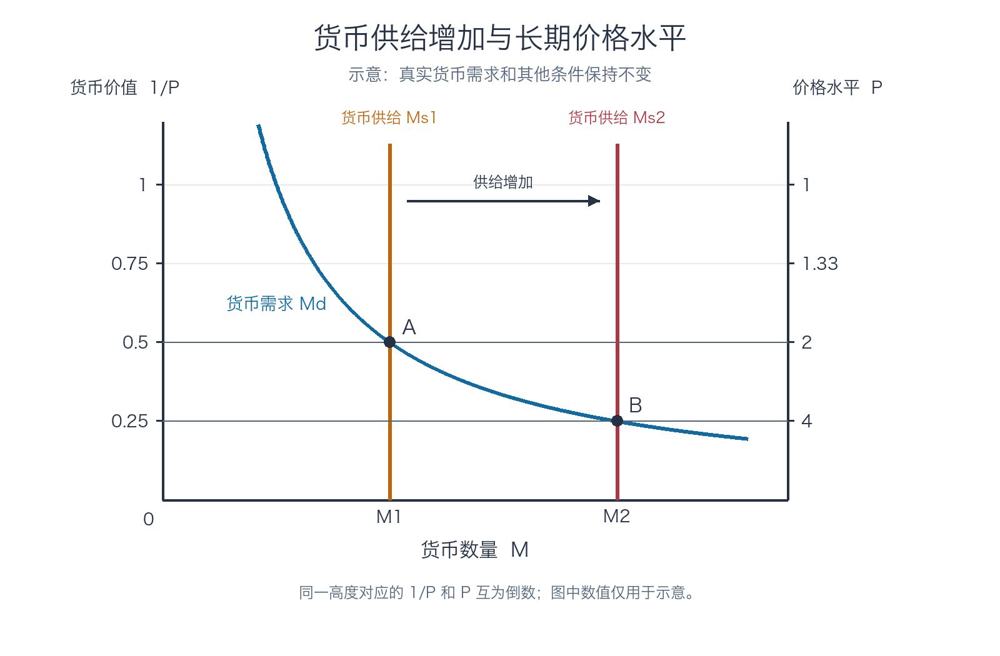

# 货币增长与通货膨胀 —— 第 30 章

> 第 29 章解释货币供给如何受到央行和银行体系影响。本章接着研究：货币供给与需求怎样决定长期价格水平，持续货币增长与通胀有什么关系，以及价格水平变化会带来哪些成本。

## 目录

- [1. 古典通货膨胀理论](#1-古典通货膨胀理论)
  - [通货膨胀、通货紧缩与货币价值](#11-通货膨胀通货紧缩与货币价值课件第-24-页)
  - [货币需求、货币供给与长期均衡](#12-货币需求货币供给与长期均衡课件第-57-页)
  - [增发货币怎样影响价格水平](#13-增发货币怎样影响价格水平课件第-810-页)
  - [货币流通速度与数量方程](#14-货币流通速度与数量方程课件第-1112-页)
  - [从数量方程到长期通胀](#15-从数量方程到长期通胀课件第-1314-页)
  - [古典二分法与货币中性](#16-古典二分法与货币中性课件第-1516-页)
  - [费雪效应与持有货币的机会成本](#17-费雪效应与持有货币的机会成本课件第-17-页)
- [2. 通货膨胀的成本](#2-通货膨胀的成本)
  - [“通货膨胀谬误”与实际购买力](#21-通货膨胀谬误与实际购买力)
  - [皮鞋成本](#22-皮鞋成本)
  - [菜单成本与价格、工资黏性](#23-菜单成本与价格工资黏性)
  - [相对价格扭曲](#24-相对价格扭曲)
  - [未预期的财富再分配](#25-未预期的财富再分配)
  - [混乱与不方便](#26-混乱与不方便)
  - [通货紧缩的影响](#27-通货紧缩的影响课件第-2324-页)
  - [全章复习与综合练习](#全章复习与综合练习)

---

## 1. 古典通货膨胀理论

### 1.1 通货膨胀、通货紧缩与货币价值（课件第 2—4 页）

#### 1.1.1 三个概念

- **通货膨胀**（inflation）：经济中的**总价格水平上升**。
- **通货紧缩**（deflation）：经济中的**总价格水平下降**。
- **超速通货膨胀**（hyperinflation）：通货膨胀率极高的情况。课件没有给出具体的数值门槛。

这里研究的是总价格水平，而不是某一种商品的价格。某商品因为供给减少而涨价，可以伴随其他价格不变甚至下降，因此单独观察到它涨价，不能判断整个经济是否发生了通货膨胀。

课件第 4 页用一幅购买圣诞树的漫画提出：“我们该怎么办？是要和去年一样大小的，还是要与去年一样价钱的？”如果相同大小的树比去年更贵，消费者可能选择多花钱买同样大小的树，也可能保持原支出、改买更小的树。比较生活费用时，应注意商品数量和品质；这幅漫画说明单件商品购买选择的变化，本身不足以证明总体通胀。

用 $P_t$ 表示第 $t$ 期的价格指数，本期通货膨胀率为：

$$
\pi_t=\frac{P_t-P_{t-1}}{P_{t-1}}=\frac{P_t}{P_{t-1}}-1.
$$

$P_t$ 表示物价水平，$\pi_t$ 表示物价水平的变化率。价格水平高，不等于该期通胀率高；通胀率下降，也不一定意味着价格下降，只要通胀率仍为正，价格水平就在继续上升。

**补充例子。** 设某价格指数连续四年为 100、110、115.5、115.5，后三年的通胀率分别为 $10\%$、$5\%$、$0\%$。第三年通胀率虽从 $10\%$ 降到 $5\%$，价格指数仍从 110 升到 115.5；第四年通胀率为零，只是价格指数不再上涨，没有回到最初的 100。

#### 1.1.2 物价水平与货币购买力

如果用 $P$ 表示物价水平，一单位货币的购买力可用 $1/P$ 表示。因此，在所用价格指数和基期固定的情况下：

$$
P\uparrow\quad\Longleftrightarrow\quad \frac{1}{P}\downarrow,
\qquad
P\downarrow\quad\Longleftrightarrow\quad \frac{1}{P}\uparrow.
$$

例如，以初始价格指数 100 为基期，如果以后指数为 125，同样一笔名义货币可购买的固定篮子数量变成原来的 $100/125=0.8$，货币购买力下降 $20\%$。物价上涨 $25\%$ 与货币购买力下降 $20\%$ 的分母不同，不应混为一谈。

货币购买力下降描述的是**每一单位货币**的购买力，不等于每个人的实际收入都按同一比例下降。后者还取决于个人的名义收入如何变化，见第 2.1 节。

### 1.2 货币需求、货币供给与长期均衡（课件第 5—7 页）

#### 1.2.1 什么是货币需求

**货币需求**是人们希望以流动性形式持有的货币资产量。它回答的是“希望持有多少货币”，与想获得多少财富或多少收入不同。人们持有货币是为了交易及其他流动性需要，但持有货币也可能放弃其他资产的收益。

课件列出以下影响因素：

| 因素变化 | 对名义货币需求的影响 | 原因 |
| --- | --- | --- |
| 总价格水平上升 | 增加 | 完成相同数量的交易需要更多名义货币 |
| 其他资产收益率上升 | 减少 | 持有货币所放弃的收益提高 |
| 其他支付方式更便捷 | 减少 | 为完成交易而持有货币的需要可能降低 |

还可以补充：其他条件相同时，真实交易或产出增加，往往会提高交易所需的真实货币余额。

在第 30 章的图中，货币价值 $1/P$ 的变化对应**沿既定需求曲线移动**。在同一货币价值下，如果其他资产的收益率或支付习惯改变，使人们愿意持有的货币量改变，则表现为**需求曲线移动**。

#### 1.2.2 货币供给与长期均衡

**货币供给**由央行及银行体系共同影响。为了分析长期价格水平，本章在其他条件给定时，把名义货币供给量 $M^s$ 当作既定值，画为垂直线。现实中，银行放贷、公众持有现金等因素会影响最终货币量；垂直供给线是此处的模型设定。

长期均衡要求：

$$
M^s=M^d.
$$

当货币需求的其他决定因素保持不变时，物价水平会调整，使人们希望持有的名义货币量与给定供给相等。

可以用一个简单形式说明。设所需的真实货币余额为常数 $L>0$，则：

$$
\frac{M^d}{P}=L,\qquad M^d=PL.
$$

均衡时 $M^s=PL$，所以：

$$
P=\frac{M^s}{L},\qquad \frac{1}{P}=\frac{L}{M^s}.
$$

在这个补充模型里，如果 $L$ 固定，货币供给翻倍，均衡价格水平也翻倍；如果其他资产收益率、真实产出或支付方式改变了 $L$，就不能仅凭货币供给推算价格水平。

#### 1.2.3 如何读货币供求图

课件图以货币数量为横轴，左侧纵轴为货币价值 $1/P$，右侧纵轴为物价水平 $P$。同一高度的两个刻度互为倒数：图上越高，$1/P$ 越高而 $P$ 越低。

- **供给曲线垂直**：本模型中供给量预先给定，不随 $P$ 变化。
- **需求曲线向右下方倾斜**：向下看，$1/P$ 降低意味着 $P$ 上升，完成交易需要的名义货币量更多。
- **供求交点**：同时确定均衡货币价值和与之对应的价格水平。

如果画图时把纵轴改成自下而上递增的 $P$，同一货币需求关系会向右上方倾斜。不能把 $P$ 的正向刻度与原来向右下倾斜的曲线直接拼在一起。

### 1.3 增发货币怎样影响价格水平（课件第 8—10 页）

下图根据课件图 1、图 2 的逻辑自行绘制。两条供给线对应 $M_1$ 和 $M_2$，需求曲线保持不变。图中 $M_2$ 为 $M_1$ 的两倍，$P$ 从 2 升至 4 是在所示需求曲线和其他条件固定时的示意，并非任意情形下都必然发生的即时结果。 这里的 $M_1$、$M_2$ 表示前后的货币供给水平，并非第 29 章货币统计中的 M1、M2 层次。

从原均衡 $A$ 出发，央行通过公开市场操作等方式增加货币供给，供给曲线向右移到 $M_2$。在原有价格水平下，人们持有的名义货币超过原本希望持有的数量，于是会调整支出和资产持有。随着价格水平调整，人们进行交易所需的名义货币增加；在新长期均衡 $B$，货币价值下降、价格水平上升。

这是一种长期调整的解释，并不意味着每一次增发都会立刻以相同比例推高全部商品价格。短期里产出、利率、资产价格及持币意愿都可能变化，调整路径也需要额外的模型分析。

#### 1.3.1 供给或需求移动的比较

下表使用纵轴 $1/P$，并假设每次只有表中列出的曲线发生移动：

| 初始变化 | 曲线变化 | 新均衡货币量 | 货币价值 $1/P$ | 价格水平 $P$ |
| --- | --- | --- | --- | --- |
| 货币供给增加 | 供给右移 | 增加 | 下降 | 上升 |
| 货币供给减少 | 供给左移 | 减少 | 上升 | 下降 |
| 货币需求增加，供给不变 | 需求右移 | 不变 | 上升 | 下降 |
| 货币需求减少，供给不变 | 需求左移 | 不变 | 下降 | 上升 |

例如，其他条件不变时，如果其他资产的收益率上升，人们愿意持有的货币减少，需求曲线左移。供给量已经由垂直线固定，因此新的均衡货币量仍等于既定供给量，调整的是货币价值和价格水平。

### 1.4 货币流通速度与数量方程（课件第 11—12 页）

#### 1.4.1 流通速度和符号

货币流通速度描述货币在一定时期内支持交易的周转程度。课件用真实 GDP 表示产出，因此这里采用**收入流通速度**：

$$
V=\frac{PY}{M}.
$$

| 符号 | 含义 | 口径 |
| --- | --- | --- |
| $M$ | 货币数量 | 使用选定的货币统计口径，可用与期间相配的代表性存量 |
| $V$ | 货币流通速度 | 名义 GDP 相对货币量的比值，带有时期含义 |
| $P$ | 总价格水平 | 与真实 GDP 配合的价格指数 |
| $Y$ | 真实 GDP | 一定时期最终产出的实际数量或指数 |
| $PY$ | 名义 GDP | 同一时期最终物品与服务的名义价值 |

整理定义得**货币数量方程**：

$$
\boxed{MV=PY}.
$$

**补充例子。** 某经济体在一年内的名义 GDP 为 500 亿元，该年代表性的货币存量为 100 亿元，则收入流通速度为 $V=500/100=5$，即该年名义 GDP 相当于货币存量的 5 倍。这个比值是整个经济的统计量，不要求每张钞票恰好易手 5 次。

课件把 $MV=T=PY$ 中的 $T$ 称为交易的物品与服务价值。这里 $T$ 按课件的**最终产出交易价值**理解。现实中的全部货币交易还包括二手资产和中间品等，并不等于 GDP；如果把 $T$ 定义为全部交易额，必须相应采用与全部交易额配套的速度和价格口径。

#### 1.4.2 方程与理论的区别

按照 $V=PY/M$ 定义收入流通速度，$MV=PY$ 是一个恒等关系。本身只说明四个变量之间必须相互一致：如果 $M$ 增加，$V$、$P$、$Y$ 至少有相应变化。单独写出这个方程，不能判断到底由价格、产出还是速度承担调整。

**货币数量论**进一步加入关于 $V$ 和长期 $Y$ 的假设，才得出货币与物价之间更具体的关系。

### 1.5 从数量方程到长期通胀（课件第 13—14 页）

#### 1.5.1 水平关系

课件采用的长期分析包含两个条件：

1. 货币流通速度 $V$ 较为稳定；在推导同比例变化时，先把它当作不变。
2. 经济的长期真实产出 $Y$ 主要由要素供给和生产技术决定；在比较一次性货币变化时，先把它当作不变。

由数量方程可得：

$$
P=\frac{MV}{Y}.
$$

当 $V$、$Y$ 都不变时，$P$ 与 $M$ 同比例变化。这一结论对应的是**价格水平**的比较。若 $V$ 或 $Y$ 也改变，它们同样影响价格水平。

**补充例子。** 已知某经济体最初 $M=500$、$V=4$、$Y=1000$：

$$
P_0=\frac{500\times4}{1000}=2.
$$

若货币数量一次性增加到 600，且 $V$ 和 $Y$ 不变，新价格水平为：

$$
P_1=\frac{600\times4}{1000}=2.4.
$$

$M$ 和 $P$ 都提高 $20\%$。如果此后货币量不再提高、其他条件也不再变化，价格可停留在新水平，不能由此推出未来每期仍有 $20\%$ 的通胀率。

#### 1.5.2 增长率关系

令 $g_M,g_V,g_Y$ 分别表示货币数量、流通速度和真实产出在**同一时期**的增长率，令 $\pi$ 表示该时期的通胀率。将两期的 $MV=PY$ 相除，得到精确关系：

$$
(1+g_M)(1+g_V)=(1+\pi)(1+g_Y).
$$

因此：

$$
\boxed{\pi=\frac{(1+g_M)(1+g_V)}{1+g_Y}-1}.
$$

增长率较小时，乘积项较小，可近似写作：

$$
\pi\approx g_M+g_V-g_Y.
$$

若 $V$ 稳定，即 $g_V\approx0$，则：

$$
\boxed{\pi\approx g_M-g_Y}.
$$

只有进一步假定真实产出不增长，才近似得到 $\pi\approx g_M$。长期持续的货币增长快于真实产出增长，在上述速度稳定等条件下，与持续通胀相联系；一次性的货币存量增加与持续更高的货币增长率要分开讨论。

**补充例子。** 假设一年内货币量增长 $8\%$、流通速度不变、真实 GDP 增长 $3\%$。精确通胀率为：

$$
\pi=\frac{1.08}{1.03}-1\approx4.85\%.
$$

小增长率近似给出 $8\%-3\%=5\%$。如果只写 $8\%$，就忽略了真实产出增长。

### 1.6 古典二分法与货币中性（课件第 15—16 页）

#### 1.6.1 名义变量和真实变量

**名义变量**以货币单位衡量，如名义 GDP、名义工资、以元计价的商品价格。**真实变量**经价格因素调整，或直接以实物及购买力衡量，如真实 GDP、真实工资和真实利率。

若 $W$ 为名义工资，则：

$$
\text{真实工资}=\frac{W}{P}.
$$

例如，若名义工资从 100 升到 120，价格水平也从 1 升到 1.2，真实工资从 $100/1=100$ 变为 $120/1.2=100$。工资的货币数额增加了，按所用价格指数衡量的购买力没有变化。

**古典二分法**强调将名义变量和真实变量区分开，分别分析它们的决定因素。它是一种分析方式，本身还没有说明货币变化对真实变量是否有影响。

#### 1.6.2 货币中性

**货币中性**指货币供给变化不影响真实变量。在本章的长期模型里，货币数量变化主要反映在价格及其他名义变量上，真实产出、真实工资等由真实因素决定。

这与“物价不变”不同：例如长期货币供给加倍，若物价和名义工资都加倍，则真实工资可以不变。在货币中性成立且真实产出、流通速度不变的比较中，名义变量随货币量同比例变化。

课件将长期货币中性与短期情况区分：短期内商品价格和工资可能具有**黏性**，即不能马上充分调整。若价格或工资调整速度不同，货币变化就可能暂时改变实际需求、产出或就业。不能把长期中性的结论不加条件地套用到每一个短期阶段。

### 1.7 费雪效应与持有货币的机会成本（课件第 17 页）

#### 1.7.1 名义利率与真实利率

名义利率 $i$ 是按货币数额计算的收益率；真实利率反映按价格水平调整后的购买力收益率。如果同一时期实际通胀率为 $\pi$，则事后真实利率为：

$$
1+r_{\text{事后}}=\frac{1+i}{1+\pi},
\qquad
r_{\text{事后}}=\frac{i-\pi}{1+\pi}.
$$

当利率和通胀率较低时，常用近似为：

$$
r_{\text{事后}}\approx i-\pi,
\qquad i\approx r+\pi.
$$

借贷合同签订时，未来实际通胀还不知道。设预期通胀为 $\pi^e$，以预期价格水平变化计算的事前真实利率满足：

$$
1+r_{\text{事前}}=\frac{1+i}{1+\pi^e},
\qquad i\approx r_{\text{事前}}+\pi^e.
$$

课件用当期通胀写出费雪关系；分析合同签订时的名义利率时，写出预期通胀更能说明利率如何形成。实际通胀与预期不一致时，事后真实收益就会偏离事前预期。

#### 1.7.2 费雪效应

在长期货币中性和真实利率由真实因素决定的条件下，持续货币增长加快会提高通胀预期，名义利率随之上升。这种长期关系称为**费雪效应**。

在近似式 $i\approx r+\pi^e$ 中，若 $r$ 不变、预期通胀上升 1 个百分点，则名义利率约上升 1 个百分点。这里的“一对一”是加法近似；精确乘法关系含有交叉项。

**补充例子。** 假定事前真实利率为 $2\%$。预期通胀率为 $2\%$ 时：

$$
i=(1.02)(1.02)-1=4.04\%.
$$

预期通胀率升至 $6\%$ 而事前真实利率不变时：

$$
i=(1.02)(1.06)-1=8.12\%.
$$

精确名义利率增加 4.08 个百分点；近似式则分别给出 $4\%$ 和 $8\%$。现实中名义利率也可能因真实利率等因素变化，不能仅凭名义利率上升就断言通胀一定上升。

#### 1.7.3 为什么持有现金的机会成本通常用名义利率表示

把不付息现金与风险、流动性等其他条件可比的一项计息资产比较，持有现金会放弃后者的名义利息。若名义利率为 $i$、实际通胀率为 $\pi$，两者的事后真实收益率分别为：

$$
r_{\text{资产}}=\frac{1+i}{1+\pi}-1,
\qquad
r_{\text{现金}}=\frac{1}{1+\pi}-1.
$$

其差额为：

$$
r_{\text{资产}}-r_{\text{现金}}=\frac{i}{1+\pi}\approx i.
$$

所以教材在低通胀近似下把持有不付息现金的机会成本写为名义利率。通胀会侵蚀现金购买力，但这里计算的是**现金与替代资产之间的收益差**，不能直接把通胀率当作两者的机会成本。若货币本身付息，还应比较替代资产收益与货币自身收益。

---

## 2. 通货膨胀的成本

### 2.1 “通货膨胀谬误”与实际购买力

课件首先讨论一种直觉：物价上涨，人们购买东西要支付更多，因此通胀必然让每个人都变穷。这种推论忽视了另一面：一方的支出也是另一方的收入。

在一个假设情形下，如果所有商品价格、名义工资和其他名义收入都同时同比例上升，真实收入和相对价格不变。此时，不能仅凭“物价上涨”断定所有人的实际购买力都下降。

现实中不同价格、工资和收入的调整时间和幅度可能不同，持有的现金及签订的合同也不同。因此，上面的假设不意味着通胀没有成本，而是提醒我们找出成本**具体从何处产生、由谁承担**。

### 2.2 皮鞋成本

**皮鞋成本**来自人们为了减少持有货币而增加交易和资金管理的次数。通胀较高时，现金购买力下降得更快；当替代资产收益较高、持有现金的机会成本上升时，人们可能更频繁地将资金在现金和其他资产之间转换。

传统例子是更频繁地去银行取款，鞋子磨损只是形象说法。即使使用电子支付，转账、管理账户及安排流动性所耗费的时间和其他资源仍可能存在。

### 2.3 菜单成本与价格、工资黏性

**菜单成本**是改变标价所需耗费的资源，包括重新制作价格表、调整系统、通知客户等。名称来自餐馆修改菜单的例子，但适用于其他需要更新价格的企业。

调整存在成本、合同期限或其他约束时，商品价格和工资可能不会随一般物价立即变化，这就是价格与工资的**黏性**。例如，在名义工资暂时不变时，若 $P$ 上升，$W/P$ 会暂时下降；不同人的合同与收入调整速度可能不同。

### 2.4 相对价格扭曲

**相对价格**是两种商品价格的比率，它向消费者和生产者传递资源稀缺程度等信息。当不同商品调整名义价格的时间不一致时，即使原来没有发生相应的真实供需变化，也可能出现相对价格变动。

**补充例子。** 最初商品 A 和 B 都售价 10 元，相对价格 $P_A/P_B=1$。若一般价格上涨时 A 先涨到 12 元，B 的价格仍暂时固定在 10 元：

$$
\frac{P_A}{P_B}=\frac{12}{10}=1.2.
$$

消费者面对的 A 相对价格暂时提高，可能减少对 A 的购买；生产者也可能改变生产安排。如果这只是调价时间差，而非真实稀缺程度改变，就可能使消费和生产偏离原本有效的选择。等 B 的价格也调整到 12 元后，比例又回到 1。

### 2.5 未预期的财富再分配

通胀具有不确定性，尤其高通胀可能使未来价格更难预测。对于偿还金额已经固定、没有随价格指数调整的名义债务：

| 实际通胀与合同预期比较 | 偿还款的实际价值 | 相对于预期的结果 |
| --- | --- | --- |
| 实际通胀更高 | 更低 | 债务人获益，债权人受损 |
| 实际通胀更低 | 更高 | 债权人获益，债务人受损 |

这里说的获益和受损，是**相对于合同中隐含的预期**而言，并不意味着债务人一定不用偿还本金。若通胀被准确预期且已体现在名义利率中，就不一定发生这种意外转移；指数化条款也可能改变结论。

**补充例子。** 借款合同约定一年后偿还 110 元，双方预期一年物价上涨 $10\%$，因此预期偿还款相当于期初购买力 $110/1.10=100$ 元。如果实际物价上涨 $20\%$，实际偿还价值为：

$$
\frac{110}{1.20}\approx91.67\text{元（按期初购买力计）}.
$$

债权人收到的实际价值比预期少约 8.33 元，债务人的实际负担相应低于预期。若实际物价不变，实际偿还价值为 110 元，则债权人相对于预期获益。

### 2.6 混乱与不方便

货币是计价单位。价格水平波动较大时，今天的 100 元与若干年后的 100 元所代表的购买力不同，跨期比较收入、成本和利润变得更困难。名义金额的变化可能同时包含真实变化和价格变化，需要调整后才能判断。

### 2.7 通货紧缩的影响（课件第 23—24 页）

通缩使单位货币购买力上升，但其经济影响还取决于通缩幅度、持续性、是否被预见及背后的原因。

#### 2.7.1 弗里德曼法则的直觉

课件指出，小幅且可预见的通缩可能降低名义利率，从而降低持有货币的机会成本。根据 $i\approx r+\pi^e$，若事前真实利率给定，较低的预期通胀率对应较低的名义利率。**弗里德曼法则**的这一直觉是：在简化条件下，让持有不付息货币的机会成本尽可能低。

这一说法针对特定条件下稳定、可预见的价格变化，不能据此把任何突然或剧烈的通缩都看作有益。

#### 2.7.2 通缩的可能成本

1. **菜单成本**：企业仍需要调整价格。
2. **相对价格波动**：各商品价格下调速度不同，可能影响资源配置。
3. **债务负担与财富再分配**：对于固定名义债务，未预期的通缩提高偿还款的实际价值，使债务人的实际负担相对于预期上升、债权人相对于预期获益。
4. **消费和投资的不足或推迟**：如果家庭和企业预期价格继续下降，可能推迟部分支出；这种行为的规模取决于实际收入、利率、预期及其他条件。
5. **更深层经济问题的症状**：通缩也可能与疲弱需求或其他经济问题同时出现。观察到通缩，需要进一步分析原因，不能仅根据物价下降断定因果关系。

---

### 全章复习与综合练习

以下练习与对照表综合覆盖本章两个部分。

#### 综合练习与参考解答（以下均为补充题）

##### 练习 1：区分价格水平、通胀和货币购买力

**题目。** 某经济体价格指数在第 0、1、2、3 年分别为 100、120、126、119.7。求第 1、2、3 年各自的通胀率，并比较第 1 年和第 0 年每单位货币的购买力。第 2 年发生了通货紧缩吗？

**解答。**

$$
\pi_1=\frac{120}{100}-1=20\%,\quad
\pi_2=\frac{126}{120}-1=5\%,\quad
\pi_3=\frac{119.7}{126}-1=-5\%.
$$

第 2 年通胀率下降到 $5\%$，但价格仍在上升，因此并未通缩；第 3 年价格水平下降，才发生通缩。第 1 年的单位货币购买力相对第 0 年为 $100/120=5/6$，下降 $1/6\approx16.67\%$。

##### 练习 2：从货币需求到长期均衡

**题目。** 假设一国的真实货币需求固定为 $L=50$，即 $M^d/P=50$；央行和银行体系决定的货币供给由 200 增至 300。其他条件不变。求增发前后的长期均衡价格水平、货币价值及其变化百分比。

**解答。** 根据 $M^s=PL$：

$$
P_0=\frac{200}{50}=4,\qquad P_1=\frac{300}{50}=6.
$$

价格水平上升 $(6-4)/4=50\%$。货币价值从 $1/4$ 变为 $1/6$，变化率为：

$$
\frac{1/6-1/4}{1/4}=-\frac13\approx-33.33\%.
$$

价格上升 $50\%$ 而购买力下降约 $33.33\%$，仍然是由于两个变化率的基数不同。真实货币需求固定是得出本题结果的条件。

##### 练习 3：数量方程的增长率

**题目。** 某经济体一年内货币数量增加 $10\%$，收入流通速度下降 $2\%$，真实 GDP 增加 $4\%$。求该年的精确通胀率和增长率近似值。若只知道货币数量增加 $10\%$，能否确定通胀率？

**解答。**

$$
\pi=\frac{(1+0.10)(1-0.02)}{1+0.04}-1
=\frac{1.078}{1.04}-1\approx3.65\%.
$$

近似值为 $10\%-2\%-4\%=4\%$。只知道货币增长 $10\%$ 时，还不知道 $V$ 和 $Y$ 如何变化，因此不能确定通胀率。

##### 练习 4：预期与实际通胀

**题目。** 某贷款约定一年名义利率为 $8\%$，签约时预期通胀率为 $5\%$，但一年后实际通胀率为 $10\%$。计算按预期价格水平得到的事前真实利率和事后真实利率，并判断固定名义债务的实际偿还价值相对预期如何变化。

**解答。**

$$
r_{\text{事前}}=\frac{1.08}{1.05}-1\approx2.86\%,
\qquad
r_{\text{事后}}=\frac{1.08}{1.10}-1\approx-1.82\%.
$$

实际通胀高于预期，固定名义偿还款的购买力低于签约时预期，债务人相对于预期获益，债权人相对于预期受损。近似计算分别为 $8\%-5\%=3\%$ 和 $8\%-10\%=-2\%$。

#### 复习时需要区分的关系

| 概念或结论 | 判断时需要注意的条件 |
| --- | --- |
| 价格水平与通胀率 | 前者是水平，后者是水平的变化率；低通胀仍可能对应持续上涨的物价 |
| 货币需求量与需求曲线 | 价格水平变化对应沿曲线移动；其他收益率或支付方式变化可使整条曲线移动 |
| 货币数量方程与数量论 | 方程是恒等关系；数量论还需要关于速度和长期产出的假设 |
| 一次性增发与持续更快的货币增长 | 前者比较价格水平的变化，后者才对应持续通胀率的变化 |
| 古典二分法与货币中性 | 前者区分变量，后者讨论货币变化是否影响真实变量 |
| 名义利率与真实利率 | 签约时关注预期通胀，事后收益取决于实际通胀 |
| 通胀与意外再分配 | 固定名义合同中，关键是实际价格变化与签约预期的偏差 |
| 通缩与福利 | 需区分稳定、可预见的通缩与突然、未预期的通缩，并分析产生原因 |

#### 来源覆盖

对应课件：[[assets/宏观经济学/课件/7-Chapter 30 货币增长与通货膨胀.pptx|第 30 章《货币增长与通货膨胀》课件]]，共 24 页。

- 课件第 1—4 页：章节主题、通胀、通缩、超速通胀与货币价值，见第 1.1 节。
- 第 5—10 页：货币供求、长期均衡与增发货币，见第 1.2—1.3 节。
- 第 11—14 页：流通速度、数量方程和货币数量论，见第 1.4—1.5 节。
- 第 15—17 页：古典二分法、货币中性与费雪效应，见第 1.6—1.7 节。
- 第 18—22 页：通胀谬误、皮鞋成本、菜单成本、价格黏性、相对价格、财富再分配及计价问题，见第 2.1—2.6 节。
- 第 23—24 页：弗里德曼法则与通缩成本，见第 2.7 节。上面的“综合练习与参考解答”均为补充题，不属于课件原题。
