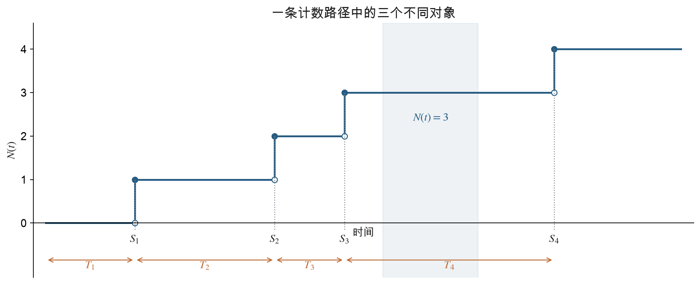

## 1 指数分布

### 1.1 定义与参数

设连续型随机变量 $X$ 的概率密度函数为

$$
f_X(x)=
\begin{cases}
\lambda e^{-\lambda x},&x\geq 0,\\
0,&x<0,
\end{cases}
\qquad \lambda>0.
\tag{1.1}
$$

则称 $X$ 服从参数为 $\lambda$ 的**指数分布**（exponential distribution），记作 $X\sim\operatorname{Exp}(\lambda)$。其分布函数和生存函数分别为

$$
F_X(x)=
\begin{cases}
1-e^{-\lambda x},&x\geq0,\\
0,&x<0,
\end{cases}
\qquad
\overline F_X(x)=P(X>x)=e^{-\lambda x},\quad x\geq0.
\tag{1.2}
$$

本章的 $\lambda$ 始终表示**速率**（rate），不是均值。如果 $X$ 以分钟计，那么 $\lambda$ 的单位是“每分钟”，$\lambda x$ 没有量纲。$\lambda$ 越大，随机等待通常越短。

由分部积分，或非负随机变量的尾积分公式，得到

$$
E[X]=\int_0^\infty P(X>x)\,dx
=\int_0^\infty e^{-\lambda x}\,dx
=\frac1\lambda.
$$

又因为

$$
E[X^2]=2\int_0^\infty xP(X>x)\,dx
=\frac{2}{\lambda^2},
$$

所以

$$
\operatorname{Var}(X)=E[X^2]-E[X]^2=\frac1{\lambda^2},
\qquad \operatorname{SD}(X)=\frac1\lambda.
\tag{1.3}
$$

指数分布的标准差与均值相等。题目若说“平均服务时间为 10 分钟”，应先写 $\lambda=1/10$，再代入概率公式。

### 1.2 无记忆性

对任意 $s,t\geq0$，指数分布满足

$$
P(X>t+s\mid X>t)=P(X>s)=e^{-\lambda s}.
\tag{1.4}
$$

证明只需使用条件概率。由于 $\{X>t+s\}\subseteq\{X>t\}$，

$$
\begin{aligned}
P(X>t+s\mid X>t)
&=\frac{P(X>t+s)}{P(X>t)}\\
&=\frac{e^{-\lambda(t+s)}}{e^{-\lambda t}}
=e^{-\lambda s}.
\end{aligned}
$$

这说明，在已知等待了 $t$ 个时间单位且事件仍未发生之后，**从现在起还需等待的时间**仍服从原来的指数分布：

$$
(X-t\mid X>t)\overset d=X.
\tag{1.5}
$$

无记忆性并不表示已经过去的 $t$ 消失了。条件下的总时间满足

$$
E[X\mid X>t]=t+\frac1\lambda,
\qquad
E[X-t\mid X>t]=\frac1\lambda.
$$

**补充：指数分布为何是连续等待时间中的无记忆分布。** 若一个非退化、取有限非负值的连续型随机变量满足无记忆性，则其生存函数满足

$$
\overline F(s+t)=\overline F(s)\overline F(t).
$$

令 $g(t)=-\log\overline F(t)$，便有 $g(s+t)=g(s)+g(t)$。分布函数的单调性排除了非规则的加性函数解，因此 $g(t)=\lambda t$，从而 $\overline F(t)=e^{-\lambda t}$。离散时间中的对应分布是几何分布。

### 1.3 例 5.2：在银行停留的时间

**题目。** 一位顾客在银行内停留的总时间 $X$ 服从指数分布，均值为 10 分钟。

1. 求该顾客在银行停留超过 15 分钟的概率。
2. 已知她进入银行 10 分钟后仍在银行，求她的总停留时间超过 15 分钟的条件概率。

**解。** 速率为 $\lambda=1/10$，因此第一问为

$$
P(X>15)=e^{-15/10}=e^{-1.5}\approx0.22313.
$$

第二问中的“超过 15 分钟”仍指从进入银行算起的总时间。在已经过去的 10 分钟之后，只需再停留超过 5 分钟：

$$
P(X>15\mid X>10)
=P(X>5)=e^{-0.5}\approx0.60653.
$$

如果题目改为“已停留 10 分钟后，还要再停留超过 15 分钟”，对应的事件才是 $\{X>25\mid X>10\}$，概率为 $e^{-1.5}$。

### 1.4 例 5.4：带免赔额的保险赔付

**题目。** 每次事故造成的损失金额 $X$ 服从均值为 1,000 美元的指数分布。保险公司仅赔偿超过 400 美元的部分；损失不超过 400 美元时不赔付。令每次事故的赔付金额为 $Y$，求 $E[Y]$ 和 $\operatorname{SD}(Y)$。

**解。** 赔付规则为

$$
Y=(X-400)^+=\max\{X-400,0\}.
$$

令 $I=\mathbf1_{\{X>400\}}$，并记

$$
p=P(I=1)=e^{-400/1000}=e^{-0.4}.
$$

当 $I=0$ 时，$Y=0$；当 $I=1$ 时，由无记忆性，

$$
(Y\mid I=1)=(X-400\mid X>400)
\sim\operatorname{Exp}(1/1000).
$$

因此

$$
E[Y\mid I]=1000I,
\qquad
\operatorname{Var}(Y\mid I)=10^6I.
$$

先用全期望公式：

$$
E[Y]=1000p=1000e^{-0.4}\approx670.3200\ \text{美元}.
$$

再用全方差公式：

$$
\begin{aligned}
\operatorname{Var}(Y)
&=E[\operatorname{Var}(Y\mid I)]
+\operatorname{Var}(E[Y\mid I])\\
&=10^6p+10^6p(1-p)\\
&=10^6(2p-p^2).
\end{aligned}
$$

于是

$$
\operatorname{SD}(Y)
=1000\sqrt{2e^{-0.4}-e^{-0.8}}
\approx944.0928\ \text{美元}.
\tag{1.6}
$$

无条件的 $Y$ 不是指数随机变量，因为它在 0 处有正概率 $1-p$。不能把条件均值 1,000 美元当成每次事故的平均赔付，也不能只减去免赔额而忽略不赔付的情况。

一般地，若 $X\sim\operatorname{Exp}(\lambda)$，免赔额为 $a\geq0$，则

$$
E[(X-a)^+]=\frac{e^{-\lambda a}}\lambda,
\qquad
\operatorname{Var}((X-a)^+)
=\frac{2e^{-\lambda a}-e^{-2\lambda a}}{\lambda^2}.
$$

### 1.5 失效率函数

设正的连续型寿命变量 $X$ 有密度 $f$ 和分布函数 $F$。在 $P(X>t)>0$ 的位置定义**失效率函数**（failure rate，也称 hazard rate）

$$
r(t)=\frac{f(t)}{1-F(t)}.
\tag{1.7}
$$

其含义来自短时间条件概率：

$$
\begin{aligned}
P(t<X\leq t+h\mid X>t)
&=\frac{F(t+h)-F(t)}{1-F(t)}\\
&=r(t)h+o(h),\qquad h\downarrow0.
\end{aligned}
$$

$r(t)$ 是“已经存活到年龄 $t$ 的个体，在接下来单位小时间内失效的速率”。它是条件概率密度意义上的速率，本身不必介于 0 与 1 之间。

对指数分布，

$$
r(t)=\frac{\lambda e^{-\lambda t}}{e^{-\lambda t}}=\lambda.
$$

年龄增长不会改变其瞬时失效率，这正是无记忆性的另一种表达。

**补充：由失效率恢复分布。** 因为

$$
\frac{d}{dt}\log\overline F(t)
=-\frac{f(t)}{\overline F(t)}=-r(t),
$$

在 $\overline F(0)=1$ 时有

$$
\overline F(t)=\exp\left\{-\int_0^t r(u)\,du\right\}.
\tag{1.8}
$$

例如递增的 $r(t)$ 可描述老化现象；恒定的 $r(t)$ 对应指数寿命。这些模型的判断依据是条件失效率，而不是只看密度曲线是否下降。

## 2 独立指数变量的和与竞争

### 2.1 命题 5.1：同速率指数变量之和

设 $X_1,\ldots,X_n$ 相互独立，且均服从 $\operatorname{Exp}(\lambda)$。则

$$
W_n=\sum_{i=1}^nX_i\sim\operatorname{Gamma}(n,\lambda),
$$

这里采用“形状参数 $n$、速率参数 $\lambda$”的记法。正整数形状的 Gamma 分布也称 Erlang 分布，其密度为

$$
f_{W_n}(t)
=\frac{\lambda^n t^{n-1}e^{-\lambda t}}{(n-1)!}
=\lambda e^{-\lambda t}\frac{(\lambda t)^{n-1}}{(n-1)!},
\qquad t>0.
\tag{2.1}
$$

**证明。** $n=1$ 时就是指数密度。假设 $W_n$ 的密度为式（2.1），由独立性作卷积，

$$
\begin{aligned}
f_{W_{n+1}}(t)
&=\int_0^t f_{W_n}(u)f_{X_{n+1}}(t-u)\,du\\
&=\int_0^t
\frac{\lambda^n u^{n-1}e^{-\lambda u}}{(n-1)!}
\lambda e^{-\lambda(t-u)}\,du\\
&=\frac{\lambda^{n+1}e^{-\lambda t}}{(n-1)!}
\frac{t^n}{n}
=\frac{\lambda^{n+1}t^ne^{-\lambda t}}{n!}.
\end{aligned}
$$

归纳完成。由独立变量求和还可直接得到

$$
E[W_n]=\frac n\lambda,
\qquad
\operatorname{Var}(W_n)=\frac n{\lambda^2}.
\tag{2.2}
$$

“相互独立”和“速率相同”缺一不可。不同速率指数变量的和一般不属于上述单一速率的 Gamma 分布；而 $n>1$ 时的 Gamma 等待时间也不具有指数分布的无记忆性。

### 2.2 两个指数时钟谁先响

设 $X_1\sim\operatorname{Exp}(\lambda_1)$、$X_2\sim\operatorname{Exp}(\lambda_2)$，且相互独立。对 $X_1$ 条件化，

$$
\begin{aligned}
P(X_1<X_2)
&=\int_0^\infty P(X_2>x)f_{X_1}(x)\,dx\\
&=\int_0^\infty e^{-\lambda_2x}\lambda_1e^{-\lambda_1x}\,dx\\
&=\frac{\lambda_1}{\lambda_1+\lambda_2}.
\end{aligned}
\tag{2.3}
$$

速率越大，先发生的概率越大。连续分布下 $P(X_1=X_2)=0$，因此另一方先发生的概率为 $\lambda_2/(\lambda_1+\lambda_2)$。

### 2.3 命题 5.2：最小值的分布和获胜者

设 $X_i\sim\operatorname{Exp}(\lambda_i)$，$i=1,\ldots,n$，相互独立。记

$$
M=\min_{1\leq i\leq n}X_i,
\qquad \Lambda=\sum_{i=1}^n\lambda_i.
$$

最小值超过 $t$，等价于所有变量都超过 $t$，所以

$$
P(M>t)=\prod_{i=1}^nP(X_i>t)
=\prod_{i=1}^ne^{-\lambda_it}=e^{-\Lambda t}.
$$

于是

$$
M\sim\operatorname{Exp}(\Lambda),
\qquad E[M]=\frac1\Lambda.
\tag{2.4}
$$

设 $J$ 是取得最小值的下标。利用独立性，

$$
\begin{aligned}
P(J=i)
&=\int_0^\infty f_{X_i}(x)
\prod_{j\ne i}P(X_j>x)\,dx\\
&=\int_0^\infty\lambda_i e^{-\Lambda x}\,dx
=\frac{\lambda_i}\Lambda.
\end{aligned}
\tag{2.5}
$$

因此，“多久发生第一件事”由速率之和决定；“第一件事属于哪类”由各速率占总速率的比例决定。

### 2.4 最小值与全部排序相互独立

命题 5.2 还包含更强的结论：$M$ 不仅与获胜者 $J$ 独立，而且与整个排序独立。对任意排列 $(i_1,\ldots,i_n)$，

$$
P(X_{i_1}<\cdots<X_{i_n}\mid M>t)
=P(X_{i_1}<\cdots<X_{i_n}).
\tag{2.6}
$$

**证明。** 事件 $\{M>t\}$ 等价于 $X_i>t$ 对所有 $i$ 同时成立。由于原变量独立，条件下的剩余时间 $X_i-t$ 仍相互独立，且各自保持速率 $\lambda_i$ 的指数分布。所有变量同时减去 $t$ 不改变大小顺序，因此条件排序概率不变。事件 $\{M>t\}$ 随 $t$ 的变化确定了 $M$ 的分布，故得到独立性。

也可直接核对获胜者与最小值的联合密度：

$$
f_{M,J}(x,i)=\lambda_i e^{-\Lambda x}
=\underbrace{\Lambda e^{-\Lambda x}}_{f_M(x)}
\underbrace{\frac{\lambda_i}\Lambda}_{P(J=i)}.
$$

进一步逐次使用无记忆性，可以得到完整排序的概率（补充推论）：

$$
P(X_{i_1}<\cdots<X_{i_n})
=\prod_{k=1}^n
\frac{\lambda_{i_k}}{\lambda_{i_k}+\cdots+\lambda_{i_n}}.
\tag{2.7}
$$

若各速率相同，任一种排序的概率都是 $1/n!$；速率不同则一般不是均匀排序。

### 2.5 例 5.8：两位职员的服务系统

**题目。** 某办公室有两位职员，第 $i$ 位职员对每位顾客的服务时间服从速率为 $\lambda_i$ 的指数分布。各次服务时间相互独立。Smith 先生到达时，两位职员均在服务，且没有其他顾客排队。他等待先空闲的职员，随后由该职员完成自己的服务。求 Smith 从到达到离开的期望总停留时间。

**解。** 虽然两位职员都已经服务了一段时间，但由无记忆性，其剩余服务时间仍分别服从 $\operatorname{Exp}(\lambda_1)$ 和 $\operatorname{Exp}(\lambda_2)$。

令 $W$ 为 Smith 的等待时间，$J$ 为先空闲的职员，则

$$
E[W]=\frac1{\lambda_1+\lambda_2},
\qquad
P(J=i)=\frac{\lambda_i}{\lambda_1+\lambda_2}.
$$

Smith 自己的服务时间记为 $V$。给定 $J=i$ 后，$E[V\mid J=i]=1/\lambda_i$，从而

$$
\begin{aligned}
E[W+V]
&=\frac1{\lambda_1+\lambda_2}
+\frac{\lambda_1}{\lambda_1+\lambda_2}\frac1{\lambda_1}
+\frac{\lambda_2}{\lambda_1+\lambda_2}\frac1{\lambda_2}\\
&=\frac3{\lambda_1+\lambda_2}.
\end{aligned}
\tag{2.8}
$$

不能把接受两位职员服务的概率都写成 $1/2$；先空闲的更可能是速率较大的职员。总停留时间也不能只计算最小剩余时间，因为 Smith 还需要接受自己的服务。

### 2.6 例 5.7：两种贪心分配算法

**题目。** 将 $n$ 个人分配给 $n$ 项工作，每人恰好承担一项工作，每项工作恰好分配给一人。将第 $i$ 个人分配给第 $j$ 项工作的成本为 $C_{ij}$。假设 $n^2$ 个成本相互独立，且均服从均值为 1 的指数分布。比较以下两种算法的期望总成本。

- 算法 A：按第 $1,2,\ldots,n$ 个人的固定顺序，给当前人选择尚未分配的工作中成本最低的一项，然后删除该工作。
- 算法 B：在尚未分配的所有人和工作构成的成本矩阵中，选择全局最小的一对，完成分配后删除对应的行与列，重复直至完成。

经典分配问题追求实际总成本的最小值；这里比较的是上述两个特定启发式算法在随机成本下的期望，并未假设它们达到最优分配。

**算法 A。** 第 $i$ 个人面临 $n-i+1$ 项工作。此前删除哪些工作只依赖前面各人的成本，与当前这一行成本独立，因此当前候选成本仍是 $n-i+1$ 个独立的 $\operatorname{Exp}(1)$ 变量。设第 $i$ 次选中的成本为 $A_i$，则

$$
E[A_i]=\frac1{n-i+1},
\qquad
E\left[\sum_{i=1}^nA_i\right]
=\sum_{k=1}^n\frac1k=:H_n.
\tag{2.9}
$$

**算法 B。** 设依次选中的实际成本为 $B_1,\ldots,B_n$。第一步在 $n^2$ 个指数变量中取最小值，因此

$$
E[B_1]=\frac1{n^2}.
$$

第一步完成后，剩下的原始成本都大于 $B_1$。无记忆性说明，它们超过 $B_1$ 的部分仍是独立的 $\operatorname{Exp}(1)$ 变量。因此第二步选中的**实际成本**是

$$
B_2=B_1+\text{剩余 }(n-1)^2\text{ 个超额成本的最小值},
$$

所以

$$
E[B_2]=\frac1{n^2}+\frac1{(n-1)^2}.
$$

重复这一论证，得到

$$
E[B_i]=\sum_{k=n-i+1}^n\frac1{k^2}.
$$

求总成本时，增量 $1/k^2$ 会出现在后续 $k$ 次实际成本中，因此

$$
\begin{aligned}
E\left[\sum_{i=1}^nB_i\right]
&=\frac n{n^2}+\frac{n-1}{(n-1)^2}+\cdots+\frac11\\
&=H_n.
\end{aligned}
\tag{2.10}
$$

**结论：两种算法的期望总成本相同，均为 $H_n$。** 算法 B 的每一步成本不是从零开始重新抽取的最小值，必须累加此前的成本门槛。例如 $n=2$ 时，两步期望成本为 $1/4$ 与 $1/4+1$，总和为 $3/2$。

## 3 计数过程

### 3.1 定义与样本路径

随机过程 $\{N(t),t\geq0\}$ 若表示截至时刻 $t$ 已发生的事件总数，就称为**计数过程**（counting process）。通常从时间 0 开始记录，将 $N(t)$ 解释为 $(0,t]$ 内的事件数。

它满足以下四项性质：

1. $N(t)\geq0$。
2. $N(t)$ 取整数值。
3. 若 $s<t$，则 $N(s)\leq N(t)$。
4. $N(t)-N(s)$ 等于区间 $(s,t]$ 内发生的事件数。

课件中的例子包括：截至 $t$ 时上海报告的交通事故总数、进入某商店的累计人数、累计出生人数、某足球运动员的累计进球数。它们都可以定义为计数过程，但是否满足泊松过程的额外假设，需要另行判断。例如门店客流的速率可能随一天中的时段变化。

计数过程的路径通常是右连续的阶梯函数。若一次只发生一件事，每次向上跳 1；一般计数过程也可能有批量到达。商店内的**当前人数**可能下降，因此与累计进入人数不同，通常不是这种单调计数过程。

图 2：跳跃所在的横坐标是 $S_n$，相邻跳跃之间的水平距离是 $T_n$，任意时刻的阶梯高度是 $N(t)$。图中为说明记号的示意路径。

### 3.2 独立增量与平稳增量

**独立增量**（independent increments）表示：对任意

$$
0\leq t_0<t_1<\cdots<t_k,
$$

随机变量

$$
N(t_1)-N(t_0),\ldots,N(t_k)-N(t_{k-1})
$$

相互独立。这里要求独立的是互不重叠区间内的**新增数量**，不是不同时间的累计数量。

**平稳增量**（stationary increments）表示：区间内事件数的分布仅依赖区间长度，不依赖区间起点。在 $N(0)=0$ 时可写为

$$
N(s+t)-N(s)\overset d=N(t),\qquad s,t\geq0.
\tag{3.1}
$$

这两种性质不同。第一种约束不同区间之间的依赖关系，第二种约束相同长度区间的分布是否一致。

另外，“平稳增量”不表示“过程本身平稳”。泊松过程的 $E[N(t)]=\lambda t$ 会随时间增长，其累计数量分布并不保持不变。

## 4 泊松过程的定义

### 4.1 定义 5.1：小量 $o(h)$

若函数 $g$ 满足

$$
\lim_{h\to0}\frac{g(h)}h=0,
$$

则记 $g(h)=o(h)$。研究未来短时间区间时取 $h\downarrow0$。

**例 5.12。** 判断 $h^2$、$h$ 是否为 $o(h)$，并判断两个 $o(h)$ 的和及常数倍是否仍为 $o(h)$。

由定义直接得到

$$
\frac{h^2}h=h\to0,
\qquad \frac hh=1\not\to0.
$$

所以 $h^2=o(h)$，但 $h$ 不是 $o(h)$。若 $f(h)=o(h)$、$g(h)=o(h)$，且 $c$ 是固定有限常数，那么

$$
\frac{f(h)+g(h)}h\to0,
\qquad \frac{cf(h)}h\to0,
$$

即有限个小量之和及固定常数倍仍为 $o(h)$。不同公式中的 $o(h)$ 不一定是同一个函数。它也不一定等于 $O(h^2)$，例如 $h^{3/2}=o(h)$。

### 4.2 定义 5.2：速率为 $\lambda$ 的泊松过程

计数过程 $\{N(t),t\geq0\}$ 称为速率 $\lambda>0$ 的**泊松过程**（Poisson process），若满足

$$
\begin{aligned}
&N(0)=0;\\
&\{N(t),t\geq0\}\text{ 具有独立增量};\\
&P(N(t+h)-N(t)=1)=\lambda h+o(h);\\
&P(N(t+h)-N(t)\geq2)=o(h).
\end{aligned}
\tag{4.1}
$$

第三项给出短时间内发生一次事件的概率的一阶项，第四项说明两次及以上事件相对于 $h$ 可忽略。只写第三项是不完整的；原课件在先介绍部分条件后，又补齐了第四项。

三种互斥情形的概率相加为 1，因此

$$
P(N(t+h)-N(t)=0)=1-\lambda h+o(h).
\tag{4.2}
$$

速率 $\lambda$ 并不是“任意一个长度为 1 的区间恰好发生一次事件的概率”。准确概率需由泊松分布计算；$\lambda h$ 只是 $h$ 很小时的一阶近似。

### 4.3 引理 5.1：从固定时刻重新开始计数

对固定 $s\geq0$，定义

$$
N_s(t)=N(s+t)-N(s),\qquad t\geq0.
$$

则 $\{N_s(t),t\geq0\}$ 仍是速率 $\lambda$ 的泊松过程。

这是因为 $N_s(0)=0$，新过程不同区间的增量对应原过程不同区间的增量，而短时间条件中的速率仍为常数 $\lambda$。由于独立增量，新过程还独立于时刻 $s$ 及以前的到达历史。

这里 $s$ 首先是固定时刻。后文在事件发生时刻重新开始使用同一结论，依据的是泊松过程的再生性质；不能对任意依赖未来信息的随机时刻直接作同样推断。

## 5 首次到达、到达间隔与到达时刻

### 5.1 引理 5.2：首次到达时间

记第一次事件发生的时刻为

$$
T_1=\inf\{t\geq0:N(t)\geq1\}.
$$

事件“第一次到达在 $t$ 之后”与“到 $t$ 为止没有任何到达”等价：

$$
\{T_1>t\}=\{N(t)=0\}.
\tag{5.1}
$$

令 $p_0(t)=P(N(t)=0)$。利用独立增量和式（4.2），

$$
\begin{aligned}
p_0(t+h)
&=p_0(t)P(N(t+h)-N(t)=0)\\
&=p_0(t)[1-\lambda h+o(h)].
\end{aligned}
$$

相减、除以 $h$ 并令 $h\downarrow0$，得到

$$
p_0'(t)=-\lambda p_0(t),\qquad p_0(0)=1.
$$

解得

$$
p_0(t)=e^{-\lambda t},
\qquad P(T_1>t)=e^{-\lambda t}.
$$

所以 $T_1\sim\operatorname{Exp}(\lambda)$。

### 5.2 命题 5.4：全部到达间隔独立同分布

记第 $n$ 次到达的时刻为 $S_n$，令 $S_0=0$，并定义

$$
T_n=S_n-S_{n-1},\qquad n\geq1.
$$

则

$$
T_1,T_2,\ldots\overset{\text{i.i.d.}}\sim\operatorname{Exp}(\lambda).
\tag{5.2}
$$

首次间隔已由上一节证明。每当一次事件发生，随后的新到达过程与此前历史独立，并保持速率 $\lambda$；因此下一个间隔与已发生的各间隔独立，且仍为指数分布。这称为泊松过程在到达时刻的**再生性**。

从固定时刻的独立增量推广到随机到达时刻时，可先用离散时间网格从右侧逼近该时刻，再利用过程的右连续性和短时间条件取极限；本章通常把这一再生性作为泊松过程的基本性质使用。它比“单独知道每个 $T_n$ 都服从指数分布”更强，因为命题同时断言各间隔相互独立。

### 5.3 第 $n$ 次到达的时刻

到达时刻是从时间原点开始累计的等待时间：

$$
S_n=T_1+\cdots+T_n.
$$

根据命题 5.1，

$$
S_n\sim\operatorname{Gamma}(n,\lambda),
\qquad
E[S_n]=\frac n\lambda,
\qquad
\operatorname{Var}(S_n)=\frac n{\lambda^2}.
\tag{5.3}
$$

本章三个基本对象的区别如下。

| 记号 | 含义 | 分布 | 单位 |
|---|---|---|---|
| $N(t)$ | 前 $t$ 时间内发生了几次 | $\operatorname{Poisson}(\lambda t)$ | 次数 |
| $T_n$ | 第 $n-1$ 次与第 $n$ 次之间隔了多久 | $\operatorname{Exp}(\lambda)$ | 时间 |
| $S_n$ | 从 0 等到第 $n$ 次到达的时长 | $\operatorname{Gamma}(n,\lambda)$ | 时间 |

不同的 $T_i$ 相互独立，但不同的 $S_i$ 会共享早期到达间隔。比如 $S_2=T_1+T_2$ 包含 $S_1=T_1$，所以二者不独立。

### 5.4 例：两个服务台均忙时，下一位获准进入的顾客

**题目。** 顾客按速率 $\lambda$ 的泊松过程到达一个含两个并行服务台的系统。每个服务台的服务时间相互独立，均服从 $\operatorname{Exp}(\mu)$，且与到达过程独立。到达时若两个服务台都忙，顾客立即离开而不接受服务；若至少有一个空闲，则立即开始服务。目前两个服务台均忙，求从现在起直到下一位顾客成功进入系统接受服务的期望时间。

**解。** 下一位成功进入的顾客必须等到至少一个当前服务完成。两个剩余服务时间仍为独立的 $\operatorname{Exp}(\mu)$，所以到首次服务完成的时间 $D$ 满足

$$
D\sim\operatorname{Exp}(2\mu),\qquad E[D]=\frac1{2\mu}.
$$

在 $D$ 之前到达的顾客全部被拒绝，不会影响服务完成时间。在时刻 $D$ 之后，直到下一次到达之前，至少有一个服务台持续空闲。由于服务时间与到达过程独立，从 $D$ 起等待下一次到达的时间 $A$ 服从 $\operatorname{Exp}(\lambda)$。该次到达一定能够进入，故

$$
E[\text{下一位成功进入前的时间}]
=E[D]+E[A]
=\frac1{2\mu}+\frac1\lambda.
\tag{5.4}
$$

不能把答案写成 $1/(\lambda+2\mu)$：该式只计算“下一次任意到达或服务完成事件”的等待时间，而一次被拒绝的到达并未实现题目要求。

### 5.5 例：第十位与第十一位移民

**题目。** 移民按速率为每天 $\lambda$ 人的泊松过程进入某地区，从时间 0 开始计数。

1. 求第十位移民到达前所需时间的期望。
2. 求第十位与第十一位移民到达之间的间隔超过两天的概率。

**解。** 第一问求 $S_{10}$，第二问求 $T_{11}=S_{11}-S_{10}$，因此

$$
E[S_{10}]=\frac{10}\lambda\ \text{天},
\qquad
P(T_{11}>2)=e^{-2\lambda}.
$$

第二问与前面已经发生了十次到达无关；它是一个新的指数间隔，不是第十一次到达时刻的 Gamma 尾概率。

## 6 泊松计数分布及其推论

### 6.1 定理 5.1：$N(t)$ 的分布

若 $\{N(t),t\geq0\}$ 是速率 $\lambda$ 的泊松过程，则

$$
P(N(t)=n)=e^{-\lambda t}\frac{(\lambda t)^n}{n!},
\qquad n=0,1,2,\ldots.
\tag{6.1}
$$

也即 $N(t)\sim\operatorname{Poisson}(\lambda t)$。

**按讲义提示，对 $S_n$ 条件化证明。** $n=0$ 的情况已经证明。对 $n\geq1$，

$$
\{N(t)=n\}=\{S_n\leq t<S_{n+1}\}.
$$

给定 $S_n=s\leq t$，只需下一段间隔 $T_{n+1}>t-s$。由于 $T_{n+1}$ 独立于 $S_n$，

$$
\begin{aligned}
P(N(t)=n)
&=\int_0^tP(T_{n+1}>t-s)f_{S_n}(s)\,ds\\
&=\int_0^te^{-\lambda(t-s)}
\frac{\lambda^ns^{n-1}e^{-\lambda s}}{(n-1)!}\,ds\\
&=\frac{\lambda^ne^{-\lambda t}}{(n-1)!}\int_0^ts^{n-1}\,ds\\
&=e^{-\lambda t}\frac{(\lambda t)^n}{n!}.
\end{aligned}
$$

这一步同时说明了计数和等待时间之间的关系：固定 $t$ 问“已有几次”，与固定 $n$ 问“第 $n$ 次是否已发生”，可以相互转换。

### 6.2 任意区间的计数与平稳增量

根据引理 5.1，从 $s$ 开始的新过程仍有相同速率，所以

$$
N(s+t)-N(s)\sim\operatorname{Poisson}(\lambda t).
\tag{6.2}
$$

分布只取决于长度 $t$，这证明了本章定义下泊松过程的平稳增量性质。对于一般区间 $(a,b]$，

$$
P(N(b)-N(a)=k)
=e^{-\lambda(b-a)}\frac{[\lambda(b-a)]^k}{k!}.
$$

相应地，

$$
E[N(t)]=\operatorname{Var}(N(t))=\lambda t.
\tag{6.3}
$$

### 6.3 多时刻联合概率与相关性（补充）

若 $0<s<t$ 且 $0\leq i\leq j$，先把累计数量改写成不重叠增量：

$$
\begin{aligned}
P(N(s)=i,N(t)=j)
&=P(N(s)=i,N(t)-N(s)=j-i)\\
&=e^{-\lambda s}\frac{(\lambda s)^i}{i!}
e^{-\lambda(t-s)}\frac{[\lambda(t-s)]^{j-i}}{(j-i)!}.
\end{aligned}
\tag{6.4}
$$

若 $j<i$，该概率为 0。推广到多个时刻时，只需逐段使用独立增量并相乘。

由于 $N(t)=N(s)+[N(t)-N(s)]$，

$$
\operatorname{Cov}(N(s),N(t))
=\operatorname{Var}(N(s))=\lambda s.
$$

对任意 $s,t\geq0$，可统一写为

$$
\operatorname{Cov}(N(s),N(t))=\lambda\min\{s,t\}.
\tag{6.5}
$$

所以累计计数通常相关，独立的是不重叠区间的增量。

### 6.4 到达时刻与计数事件的转换

由

$$
\{S_n\leq t\}=\{N(t)\geq n\},
\qquad
\{S_n>t\}=\{N(t)\leq n-1\},
$$

得到 Gamma 分布的尾概率表达：

$$
P(S_n>t)=e^{-\lambda t}
\sum_{k=0}^{n-1}\frac{(\lambda t)^k}{k!}.
\tag{6.6}
$$

例如“一个小时内等不到第三位顾客”对应 $N(1)\leq2$；“第三位已经到达、第四位尚未到达”对应 $N(1)=3$。先写事件等价关系，往往比直接积分 Gamma 密度更方便。

### 6.5 从二项分布的泊松极限理解计数

将长为 $t$ 的区间分为 $m$ 个小段，每段长度为 $t/m$。各段独立，出现一次事件的概率约为 $\lambda t/m$，出现两次及以上的概率是更高阶的小量。因此总事件数近似于

$$
\operatorname{Bin}\left(m,\frac{\lambda t}{m}\right).
$$

令 $m\to\infty$，单段概率趋于 0，但期望总数保持为 $\lambda t$。对固定 $n$，

$$
\begin{aligned}
\binom mn\left(\frac{\lambda t}{m}\right)^n
\left(1-\frac{\lambda t}{m}\right)^{m-n}
\longrightarrow e^{-\lambda t}\frac{(\lambda t)^n}{n!}.
\end{aligned}
$$

这是讲义最后一条备注中的“二项分布的泊松近似”。这里需要“大量独立、单次概率很小、总体均值有限”的条件；计数过程并不会仅因为事件很多就自动成为泊松过程。

## 7 公式与适用条件

| 问题 | 结果 | 需要核对的条件 |
|---|---|---|
| 指数等待超过 $t$ | $e^{-\lambda t}$ | $\lambda$ 为速率 |
| 已等 $t$ 后再等超过 $s$ | $e^{-\lambda s}$ | 原等待为指数分布 |
| $n$ 个等待时间的和 | $\operatorname{Gamma}(n,\lambda)$ | 独立且速率相同 |
| $n$ 个指数时间的最小值 | $\operatorname{Exp}(\sum_i\lambda_i)$ | 各变量相互独立 |
| 第 $i$ 个时钟先响 | $\lambda_i/\sum_j\lambda_j$ | 连续指数竞争，无并列 |
| 区间 $(a,b]$ 的到达数 | $\operatorname{Poisson}(\lambda(b-a))$ | 齐次泊松过程 |
| 第 $n$ 次到达时刻 | $\operatorname{Gamma}(n,\lambda)$ | 从时间 0 起累计 |
| 下一段到达间隔 | $\operatorname{Exp}(\lambda)$ | 泊松过程的再生性 |
