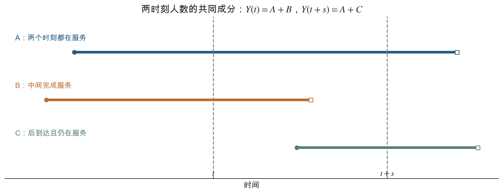

## 1 泊松过程的独立分裂

### 1.1 命题 5.5

设每次到达都被分为两类：以概率 $p$ 为第 I 类，以概率 $1-p$ 为第 II 类。分类相互独立，并独立于到达时刻。令 $N_1(t)$、$N_2(t)$ 分别为截至 $t$ 的两类事件数，则

$$
N(t)=N_1(t)+N_2(t).
$$

**命题 5.5。** $\{N_1(t),t\geq0\}$ 与 $\{N_2(t),t\geq0\}$ 是相互独立的泊松过程，速率分别为 $\lambda p$ 与 $\lambda(1-p)$。

### 1.2 先证明固定时刻的联合分布

给定总数 $N(t)=n+m$，要使第一类有 $n$ 个、第二类有 $m$ 个，就相当于对 $n+m$ 次独立分类计算二项概率。因此

$$
\begin{aligned}
&P(N_1(t)=n,N_2(t)=m)\\
&=P(N(t)=n+m)
P(N_1(t)=n\mid N(t)=n+m)\\
&=e^{-\lambda t}\frac{(\lambda t)^{n+m}}{(n+m)!}
\binom{n+m}{n}p^n(1-p)^m\\
&=\left[e^{-\lambda pt}\frac{(\lambda pt)^n}{n!}\right]
\left[e^{-\lambda(1-p)t}\frac{[\lambda(1-p)t]^m}{m!}\right].
\end{aligned}
\tag{1.1}
$$

联合概率分解为两个泊松概率质量函数的乘积，所以 $N_1(t)$ 与 $N_2(t)$ 独立，且边缘分布具有所述参数。

要从“固定时刻的两个随机变量独立”得到“两个过程独立”，还需要检查多区间情况。取任意有限组时间点，将时间轴分成互不重叠的小区间。在每个区间内重复上述分类证明；不同区间的原到达数独立，分类也独立，因而所有区间内的两类增量联合分布都分解。这就同时得到各子过程的独立增量、平稳增量，以及两个过程之间的独立性。

### 1.3 无条件独立与条件不独立

已知总数 $N(t)=k$ 时，

$$
N_1(t)\mid N(t)=k\sim\operatorname{Bin}(k,p),
\qquad N_2(t)=k-N_1(t).
$$

所以在该条件下，两类数目相互制约，且

$$
\operatorname{Cov}(N_1(t),N_2(t)\mid N(t)=k)
=-kp(1-p).
$$

而不固定总数时，两类数目独立。这并不矛盾：固定一个随机和，通常会改变组成部分的依赖关系。

**补充核对。** 全协方差公式给出

$$
\begin{aligned}
\operatorname{Cov}(N_1,N_2)
&=-p(1-p)E[N]+p(1-p)\operatorname{Var}(N)\\
&=0,
\end{aligned}
$$

其中用了泊松变量的均值等于方差。但“协方差为 0”本身不能证明一般随机变量独立；这里的独立性仍由式（1.1）的联合分布分解保证。

### 1.4 多类分裂与泊松随机变量的分裂

若每次事件独立地以概率 $p_j$ 属于第 $j$ 类，$j=1,\ldots,r$，且 $\sum_jp_j=1$，则各类过程相互独立，第 $j$ 类速率为 $\lambda p_j$。固定时刻下，

$$
P(N_j(t)=n_j,\ j=1,\ldots,r)
=\prod_{j=1}^r
e^{-\lambda tp_j}\frac{(\lambda tp_j)^{n_j}}{n_j!}.
\tag{1.2}
$$

这一结论只涉及固定时刻时，也可表述为：若总人数 $K\sim\operatorname{Poisson}(\theta)$，再对每个人独立分类，则各类人数独立，且分别为 $\operatorname{Poisson}(\theta p_j)$。

独立分类是必要条件。若所有事件都依据同一次共同抛硬币进入同一类，或者把奇数次、偶数次到达交替分类，就不符合该命题的假设。

### 1.5 例 5.14：二月份的英国血统移民

**题目。** 移民按每周 10 人的泊松速率进入地区 A。每位移民独立地以概率 $1/12$ 具有英国血统。求二月份没有英国血统移民进入地区 A 的概率。

**解。** 英国血统移民构成速率为

$$
\lambda_E=10\times\frac1{12}=\frac56\quad\text{人/周}
$$

的泊松过程。按课件例题与教材的计算口径，将二月份取为 28 天，即 4 周，则该月人数 $K_E$ 满足

$$
K_E\sim\operatorname{Poisson}\left(4\times\frac56\right)
=\operatorname{Poisson}\left(\frac{10}3\right).
$$

因此

$$
P(K_E=0)=e^{-10/3}\approx0.035674.
$$

## 2 报价阈值与最优等待

### 2.1 例 5.15：出售物品的阈值策略

**题目。** 购买某件物品的报价按速率 $\lambda$ 的泊松过程到达。每次报价是非负连续型随机变量 $X$ 的一个独立样本，密度为 $f$；各报价相互独立，并与到达过程独立。报价出现后，卖方必须立即接受或拒绝；一旦拒绝就等待下一个报价。在售出之前，每单位时间承担成本 $c>0$。净收益为成交价格减去累计等待成本。考虑“接受第一个严格大于阈值 $y$ 的报价”的策略，求最佳阈值和最大期望净收益。

以下假设 $E[X]<\infty$，并只考虑 $P(X>y)>0$ 的阈值。连续报价下，将“严格大于”换成“大于或等于”不改变概率。

### 2.2 接受报价的等待时间

记

$$
\overline F(y)=P(X>y)=\int_y^\infty f(x)\,dx.
$$

对每次报价按是否超过 $y$ 分类。超过阈值的报价构成速率为 $\lambda\overline F(y)$ 的泊松过程，因此成交等待时间 $T_y$ 满足

$$
T_y\sim\operatorname{Exp}(\lambda\overline F(y)),
\qquad E[T_y]=\frac1{\lambda\overline F(y)}.
$$

成交报价的分布为 $X\mid X>y$，故其均值为

$$
E[X\mid X>y]
=\frac{\int_y^\infty xf(x)\,dx}{\overline F(y)}.
$$

设策略 $y$ 的期望净收益为 $V(y)$，则

$$
V(y)
=E[X\mid X>y]-cE[T_y]
=\frac{\int_y^\infty xf(x)\,dx-c/\lambda}{\overline F(y)}.
\tag{2.1}
$$

等待成本应使用**成交时间**的期望，不能使用原报价过程的平均间隔 $1/\lambda$，因为很多报价会被拒绝。

### 2.3 内部最优阈值的推导

令 $A(y)=\int_y^\infty xf(x)\,dx$，则 $A'(y)=-yf(y)$，$\overline F'(y)=-f(y)$。求导得到

$$
\begin{aligned}
V'(y)
&=\frac{f(y)}{\overline F(y)^2}
\left[A(y)-y\overline F(y)-\frac c\lambda\right]\\
&=\frac{f(y)}{\overline F(y)^2}
\left[\int_y^\infty(x-y)f(x)\,dx-\frac c\lambda\right].
\end{aligned}
$$

定义

$$
g(y)=E[(X-y)^+]
=\int_y^\infty(x-y)f(x)\,dx
=\int_y^\infty\overline F(x)\,dx.
$$

最后一个等式由分部积分或尾积分公式得到。在尾概率为正的范围内，$g$ 随 $y$ 严格下降，且 $g'(y)=-\overline F(y)$。因此内部最优阈值满足

$$
E[(X-y^*)^+]=\frac c\lambda.
\tag{2.2}
$$

当 $0<c/\lambda<E[X]$ 时，存在唯一正解。低于该阈值时提高门槛有利，高于该阈值时额外等待成本超过提高报价带来的收益。

把式（2.2）代回式（2.1），

$$
\begin{aligned}
V(y^*)
&=\frac{\int_{y^*}^\infty[(x-y^*)+y^*]f(x)\,dx-c/\lambda}
{\overline F(y^*)}\\
&=y^*.
\end{aligned}
\tag{2.3}
$$

即内部最优阈值恰好等于最大期望净收益。若拒绝当前报价，未来问题重新开始，未来最优期望净收益就是继续等待的价值；因此只有当前报价超过这一继续价值时才应成交。

### 2.4 边界情况与一个可计算的例子（补充）

若限制 $y\geq0$，而 $c/\lambda\geq E[X]$，式（2.2）没有正解。此时应取边界 $y=0$，即接受第一份报价，期望净收益为

$$
V(0)=E[X]-\frac c\lambda\leq0.
$$

例如 $X\sim\operatorname{Exp}(\beta)$，$\beta$ 为报价金额分布的速率，则对 $y\geq0$，

$$
E[(X-y)^+]=\frac{e^{-\beta y}}\beta.
$$

在 $c\beta<\lambda$ 时，

$$
y^*=\frac1\beta\log\frac{\lambda}{c\beta},
\qquad V(y^*)=y^*.
$$

当 $c\beta\geq\lambda$ 时，接受第一份报价的期望净收益为 $1/\beta-c/\lambda$。

## 3 叠加、状态迁移与两个过程的竞争

### 3.1 独立泊松过程的叠加

设 $N_1,N_2$ 是相互独立、速率分别为 $\lambda_1,\lambda_2$ 的泊松过程。则

$$
N(t)=N_1(t)+N_2(t)
$$

是速率 $\lambda_1+\lambda_2$ 的泊松过程。

固定时刻的分布可由卷积计算：

$$
\begin{aligned}
P(N(t)=n)
&=\sum_{k=0}^n
e^{-\lambda_1t}\frac{(\lambda_1t)^k}{k!}
e^{-\lambda_2t}\frac{(\lambda_2t)^{n-k}}{(n-k)!}\\
&=e^{-(\lambda_1+\lambda_2)t}
\frac{[(\lambda_1+\lambda_2)t]^n}{n!}.
\end{aligned}
$$

不同区间的增量由相互独立的原过程增量相加而成，仍具有独立性和平稳性。由此完成过程层面的证明。

### 3.2 例 5.16：独立个体的马尔可夫状态迁移

**题目。** 一个系统有 $r$ 个状态。每个个体按同一个离散时间马尔可夫链迁移，转移概率为 $P_{ij}$；不同个体的迁移过程相互独立。在时间 0，各状态的初始人数相互独立，分别服从均值为 $\lambda_1,\ldots,\lambda_r$ 的泊松分布。求第 $n$ 个时刻各状态人数的联合分布。

**解。** 记 $p_{ij}^{(n)}=(P^n)_{ij}$。令 $Z_{ij}(n)$ 表示“初始位于 $i$，第 $n$ 步位于 $j$”的人数。对固定 $i$，每个初始个体独立地以概率 $p_{ij}^{(n)}$ 出现在状态 $j$，所以泊松分裂给出

$$
Z_{ij}(n)\sim\operatorname{Poisson}(\lambda_i p_{ij}^{(n)}),
\qquad j=1,\ldots,r,
$$

并且这些变量独立。不同初始状态的人数和迁移过程也独立，因此所有 $Z_{ij}(n)$ 联合独立。

令 $Z_j(n)$ 为第 $n$ 步状态 $j$ 的总人数，则

$$
Z_j(n)=\sum_{i=1}^rZ_{ij}(n)
\sim\operatorname{Poisson}(\theta_j(n)),
\qquad
\theta_j(n)=\sum_{i=1}^r\lambda_i p_{ij}^{(n)}.
\tag{3.1}
$$

不同 $j$ 对应不同组的独立变量之和，因而 $Z_1(n),\ldots,Z_r(n)$ 相互独立，其联合分布为

$$
P(Z_j(n)=z_j,\ j=1,\ldots,r)
=\prod_{j=1}^r e^{-\theta_j(n)}
\frac{\theta_j(n)^{z_j}}{z_j!}.
$$

以行向量记各状态均值，便有 $\boldsymbol\theta(n)=\boldsymbol\lambda P^n$，且 $\sum_j\theta_j(n)=\sum_i\lambda_i$。固定时刻各状态人数可以独立，但不同时刻的人数一般会相关，因为它们来自同一批个体。

### 3.3 叠加过程中的事件标签

设两个独立泊松过程速率分别为 $\lambda_1,\lambda_2$。每次叠加过程到达后，下一次两类到达的剩余时间是独立指数变量，因此下一件事件来自第一类的概率为

$$
p=\frac{\lambda_1}{\lambda_1+\lambda_2},
\qquad
1-p=\frac{\lambda_2}{\lambda_1+\lambda_2}.
\tag{3.2}
$$

该概率不依赖过去；逐次利用指数分布的无记忆性，叠加后的事件标签构成独立同分布的伯努利序列，并且与叠加过程的到达时刻独立。

于是，可以把两个连续时间过程的竞争转化为“每次试验以概率 $p$ 获得第一类标签”的离散试验。

### 3.4 第 $n$ 个第一类事件是否早于第 $m$ 个第二类事件

**题目。** 两个独立泊松过程的速率分别为 $\lambda_1,\lambda_2$。用 $S_n^{(1)}$ 表示第一过程的第 $n$ 次到达时刻，用 $S_m^{(2)}$ 表示第二过程的第 $m$ 次到达时刻，求

$$
P(S_n^{(1)}<S_m^{(2)}).
$$

**解法一：数第二类已经出现了几次。** 当第 $n$ 个第一类事件出现时，第二类必须只出现了 $k=0,\ldots,m-1$ 次。若恰好为 $k$ 次，最后一次标签必须为第一类，此前 $n+k-1$ 次中有 $n-1$ 个第一类和 $k$ 个第二类。因此

$$
P(S_n^{(1)}<S_m^{(2)})
=\sum_{k=0}^{m-1}
\binom{n+k-1}{k}p^n(1-p)^k.
\tag{3.3}
$$

**解法二：观察前 $n+m-1$ 个合并事件。** 到这一时点，第一类已达 $n$ 次与第二类已达 $m$ 次不可能同时发生，且必有一方达到目标。因此所求事件等价于前 $n+m-1$ 次中至少有 $n$ 个第一类：

$$
P(S_n^{(1)}<S_m^{(2)})
=\sum_{j=n}^{n+m-1}
\binom{n+m-1}{j}p^j(1-p)^{n+m-1-j}.
\tag{3.4}
$$

课件的两个特殊问题分别得到

$$
P(S_1^{(1)}<S_1^{(2)})=p,
\qquad
P(S_2^{(1)}<S_1^{(2)})=p^2.
$$

第二式要求合并后的前两件事件都来自第一类。只用两种到达时间的均值作比较，不能得到这一概率。

## 4 给定总到达数后的到达时刻

### 4.1 已知恰好一次到达

**问题。** 已知速率 $\lambda$ 的泊松过程在 $(0,t]$ 中恰好到达一次，求该次到达时刻 $S_1$ 的分布。

对 $0<s<t$，条件事件下的 $\{S_1\leq s\}$ 等价于“前 $s$ 时间发生一次，后 $t-s$ 时间没有发生”。因此

$$
\begin{aligned}
P(S_1\leq s\mid N(t)=1)
&=\frac{P(N(s)=1,N(t)-N(s)=0)}{P(N(t)=1)}\\
&=\frac{(\lambda s)e^{-\lambda s}e^{-\lambda(t-s)}}
{(\lambda t)e^{-\lambda t}}\\
&=\frac st.
\end{aligned}
$$

于是

$$
S_1\mid N(t)=1\sim\operatorname{Uniform}(0,t).
\tag{4.1}
$$

无条件下，$S_1$ 是指数变量；已知整个区间内恰好只有一次到达后，它变成区间上的均匀变量。条件不仅说明“至少一次”，还排除了其后的其他到达。

### 4.2 一般情形：联合条件密度

设已知 $N(t)=n$，考虑

$$
0<s_1<\cdots<s_n<t.
$$

相应到达间隔为

$$
T_1=s_1,\quad T_2=s_2-s_1,\quad\ldots,\quad T_n=s_n-s_{n-1}.
$$

从 $(T_1,\ldots,T_n)$ 到 $(S_1,\ldots,S_n)$ 的变换是三角线性变换，Jacobian 的绝对值为 1，因此前 $n$ 个到达时刻的无条件联合密度为

$$
f_{S_1,\ldots,S_n}(s_1,\ldots,s_n)
=\prod_{i=1}^n\lambda e^{-\lambda(s_i-s_{i-1})}
=\lambda^n e^{-\lambda s_n},
$$

其中 $s_0=0$。

但仅到此还没有保证 $N(t)=n$：必须再要求第 $n+1$ 次到达晚于 $t$，即 $T_{n+1}>t-s_n$。它与前 $n$ 个间隔独立，概率为 $e^{-\lambda(t-s_n)}$。于是“前 $n$ 个时刻在指定微元内，并且 $N(t)=n$”的联合密度为

$$
\lambda^ne^{-\lambda s_n}e^{-\lambda(t-s_n)}
=\lambda^ne^{-\lambda t}.
$$

除以 $P(N(t)=n)=e^{-\lambda t}(\lambda t)^n/n!$，得到

$$
f_{S_1,\ldots,S_n\mid N(t)=n}(s_1,\ldots,s_n)
=\frac{n!}{t^n},
\qquad 0<s_1<\cdots<s_n<t,
\tag{4.2}
$$

在其他位置密度为 0。区域 $0<s_1<\cdots<s_n<t$ 的体积为 $t^n/n!$，因此密度积分等于 1。

上述计算中，离散事件 $N(t)=n$ 使用概率，连续到达时刻使用密度，不能把“$S_i=s_i$ 的概率”当成正数相乘。

### 4.3 次序统计量与定理 5.2

设 $U_1,\ldots,U_n$ 是独立同分布的连续型随机变量，密度为 $f$。将它们从小到大排列，得到**次序统计量**（order statistics）

$$
U_{(1)}<\cdots<U_{(n)}.
$$

在 $u_1<\cdots<u_n$ 上，一组排序后的数值可由原变量的 $n!$ 种排列产生。各排列具有相同密度，因此

$$
f_{U_{(1)},\ldots,U_{(n)}}(u_1,\ldots,u_n)
=n!\prod_{i=1}^nf(u_i).
\tag{4.3}
$$

特别地，若 $U_i$ 独立均匀分布在 $(0,t)$，则右侧等于 $n!/t^n$，与式（4.2）相同。

**定理 5.2。** 给定 $N(t)=n$，有

$$
(S_1,\ldots,S_n)\mid N(t)=n
\overset d=(U_{(1)},\ldots,U_{(n)}),
\qquad U_i\overset{\text{i.i.d.}}\sim\operatorname{Uniform}(0,t).
\tag{4.4}
$$

这里必须区分两种对象：未排序、随机编号的 $U_i$ 相互独立且均匀；按到达顺序编号的 $S_1<\cdots<S_n$ 是次序统计量，彼此不独立，也不各自都均匀。课件中的“unordered”正是取消时间顺序的含义。

对于不受排列影响的函数，例如求和、求最大值、统计落入某区间的人数，可以使用未排序的 $U_i$ 计算；最早到达时刻则为 $U_{(1)}=\min(U_1,\ldots,U_n)$，不能把它直接当成 $U_1$。

### 4.4 第 $k$ 个到达时刻的边缘分布（补充推论）

给定 $N(t)=n$，要使第 $k$ 次到达在 $s$ 附近，需要有 $k-1$ 个时刻在 $(0,s)$，一个在 $s$ 的小邻域，另有 $n-k$ 个在 $(s,t)$。由均匀次序统计量公式，

$$
f_{S_k\mid N(t)=n}(s)
=\frac{n!}{(k-1)!(n-k)!}
\frac{s^{k-1}(t-s)^{n-k}}{t^n},
\qquad 0<s<t.
\tag{4.5}
$$

因此

$$
\frac{S_k}{t}\biggm|N(t)=n
\sim\operatorname{Beta}(k,n-k+1),
$$

从而

$$
E[S_k\mid N(t)=n]=\frac{kt}{n+1},
$$

$$
\operatorname{Var}(S_k\mid N(t)=n)
=\frac{k(n-k+1)t^2}{(n+1)^2(n+2)}.
$$

最早一次通常早于 $t/2$，最晚一次通常晚于 $t/2$。只有从全部事件中均匀随机抽取一件，其到达时刻才均匀分布在 $(0,t)$。

### 4.5 条件计数为二项或多项分布（补充推论）

已知 $N(t)=n$，每个未排序均匀时刻落入 $(0,s]$ 的概率为 $s/t$。因此

$$
N(s)\mid N(t)=n\sim\operatorname{Bin}\left(n,\frac st\right),
\qquad 0<s<t.
\tag{4.6}
$$

若把 $(0,t]$ 划分成长度为 $\ell_1,\ldots,\ell_r$ 的不重叠区间，条件于总数 $n$，各区间计数联合服从

$$
\operatorname{Multinomial}\left(n;\frac{\ell_1}t,\ldots,\frac{\ell_r}t\right).
$$

例如已知 1 小时内恰好到达 6 人，前 20 分钟恰好到达 2 人的条件概率为

$$
\binom62\left(\frac13\right)^2\left(\frac23\right)^4
=\frac{80}{243}\approx0.32922.
$$

给定总数后，结果不含 $\lambda$。总数的信息已固定，剩下的随机性是这些时刻在区间中的位置。

## 5 条件到达时刻的两个应用

### 例题前：对称求和为什么可以使用未排序的均匀变量

下面的例题会用到到达时刻的函数之和。关键是先区分两件事：$S_1,\ldots,S_n$ 按到达次序排列；$U_1,\ldots,U_n$ 是尚未排序的独立均匀变量。两组变量逐项并不相同，但某些计算结果不受排列顺序影响。

#### 1. 条件到达时刻与均匀变量的关系

设 $\{N(t)\}$ 是速率为 $\lambda$ 的齐次泊松过程，$t>0$。给定 $N(t)=n$（先取 $n\geq1$），实际到达时刻满足

$$
0<S_1<S_2<\cdots<S_n<t.
$$

另外取 $n$ 个独立的均匀变量 $U_1,\ldots,U_n$，均服从 $\operatorname{Uniform}(0,t)$，将它们从小到大排列，记为 $U_{(1)},\ldots,U_{(n)}$。由定理 5.2，

$$
(S_1,\ldots,S_n)\mid N(t)=n
\overset{d}= (U_{(1)},\ldots,U_{(n)}).
$$

这个等式是**联合分布相同**：实际到达时刻对应排序后的均匀变量，而不是说 $S_i$ 就等于未排序的 $U_i$。其依据是，前一节得到的有序到达时刻条件密度在 $0<s_1<\cdots<s_n<t$ 上为 $n!/t^n$；$n$ 个独立均匀变量排序后，在同一区域上的联合密度也是 $n!/t^n$。

若进一步在给定 $N(t)=n$ 后，将 $S_1,\ldots,S_n$ 用一个独立的、等概率选择的随机排列重新编号，得到的随机向量才具有 $n$ 个独立 $\operatorname{Uniform}(0,t)$ 变量的联合分布。这样的“未排序”指不再使用到达先后给事件编号。

#### 2. 同一个函数在所有时刻上的求和

设 $f$ 是定义在 $(0,t)$ 上的确定函数，并且

$$
\int_0^t|f(u)|\,du<\infty.
$$

由于排序后的 $U_{(1)},\ldots,U_{(n)}$ 只是 $U_1,\ldots,U_n$ 的重新排列，每一个函数值都恰好出现一次，所以对每一组样本值都有

$$
\sum_{i=1}^n f(U_{(i)})=\sum_{i=1}^n f(U_i).
$$

因此，对实际到达时刻的求和，

$$
\left.\sum_{i=1}^n f(S_i)\,\right|\,N(t)=n
\overset{d}=\sum_{i=1}^n f(U_i).
$$

左边与右边是**同分布**；右边的排序前后之和则是在同一组 $U_i$ 样本值上直接相等。利用期望的线性性，得到通用公式

$$
\begin{aligned}
E\left[\sum_{i=1}^nf(S_i)\,\middle|\,N(t)=n\right]
&=\sum_{i=1}^n E[f(U_i)]\\
&=nE[f(U)]\\
&=\frac nt\int_0^t f(u)\,du,
\qquad U\sim\operatorname{Uniform}(0,t).
\end{aligned}
$$

当 $n=0$ 时，求和为空和，结果是 0。若 $n\geq1$ 且 $f\geq0$，即使积分发散，公式也可在两边都允许取 $+\infty$ 的意义下成立。上述求和结果适用于同一个 $f$ 作用在每一个到达时刻；$f$ 可以在固定 $n,t$ 后依赖于这两个已知数值。

例如，取 $f(s)=s^2$，则

$$
E\left[\sum_{i=1}^n S_i^2\,\middle|\,N(t)=n\right]
=\frac nt\int_0^tu^2\,du=\frac{nt^2}{3}.
$$

再如，若所有在 $(0,t]$ 内到达的物品都在时刻 $t$ 发出，每件物品的等待时间为 $f(s)=t-s$，则给定恰有 $n$ 件物品时，总等待时间的条件期望为

$$
E\left[\sum_{i=1}^n(t-S_i)\,\middle|\,N(t)=n\right]
=\frac nt\int_0^t(t-u)\,du=\frac{nt}{2}.
$$

如果这里的 $f$ 不依赖随机到达总数 $N(t)$，进一步对 $N(t)$ 取期望，并利用 $E[N(t)]=\lambda t$，可得到无条件形式

$$
E\left[\sum_{i=1}^{N(t)}f(S_i)\right]
=\lambda\int_0^t f(u)\,du.
$$

以上等式不要求按时间排序的 $S_i$ 相互独立；计算右侧期望使用的是期望的线性性。独立性属于所构造的未排序变量 $U_i$。

#### 3. 不限于求和：什么叫对称

设 $H(x_1,\ldots,x_n)$ 对任意排列 $\pi$ 都满足

$$
H(x_1,\ldots,x_n)=H(x_{\pi(1)},\ldots,x_{\pi(n)}),
$$

则称 $H$ 是对称函数。排序只改变输入的位置，不改变 $H$ 的值，所以

$$
H(S_1,\ldots,S_n)\mid N(t)=n
\overset{d}=H(U_1,\ldots,U_n).
$$

除 $\sum_i f(S_i)$ 外，乘积、最大值，以及落在给定区间内的时刻个数也是例子。最早到达时刻虽然记为 $S_1$，也可以写成所有时刻的最小值：

$$
S_1\mid N(t)=n\overset{d}=U_{(1)}=\min(U_1,\ldots,U_n).
$$

因此可以对未排序的 $U_i$ 直接取最小值，但不能把 $S_1$ 当成某一个普通的 $U_1$。

#### 4. 反例：系数依赖到达次序

**题目。** 已知齐次泊松过程在 $(0,1]$ 内恰好到达两次，$S_1<S_2$ 分别为第一次、第二次到达时刻。求

$$
E[2S_1+S_2\mid N(1)=2].
$$

这里第一次到达的时刻乘以 2，第二次到达的时刻乘以 1。交换两个时刻后，表达式一般会改变，所以 $2S_1+S_2$ 不是对称函数。

由次序统计量的均值，

$$
E[S_1\mid N(1)=2]=\frac13,\qquad
E[S_2\mid N(1)=2]=\frac23.
$$

因此正确答案是

$$
E[2S_1+S_2\mid N(1)=2]
=2\cdot\frac13+\frac23=\frac43.
$$

如果错误地将 $S_1,S_2$ 分别换成未排序的 $U_1,U_2$，就会得到

$$
E[2U_1+U_2]=2\cdot\frac12+\frac12=\frac32,
$$

与正确答案不同。正确的均匀变量表示应保留次序：$2U_{(1)}+U_{(2)}$，也就是 $2\min(U_1,U_2)+\max(U_1,U_2)$。

这个差异不来自均匀变量本身，而是因为系数 2 指定给了较早的时刻；随意把它指定给未排序的第一个变量，就改变了所求量。

#### 5. 使用时需要检查的条件

1. **过程与条件。** 以上使用的是齐次泊松过程，并给定 $N(t)=n$。若给定的是 $S_n=t$，时刻 $t$ 已被固定，只有前 $n-1$ 个时刻可以由均匀变量的次序统计量表示；见第 9 节。
2. **求和是否对称。** $\sum_i f(S_i)$ 对所有时刻使用同一个函数，因而对称；若各项函数或权重依赖到达次序，例如 $\sum_i iS_i$，一般不能直接把 $S_i$ 分别替换成 $U_i$。有无对称性应根据整个表达式判断。
3. **其他随机标记。** 若每次到达还带有金额、服务时间等标记，需要保留标记和对应事件的配对。若标记相互独立同分布，且独立于到达过程，可以先按条件对标记取期望，或连同时刻一起重新编号；若标记依赖到达次序或到达过程，则必须另行分析。
4. **期望是否存在。** 对可能取正、负值的 $f$，上面的期望公式要求相应期望有定义；上文给出的绝对可积条件是一组充分条件。

例 5.21 正是先对独立且同分布的索赔金额取期望，从而得到关于 $S_i$ 的同一个函数 $f(s)=e^{-\alpha s}$ 的求和。

### 5.1 例 5.21：保险索赔的折现总成本

**题目。** 保险索赔按速率 $\lambda$ 的泊松过程发生。第 $i$ 次索赔发生时刻为 $S_i$，金额为 $C_i$。各次金额相互独立、同分布，分布函数为 $G$、均值为 $\mu$，并与全部索赔时刻独立。连续折现率为 $\alpha>0$，发生在时间 $s$、金额为 $C$ 的索赔折现至时间 0 的成本是 $e^{-\alpha s}C$。截至时间 $t$ 的折现总成本为

$$
D(t)=\sum_{i=1}^{N(t)}e^{-\alpha S_i}C_i.
$$

求 $E[D(t)]$。

**解。** 给定 $N(t)=n$ 和到达时刻，先对独立索赔金额取期望，

$$
E[D(t)\mid N(t)=n,S_1,\ldots,S_n]
=\mu\sum_{i=1}^ne^{-\alpha S_i}.
$$

右侧是关于时刻的对称求和，故可以用 $n$ 个未排序的独立均匀时刻替代：

$$
\begin{aligned}
E[D(t)\mid N(t)=n]
&=n\mu E[e^{-\alpha U}],
\qquad U\sim\operatorname{Uniform}(0,t),\\
E[e^{-\alpha U}]
&=\frac1t\int_0^te^{-\alpha u}\,du
=\frac{1-e^{-\alpha t}}{\alpha t}.
\end{aligned}
$$

再对 $N(t)$ 取期望，

$$
E[D(t)]
=\mu\frac{1-e^{-\alpha t}}{\alpha t}E[N(t)]
=\frac{\lambda\mu}{\alpha}(1-e^{-\alpha t}).
\tag{5.1}
$$

当 $\alpha\downarrow0$ 时，上式趋于 $\lambda\mu t$，即无折现时的总金额均值；当 $t\to\infty$ 且 $\alpha>0$ 时，期望折现总成本趋于 $\lambda\mu/\alpha$。

此处不能说“给定 $N(t)=n$，每个 $S_i$ 都是均匀变量”。正确理由是：对称求和不随排序改变。

### 5.2 例 5.22：增加一次中途发货

**题目。** 物品按速率 $\lambda$ 的泊松过程到达加工厂。系统从时间 0 开始为空，固定时刻 $T$ 将当时全部物品发出。现在允许在某一确定的中间时刻 $t\in(0,T)$ 再统一发货一次。求使所有物品的期望总等待时间最小的 $t$。

**解。** 在 $(0,t]$ 到达的物品都在 $t$ 发出；在 $(t,T]$ 到达的物品都在 $T$ 发出。总等待时间为

$$
W(t)=\sum_{S_i\leq t}(t-S_i)
+\sum_{t<S_i\leq T}(T-S_i).
$$

给定第一段有 $n$ 件物品，其到达时刻可按均匀点计算对称求和，每件平均等待 $t/2$。该段平均到达数为 $\lambda t$，所以第一段的期望总等待为 $\lambda t^2/2$。第二段同理为 $\lambda(T-t)^2/2$。于是

$$
E[W(t)]=\frac\lambda2[t^2+(T-t)^2].
\tag{5.2}
$$

求导得到

$$
\frac{d}{dt}E[W(t)]=\lambda(2t-T),
\qquad
\frac{d^2}{dt^2}E[W(t)]=2\lambda>0.
$$

因此

$$
t^*=\frac T2,
\qquad
\min E[W(t)]=\frac{\lambda T^2}{4}.
\tag{5.3}
$$

若只在 $T$ 发货，期望总等待是 $\lambda T^2/2$；增加中点发货后减半。这里优化的是所有物品等待时间的总和，且 $t$ 在观察到随机到达之前就固定；题目未包含固定发货成本，也没有要求根据当前库存动态决定发货时机。

还可直接通过面积核对：在一段长度为 $\ell$ 的发货周期内，平均库存从 0 线性增加到 $\lambda\ell$，其期望库存面积为 $\lambda\ell^2/2$，恰等于该段的期望总等待。

## 6 随时间变化的分类概率

### 6.1 命题 5.6：对泊松过程进行时变抽样

仍设原过程速率为 $\lambda$，但允许分类概率随事件发生时间变化。若一件事件在时刻 $u$ 发生，则它以概率 $P_i(u)$ 属于第 $i$ 类，其中

$$
P_i(u)\geq0,\qquad\sum_{i=1}^kP_i(u)=1.
$$

给定到达时刻，各事件独立分类，其随机标记不受其他事件影响。$P_i$ 是预先给定的确定函数，而不是由整个系统共享的未知随机环境。

**命题 5.6。** 令 $N_i(t)$ 为截至 $t$ 的第 $i$ 类事件数，则 $N_1(t),\ldots,N_k(t)$ 相互独立，且

$$
N_i(t)\sim\operatorname{Poisson}(\theta_i(t)),
\qquad
\theta_i(t)=\lambda\int_0^tP_i(u)\,du.
\tag{6.1}
$$

分类后的过程一般不再具有平稳增量；若某类在晚间更容易出现，那么相同长度的上午区间与晚间区间内的均值就可能不同。第三篇将证明各类过程是强度函数为 $\lambda P_i(t)$ 的非齐次泊松过程。

### 6.2 用定理 5.2 完整证明命题 5.6

课件要求用条件到达时刻定理证明，而不是只引用固定概率的分裂公式。

给定 $N(t)=n$，把到达时刻看成未排序的独立均匀变量 $U_1,\ldots,U_n$。单个随机到达属于第 $i$ 类的概率为

$$
q_i(t)=E[P_i(U)]
=\frac1t\int_0^tP_i(u)\,du,
\qquad U\sim\operatorname{Uniform}(0,t).
\tag{6.2}
$$

每个事件的时刻和用于分类的独立随机标记组成一对；不同事件的这些随机对独立，因此积分掉时刻后，未排序事件的类别仍相互独立，且具有共同类别概率 $q_i(t)$。

所以给定总数 $n$，各类数量为多项分布。令 $n=\sum_i n_i$，则

$$
\begin{aligned}
&P(N_i(t)=n_i,\ i=1,\ldots,k)\\
&=e^{-\lambda t}\frac{(\lambda t)^n}{n!}
\frac{n!}{\prod_i n_i!}\prod_iq_i(t)^{n_i}\\
&=\prod_{i=1}^k
\left[e^{-\lambda t q_i(t)}
\frac{[\lambda t q_i(t)]^{n_i}}{n_i!}\right].
\end{aligned}
$$

最后一步用了 $\sum_iq_i(t)=1$。又因为 $\lambda t q_i(t)=\theta_i(t)$，联合分布分解为各个泊松质量函数，命题得证。

注意：给定已经排序的具体时刻 $s_1<\cdots<s_n$ 时，各事件的类别概率分别为 $P_i(s_1),\ldots,P_i(s_n)$，通常并不相同。证明中的共同概率 $q_i(t)$ 是先对未排序的随机均匀时刻取平均之后得到的。

## 7 无限服务台中的人数

### 7.1 例 5.18 的完整模型

**题目。** 顾客按速率 $\lambda$ 的泊松过程到达一个有无限多个服务台的服务站。每位顾客到达后立即接受服务，服务时间相互独立、同分布，分布函数为 $G$，并与到达过程独立。系统在时间 0 为空。令

- $X(t)$：截至时刻 $t$ 已经完成服务的累计人数；
- $Y(t)$：时刻 $t$ 仍在接受服务的人数。

求 $X(t)$ 的分布、$Y(t)$ 的分布，以及 $Y(t)$ 与 $Y(t+s)$ 的联合分布，其中 $s>0$。

这种系统记为 $M/G/\infty$：$M$ 表示泊松到达所对应的无记忆到达间隔，$G$ 表示一般服务时间分布，$\infty$ 表示服务台数量无限。以下所有结论均以系统初始为空为前提；若初始已有顾客，必须另计其剩余服务时间。

### 7.2 固定时刻的“已完成”和“仍在服务”

记服务时间为 $V$，并写 $\overline G(v)=1-G(v)$。对于在时刻 $u\leq t$ 到达的顾客，到观察时刻 $t$ 已经过了 $t-u$ 时间，因此

$$
P(\text{已完成}\mid\text{到达于 }u)=G(t-u),
$$

$$
P(\text{仍在服务}\mid\text{到达于 }u)=\overline G(t-u).
$$

这是对 $(0,t]$ 内到达事件的时变分类。由命题 5.6，

$$
X(t)\sim\operatorname{Poisson}\left(\lambda\int_0^tG(t-u)\,du\right)
=\operatorname{Poisson}\left(\lambda\int_0^tG(v)\,dv\right),
\tag{7.1}
$$

$$
Y(t)\sim\operatorname{Poisson}\left(\lambda\int_0^t\overline G(t-u)\,du\right)
=\operatorname{Poisson}\left(\lambda\int_0^t\overline G(v)\,dv\right).
\tag{7.2}
$$

而且，**对于同一个固定时刻 $t$，$X(t)$ 与 $Y(t)$ 独立。** 二者均值之和为 $\lambda t$，与 $X(t)+Y(t)=N(t)$ 一致。

$X(t)$ 是单调的累计离开数；$Y(t)$ 是可以上升也可以下降的在场人数。不能因为每个固定时刻的 $Y(t)$ 都服从泊松分布，就把 $\{Y(t)\}$ 称为泊松计数过程。

### 7.3 两个时刻的人数：分成三个独立来源

要研究 $Y(t)$ 与 $Y(t+s)$，需要识别两者共同包含的顾客。定义

- $A$：在 $t$ 之前到达，并且到 $t+s$ 仍未完成服务的人数；
- $B$：在 $t$ 仍在服务，但在 $(t,t+s]$ 内完成服务的人数；
- $C$：在 $(t,t+s]$ 内新到达，并且到 $t+s$ 仍在服务的人数。

则

$$
Y(t)=A+B,\qquad Y(t+s)=A+C.
\tag{7.3}
$$

图 2：横线表示从到达到完成服务的区间。两次人数的共同随机部分是 $A$。

对于在 $u\leq t$ 到达的顾客，属于 $A$ 的概率为 $\overline G(t+s-u)$，属于 $B$ 的概率为 $G(t+s-u)-G(t-u)$。因此

$$
\begin{aligned}
a:=E[A]
&=\lambda\int_0^t\overline G(t+s-u)\,du\\
&=\lambda\int_s^{t+s}\overline G(v)\,dv,
\end{aligned}
\tag{7.4}
$$

$$
b:=E[B]
=\lambda\int_0^t[G(t+s-u)-G(t-u)]\,du.
\tag{7.5}
$$

由时变分裂，$A\sim\operatorname{Poisson}(a)$、$B\sim\operatorname{Poisson}(b)$ 且独立。对于后一个区间的新顾客，

$$
\begin{aligned}
c:=E[C]
&=\lambda\int_t^{t+s}\overline G(t+s-u)\,du\\
&=\lambda\int_0^s\overline G(v)\,dv,
\end{aligned}
\tag{7.6}
$$

且 $C\sim\operatorname{Poisson}(c)$。由于它来自与早期到达独立的后续增量，$C$ 与 $(A,B)$ 独立。因此 $A,B,C$ 联合独立。

### 7.4 联合概率质量函数与协方差

若 $Y(t)=i$、$Y(t+s)=j$，共同人数 $A$ 可取 $k=0,\ldots,\min(i,j)$，并且必须有 $B=i-k$、$C=j-k$。因此

$$
\begin{aligned}
&P(Y(t)=i,Y(t+s)=j)\\
&=e^{-(a+b+c)}
\sum_{k=0}^{\min(i,j)}
\frac{a^k}{k!}
\frac{b^{i-k}}{(i-k)!}
\frac{c^{j-k}}{(j-k)!}.
\end{aligned}
\tag{7.7}
$$

这称为具有共同泊松成分的二元泊松分布。边缘均值满足

$$
a+b=\lambda\int_0^t\overline G(v)\,dv,
\qquad
a+c=\lambda\int_0^{t+s}\overline G(v)\,dv,
$$

与单时刻结果一致。协方差为

$$
\operatorname{Cov}(Y(t),Y(t+s))
=\operatorname{Var}(A)
=a=\lambda\int_s^{t+s}\overline G(v)\,dv.
\tag{7.8}
$$

两次人数通常相关，原因是同一些顾客可以跨越两个观察时刻。只有共同成分的均值 $a=0$ 时，二者才独立。

### 7.5 给定当前人数后的未来人数（补充）

当 $a+b>0$ 时，由两个独立泊松变量给定总和的条件分布，

$$
A\mid Y(t)=n\sim\operatorname{Bin}\left(n,\frac{a}{a+b}\right).
$$

$C$ 仍与该条件独立，所以

$$
Y(t+s)\mid Y(t)=n
\overset d=
\operatorname{Bin}\left(n,\frac{a}{a+b}\right)
+\operatorname{Poisson}(c),
\tag{7.9}
$$

其中右侧两个变量独立。这一式子的直观含义是“当前顾客中的幸存人数，加上未来新到顾客中的幸存人数”。如果 $a+b=0$，则 $Y(t)=0$ 几乎必然，直接有 $Y(t+s)=C$。

若 $V\sim\operatorname{Exp}(\mu)$，则

$$
E[Y(t)]=\frac\lambda\mu(1-e^{-\mu t}),
\quad
\frac a{a+b}=e^{-\mu s},
\quad
c=\frac\lambda\mu(1-e^{-\mu s}).
$$

所以指数服务时，每位当前顾客再经过 $s$ 后留下的概率都为 $e^{-\mu s}$。一般服务分布下，单个顾客的剩余寿命还取决于已服务多久；式（7.9）只给定总人数而未给定各人年龄，因此并不自动证明一般的 $\{Y(t)\}$ 是马尔可夫过程。

若 $E[V]<\infty$，由尾积分公式，$\int_0^\infty\overline G(v)\,dv=E[V]$，于是初始为空系统的单时刻分布满足

$$
Y(t)\xrightarrow{d}\operatorname{Poisson}(\lambda E[V]).
$$

这是 $t\to\infty$ 的极限结果，不应当直接替换任意有限 $t$ 下的式（7.2）。

## 8 例 5.20：存在观察延迟的感染计数模型

### 8.1 题目与建模口径

**课件给出的背景。** 从感染 HIV 到出现相应症状之间存在潜伏时间，因此在某一时刻观察到的症状人数，并不等于同期已经感染的人数。作为课堂中的简化概率模型，假设从时间 0 开始，感染事件按一个未知速率 $\lambda$ 的泊松过程发生；从感染到出现症状的时间分布函数 $G$ 已知，各个体的潜伏时间相互独立，并与感染过程独立。

**按教材补全的所求。** 令 $N_1(t)$ 为到 $t$ 已出现症状的累计人数，$N_2(t)$ 为已感染但尚未出现症状的人数。求二者的分布；若观察到 $N_1(t)=n_1$，如何估计 $\lambda$ 以及尚未出现症状的人数？

这里的时间 0 是模型中开始累计感染的起点，不含未记录的初始感染者。模型未描述传播网络、死亡、治疗或检测机制；下述结果是该课堂模型下的计数与估计关系。

### 8.2 用时变分类得到两个泊松变量

在时刻 $u$ 感染的人，到 $t$ 已出现症状的概率为 $G(t-u)$，尚未出现症状的概率为 $\overline G(t-u)$。因此

$$
N_1(t)\sim\operatorname{Poisson}(\lambda A(t)),
\qquad A(t)=\int_0^tG(v)\,dv,
$$

$$
N_2(t)\sim\operatorname{Poisson}(\lambda B(t)),
\qquad B(t)=\int_0^t\overline G(v)\,dv=t-A(t).
\tag{8.1}
$$

当 $\lambda$ 是固定参数时，二者独立。这与无限服务台中“已完成服务”和“仍在服务”的分解形式完全一致。

### 8.3 估计未知速率和未显现人数

若 $A(t)>0$，把观测值 $n_1$ 代替其期望 $\lambda A(t)$，得到

$$
\widehat\lambda=\frac{n_1}{A(t)}.
\tag{8.2}
$$

它也是基于该单个泊松计数的极大似然估计。将其代入未显现人数的期望，得到

$$
\widehat N_2(t)
=\widehat\lambda B(t)
=n_1\frac{\int_0^t\overline G(v)\,dv}
{\int_0^tG(v)\,dv}.
\tag{8.3}
$$

这只是代入估计，不是把未知人数确定为该数值，也不是为 $\lambda$ 指定先验后的贝叶斯条件期望。参数未知并不自动意味着参数是随机变量。

**教材的数值示例。** 若潜伏时间在这个例子中被假设为均值 $\mu=10$ 年的指数分布，则

$$
B(t)=\mu(1-e^{-t/\mu}),
\qquad
A(t)=t-\mu(1-e^{-t/\mu}).
$$

若 $t=16$ 年，已出现症状的累计人数为 $n_1=220{,}000$，则

$$
\widehat N_2(16)
=220{,}000\,
\frac{10(1-e^{-1.6})}{16-10(1-e^{-1.6})}
\approx218{,}959.
$$

这里的 10 年、16 年和 22 万都是教材算例的设定，不是对当前现实流行情况的估计。恒定感染速率尤其是较强的简化假设。

## 9 给定第 $n$ 次到达时刻

### 9.1 命题 5.7 的准确表述

前面给定的是 $N(t)=n$：到 $t$ 一共有 $n$ 次，但最后一次何时发生仍随机。现在给定的是 $S_n=t$：第 $n$ 次恰好发生在指定时刻，随机的只有之前 $n-1$ 个时刻。

**命题 5.7。** 对 $n\geq2$，给定 $S_n=t$，有

$$
(S_1,\ldots,S_{n-1})\mid S_n=t
\overset d=(U_{(1)},\ldots,U_{(n-1)}),
$$

其中 $U_1,\ldots,U_{n-1}$ 是独立的 $\operatorname{Uniform}(0,t)$ 变量。

课件用“set”描述这些到达时刻。严格地说，忽略顺序后的点集可以用独立均匀点生成；保留 $S_1<\cdots<S_{n-1}$ 的编号时，应表述为这些均匀点的次序统计量。

### 9.2 条件密度的证明

连续随机变量满足 $P(S_n=t)=0$，因此不能以概率之比直接除以这一零概率。应使用条件密度。在

$$
0<s_1<\cdots<s_{n-1}<t
$$

上，联合密度与边缘密度分别为

$$
f_{S_1,\ldots,S_n}(s_1,\ldots,s_{n-1},t)=\lambda^ne^{-\lambda t},
$$

$$
f_{S_n}(t)=\frac{\lambda^nt^{n-1}e^{-\lambda t}}{(n-1)!}.
$$

所以

$$
f_{S_1,\ldots,S_{n-1}\mid S_n=t}
(s_1,\ldots,s_{n-1})
=\frac{(n-1)!}{t^{n-1}}.
\tag{9.1}
$$

这正是 $n-1$ 个均匀变量的次序统计量联合密度。$n=1$ 时不存在更早的到达时刻，命题退化为空点集的陈述。

### 9.3 两种条件的比较

| 条件 | 随机到达时刻 | 未排序均匀点个数 | 条件均值 |
|---|---|---|---|
| $N(t)=n$ | $S_1,\ldots,S_n$ 全部随机且小于 $t$ | $n$ 个 | $E[S_k\mid N(t)=n]=kt/(n+1)$ |
| $S_n=t$ | $S_1,\ldots,S_{n-1}$ 随机，$S_n$ 已固定 | $n-1$ 个 | $E[S_k\mid S_n=t]=kt/n$，$k<n$ |

例如：若已知 1 小时内恰有 4 次到达，第一次到达的条件均值是 $1/5$ 小时；若已知第 4 次到达恰在 1 小时，第一次到达的条件均值是 $1/4$ 小时。

此外，对 $0<s<t$，

$$
N(s)\mid S_n=t\sim\operatorname{Bin}\left(n-1,\frac st\right).
$$

二项试验数为 $n-1$，因为恰在 $t$ 的那次到达不在 $(0,s]$ 内。

## 10 公式与适用条件

| 情形             | 可以使用的结果                        | 关键条件        |
| -------------- | ------------------------------ | ----------- |
| 固定概率分裂         | 各类为独立泊松过程，速率 $\lambda p_i$     | 每个事件独立标记    |
| 独立过程叠加         | 速率相加                           | 原过程彼此独立     |
| 两个过程竞争         | 合并后为独立伯努利标签                    | 类别概率为速率比例   |
| 给定 $N(t)=n$    | $n$ 个均匀点的次序统计量                 | 保留顺序时不独立    |
| 给定 $S_n=t$     | $n-1$ 个均匀点的次序统计量               | 使用条件密度      |
| 时变分类           | 均值 $\lambda\int_0^tP_i(u)\,du$ | 分类函数确定，标记独立 |
| 同一时刻的已完成数与在服务数 | 独立泊松变量                         | 初始为空，服务独立   |
| 两个时刻的在服务数      | $A+B$ 与 $A+C$                  | 共同在场人数导致相关  |
