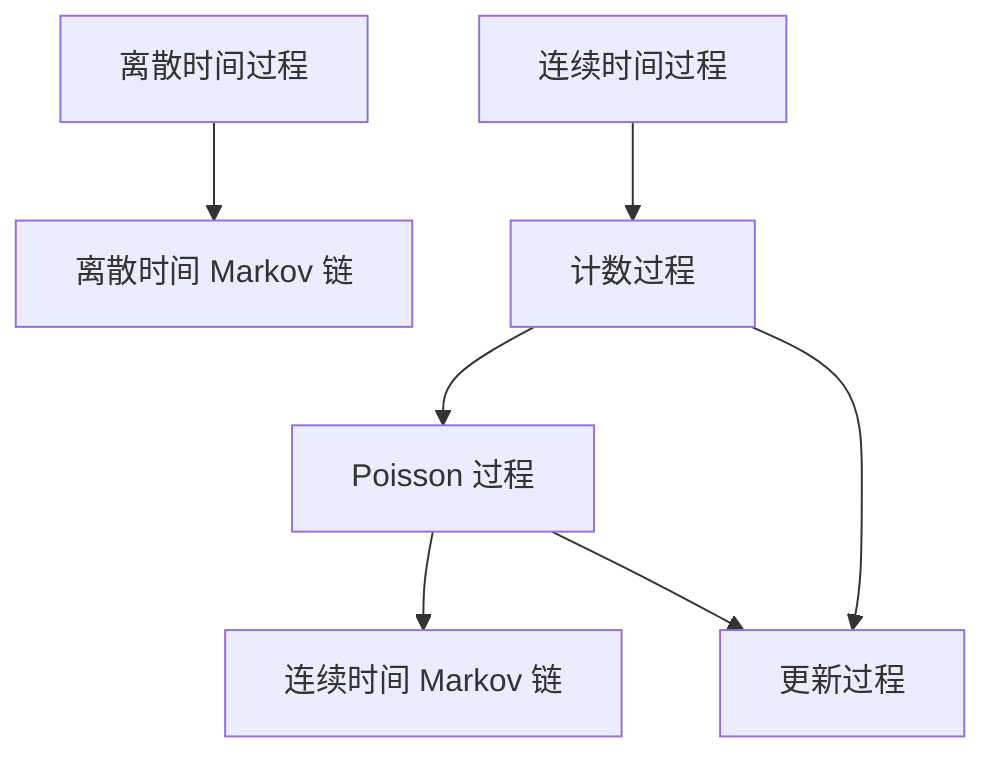
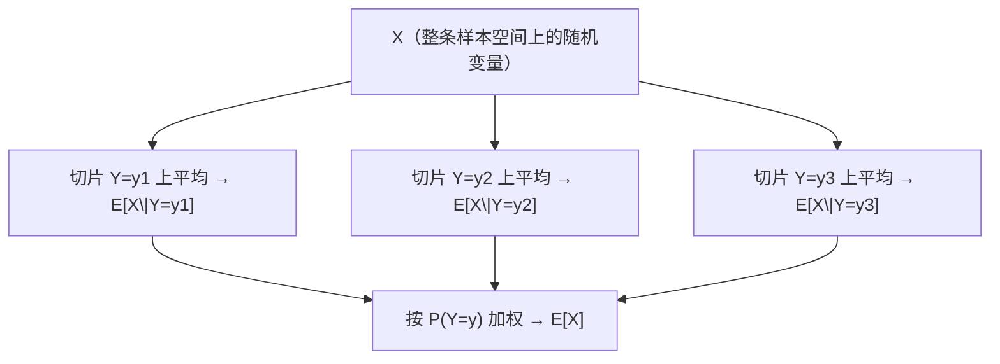

# 随机过程导论与概率论复习

---

## 1 随机过程是什么

考虑连续掷三次骰子。一次投掷的点数可以用一个随机变量表示。若要同时记录三次结果，可用 $X(1),X(2),X(3)$，其中 $X(t)$ 表示第 $t$ 次的点数。

一般地，若对每个 $t\in T$ 都定义了一个随机变量 $X(t)$，则称 $\{X(t):t\in T\}$ 为**随机过程**。$T$ 为指标集，通常取作时间。$X(t)$ 的取值称为时刻 $t$ 的状态，所有可能状态组成状态空间。将一次试验在各时刻的状态依次记录，便得到一条样本路径。下表给出六个例子。

| | 例子 | 指标 $T$ | 状态空间（直观） |
|---|---|---|---|
| E1 | 接下来三次掷六面骰 | $\{1,2,3\}$，离散 | $\{1,\dots,6\}$ |
| E2 | 未来 7 天上海下午 2 点气温 | 7 个离散时刻 | 连续（温度） |
| E3 | 某超市从明天起的日销售额 | $\mathbb N$ | 连续（金额） |
| E4 | 未来 24 小时某门店卖出的 PC 数 | $[0,24]$，连续 | $\{0,1,2,\dots\}$ |
| E5 | 明天 0:01 起上海已报告的车祸数 | $[0,\infty)$ | $\{0,1,2,\dots\}$ |
| E6 | 明天 9:30–11:30 急诊室人数 | $[9{:}30,11{:}30]$ | $\{0,1,2,\dots\}$ |

由表可见，指标集和状态空间可以分别为离散或连续。例如，逐日气温在离散时刻观察，温度取值可以连续。门店的累计销售量在连续时间上定义，取值为非负整数。下面主要研究状态可数的过程。

---

## 2 按时间指标分类

| | $T$ 可数 | $T$ 是区间 |
|---|---|---|
| **名称** | 离散时间过程 $\{X_n:n=0,1,2,\dots\}$ | 连续时间过程 $\{X(t):t\ge 0\}$ |
| **讲义例子** | E1, E2, E3 | E4, E5, E6 |

对给定的指标集，可以从各时刻的随机变量相互独立这一情形出发。若预测下一步时需要利用过去的状态，应当保留多少信息？离散时间马尔可夫链给出了一种具体的假设。

---

## 3 本学期要研究的几类过程

下图列出本课程涉及的几类过程。泊松过程是计数过程的一种，也可从更新过程的角度定义。泊松过程及指数分布将用于构造连续时间马尔可夫链。



### 3.1 离散时间 Markov 链

设指标集 $T=\{0,1,2,\dots\}$。如果给定 $X_n$ 后，$X_{n+1}$ 的条件分布与更早的状态无关，则称该过程为离散时间马尔可夫链，即

$$
P(X_{n+1}=j\mid X_n=i,\,X_{n-1}=i_{n-1},\,\dots,\,X_0=i_0)=P(X_{n+1}=j\mid X_n=i)
$$

> **赌徒模型（讲义第 16–17 页）**
> 从 $i$ 美元 出发，每局独立地以概率 $p$ 赢 1 美元、否则输 1 美元；到 $0$ 或 $K$ 停。
> 令 $X_n=$ 第 $n$ 局后的财富。这就是一条有限状态随机游走，两端是吸收壁。
>
> 三个本学期会反复出现的问题：
> 1. 期望玩多少局才停？
> 2. 带着 $K$ 美元 离开、而不是破产的概率？
> 3. 财富等于 $j$ 美元（$j<K$）的期望时间？

### 3.2 计数过程

令 $X(t)$ 表示截至时刻 $t$ 已发生的事件数。若事件逐个发生，其轨迹为右连续的阶梯函数，每发生一次便增加 1。表中的累计交通事故数就是一个例子。

### 3.3 Poisson 过程

若计数过程的相邻事件间隔 $T_n$ 独立同分布且服从指数分布，便得到泊松过程。指数分布的无记忆性也将用于计算连续时间马尔可夫链的状态停留时间。

**实习录用通知。** 假设实习录用通知按泊松过程到达，每次通知的价值具有密度 $f$，等待成本率为 $c$。何时接受通知才能使预期净收益最大？这是一个最优停时问题。

### 3.4 更新过程

若将泊松过程中的指数间隔换成独立同分布的一般非负间隔 $T_n$，得到更新过程。记 $X(t)$ 为截至 $t$ 的更新次数，考虑以下两个量

$$
E[X(t)]=?,\qquad \lim_{t\to\infty}\frac{X(t)}{t}=?
$$

> **单服务员银行**：顾客 Poisson 到达；只有柜员空闲才进门，服务时间 $\sim G$。
> - 更新发生在：一次“顾客进入并完成服务、系统重新变空”的循环结束时；
> - 进入银行的长期速率、没进门就离开的比例，都是更新报酬定理的直接应用。

### 3.5 连续时间 Markov 链

设过程在状态 $i$ 停留一段指数时间，离开后以 $p_{ij}$ 转到 $j$，其中 $p_{ii}=0$、$\sum_j p_{ij}=1$。停留时间和下一状态相互独立。相应的连续时间马尔可夫性可写为

$$
P\bigl(X(t+s)=j\mid X(s)=i,\,X(u)=x_u,\,0\le u<s\bigr)=P\bigl(X(t+s)=j\mid X(s)=i\bigr)
$$

**多服务台银行。** 设银行有 $n$ 名柜员，$X(t)$ 表示时刻 $t$ 的顾客数。求系统恰有 $i$ 人的长期时间比例、平均人数及顾客的平均逗留时间。这些量分别可由平衡方程和 Little 公式求得。

### 3.6 各类模型的基本条件

比较这些过程时，可从时间指标、状态和条件分布入手。

| 时间 | 过程 | 关键结构 |
|---|---|---|
| 离散 | 离散时间 MC | 转移矩阵 $P$ |
| 连续 | 计数 / Poisson | 独立指数间隔 |
| 连续 | 更新过程 | i.i.d. 一般间隔 |
| 连续 | 连续时间 MC | 指数停留 + 跳转矩阵 |

---

## 4 概率论复习

考虑已知试验的部分信息时，如何重新计算事件概率和随机变量的期望。先给出概率与分布的记号，再由联合分布推导条件分布。

### 4.1 样本空间、事件、概率公理

做一次结果事先未知的试验。所有可能结果的集合是样本空间 $S$，事件 $E\subset S$。

对事件 $E$，概率 $P(E)$ 满足以下三条公理。

1. $0\le P(E)\le 1$；
2. $P(S)=1$；
3. 若 $E_i$ 两两不交，则 $P\bigl(\bigcup_i E_i\bigr)=\sum_i P(E_i)$（可列可加）。

### 4.2 条件概率

$$
P(E\mid F)=\frac{P(EF)}{P(F)},\qquad P(F)>0
$$

将两边乘以 $P(F)$，即得乘法公式 $P(EF)=P(E\mid F)P(F)$。例如，可以用它把“第一步走哪条路”和“从该处出发后脱险”两项合成一个联合概率。

### 4.3 随机变量与分布

随机变量 $X$：样本空间上的实值函数。

**cdf**：$F(b)=P\{X\le b\}$。

- $F$ 是**右连续非降**函数；
- $\lim_{b\to-\infty}F(b)=0$，$\lim_{b\to\infty}F(b)=1$。

**离散**：$p(a)=P\{X=a\}$（pmf）。常用：Bernoulli、Binomial、Geometric、Poisson。

**连续**：存在非负 $f$ 使 $P\{X\in B\}=\int_B f(x)\,dx$。此时 $F(a)=\int_{-\infty}^a f(x)\,dx$，$P\{X=a\}=0$。常用：Uniform、Exponential、Gamma、Normal。

### 4.4 期望与方差

$$
E[X]=\int_{-\infty}^{\infty} x\,dF(x)=\begin{cases}\sum_x x\,p(x), & \text{离散}\\ \int x f(x)\,dx, & \text{连续}\end{cases}
$$

$$
E[h(X)]=\int h(x)\,dF(x),\qquad \operatorname{Var}(X)=E[(X-E[X])^2]=E[X^2]-(E[X])^2
$$

### 4.5 联合分布、独立性

联合 cdf：$F(a,b)=P\{X\le a,\,Y\le b\}$。

| | 离散 | 连续 |
|---|---|---|
| 联合 | $p(x,y)=P\{X=x,Y=y\}$ | 存在 $f(x,y)$，$P\{X\in A,Y\in B\}=\iint_{A\times B}f$ |
| 边缘 | $p_X(x)=\sum_y p(x,y)$ | $f_X(x)=\int f(x,y)\,dy$ |

$$
E[g(X,Y)]=\sum\sum g\,p=\iint g\,f,\qquad E[aX+bY]=aE[X]+bE[Y]
$$

以上期望的线性性适用于相关的随机变量，因而可以直接对各人的匹配指示变量求和。

$X,Y$ **独立** $\iff$ 对一切 $a,b$，

$$
P\{X\le a,Y\le b\}=P\{X\le a\}P\{Y\le b\}=F_X(a)F_Y(b)
$$

离散则 $p(x,y)=p_X(x)p_Y(y)$，连续则 $f(x,y)=f_X(x)f_Y(y)$。

### 4.6 条件分布与条件期望

离散（$P\{Y=y\}>0$）：

$$
p_{X\mid Y}(x\mid y)=\frac{p(x,y)}{P\{Y=y\}},\qquad F_{X\mid Y}(x\mid y)=\sum_{a\le x}p_{X\mid Y}(a\mid y)
$$

$$
E[X\mid Y=y]=\sum_x x\,p_{X\mid Y}(x\mid y)
$$

连续（$f_Y(y)>0$）：

$$
f_{X\mid Y}(x\mid y)=\frac{f(x,y)}{f_Y(y)},\qquad E[X\mid Y=y]=\int_{-\infty}^{\infty}x\,f_{X\mid Y}(x\mid y)\,dx
$$

条件期望继承普通期望的一切线性性质，例如

$$
E\Bigl[\sum_{i=1}^n X_i\Bigm| Y=y\Bigr]=\sum_{i=1}^n E[X_i\mid Y=y]
$$

#### 全期望公式

考虑先给定 $Y$ 计算 $X$ 的期望。设 $E[|X|]<\infty$。将不同条件下的期望按 $Y$ 的分布加权，得到

$$
\boxed{E[X]=E\bigl[E[X\mid Y]\bigr]}
\tag{1}
$$

对给定的 $y$，条件期望是一个数。令 $y$ 取随机值 $Y$ 后，条件期望成为 $Y$ 的函数。三个量的含义如下。

| 符号                        | 是什么                                              | 类型                                |
| ------------------------- | ------------------------------------------------ | --------------------------------- |
| $E[X\mid Y=y]$            | 在切片 $\{Y=y\}$ 上把 $X$ 平均掉                         | **数**（$y$ 的函数）                    |
| $E[X\mid Y]$              | 把上面那个函数再套回随机变量 $Y$：$g(Y)$，其中 $g(y)=E[X\mid Y=y]$ | **随机变量**（在 $\{Y=y\}$ 上取常值 $g(y)$） |
| $E\bigl[E[X\mid Y]\bigr]$ | 再把这个随机变量按 $Y$ 的分布平均一次                            | **数**，等于 $E[X]$                   |



中间那一层合起来就是随机变量 $E[X\mid Y]$；最底下那一步才是外层的 $E[\,\cdot\,]$。

对离散型 $X,Y$，展开内层期望。由绝对可积性，可交换两重求和的顺序，得

$$
\begin{aligned}
E\bigl[E[X\mid Y]\bigr]
&= \sum_y E[X\mid Y=y]\,P(Y=y)\\
&= \sum_y\Bigl(\sum_x x\,P(X=x\mid Y=y)\Bigr)P(Y=y)\\
&= \sum_x x\sum_y P(X=x,Y=y)\\
&= \sum_x x\,P(X=x)=E[X].
\end{aligned}
$$

连续情形中，按密度 $f_Y(y)$ 对内层期望积分，得

$$
E\bigl[E[X\mid Y]\bigr]=\int E[X\mid Y=y]\,f_Y(y)\,dy=\iint x\,f_{X\mid Y}(x\mid y)f_Y(y)\,dx\,dy=E[X].
$$
---

## 5 条件概率与期望的应用

以下例题按课件顺序排列，沿用 Ross 教材的例题编号。

### 5.1 例 1.8（三顶帽子）

聚会中有三个人，每人各有一顶能够辨认归属的帽子。把三顶帽子混在一起后，每人随机取一顶，不放回；三顶帽子在三人之间的 $3!=6$ 种分配等可能。求：（1）三个人都拿回自己的帽子的概率；（2）三个人都没有拿回自己的帽子的概率。

令 $E_i$ 表示第 $i$ 人拿回自己的帽子，$E_iE_j$ 表示这两个事件的交集。

**每人恰好拿回自己的帽子**：$P(E_1E_2E_3)=1/6$。
因为 $P(E_i)=1/3$，$P(E_iE_j)=1/6$（$i\neq j$），且给定前两人拿对，第三人必然拿对。

**没人拿回自己的**（错排）：先算补事件

$$
P(E_1\cup E_2\cup E_3)=\sum P(E_i)-\sum P(E_iE_j)+P(E_1E_2E_3)=1-\tfrac12+\tfrac16=\tfrac23
$$

故 $P(\text{无人匹配})=1-2/3=1/3$。对 $n=3$，也可以直接数：$3!=6$ 个排列里，错排 2 个。

### 5.2 例 3.3（Poisson 的条件期望）

$X,Y$ 独立，$\sim\mathrm{Poisson}(\lambda_1),\mathrm{Poisson}(\lambda_2)$。求 $E[X\mid X+Y=n]$。

先固定总数。用两个泊松变量的联合概率除以总数为 $n$ 的概率，可得

$$
P\{X=k\mid X+Y=n\}=\binom{n}{k}\Bigl(\frac{\lambda_1}{\lambda_1+\lambda_2}\Bigr)^k\Bigl(\frac{\lambda_2}{\lambda_1+\lambda_2}\Bigr)^{n-k}
$$

即 $X\mid(X+Y=n)\sim\mathrm{Binomial}\bigl(n,\,\lambda_1/(\lambda_1+\lambda_2)\bigr)$。因此

$$
\boxed{E[X\mid X+Y=n]=n\cdot\frac{\lambda_1}{\lambda_1+\lambda_2}}
$$

由此可见，两类独立泊松计数相加后，给定总数时其中一类的计数服从二项分布。

### 5.3 例 3.4（下雨天的元件）

假设有 $n$ 个元件。下雨时第 $i$ 个元件工作的概率为 $p_i$，不下雨时为 $q_i$。明天下雨的概率为 $\alpha$。已知明天下雨，求正常工作元件数的条件期望。

令 $X_i=\mathbf 1_{\{\text{元件 }i\text{ 工作}\}}$，$Y=\mathbf 1_{\{\text{下雨}\}}$。则

$$
E\Bigl[\sum_i X_i\Bigm| Y=1\Bigr]=\sum_i E[X_i\mid Y=1]=\sum_{i=1}^n p_i
$$

给定 $Y=1$ 后，各项的期望都由 $p_i$ 决定。

### 5.4 例 3.7（联合密度）

$$
f(x,y)=\begin{cases}\tfrac12 y e^{-xy}, & 0<x<\infty,\; 0<y<2\\ 0, & \text{otherwise}\end{cases}
$$

设随机变量 $X,Y$ 的联合密度如上式，求 $E[e^{X/2}\mid Y=1]$。

先算 $f_Y(1)$：$f(x,1)=\tfrac12 e^{-x}$，

$$
f_Y(1)=\int_0^\infty \tfrac12 e^{-x}\,dx=\tfrac12,\qquad f_{X\mid Y}(x\mid 1)=e^{-x}\quad(x>0)
$$

于是 $X\mid Y=1\sim\mathrm{Exp}(1)$，

$$
E[e^{X/2}\mid Y=1]=\int_0^\infty e^{x/2}e^{-x}\,dx=\int_0^\infty e^{-x/2}\,dx=2
$$

### 5.5 例 3.10（随机个随机变量之和）

设每周事故数为 $N$，且 $E[N]=4$。第 $i$ 次事故的受伤人数为 $X_i$，各 $X_i$ 独立同分布，均值为 2，且与 $N$ 独立。求一周内受伤人数的期望。

$$
E\Bigl[\sum_{i=1}^N X_i\Bigr]=E\Bigl[E\bigl[\sum_{i=1}^N X_i\bigm| N\bigr]\Bigr]=E\bigl[N\,E[X]\bigr]=E[N]E[X]=8
$$

这一周的受伤人数是一个随机项数的和。一般地，若项数服从均值为 $\lambda$ 的泊松分布，且与各项独立，记一项为 $X$，总和为 $S$，则 $E[S]=\lambda E[X]$、$\operatorname{Var}(S)=\lambda E[X^2]$。第 5 章将同样的求和用于过程。

### 5.6 例 3.12（矿工三扇门）

一名矿工被困在有三扇门的矿井中。门 1 后的通道走 2 小时到达安全地点，门 2 和门 3 后的通道分别走 3 小时和 5 小时后回到原处。矿工每次都以 $1/3$ 的概率独立地选择一扇门，已走过的门仍可选择。求他脱险所需总时间的期望。

令总时间为 $T$，$\mu=E[T]$，单位为小时。若首次选门 2，走 3 小时回到原处，剩余脱险时间与 $T$ 同分布，故该条件下的期望为 $3+\mu$。同理，首次选门 3 时的期望为 $5+\mu$。

将三种条件期望按首次选门的概率加权。由 (1)，

$$
\mu=\tfrac13\cdot 2+\tfrac13\cdot(3+\mu)+\tfrac13\cdot(5+\mu)\implies \mu=10
$$

这里用第一次选择划分条件，并用回到原处时的分布列方程。后面研究赌徒破产时也会用到同样的做法。

### 5.7 例 3.15（连续 $k$ 次成功）

重复进行独立试验，每次成功概率为 $p$。求首次连续 $k$ 次成功所需的平均试验次数。记所需试验次数为 $N_k$，$M_k=E[N_k]$。

要得到 $k$ 连胜，必须先得到 $k-1$ 连胜，然后再走一段“从刚满 $k-1$ 连胜出发、直到首次满 $k$ 连胜”的附加试验。把这段附加长度记作 $A_{k-1,k}$：

$$
N_k=N_{k-1}+A_{k-1,k}.
$$

达到 $k-1$ 次连续成功后再做一次试验 $Y$，成功概率为 $p$。若成功，附加长度为 1。若失败，已经做了 1 次，随后从连续成功次数为 0 的状态重新开始。

| 下一次 $Y$ | 概率 | $A_{k-1,k}$ 等于什么 | 原因 |
|---|---|---|---|
| 成功 | $p$ | $1$ | 连胜变成 $k$，立刻结束 |
| 失败 | $1-p$ | $1+N_k'$ | 用掉 1 次，连胜清零；独立试验下，剩下的时间与从头再等 $k$ 连胜同分布 |

这里 $N_k'$ 是失败后重新开始所需的试验次数，与 $N_k$ 同分布，故 $E[N_k']=M_k$。对 $Y$ 用 (1)，得到

$$
\begin{aligned}
E[A_{k-1,k}]
&= E\bigl[E[A_{k-1,k}\mid Y]\bigr]\\
&= p\cdot 1+(1-p)\cdot(1+M_k)\\
&= 1+(1-p)M_k.
\end{aligned}
$$

两种情形都计入刚做的那一次。失败时，剩余等待从连续成功次数为 0 的状态起算，故还需加上 $M_k$ 的条件期望。

因此

$$
M_k=M_{k-1}+E[A_{k-1,k}]=M_{k-1}+1+(1-p)M_k.
$$

将递推式中含 $M_k$ 的项移到左边，得 $pM_k=M_{k-1}+1$。因此

$$
M_k=\frac{M_{k-1}+1}{p}=\frac{M_{k-1}}{p}+\frac1p.
$$

由 $M_1=1/p$（第一次成功所需次数服从几何分布），逐次代入上述递推，得到

$$
\boxed{M_k=\frac1p+\frac1{p^2}+\cdots+\frac1{p^k}=\frac{1-p^k}{p^k(1-p)}\quad(p\neq 1)}
$$

这就是 Chap.4 里“掷硬币直到连续三个正面”的期望版；那里会改用吸收 Markov 链算分布。

### 5.8 例 3.22（$P(X<Y)$）

假设 $X,Y$ 是独立的连续型随机变量，密度分别为 $f_X,f_Y$。求 $P(X<Y)$。给定 $Y=y$ 后，由独立性，$P(X<y\mid Y=y)=F_X(y)$。再对 $y$ 积分，得

$$
P(X<Y)=E\bigl[P(X<Y\mid Y)\bigr]=\int_{-\infty}^{\infty} F_X(y)\,f_Y(y)\,dy=\iint_{x<y}f_X(x)f_Y(y)\,dx\,dy
$$

### 5.9 例 3.24（瑜伽馆的 Poisson 分裂）

某瑜伽馆每日的到访人数 $N$ 服从均值为 $\lambda$ 的泊松分布。给定到访人数，每名到访者独立地以概率 $p$ 为女性、以概率 $1-p$ 为男性。求某日恰有 $n$ 名女性和 $m$ 名男性到访的概率。

对 $N$ 条件化：只有 $N=n+m$ 时该项非零，此时性别是 $\mathrm{Binomial}(n+m,p)$，

$$
P\{N_1=n,N_2=m\}=e^{-\lambda p}\frac{(\lambda p)^n}{n!}\cdot e^{-\lambda(1-p)}\frac{(\lambda(1-p))^m}{m!}
$$

因此 $N_1,N_2$ **独立**，分别是 $\mathrm{Poisson}(\lambda p)$ 与 $\mathrm{Poisson}(\lambda(1-p))$。

这个计算给出了泊松计数的独立分类。第 5 章把同样的条件化方法用于各区间的计数。相关计算见 [[assets/随机过程/Poisson分布的混合与分裂|Poisson分布的混合与分裂]]。

### 5.10 例 2.30（匹配的期望）

$N$ 个人各把自己的帽子放入一堆，混匀后每人不放回地取一顶，使 $N!$ 种分配等可能。求拿回自己帽子的人数的期望。这里 $N$ 是给定人数，不是随机人数。

令 $X$ 为匹配人数，$X_i=\mathbf 1_{\{\text{第 }i\text{ 人拿回自己的帽子}\}}$，则 $X=\sum_{i=1}^N X_i$。

$E[X_i]=P(X_i=1)=1/N$，故 $E[X]=1$——**人数多少，期望匹配数都是 1**。线性性不需要独立（事实上 $X_i$ 不独立）。

### 5.11 例 3.14（多轮匹配）

最初有 $n$ 个人和他们各自的帽子。每轮把仍在场的帽子重新混匀，让仍在场的人各不放回地抽一顶，各种分配等可能。拿回自己帽子的人带着帽子离开；拿错的人把本轮抽到的帽子放回，下一轮重新抽。各轮重新随机分配，直到所有人离开。

求：（a）总轮数 $R_n$ 的期望；（b）所有人合计抽帽次数 $S_n$ 的期望，$n\ge2$；（c）一名指定参与者抽错次数的期望，$n\ge2$。一轮若有 $k$ 人在场，就增加 1 轮、增加 $k$ 次抽取；“轮数”与“抽取次数”不是同一个量。

记 $X_n$ 为初始 $n$ 人时**第一轮**拿对帽子的人数。拿对者带走自己的帽子，所以剩下的 $n-X_n$ 人仍恰好对应剩下的 $n-X_n$ 顶帽子，后续与一个较小规模的原问题相同。约定无人剩下时 $R_0=S_0=0$；一个人单独开始时只需抽一次。

**(a) 期望轮数 $E[R_n]=n$。**
对第一轮匹配人数 $X_n$ 条件化。第一轮已经完成，剩余 $n-X_n$ 人的问题可用归纳假设计算。

$$
E[R_n]=1+E[R_n]P(X_n=0)+\sum_{i=1}^n (n-i)P(X_n=i)
$$

用 $E[X_n]=1$ 即得 $E[R_n]=n$。（约定 $P(X_n=n-1)=0$：不可能恰好 $n-1$ 人匹配。）

**(b) 期望总抽取次数 $E[S_n]=n+n^2/2$（$n\ge 2$）。**
令 $a_n=E[S_n]$。第一轮由 $n$ 人各抽一次，因此对第一轮匹配人数条件化得到

$$
a_n=n+\sum_{i=0}^n a_{n-i}P(X_n=i).
$$

这里右边的 $a_{n-i}$ 是重新随机分配后的期望，不能把两个不同实验中的随机变量直接当作同一个。对 $n\ge2$，$E[X_n]=1$、$E[X_n^2]=2$。尝试 $a_n=an+bn^2$，代入得

$$
an+bn^2=n+a(n-1)+b(n^2-2n+2),
$$

即 $0=n(1-2b)-a+2b$，所以 $b=1/2$、$a=1$。边界 $a_0=0$、$a_1=1$；公式只用于 $n\ge2$。由于不可能恰有 $n-1$ 人匹配，从 $n\ge2$ 出发不会只剩一人，因此递推不需要把该二次公式误用于 $a_1$。

**(c) 某一个人期望“抽错的次数”** $=E[S_n]/n-1=n/2$（$n\ge 2$）。

另外：$\operatorname{Var}(R_n)=n$（$n\ge 2$），用条件方差公式可证。

### 5.12 例 3.18（已知第一人没抽中）

$n\ge2$ 个人把各自的帽子混在一起，每人不放回地随机取一顶，所有 $n!$ 种分配等可能。已知第 1 人没有拿回自己的帽子，求这一轮拿回自己帽子的总人数的条件期望。

令总匹配人数为 $X$，$X_1$ 是“第 1 人拿对”的指示变量。因此条件 $X_1=0$ 只给出了第一人拿错这一信息，并没有告知他拿走了谁的帽子。用全期望反解：

$$
E[X]=E[X\mid X_1=0]\cdot\frac{n-1}n+E[X\mid X_1=1]\cdot\frac1n
$$

左边 $E[X]=1$。给定第 1 人拿对，剩下 $n-1$ 人仍是一次均匀匹配，期望匹配数为 1，所以 $E[X\mid X_1=1]=1+1=2$。故

$$
\boxed{E[X\mid X_1=0]=\frac{n-2}{n-1}}
$$

条件 $X_1=0$ 改变了余下各人的匹配概率，因此需要从全期望公式反解。

### 5.13 例 3.27（错排概率）

$n$ 个人各随机抽取一顶帽子，不放回且所有分配等可能。求（1）没有任何人拿回自己帽子的概率；（2）恰好 $k$ 人拿回自己帽子的概率，$0\le k\le n$。

记第一问为 $P_n$，约定 $P_0=1$。若第 1 人拿对，则“无人匹配”不可能；若他拿了第 $j$ 人的帽子（$j\ne1$），再按第 $j$ 人是否拿到第 1 人的帽子分两类：拿到了就删去这两人，余下 $n-2$ 人必须错排；没拿到则把这段配对关系合并，得到 $n-1$ 个对象的错排。若 $D_n=n!P_n$ 为错排数，这一计数给出

$$
D_n=(n-1)(D_{n-1}+D_{n-2}).
$$

除以 $n!$，得到概率递推

$$
P_n=\frac{n-1}n P_{n-1}+\frac1n P_{n-2},\qquad P_1=0,\;P_2=\tfrac12
$$

从而

$$
P_n=\sum_{k=0}^n\frac{(-1)^k}{k!}\quad\bigl(\text{从 }k=2\text{ 写起也可}\bigr)\to\frac1e
$$

第二问先选出拿对的 $k$ 人，有 $\binom nk$ 种选法。余下 $n-k$ 人必须错排，有 $D_{n-k}$ 种安排。再除以全部 $n!$ 种分配，得恰有 $k$ 个匹配的概率

$$
\frac1{k!}\,P_{n-k}\to\frac{1}{k!\,e}
$$

### 5.14 例 3.26（秘书问题 / 最佳奖品）

有 $n$ 个品质互不相同的奖品，按随机顺序逐个出现，全部 $n!$ 种次序等可能。看到一个奖品时，只知道它相对于此前已见奖品的排名，并不知道未见奖品的品质，也不能直接辨认它是否全场最好。此时必须立即接受或拒绝；接受后结束，拒绝后不能回头再取。目标是最大化最终拿到全场最好奖品的概率。

考虑事先选定一个整数 $k$（$1\le k<n$）的策略：先观察并拒绝前 $k$ 个，把它们中的最好者作为比较标准；此后接受第一个超过这个标准的奖品。若最后仍没有遇到这样的奖品，本策略未能选中最好者。求这类策略的成功概率及最合适的 $k$。

令 $X$ 为最好奖品出现的位置，$P(X=i)=1/n$。若 $i\le k$，它会被主动放弃；若 $i>k$，要等到第 $i$ 个才接受，前 $i-1$ 个中的最好者必须落在最初观察的 $k$ 个里，否则会提前接受一个较次的奖品。这个条件的概率是 $k/(i-1)$。所以

$$
P_k(\text{best})=\frac kn\sum_{i=k+1}^n\frac1{i-1}\approx\frac kn\log\frac nk
$$

令 $g(x)=(x/n)\log(n/x)$。对 $x$ 求导可知，它在 $x=n/e$ 处达到最大，最大值为 $1/e$。于是

当 $n$ 较大时，可先拒绝约 $n/e$ 个奖品，再接受第一个超过此前所有奖品的奖品，成功概率趋于 $1/e\approx0.368$。给定有限的 $n$，将各整数 $k$ 代入精确求和式即可确定最优选择。

例如 $n$ 为偶数，取 $k=n/2$，由精确式中各项 $1/(i-1)>1/n$ 可得成功概率大于 $1/4$。

---

## 6 条件化与独立性的说明

1. 当 $X$ 可积时，全期望 $E[X]=E[E[X\mid Y]]$ 成立。若 $X,Y$ 独立，内层条件期望进一步简化为常数 $E[X]$。
2. 对可积随机变量，期望的线性性适用于相关情形。若 $X,Y$ 独立且可积，则 $E[XY]=E[X]E[Y]$。当二阶矩存在时，后一等式正是不相关的定义。
3. 连续型 $Y$ 的单点概率为 0。若有联合密度且 $f_Y(y)>0$，可用联合密度与边缘密度之比计算条件密度。
4. 矿工返回原处、连胜失败后重新计数，都给出与初始问题同分布的剩余等待时间。连胜例中 $E[A]=1+(1-p)M_k$ 来自对下一次试验的条件化。
5. 匹配问题里 $X_i$ 不独立，但期望照加；$n-1$ 个匹配概率为 0，写递推时不要漏。
6. 给定泊松总数时，各类计数受总和约束。把总数的随机性积分掉后，独立分类产生的各类计数相互独立。

---

## 7 主要公式与结论

```
随机过程 {X(t), t∈T} = 一族随机变量
  离散时间：DTMC（下一步只看现在）
  连续时间：计数 → Poisson（指数间隔）→ 更新（一般间隔）
              → CTMC（指数停留 + 跳转）

全期望        E[X] = E[E[X|Y]]
算概率        P(E) = E[P(E|Y)]
复合和        E[Σ_{i=1}^N X_i] = E[N] E[X]
Poisson 分裂  N~Poi(λ) 独立分类 ⇒ 各类独立 Poi(λp_i)
匹配          E[# matches] = 1；错排 → 1/e
矿工          对第一扇门条件化，μ = 10
连胜 k 次     E = 1/p + … + 1/p^k
秘书问题      弃前 n/e，成功率 → 1/e
```

配套训练见 [[assets/随机过程/条件概率与条件期望——训练题|条件概率与条件期望——训练题]] 和 [[assets/随机过程/马尔可夫链（上+中+下）——训练题|马尔可夫链（上+中+下）——训练题]]。离散状态的转移矩阵见 [[assets/随机过程/笔记/需要调整的笔记/Chap4-1-马尔可夫链的定义、CK方程与状态分类|第 4 章第一部分]]。
