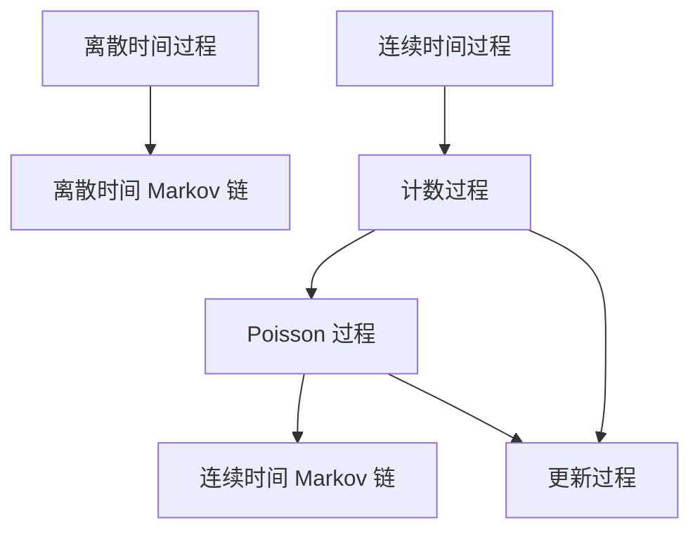
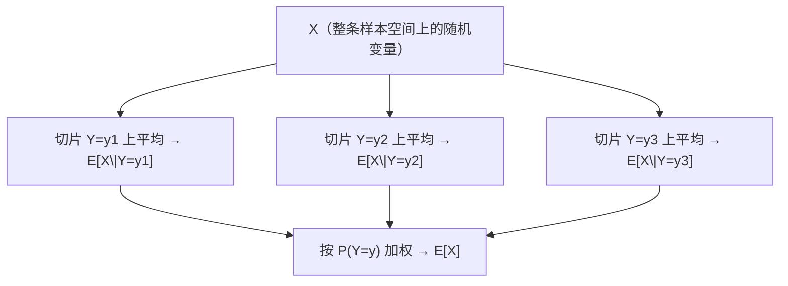

# 随机过程导论与概率论复习——Chap.3 Introduction

> **课程**：随机过程（Shanshan Guo, Fall 2026）
> **对应讲义**：`wiki/raw/随机过程/chap3intro and probability theory.pdf`（58 页）
> **教材**：Sheldon M. Ross, *Introduction to Probability Models* (12th ed.)，第 1–3 章 + 全书路线图
> **配套页**：[[sources/随机过程/chap3_intro]] · 理论串讲见 [[马尔可夫链基础总复习]]
> **训练题**：[[条件概率与条件期望——训练题]] · Poisson 分裂/混合 [[Poisson分布的混合与分裂]] · Ross 第 3 章全题 [[课后习题/第03章-条件概率与条件期望/03-原题]]

这份笔记按讲义顺序写：**先建立随机过程的语言，再把后面整学期都要用的条件期望补齐**。概率论复习不是“背公式”，而是把 Ross 第 1–3 章里**会被 Markov / Poisson / 更新过程反复调用的那几招**练熟。

---

## 目录

- [0. 课程信息](#0-课程信息)
- [1. 随机过程是什么](#1-随机过程是什么)
- [2. 按时间指标分类](#2-按时间指标分类)
- [3. 本学期要研究的几类过程](#3-本学期要研究的几类过程)
- [4. 概率论复习：从样本空间到条件期望](#4-概率论复习从样本空间到条件期望)
- [5. 讲义例题全解](#5-讲义例题全解)
- [6. 易错点](#6-易错点)
- [7. 一页速记](#7-一页速记)

---

## 0. 课程信息

| 项目 | 内容 |
|---|---|
| 教师 | 郭珊珊（信息管理与工程学院 525） |
| 邮箱 | guo.shanshan@sufe.edu.cn |
| 办公时间 | 周三 9:30–11:00，或预约 |
| 主教材 | Ross, *Introduction to Probability Models*, 12th ed., 2022 |
| 参考 | Ross *Stochastic Processes* (2e, 1995)；Ross *Applied Probability Models with Optimization Applications* (Dover, 2013) |
| 评分 | 出勤 10% + 课堂参与 20% + 作业 20% + 期末 50% |

---

## 1. 随机过程是什么

> **定义（随机过程）**
> 随机过程 $\{X(t): t\in T\}$ 是**一族随机变量**。
> - $T$ 叫**指标集**（本课几乎总是时间）；
> - 对每个 $t\in T$，$X(t)$ 是一个随机变量，叫做过程在时刻 $t$ 的**状态**；
> - 所有可能状态的集合叫**状态空间**。

一句话：**随机变量是“一个数不确定”；随机过程是“一条轨迹不确定”。**

讲义用六个例子把“过程”从抽象变具体：

| | 例子 | 指标 $T$ | 状态空间（直观） |
|---|---|---|---|
| E1 | 接下来三次掷六面骰 | $\{1,2,3\}$，离散 | $\{1,\dots,6\}^3$ |
| E2 | 未来 7 天上海下午 2 点气温 | 7 个离散时刻 | 连续（温度） |
| E3 | 某超市从明天起的日销售额 | $\mathbb N$ | 连续（金额） |
| E4 | 未来 24 小时某门店卖出的 PC 数 | $[0,24]$，连续 | $\{0,1,2,\dots\}$ |
| E5 | 明天 0:01 起上海已报告的车祸数 | $[0,\infty)$ | $\{0,1,2,\dots\}$ |
| E6 | 明天 9:30–11:30 急诊室人数 | $[9{:}30,11{:}30]$ | $\{0,1,2,\dots\}$ |

这些例子同时说明两件事：

1. **“时间”可以是离散的，也可以是连续的**；
2. **“状态”可以是离散的，也可以是连续的**。本学期主战场是**状态可数**的那一侧。

---

## 2. 按时间指标分类

| | $T$ 可数 | $T$ 是区间 |
|---|---|---|
| **名称** | 离散时间过程 $\{X_n:n=0,1,2,\dots\}$ | 连续时间过程 $\{X(t):t\ge 0\}$ |
| **讲义例子** | E1, E2, E3 | E4, E5, E6 |

能不能给这样一条过程建概率模型？最天真的假设是“各时刻独立”。**一旦“现在”依赖“过去”，独立性就崩了**——这正是后面引入马尔可夫性的动机。

---

## 3. 本学期要研究的几类过程

讲义第 14 页的图是整门课的地图。先记住依赖关系，再记定义。



### 3.1 离散时间 Markov 链

指标集 $T=\{0,1,2,\dots\}$。**下一步只通过现在依赖过去**：

$$P(X_{n+1}=j\mid X_n=i,\,X_{n-1}=i_{n-1},\,\dots,\,X_0=i_0)=P(X_{n+1}=j\mid X_n=i)$$

> **赌徒模型（讲义第 16–17 页）**
> 从 $i$ 美元 出发，每局独立地以概率 $p$ 赢 1 美元、否则输 1 美元；到 $0$ 或 $K$ 停。
> 令 $X_n=$ 第 $n$ 局后的财富。这就是一条有限状态随机游走，两端是吸收壁。
>
> 三个本学期会反复出现的问题：
> 1. 期望玩多少局才停？
> 2. 带着 $K$ 美元 离开、而不是破产的概率？
> 3. 财富等于 $j$ 美元（$j<K$）的期望时间？

### 3.2 计数过程

$X(t)=$ 到时刻 $t$ 为止已经发生的事件数。轨迹是右连续的阶梯：每次事件跳 $+1$。E5（车祸累计数）是原型。

### 3.3 Poisson 过程

计数过程 + **事件间隔 $T_n$ i.i.d. 指数**。指数分布的无记忆性，后面会变成连续时间 Markov 链“停留时间必为指数”的根源。

> **实习 offer 例**：offer 按 Poisson 过程到达，每个 offer 的价值有密度 $f$，等待成本率 $c$。这是最优停时问题——先混个脸熟，学期后半会回来。

### 3.4 更新过程

计数过程 + **间隔 $T_n$ i.i.d. 一般分布**（不再要求指数）。Poisson 是它的特例。核心问题：

$$E[X(t)]=?,\qquad \lim_{t\to\infty}\frac{X(t)}{t}=?$$

> **单服务员银行**：顾客 Poisson 到达；只有柜员空闲才进门，服务时间 $\sim G$。
> - 更新发生在：一次“顾客进入并完成服务、系统重新变空”的循环结束时；
> - 进入银行的长期速率、没进门就离开的比例，都是更新报酬定理的直接应用。

### 3.5 连续时间 Markov 链

离开状态 $i$ 后以 $p_{ij}$ 进入 $j$（$p_{ii}=0$，$\sum_j p_{ij}=1$），**停留时间独立、指数**。马尔可夫性写成

$$P\bigl(X(t+s)=j\mid X(s)=i,\,X(u)=x_u,\,0\le u<s\bigr)=P\bigl(X(t+s)=j\mid X(s)=i\bigr)$$

> **$n$ 个柜员的银行**：$X(t)=$ 网点内顾客数。问：恰好 $i$ 人的时间比例、平均人数、顾客平均逗留时间——这是后面平衡方程 + Little 公式的原型。

### 3.6 导论收束

随机过程 = 指标 + 状态。本学期四条主线：

| 时间 | 过程 | 关键结构 |
|---|---|---|
| 离散 | 离散时间 MC | 转移矩阵 $P$ |
| 连续 | 计数 / Poisson | 独立指数间隔 |
| 连续 | 更新过程 | i.i.d. 一般间隔 |
| 连续 | 连续时间 MC | 指数停留 + 跳转矩阵 |

---

## 4. 概率论复习：从样本空间到条件期望

讲义后半（p.28–58）是填空式复习。下面把空补上，并标出**本课真正会反复用的**。

### 4.1 样本空间、事件、概率公理

做一次结果事先未知的试验。所有可能结果的集合是样本空间 $S$，事件 $E\subset S$。

$P(E)$ 满足：

1. $0\le P(E)\le 1$；
2. $P(S)=1$；
3. 若 $E_i$ 两两不交，则 $P\bigl(\bigcup_i E_i\bigr)=\sum_i P(E_i)$（可列可加）。

### 4.2 条件概率

$$P(E\mid F)=\frac{P(EF)}{P(F)},\qquad P(F)>0$$

乘法公式 $P(EF)=P(E\mid F)P(F)$ 是后面“按第一条路、第一次试验、第一个到达条件化”的起点。

### 4.3 随机变量与分布

随机变量 $X$：样本空间上的实值函数。

**cdf**：$F(b)=P\{X\le b\}$。

- $F$ 是**右连续非降**函数；
- $\lim_{b\to-\infty}F(b)=0$，$\lim_{b\to\infty}F(b)=1$。

**离散**：$p(a)=P\{X=a\}$（pmf）。常用：Bernoulli、Binomial、Geometric、Poisson。

**连续**：存在非负 $f$ 使 $P\{X\in B\}=\int_B f(x)\,dx$。此时 $F(a)=\int_{-\infty}^a f(x)\,dx$，$P\{X=a\}=0$。常用：Uniform、Exponential、Gamma、Normal。

### 4.4 期望与方差

$$E[X]=\int_{-\infty}^{\infty} x\,dF(x)=\begin{cases}\sum_x x\,p(x), & \text{离散}\\ \int x f(x)\,dx, & \text{连续}\end{cases}$$

$$E[h(X)]=\int h(x)\,dF(x),\qquad \operatorname{Var}(X)=E[(X-E[X])^2]=E[X^2]-(E[X])^2$$

### 4.5 联合分布、独立性

联合 cdf：$F(a,b)=P\{X\le a,\,Y\le b\}$。

| | 离散 | 连续 |
|---|---|---|
| 联合 | $p(x,y)=P\{X=x,Y=y\}$ | 存在 $f(x,y)$，$P\{X\in A,Y\in B\}=\iint_{A\times B}f$ |
| 边缘 | $p_X(x)=\sum_y p(x,y)$ | $f_X(x)=\int f(x,y)\,dy$ |

$$E[g(X,Y)]=\sum\sum g\,p=\iint g\,f,\qquad E[aX+bY]=aE[X]+bE[Y]$$

（线性性**不需要独立**。这是匹配问题、示性变量法能用的全部理由。）

$X,Y$ **独立** $\iff$ 对一切 $a,b$，

$$P\{X\le a,Y\le b\}=P\{X\le a\}P\{Y\le b\}=F_X(a)F_Y(b)$$

离散则 $p(x,y)=p_X(x)p_Y(y)$，连续则 $f(x,y)=f_X(x)f_Y(y)$。

### 4.6 条件分布与条件期望（本课引擎）

离散（$P\{Y=y\}>0$）：

$$p_{X\mid Y}(x\mid y)=\frac{p(x,y)}{P\{Y=y\}},\qquad F_{X\mid Y}(x\mid y)=\sum_{a\le x}p_{X\mid Y}(a\mid y)$$

$$E[X\mid Y=y]=\sum_x x\,p_{X\mid Y}(x\mid y)$$

连续（$f_Y(y)>0$）：

$$f_{X\mid Y}(x\mid y)=\frac{f(x,y)}{f_Y(y)},\qquad E[X\mid Y=y]=\int_{-\infty}^{\infty}x\,f_{X\mid Y}(x\mid y)\,dx$$

条件期望继承普通期望的一切线性性质，例如

$$E\Bigl[\sum_{i=1}^n X_i\Bigm| Y=y\Bigr]=\sum_{i=1}^n E[X_i\mid Y=y]$$

#### 全期望公式：先分片平均，再对分片平均

讲义最重要的一行是

$$\boxed{E[X]=E\bigl[E[X\mid Y]\bigr]}$$

它不是新公理，只是**换序求和**。容易混的是式子里其实有**三个不同的对象**：

| 符号                        | 是什么                                              | 类型                                |
| ------------------------- | ------------------------------------------------ | --------------------------------- |
| $E[X\mid Y=y]$            | 在切片 $\{Y=y\}$ 上把 $X$ 平均掉                         | **数**（$y$ 的函数）                    |
| $E[X\mid Y]$              | 把上面那个函数再套回随机变量 $Y$：$g(Y)$，其中 $g(y)=E[X\mid Y=y]$ | **随机变量**（在 $\{Y=y\}$ 上取常值 $g(y)$） |
| $E\bigl[E[X\mid Y]\bigr]$ | 再把这个随机变量按 $Y$ 的分布平均一次                            | **数**，等于 $E[X]$                   |



中间那一层合起来就是随机变量 $E[X\mid Y]$；最底下那一步才是外层的 $E[\,\cdot\,]$。

**离散情形的一行证明**（假设期望绝对收敛，才能换序）：

$$\begin{aligned}
E\bigl[E[X\mid Y]\bigr]
&= \sum_y E[X\mid Y=y]\,P(Y=y)\\
&= \sum_y\Bigl(\sum_x x\,P(X=x\mid Y=y)\Bigr)P(Y=y)\\
&= \sum_x x\sum_y P(X=x,Y=y)\\
&= \sum_x x\,P(X=x)=E[X].
\end{aligned}$$

连续情形把和换成积分、把 $P(Y=y)$ 换成 $f_Y(y)\,dy$：

$$E\bigl[E[X\mid Y]\bigr]=\int E[X\mid Y=y]\,f_Y(y)\,dy=\iint x\,f_{X\mid Y}(x\mid y)f_Y(y)\,dx\,dy=E[X].$$
---

## 5. 讲义例题全解

以下按讲义页码。数字全部来自 Ross 12e 对应例题。

### 5.1 Example 1.8：三顶帽子（p.31）

**题目。** 聚会中有三个人，每人各有一顶能够辨认归属的帽子。把三顶帽子混在一起后，每人随机取一顶，不放回；三顶帽子在三人之间的 $3!=6$ 种分配等可能。求：（1）三个人都拿回自己的帽子的概率；（2）三个人都没有拿回自己的帽子的概率。

**记号与解答。** 令 $E_i$ 表示“第 $i$ 人拿回自己的帽子”。$E_iE_j$ 表示两个事件同时发生，而不是把它们当作独立事件相乘。

**每人恰好拿回自己的帽子**：$P(E_1E_2E_3)=1/6$。
因为 $P(E_i)=1/3$，$P(E_iE_j)=1/6$（$i\neq j$），且给定前两人拿对，第三人必然拿对。

**没人拿回自己的**（错排）：先算补事件

$$P(E_1\cup E_2\cup E_3)=\sum P(E_i)-\sum P(E_iE_j)+P(E_1E_2E_3)=1-\tfrac12+\tfrac16=\tfrac23$$

故 $P(\text{无人匹配})=1-2/3=1/3$。对 $n=3$，也可以直接数：$3!=6$ 个排列里，错排 2 个。

### 5.2 Example 3.3：Poisson 的条件期望（p.41）

$X,Y$ 独立，$\sim\mathrm{Poisson}(\lambda_1),\mathrm{Poisson}(\lambda_2)$。求 $E[X\mid X+Y=n]$。

先算条件分布：

$$P\{X=k\mid X+Y=n\}=\binom{n}{k}\Bigl(\frac{\lambda_1}{\lambda_1+\lambda_2}\Bigr)^k\Bigl(\frac{\lambda_2}{\lambda_1+\lambda_2}\Bigr)^{n-k}$$

即 $X\mid(X+Y=n)\sim\mathrm{Binomial}\bigl(n,\,\lambda_1/(\lambda_1+\lambda_2)\bigr)$。因此

$$\boxed{E[X\mid X+Y=n]=n\cdot\frac{\lambda_1}{\lambda_1+\lambda_2}}$$

> **要记住的结构**：独立 Poisson 之和仍是 Poisson；在和固定时，拆分是二项（这就是 Poisson 分裂的逆）。

### 5.3 Example 3.4：下雨天的元件（p.43）

$n$ 个元件，下雨时第 $i$ 个以 $p_i$ 工作，不下雨以 $q_i$ 工作；明天下雨概率 $\alpha$。求**给定下雨**时，工作元件数的条件期望。

令 $X_i=\mathbf 1_{\{\text{元件 }i\text{ 工作}\}}$，$Y=\mathbf 1_{\{\text{下雨}\}}$。则

$$E\Bigl[\sum_i X_i\Bigm| Y=1\Bigr]=\sum_i E[X_i\mid Y=1]=\sum_{i=1}^n p_i$$

$\alpha$ 和 $q_i$ 在这个条件化问题里用不上。

### 5.4 Example 3.7：联合密度（p.45）

$$f(x,y)=\begin{cases}\tfrac12 y e^{-xy}, & 0<x<\infty,\; 0<y<2\\ 0, & \text{otherwise}\end{cases}$$

求 $E[e^{X/2}\mid Y=1]$。

先算 $f_Y(1)$：$f(x,1)=\tfrac12 e^{-x}$，

$$f_Y(1)=\int_0^\infty \tfrac12 e^{-x}\,dx=\tfrac12,\qquad f_{X\mid Y}(x\mid 1)=e^{-x}\quad(x>0)$$

于是 $X\mid Y=1\sim\mathrm{Exp}(1)$，

$$E[e^{X/2}\mid Y=1]=\int_0^\infty e^{x/2}e^{-x}\,dx=\int_0^\infty e^{-x/2}\,dx=2$$

### 5.5 Example 3.10：随机个随机变量之和（p.47–48）

每周事故期望数 $4$，每次事故受伤人数 i.i.d.、均值 $2$，且与事故数独立。一周期望受伤人数？

$$E\Bigl[\sum_{i=1}^N X_i\Bigr]=E\Bigl[E\bigl[\sum_{i=1}^N X_i\bigm| N\bigr]\Bigr]=E\bigl[N\,E[X]\bigr]=E[N]E[X]=8$$

这叫**复合随机变量**。后面复合 Poisson 过程就是它的过程版：$E[S]=\lambda E[X]$，$\operatorname{Var}(S)=\lambda E[X^2]$。

### 5.6 Example 3.12：矿工三扇门（p.49）

**题目。** 一名矿工被困在有三扇门的矿井里。门 1 后的通道走 2 小时可到安全地点；门 2 后的通道走 3 小时会返回原来的矿井；门 3 后的通道走 5 小时也会返回原处。每次处于矿井时，他都独立地以 $1/3$ 的概率选择每一扇门，包括刚走过却未能脱险的门。求从现在起直到脱险的总时间期望。

令总时间为 $T$，$\mu=E[T]$，单位是小时。题设并没有让矿工记住并排除走过的错误通道；因此回到原处后，剩余脱险时间与最初的 $T$ 同分布。选门 2 时总时间是已花的 3 小时加一次新的脱险等待，故该分支的条件期望为 $3+\mu$；门 3 同理。

对“第一扇门”条件化：

$$\mu=\tfrac13\cdot 2+\tfrac13\cdot(3+\mu)+\tfrac13\cdot(5+\mu)\implies \mu=10$$

> **招式**：没有明显的 $Y$ 时，**对“最先发生的那件事”条件化**。几何分布均值 $1/p$、赌徒破产、更新过程的循环分析，用的都是这一招。

### 5.7 Example 3.15：连续 $k$ 次成功（p.50）

独立试验、成功概率 $p$，直到出现连续 $k$ 次成功。令 $N_k$ 为所需试验次数，$M_k=E[N_k]$。

要得到 $k$ 连胜，必须先得到 $k-1$ 连胜，然后再走一段“从刚满 $k-1$ 连胜出发、直到首次满 $k$ 连胜”的附加试验。把这段附加长度记作 $A_{k-1,k}$：

$$N_k=N_{k-1}+A_{k-1,k}.$$

$A_{k-1,k}$ **不是**“再等一次成功”的几何分布。它从**已经连胜 $k-1$ 次**这个位置开始，只看**下一次**试验 $Y$（成功概率 $p$）：

| 下一次 $Y$ | 概率 | $A_{k-1,k}$ 等于什么 | 原因 |
|---|---|---|---|
| 成功 | $p$ | $1$ | 连胜变成 $k$，立刻结束 |
| 失败 | $1-p$ | $1+N_k'$ | 用掉 1 次，连胜清零；独立试验下，剩下的时间与从头再等 $k$ 连胜同分布 |

这里 $N_k'$ 是 $N_k$ 的独立拷贝，$E[N_k']=M_k$。对 $Y$ 用全期望：

$$\begin{aligned}
E[A_{k-1,k}]
&= E\bigl[E[A_{k-1,k}\mid Y]\bigr]\\
&= p\cdot 1+(1-p)\cdot(1+M_k)\\
&= 1+(1-p)M_k.
\end{aligned}$$

“$1$”是无论成败都要做的那一次；只有失败时才额外付一整段 $M_k$。不要写成 $1+(1-p)(1+M_k)$（会把那一次失败数两遍），也不要把失败后的剩余写成 $A_{k-1,k}$ 自己——失败后已经回到 $0$ 连胜，不是还停在 $k-1$。

因此

$$M_k=M_{k-1}+E[A_{k-1,k}]=M_{k-1}+1+(1-p)M_k.$$

把含 $M_k$ 的项移到左边：$pM_k=M_{k-1}+1$，即

$$M_k=\frac{M_{k-1}+1}{p}=\frac{M_{k-1}}{p}+\frac1p.$$

末尾那个 $1/p$ 是整理出来的，**不是**先假定 $A_{k-1,k}\sim\mathrm{Geo}(p)$。由 $M_1=1/p$（第一次成功就是几何计次）递推：

$$\boxed{M_k=\frac1p+\frac1{p^2}+\cdots+\frac1{p^k}=\frac{1-p^k}{p^k(1-p)}\quad(p\neq 1)}$$

这就是 Chap.4 里“掷硬币直到连续三个正面”的期望版；那里会改用吸收 Markov 链算分布。

### 5.8 Example 3.22：$P(X<Y)$（p.52）

$X,Y$ 独立连续，密度 $f_X,f_Y$。对 $Y$ 条件化：

$$P(X<Y)=E\bigl[P(X<Y\mid Y)\bigr]=\int_{-\infty}^{\infty} F_X(y)\,f_Y(y)\,dy=\iint_{x<y}f_X(x)f_Y(y)\,dx\,dy$$

### 5.9 Example 3.24：瑜伽馆的 Poisson 分裂（p.53）

每天到访人数 $N\sim\mathrm{Poisson}(\lambda)$，每人独立以 $p$ 为女、以 $1-p$ 为男。求恰有 $n$ 女 $m$ 男的联合概率。

对 $N$ 条件化：只有 $N=n+m$ 时该项非零，此时性别是 $\mathrm{Binomial}(n+m,p)$，

$$P\{N_1=n,N_2=m\}=e^{-\lambda p}\frac{(\lambda p)^n}{n!}\cdot e^{-\lambda(1-p)}\frac{(\lambda(1-p))^m}{m!}$$

因此 $N_1,N_2$ **独立**，分别是 $\mathrm{Poisson}(\lambda p)$ 与 $\mathrm{Poisson}(\lambda(1-p))$。

> **Poisson 分裂**：Poisson 个数的事件被独立分类后，各类人数独立 Poisson。这是 Poisson 过程“染色定理”的随机变量版，Chap.5 会升级成过程。混合、叠加与复合的对照见 [[Poisson分布的混合与分裂]]。

### 5.10 Example 2.30：匹配的期望（p.55）

**题目。** $N$ 个人各把自己的帽子放入一堆，混匀后每人不放回地取一顶，使 $N!$ 种分配等可能。求拿回自己帽子的人数的期望。这里 $N$ 是给定人数，不是随机人数。

令 $X$ 为匹配人数，$X_i=\mathbf 1_{\{\text{第 }i\text{ 人拿回自己的帽子}\}}$，则 $X=\sum_{i=1}^N X_i$。

$E[X_i]=P(X_i=1)=1/N$，故 $E[X]=1$——**人数多少，期望匹配数都是 1**。线性性不需要独立（事实上 $X_i$ 不独立）。

### 5.11 Example 3.14：多轮匹配（p.56）

**题目。** 最初有 $n$ 个人和他们各自的帽子。每轮把仍在场的帽子重新混匀，让仍在场的人各不放回地抽一顶，各种分配等可能。拿回自己帽子的人带着帽子离开；拿错的人把本轮抽到的帽子放回，下一轮重新抽。各轮重新随机分配，直到所有人离开。

求：（a）总轮数 $R_n$ 的期望；（b）所有人合计抽帽次数 $S_n$ 的期望，$n\ge2$；（c）一名指定参与者抽错次数的期望，$n\ge2$。一轮若有 $k$ 人在场，就增加 1 轮、增加 $k$ 次抽取；“轮数”与“抽取次数”不是同一个量。

记 $X_n$ 为初始 $n$ 人时**第一轮**拿对帽子的人数。拿对者带走自己的帽子，所以剩下的 $n-X_n$ 人仍恰好对应剩下的 $n-X_n$ 顶帽子，后续与一个较小规模的原问题相同。约定无人剩下时 $R_0=S_0=0$；一个人单独开始时只需抽一次。

**(a) 期望轮数 $E[R_n]=n$。**
每轮期望匹配数仍是 1，所以“大约 $n$ 轮”的直觉是对的。严格用对第一轮匹配数 $X_n$ 条件化 + 归纳：

$$E[R_n]=1+E[R_n]P(X_n=0)+\sum_{i=1}^n (n-i)P(X_n=i)$$

用 $E[X_n]=1$ 即得 $E[R_n]=n$。（约定 $P(X_n=n-1)=0$：不可能恰好 $n-1$ 人匹配。）

**(b) 期望总抽取次数 $E[S_n]=n+n^2/2$（$n\ge 2$）。**
令 $a_n=E[S_n]$。第一轮由 $n$ 人各抽一次，因此对第一轮匹配人数条件化得到

$$
a_n=n+\sum_{i=0}^n a_{n-i}P(X_n=i).
$$

这里右边的 $a_{n-i}$ 是重新随机分配后的期望，不能把两个不同实验中的随机变量直接当作同一个。对 $n\ge2$，$E[X_n]=1$、$E[X_n^2]=2$。尝试 $a_n=an+bn^2$，代入得

$$
an+bn^2=n+a(n-1)+b(n^2-2n+2),
$$

即 $0=n(1-2b)-a+2b$，所以 $b=1/2$、$a=1$。边界 $a_0=0$、$a_1=1$；公式只用于 $n\ge2$。由于不可能恰有 $n-1$ 人匹配，从 $n\ge2$ 出发不会只剩一人，因此递推不需要把该二次公式误用于 $a_1$。

**(c) 某一个人期望“抽错的次数”** $=E[S_n]/n-1=n/2$（$n\ge 2$）。

另外：$\operatorname{Var}(R_n)=n$（$n\ge 2$），用条件方差公式可证。

### 5.12 Example 3.18：已知第一人没抽中（p.57）

**题目。** $n\ge2$ 个人把各自的帽子混在一起，每人不放回地随机取一顶，所有 $n!$ 种分配等可能。已知第 1 人没有拿回自己的帽子，求这一轮拿回自己帽子的总人数的条件期望。

令总匹配人数为 $X$，$X_1$ 是“第 1 人拿对”的指示变量。因此条件 $X_1=0$ 只给出了第一人拿错这一信息，并没有告知他拿走了谁的帽子。用全期望反解：

$$E[X]=E[X\mid X_1=0]\cdot\frac{n-1}n+E[X\mid X_1=1]\cdot\frac1n$$

左边 $E[X]=1$。给定第 1 人拿对，剩下 $n-1$ 人仍是一次均匀匹配，期望匹配数为 1，所以 $E[X\mid X_1=1]=1+1=2$。故

$$\boxed{E[X\mid X_1=0]=\frac{n-2}{n-1}}$$

不是“剩下 $n-1$ 人期望还是 1”——因为条件 $X_1=0$ 改变了联合结构。

### 5.13 Example 3.27：错排概率（p.58）

**题目。** $n$ 个人各随机抽取一顶帽子，不放回且所有分配等可能。求（1）没有任何人拿回自己帽子的概率；（2）恰好 $k$ 人拿回自己帽子的概率，$0\le k\le n$。

记第一问为 $P_n$，约定 $P_0=1$。若第 1 人拿对，则“无人匹配”不可能；若他拿了第 $j$ 人的帽子（$j\ne1$），再按第 $j$ 人是否拿到第 1 人的帽子分两类：拿到了就删去这两人，余下 $n-2$ 人必须错排；没拿到则把这段配对关系合并，得到 $n-1$ 个对象的错排。若 $D_n=n!P_n$ 为错排数，这一计数给出

$$
D_n=(n-1)(D_{n-1}+D_{n-2}).
$$

除以 $n!$，得到概率递推

$$P_n=\frac{n-1}n P_{n-1}+\frac1n P_{n-2},\qquad P_1=0,\;P_2=\tfrac12$$

从而

$$P_n=\sum_{k=0}^n\frac{(-1)^k}{k!}\quad\bigl(\text{从 }k=2\text{ 写起也可}\bigr)\to\frac1e$$

第二问先选择哪 $k$ 人拿对（$\binom nk$ 种），其余 $n-k$ 人必须错排（$D_{n-k}$ 种）；除以全部 $n!$ 种分配。因此恰有 $k$ 个匹配的概率为

$$\frac1{k!}\,P_{n-k}\to\frac{1}{k!\,e}$$

### 5.14 Example 3.26：秘书问题 / 最佳奖品（p.59）

**题目。** 有 $n$ 个品质互不相同的奖品，按随机顺序逐个出现，全部 $n!$ 种次序等可能。看到一个奖品时，只知道它相对于此前已见奖品的排名，并不知道未见奖品的品质，也不能直接辨认它是否全场最好。此时必须立即接受或拒绝；接受后结束，拒绝后不能回头再取。目标是最大化最终拿到全场最好奖品的概率。

考虑事先选定一个整数 $k$（$1\le k<n$）的策略：先观察并拒绝前 $k$ 个，把它们中的最好者作为比较标准；此后接受第一个超过这个标准的奖品。若最后仍没有遇到这样的奖品，本策略未能选中最好者。求这类策略的成功概率及最合适的 $k$。

令 $X$ 为最好奖品出现的位置，$P(X=i)=1/n$。若 $i\le k$，它会被主动放弃；若 $i>k$，要等到第 $i$ 个才接受，前 $i-1$ 个中的最好者必须落在最初观察的 $k$ 个里，否则会提前接受一个较次的奖品。这个条件的概率是 $k/(i-1)$。所以

$$P_k(\text{best})=\frac kn\sum_{i=k+1}^n\frac1{i-1}\approx\frac kn\log\frac nk$$

$g(x)=(x/n)\log(n/x)$ 在 $x=n/e$ 取最大，最大值 $1/e$。因此：

> **大样本近似。** $n$ 大时，先拒绝约 $n/e$ 个，再取第一个创纪录者，成功概率趋于 $1/e\approx0.368$。有限 $n$ 时，应在整数 $k$ 上比较上面的精确和式；$n/e$ 不是无需取整的精确最优解。

粗界：弃前一半，成功概率 $>1/4$——不用算也能看出“能做得不差”。

---

## 6. 易错点

1. **$E[X]=E[E[X\mid Y]]$ 不是 $E[X\mid Y]=E[X]$**。前者是全期望（恒成立，见 §4.6）；后者是「条件期望退化成常数」，独立时才有。
2. **线性性不需要独立**；$E[XY]=E[X]E[Y]$ 才需要（不相关 / 独立）。
3. 连续 r.v. 的 $P\{X=a\}=0$，所以连续情形必须用密度而不是“$P(Y=y)$”。
4. 矿工、几何、连胜：条件化之后**过程重新开始**，才能写 $\mu= \cdots+\mu$。这已经是强马尔可夫的雏形。连胜里 $A_{k-1,k}$ 只对**下一次**分成功 / 失败：$E[A]=1+(1-p)M_k$，不要把它当成 $\mathrm{Geo}(p)$。
5. 匹配问题里 $X_i$ 不独立，但期望照加；$n-1$ 个匹配概率为 0，写递推时不要漏。
6. Poisson 分裂得到的是**独立**的两条 Poisson，不是“相关的拆分”。

---

## 7. 一页速记

```
随机过程 {X(t), t∈T} = 一族随机变量
  离散时间：DTMC（下一步只看现在）
  连续时间：计数 → Poisson（指数间隔）→ 更新（一般间隔）
              → CTMC（指数停留 + 跳转）

全期望        E[X] = E[E[X|Y]]
算概率        P(E) = E[P(E|Y)]
复合和        E[Σ_{i=1}^N X_i] = E[N] E[X]
Poisson 分裂  N~Poi(λ) 独立分类 ⇒ 各类独立 Poi(λp_i)
匹配          E[# matches] = 1；错排 → 1/e
矿工          对第一扇门条件化，μ = 10
连胜 k 次     E = 1/p + … + 1/p^k
秘书问题      弃前 n/e，成功率 → 1/e
```

条件期望动手练：[[条件概率与条件期望——训练题]]。下一份笔记进入 Chap.4 Part I：把“下一步只看现在”写成矩阵，并开始给状态分类。Markov 部分训练题：[[马尔可夫链（上+中+下）——训练题]]。
