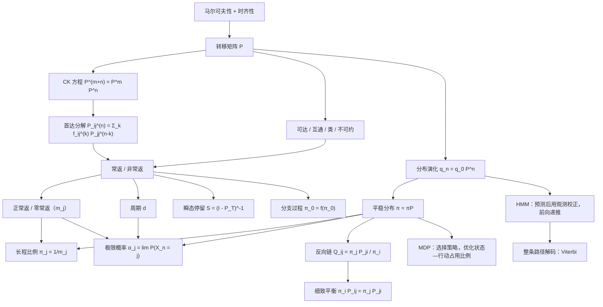

# 马尔可夫链基础总复习

> **课程**：随机过程（Ross, *Introduction to Probability Models*, Ch.4）
> **定位**：把「引言 → CK方程 → 状态分类 → 长程性质与极限概率 → 瞬态停留 → 分支过程 → 时间可逆 → 决策过程 → 隐马尔可夫链」九个板块串成**一条推导链**，而不是并列的定义。
> **配套证据**：[[sources/随机过程/chap4_1]]、[[sources/随机过程/chap4_2]]、[[sources/随机过程/chap4_3]]、[[sources/随机过程/chap3_intro]]
> **讲义笔记**（按 slide 做例题）：[[随机过程导论与概率论复习——Chap3 Introduction]]、[[马尔可夫链（上）——定义、CK方程与状态分类——Chap4 Part I]]、[[马尔可夫链（中）——长程比例、平稳分布与极限概率——Chap4 Part II]]、[[马尔可夫链（下）——瞬态停留、分支过程与时间可逆——Chap4 Part III]]
> **训练题**：[[马尔可夫链（上+中+下）——训练题]]（Ross 全章 79 题）
> **合并说明**：原「整合笔记——Chap4」「完整笔记——Chap4三讲合一」两稿已并入本页（Part III 三个板块为 2026-10-07 补入），那两个文件已删除；本页现为 Chap4 唯一的整合笔记。
> **新增讲义**：[[wiki/raw/随机过程/chap4-4-handout.pdf|chap4-4-handout]]（封面标为 Part VI / Fall 2026，共 24 页）；MDP 与 HMM 已整合至 §8–§9，讲义留空的递推式与例题解答由本笔记补全。
> **关联页**：[[concepts/离散时间马尔可夫链]]

---

## 目录

- [0. 这份笔记的骨架](#0-这份笔记的骨架先看依赖关系再看细节)
- [1. 引言：马尔可夫链到底假设了什么](#1-引言马尔可夫链到底假设了什么)
- [2. Chapman–Kolmogorov 方程](#2-chapmankolmogorov-方程)
- [3. 状态的分类](#3-状态的分类)
- [4. 长程性质与极限概率](#4-长程性质与极限概率)
- [5. 瞬态上的期望停留](#5-瞬态上的期望停留)
- [6. 分支过程](#6-分支过程)
- [7. 时间可逆](#7-时间可逆)
- [8. 马尔可夫决策过程](#8-马尔可夫决策过程)
- [9. 隐马尔可夫链](#9-隐马尔可夫链)
- [10. 自测题（附答案）](#10-自测题附答案)
- [11. 一页速记（考前 5 分钟）](#11-一页速记考前-5-分钟)
- [12. 符号对照（两套笔记打通）](#12-符号对照两套笔记打通)

---

## 0. 这份笔记的骨架（先看依赖关系，再看细节）

全章以**马尔可夫性**为主线；各结论还各有适用条件。MDP 额外引入行动与策略，HMM 额外引入给定状态下的观测模型，不能把它们当作马尔可夫性自动推出的性质。所以真正的复习方式不是背定义，而是记住「**每个定义是为了解决哪个问题而被逼出来的**」。



**一句话总纲**：

- **引言**回答「什么过程值得研究」；
- **CK 方程**回答「多步概率怎么算」；
- **状态分类**回答「一个状态会不会被反复访问」；
- **长程性质与极限概率**回答「跑久了会发生什么」；
- **瞬态停留**回答「回不来的状态，在被吸走之前待多久」；
- **分支过程**回答「平均生几个后代才不会死光——灭绝还是爆炸」；
- **时间可逆**回答「电影倒着放，还是不是同一条链」；
- **决策过程**回答「可以控制转移时，怎样获得最大的长期平均收益」；
- **隐马尔可夫链**回答「看不到状态，只看到信号，怎样推断状态与路径」。

前四个板块（§1–§4）是主干；§5–§7 是三件趁手的工具：非常返状态怎么算、一个非常返结构的经典应用、以及一条求 $\pi$ 的捷径。§8–§9 再沿两条方向扩展：**控制状态转移**与**从观测反推状态**。

---

## 1. 引言：马尔可夫链到底假设了什么

### 1.1 随机过程与它的分类

**随机过程**是一族随机变量 $\{X(t), t \in T\}$：$T$ 是**指标集**（通常理解为时间），$X(t)$ 是过程在时刻 $t$ 的**状态**。

按两个维度分类，四个象限里我们只研究最简单的一格：

| | 状态离散（可数） | 状态连续 |
|---|---|---|
| **时间离散**（$T = \{0,1,2,\dots\}$） | **离散时间马尔可夫链 ← 本课主战场** | 随机游走型连续状态链 |
| **时间连续**（$T = [0,\infty)$） | 泊松过程、连续时间马尔可夫链 | 布朗运动 |

> **为什么要先学这一格？** 因为它把「随机」压到了最低限度：随机性只体现在「下一步去哪个状态」，而这一步的概率规则**固定不变**。等这套语言熟练了，再往上加连续时间、连续状态，就只是换记号。

---

### 1.2 唯一的根：马尔可夫性（无后效性）

这是全章**唯一**的额外假设。它是一条**无条件真理**——不需要任何前置条件就能接受，也不需要任何证明，它就是一个建模假设。

> **定义 1（马尔可夫性 / 无后效性）**
> 对任意 $n \ge 0$ 与任意状态 $i_0, i_1, \dots, i_{n-1}, i, j$：
> $$P(X_{n+1} = j \mid X_n = i,\; X_{n-1} = i_{n-1},\; \dots,\; X_0 = i_0) = P(X_{n+1} = j \mid X_n = i)$$

**它到底在说什么？** 等式左边是「知道全部历史之后，下一步去哪」；右边是「只知道当前状态时，下一步去哪」。两者相等 ⟹ **历史里除了「现在」以外的全部信息，对未来都是冗余的**。

一句话：**给定现在，未来与过去条件独立。**

**为什么这条要单独抽出来当公理？** 因为一旦成立，整个过程的描述量就从「所有有限维联合分布」塌缩成「一个转移规则」。这就是「**压缩**」：无穷多参数 → 一个矩阵。整章后面所有的漂亮结论，本质都是这个压缩的红利。

> **定义 2（时齐性）**
> 若 $P(X_{n+1} = j \mid X_n = i)$ 与 $n$ 无关，记为 $P_{ij}$，则称该链**时齐（time homogeneous）**。

本课默认时齐。时齐的意思是「**规则不随时间改变**」——否则我们要为每个时刻准备一个矩阵，理论会复杂得多，而工程上也很少需要。

**验证马尔可夫性时最容易踩的坑**：不要凭「$X_n$ 只由最近几个 $Y$ 构成」就下结论，必须检查**条件**是否真的把所有过去信息都吃掉了。

> **反例（你笔记（1）里那个）**：$Y_0, Y_1, \dots$ 是独立同分布抛硬币（正 $0$ / 反 $1$，各 $1/2$），令 $X_n = Y_n + Y_{n-1}$（$n \ge 1$）。
> 直观上 $X_n$ 只用到最近的 $Y$，很像马尔可夫链，但
> $$P(X_3 = 2 \mid X_2 = 1, X_1 = 0) = \tfrac12, \qquad P(X_3 = 2 \mid X_2 = 1, X_1 = 2) = 0$$
> 同一个「现在」$X_2 = 1$ 给出两种不同的未来分布 ⟹ **不是马尔可夫链**。
> 原因：$X_2 = 1$ 这个信息本身携带了 $Y_1$ 的信息（$X_2 = Y_2 + Y_1$），而 $X_3 = Y_3 + Y_2$ 又要用 $Y_2$——**「现在」不足以屏蔽「过去」**。

---

### 1.3 转移矩阵：把假设变成可计算的对象

> **定义 3（转移概率、转移矩阵）**
> $P_{ij} = P(X_{n+1} = j \mid X_n = i)$ 称为**一步转移概率**；$\mathbf{P} = (P_{ij})_{i,j \in S}$ 称为**转移矩阵**。

一个矩阵是转移矩阵，**当且仅当**（这是充要的刻画）：

$$\text{(1) } P_{ij} \ge 0 \quad\text{（非负）}; \qquad \text{(2) } \sum_{j \in S} P_{ij} = 1 \quad\text{（行和为 } 1）$$

第二条来自全概率：从 $i$ 出发，下一步必然落到某个状态。**注意是「行和为 1」，不是列和**——行 $i$ 描述的是「从 $i$ 出发的去向分布」。

### 1.4 分布的演化：第一个非平凡结论

设**行向量** $q^{(n)}_j = P(X_n = j)$ 是第 $n$ 步的分布。用全概率公式把第 $n$ 步拆到第 $n-1$ 步：

$$P(X_n = j) = \sum_{i \in S} P(X_{n-1} = i)\, P(X_n = j \mid X_{n-1} = i) = \sum_{i \in S} q^{(n-1)}_i P_{ij}$$

写成矩阵形式就是

$$\boxed{q^{(n)} = q^{(n-1)} \mathbf{P}} \qquad\Longrightarrow\qquad \boxed{q^{(n)} = q^{(0)} \mathbf{P}^{n}}$$

**这就是「分布随时间的演化」。** 它立刻引出两个问题，而这两个问题各自撑起了后面一个板块：

1. **多步转移概率** $P(X_{m+n} = j \mid X_m = i)$ 等于 $\mathbf{P}^n$ 的元素吗？→ **CK 方程**
2. 演化久了会稳定下来吗？→ **平稳分布 / 极限概率**

---

## 2. Chapman–Kolmogorov 方程

### 2.1 动机：怎么算「多步」转移

问题是：已知 $X_0 = i$，$n+m$ 步后到 $j$ 的概率是多少？

**自然的想法**：把它拆成「先走 $n$ 步，再走 $m$ 步」，而中间那个「第 $n$ 步落在哪」我们并不知道，于是**按中间状态分类求和**：

$$P(X_{n+m} = j \mid X_0 = i) = \sum_{k \in S} P(X_{n+m} = j,\, X_n = k \mid X_0 = i)$$

把每项拆成「到 $k$」乘「从 $k$ 出发再走 $m$ 步到 $j$」，此时马尔可夫性正好保证「从 $k$ 出发的那 $m$ 步」与「$i \to k$ 那段历史」无关：

$$\boxed{P_{ij}^{(n+m)} = \sum_{k \in S} P_{ik}^{(n)}\, P_{kj}^{(m)}}$$

> **这就是 CK 方程。** 它的本质不是一条新定理，而是「**在时间中点插入一个求和变量，再用马尔可夫性把两边切断**」这一招。

写成矩阵形式：

$$\mathbf{P}^{(n+m)} = \mathbf{P}^{(n)} \mathbf{P}^{(m)}$$

再对 $(n,m) = (1,1), (2,1), \dots$ 反复迭代，就得到本板块最有用的结论：

$$\boxed{\mathbf{P}^{(n)} = \mathbf{P}^{n}} \qquad\text{即}\qquad P_{ij}^{(n)} = (\mathbf{P}^n)_{ij}$$

**为什么这条重要？** 因为它把「随机过程的 $n$ 步行为」变成了「**矩阵乘幂**」——一个纯粹的线性代数计算。整章的计算题基本都靠它。

**严格证明（一遍过）**：对中间状态做全概率分解，每一步都用马尔可夫性把「条件」缩短：

$$
\begin{aligned}
P(X_{n+m} = j \mid X_n = i)
&= \frac{P(X_{n+m} = j,\, X_n = i)}{P(X_n = i)}\\
&= \sum_{i_1,\dots,i_{m-1}} \frac{P(X_n = i,\,X_{n+1}=i_1,\dots,X_{n+m}=j)}{P(X_n = i)}\\
&= \sum_{i_1,\dots,i_{m-1}} P_{i i_1}P_{i_1 i_2}\cdots P_{i_{m-1} j}
= (\mathbf{P}^m)_{ij}
\end{aligned}
$$

最后一步「看起来玄乎，其实就是矩阵乘法的定义」。

> **记号陷阱**：$P_{ij}^{(n)}$ **不是** $P_{ij}$ 的 $n$ 次幂，它是「$n$ 步转移概率」；而 $P_{ij}^{(n)} = (\mathbf{P}^n)_{ij}$ 才是真正的矩阵幂运算。

---

### 2.2 更精细的 CK：按「首次到达」劈开（首达分解）

上面的 CK 是按「**任意**中间状态 $k$」劈开。如果换成按「**第一次**到达 $j$ 的时刻」劈开，就得到一条威力大得多的公式——它是整个状态分类（常返性）的代数引擎。

> **定义 4（首达时间、首达概率）**
> $$T_j = \min\{n \ge 1 : X_n = j\}$$
> 是首次到达 $j$ 的时间（$T_j = \infty$ 表示永不到达）。记
> $$f_{ij}^{(n)} = P_i(T_j = n), \qquad f_{ij} = P_i(T_j < \infty) = \sum_{n \ge 1} f_{ij}^{(n)}$$
> 特别地 $f_{jj}$ 是从 $j$ 出发**最终回到** $j$ 的概率。

> **定理 5（首达分解 / 更新方程）**
> $$P_{ij}^{(n)} = \sum_{k=1}^{n} f_{ij}^{(k)}\, P_{jj}^{(n-k)}, \qquad P_{jj}^{(0)} := 1$$

**怎么发现的**：要算「$n$ 步后到 $j$」，就按「**第一次**到 $j$ 是在第 $k$ 步」分类（$k = 1,\dots,n$）。第一次到达发生在第 $k$ 步的概率是 $f_{ij}^{(k)}$；到达之后还剩 $n-k$ 步，而由强马尔可夫性，**在 $j$ 处「重新开始」的链与原来的完全一样**，所以剩下 $n-k$ 步从 $j$ 回到 $j$ 的概率是 $P_{jj}^{(n-k)}$。

写成**母函数**（生成函数）形式，卷积就变成了乘法，这一步极其关键：

$$P_{ij}(s) := \sum_{n\ge0} P_{ij}^{(n)}s^n, \qquad F_{ij}(s) := \sum_{n\ge1} f_{ij}^{(n)}s^n \quad\Longrightarrow\quad \boxed{P_{ij}(s) = F_{ij}(s)\, P_{jj}(s)}$$

对 $i = j$ 特别地有（因为 $P_{jj}^{(0)} = 1$）：

$$P_{jj}(s) = 1 + F_{jj}(s) P_{jj}(s) \quad\Longrightarrow\quad \boxed{P_{jj}(s) = \frac{1}{1 - F_{jj}(s)}}$$

**这一个式子就是常返性判据的全部来源**：令 $s \to 1^-$，若 $f_{jj} < 1$ 则 $P_{jj}(1) = \sum_n P_{jj}^{(n)} = \frac{1}{1-f_{jj}} < \infty$；若 $f_{jj} = 1$ 则发散。见 §3.2。

---

## 3. 状态的分类

分类的目的是回答：**一个状态会不会被反复访问？以什么节奏访问？** 这直接决定长程行为。

### 3.1 可达、互通、类、不可约

> **定义 6（可达、互通）**
> - $i \to j$（$j$ 由 $i$ **可达**）：$\exists n \ge 0$ 使 $P_{ij}^{(n)} > 0$。
> - $i \leftrightarrow j$（**互通**）：$i \to j$ 且 $j \to i$。

> **命题 7**：$i \to j \iff f_{ij} > 0$。
> （「某一步能到」和「最终能到」等价——因为只要有一条有限长的路径，最终到达的概率就 $>0$。）

**互通是等价关系**（自反、对称、传递 ⟹ 传递性需要 CK 方程：$P_{ik}^{(n_1+n_2)} \ge P_{ij}^{(n_1)}P_{jk}^{(n_2)} > 0$）。于是状态空间被划分成若干个**互通类（communication class）**。

> **定义 8（闭集、不可约）**
> - 集合 $A$ 是**闭集**：$\forall i \in A,\; j \notin A$，都有 $P_{ij} = 0$。（**从里面出不去**。）
> - 集合 $B$ 是**不可约的**：$\forall i,j \in B$，$i \leftrightarrow j$。（**类内部处处互通**。）
> - 整条链**不可约**：状态空间只有一个互通类。

**关于「分类」最重要的两条结构性事实**：

> **引理 9**：常返状态可达的状态也是常返的。（$x$ 常返且 $x \to y$ ⟹ $\rho_{yx} = 1$ 且 $y$ 常返。）
> **推论 10**：**常返性是类性质**——同一个互通类里的状态「要么全常返，要么全非常返」。

> **引理 11**：有限闭集内至少存在一个常返状态。
> **推论 12**：**有限状态链**可以被分解成「若干常返闭类 + 一堆非常返状态」。非常返状态就是那些「能跳出去但回不来」的状态。

这两个引理的证明思路（值得记）：

- 引理 9：$x$ 常返 ⟹ $E_x N(x) = \sum_n P_{xx}^{(n)} = \infty$；又有 $P_{yy}^{(j+k+l)} \ge P_{yx}^{(j)}P_{xx}^{(k)}P_{xy}^{(l)}$，对 $k$ 求和得 $\sum_n P_{yy}^{(n)} = \infty$。
- 引理 11：反设有限闭集 $C$ 全非常返，则 $\forall y \in C,\; E_x N(y) < \infty$，于是
  $$\sum_{y \in C} E_x N(y) = \sum_{n\ge1}\sum_{y \in C} P^{(n)}(x,y) = \sum_{n\ge1} 1 = \infty$$
  （中间用了 $\sum_{y\in C}P^{(n)}(x,y) = 1$，因为 $C$ 是闭集，第 $n$ 步必然还在 $C$ 里。）但有限个有限数之和有限，矛盾。

---

### 3.2 常返 vs 非常返

> **定义 13（常返 / 非常返）**
> 令 $\rho_j := f_{jj} = P_j(T_j < \infty)$（从 $j$ 出发**最终**回到 $j$ 的概率）。
> - $\rho_j = 1$：$j$ 是**常返状态（recurrent）**。
> - $\rho_j < 1$：$j$ 是**非常返状态（transient）**。

**为什么叫「常返」和「瞬时」？** 看返回次数 $N_j = \#\{n\ge1 : X_n = j\}$。

- $\rho_j < 1$ 时，$\rho_j^k \to 0$，故 $\sum_k \rho_j^k <\infty$，而 $P_j(N_j \ge k) = \rho_j^k$（靠强马尔可夫性），于是
  $$P_j(N_j = \infty) = 0 \quad\Longrightarrow\quad \text{「只回有限次」}$$
  **一瞬而逝，再不相见** → 瞬时。
- $\rho_j = 1$ 时，$\rho_j^k \equiv 1$，故 $P_j(N_j \ge k) = 1$ 对一切 $k$ 成立，于是
  $$P_j(N_j = \infty) = 1 \quad\Longrightarrow\quad \text{「必然回无穷多次」}$$

**核心判据（考试与习题的主力工具）**：

$$\boxed{\;\text{$j$ 常返} \iff \sum_{n=1}^{\infty} P_{jj}^{(n)} = \infty\;} \qquad\qquad \boxed{\;\text{$j$ 非常返} \iff \sum_{n=1}^{\infty} P_{jj}^{(n)} < \infty\;}$$

**证明（用 §2.2 的母函数，两行）**：$P_{jj}(s) = \dfrac{1}{1 - F_{jj}(s)}$，令 $s \to 1^-$：$f_{jj}<1$ 时分母 $>0$，级数有限；$f_{jj}=1$ 时发散。

**必须一起记住的两个配套事实**（它们正是「非常返」这个概念的实用价值）：

1. $\displaystyle E_i(N_j) = \sum_{n=1}^{\infty} P_{ij}^{(n)} = \frac{f_{ij}}{1 - f_{jj}}$（$f_{jj} < 1$ 时），且 $E_i(N_j) < \infty$；
2. $j$ 非常返时，$\displaystyle\lim_{n\to\infty} P_{ij}^{(n)} = 0$ 对**一切** $i$ 成立（级数收敛 ⟹ 通项趋于 0）。
   **含义：非常返状态在长期是「看不见」的——无论你从哪里出发。**

> **例题：五状态财富链的常返性。** 赌徒每局独立地以概率 $0.4$ 赢 1、以概率 $0.6$ 输 1，到财富 0 或 4 时停赌，之后保持终值。状态是当前财富 $0,1,2,3,4$，矩阵行列按此顺序排列。判断每个状态是常返还是非常返。
> $$P = \begin{bmatrix}1&0&0&0&0\\ 0.6&0&0.4&0&0\\ 0&0.6&0&0.4&0\\ 0&0&0.6&0&0.4\\ 0&0&0&0&1\end{bmatrix}$$
> 状态 $0,4$ 是吸收态，$\rho_{00} \ge P_0(T_0=1) = 1$，故常返。
> 对 $1$：$P_1(T_1 = \infty) \ge P_1(X_1 = 0) = 0.6 > 0$ ⟹ $\rho_{11} < 1$，非常返。同理 $2,3$ 非常返。
> **一眼看穿的方法**：$0$ 和 $4$ 各自是常返闭类；$1,2,3$ 都能以正概率逃进 $0$ 或 $4$ 而回不来 ⟹ 非常返。

---

### 3.3 正常返 vs 零常返（常返的细分）

$f_{jj} = 1$ 只保证「一定回来」，没保证「回来得快」。

> **定义 14（平均返回时间、正常返、零常返）**
> $$m_j := E_j(T_j) = \sum_{n\ge1} n\, f_{jj}^{(n)}$$
> - $m_j < \infty$：$j$ **正常返（positive recurrent）**；
> - $m_j = \infty$（但 $f_{jj}=1$）：$j$ **零常返（null recurrent）**。

**三种状态对应三种「长期可见度」**：

| | 回来吗 | 回得快吗 | $\sum_n P_{jj}^{(n)}$ | $\lim_n P_{jj}^{(n)}$ |
|---|---|---|---|---|
| **非常返** | 不一定（$f_{jj}<1$） | — | $<\infty$ | $0$ |
| **零常返** | 一定（$f_{jj}=1$） | 不快（$m_j = \infty$） | $=\infty$ | $0$ |
| **正常返** | 一定 | 快（$m_j<\infty$） | $=\infty$ | $>0$（周期时沿子列） |

**关于零常返，唯一必须记住的有限/无限差异**：

$$\boxed{\text{有限状态链中不存在零常返状态。}}$$

理由：有限不可约类上平稳分布存在且 $\pi_j = 1/m_j > 0$，故 $m_j < \infty$。所以**有限链的状态只有两种：正常返 或 非常返**。

而**无限状态链**三种都可能，教科书的标准例子：

- 对称随机游走在 $\mathbb Z$ 上：**零常返**（一定回来，但平均要等无穷久）；
- 带漂移的随机游走（$p \ne 1/2$）：**非常返**；
- 随机游走在 $\mathbb Z^d$：$d=1,2$ 零常返，$d \ge 3$ 非常返。

> **不可约链的「三选一」定理**：不可约链中，所有状态**同为非常返**，或**同为零常返**，或**同为正常返**。（因为它们互通，而这三条都是类性质。）

---

### 3.4 周期：决定「极限存不存在」的那把钥匙

**动机**：$0 \leftrightarrow 1$ 的两状态链虽然平稳，但 $P_{00}^{(n)}$ 在 $1,0,1,0,\dots$ 振荡，**极限不存在**。为什么？因为它「必须偶数步才能回到 0」。这就是周期性。

> **定义 15（周期）**
> $$d_j := \gcd\{n \ge 1 : P_{jj}^{(n)} > 0\}$$
> 若 $d_j = 1$，称 $j$ **非周期（aperiodic）**；若 $d_j > 1$，称 $j$ **周期为 $d_j$**。

**理解**：$I_j = \{n : P_{jj}^{(n)} > 0\}$ 是「可能回到 $j$ 的步数集合」。它的最大公约数就是「返回步数天然的节拍」。

> **引理 16**：$I_j$ 对加法封闭（$i,j \in I_j \Rightarrow i+j \in I_j$）。
> **命题 17**：若 $d_j = 1$，则存在 $n_0$ 使得**所有** $n \ge n_0$ 都有 $n \in I_j$（即 $P_{jj}^{(n)}>0$）。
> 直觉：由引理 16 拿到 $k, k+1 \in I_j$ 后，$2k, 2k+1, 2k+2 \in I_j$、$3k,\dots,3k+3 \in I_j$……连续段越来越长，最终覆盖所有足够大的整数。这是初等数论里 Frobenius/币问题的味道。

**结构定理（周期性从哪里来）**：

> **定理 18**：设不可约链的周期为 $d$。则状态空间可被划分成 $d$ 个**循环类** $C_0, C_1, \dots, C_{d-1}$，使得一步转移**只能**从 $C_r$ 走到 $C_{r+1 \bmod d}$。
> 于是 $i \to j$ 的步数必须满足 $n \equiv r(i,j) \pmod d$（某个固定余数）。

**周期也是类性质**：$i \leftrightarrow j \Rightarrow d_i = d_j$。（所以「不可约链的周期」是有定义的。）

> **注意**：$d_j$ 用 $\{n : P_{jj}^{(n)}>0\}$ 还是 $\{n : f_{jj}^{(n)}>0\}$ 定义，**结果相同**（两集合的最大公约数一样：任何一条回到 $j$ 的长 $n$ 路径，都能拆成若干条「首次回到 $j$」的回路长度之和）。

---

### 3.5 分类总表（背这一张就够）

| 概念 | 定义/判据 | 是否类性质 | 有限链的特殊性 |
|---|---|---|---|
| 可达 $i\to j$ | $\exists n,\; P_{ij}^{(n)}>0$ | — | — |
| 互通 $i\leftrightarrow j$ | 互相可达（等价关系） | — | — |
| 不可约 | 只有一个互通类 | — | 一定存在平稳分布 |
| 闭集 | 出不去：$i\in A, j\notin A \Rightarrow P_{ij}=0$ | — | 有限闭集必含常返状态 |
| 常返 | $f_{jj}=1$ | ✅ | 常返 ⟹ 正常返 |
| 非常返 | $f_{jj}<1 \iff \sum_n P_{jj}^{(n)}<\infty$ | ✅ | 不属于任何闭类的状态 |
| 正常返 | $m_j<\infty$ | ✅ | = 常返 |
| 零常返 | $f_{jj}=1, m_j=\infty$ | ✅ | **不存在** |
| 周期 $d$ | $\gcd\{n: P_{jj}^{(n)}>0\}$ | ✅ | 可以 $d>1$ |
| 非周期 | $d = 1$ | ✅ | — |

---

## 4. 长程性质与极限概率

这一板块回答三个层层递进的问题：

1. 分布演化 $q^{(n)} = q^{(0)}\mathbf{P}^n$ 会**停下来**吗？——**平稳分布**
2. 跑久了，每个状态**被访问的频率**是多少？——**长程比例** $\pi_j = 1/m_j$
3. 每个时刻 $n$，$P(X_n = j)$ **收敛**到某个与初始分布无关的值吗？——**极限概率** $\alpha_j$

**这三个问题的答案不同，千万不要混为一谈。**

---

### 4.1 平稳分布：分布演化的不动点

> **定义 19（平稳分布）**
> 概率行向量 $\pi = (\pi_j)_{j\in S}$ 满足
> $$\pi \mathbf{P} = \pi, \qquad \sum_j \pi_j = 1$$
> 则称 $\pi$ 是**平稳分布（stationary distribution）**。

**为什么这个方程就是「平稳」？** 因为 $q^{(n)} = q^{(0)}\mathbf{P}^n$，若 $q^{(0)} = \pi$ 且 $\pi\mathbf{P} = \pi$，则 $q^{(n)} \equiv \pi$：**从 $\pi$ 出发，分布永远不变**。

**分量形式的直觉解释（流量平衡）**：$\pi\mathbf{P} = \pi$ 等价于

$$\sum_{i \ne j} \pi_i P_{ij} = \sum_{k \ne j} \pi_j P_{jk} \qquad (\forall j)$$

即「**流入 $j$ 的概率流 = 流出 $j$ 的概率流**」。这才是「平稳」的形象：

```
        π_i P_ij  ──►  [ j ]  ──►  π_j P_jk
                        ↑
          流入 = 流出 ⟹ j 的占有概率 π_j 不变
```

> **定理 20（存在性与唯一性）**
> - **不可约**链若存在平稳分布，则**唯一**；
> - 不可约链若存在平稳分布，则可自动推出链是**正常返**的，且 $\pi_j = 1/m_j > 0$；
> - **有限**链一定有平稳分布（可约时有多个，每个常返闭类贡献一个）。
> - 无限不可约链：**存在平稳分布 ⟺ 正常返**；零常返与非常返时不存在平稳概率分布。

> **可约链为什么平稳分布不唯一？** 比如说两个互不相通的闭类，各自内部有一个平稳分布 $\pi'$，那么 $(\pi',\mathbf{0})$ 和 $(\mathbf{0},\pi')$ 以及它们的任意凸组合都是平稳分布。**一般地，解空间维数 = 常返类的个数。**（这也解释了为什么 $\pi(\mathbf{P}-\mathbf{I}) = 0$ 的方程「没有和的约束时解不唯一」——矩阵 $\mathbf{P}-\mathbf{I}$ 永远不满秩。）

> **平均收益定理**（你课程里的 Prop 4.6）
> $$\lim_{N\to\infty}\frac{1}{N}\sum_{n=1}^{N} r(X_n) = \sum_{j} r(j)\pi_j \qquad \text{a.s.}$$
> 含义：**长期单位时间平均收益**不需要知道初始状态和随机路径，只要知道 $\pi$。这是马尔可夫链在排队、库存、MDP、PageRank 里被大量使用的原因。

---

### 4.2 长程比例：$\pi_j = 1/m_j$

> **定理 21（长程比例，课件的 Theorem 4.1）**
> 设链**不可约、正常返**。则长程比例
> $$\pi_j := \lim_{N\to\infty} \frac{\#\{n \le N : X_n = j\}}{N} = \frac{1}{m_j} \quad\text{a.s.}$$
> 存在且与初始状态无关，并且 $\{\pi_j\}$ 是方程组
> $$\pi_j = \sum_i \pi_i P_{ij}, \quad \sum_j \pi_j = 1$$
> 的**唯一解**——也就是说：**长程比例就是平稳分布**。

**这个定理的信息量（也是它最漂亮的地方）**：

- 左边是**时间**意义上的频率（一条路径上的经验分布）；
- 右边是**空间**意义上的方程（一个静态的线性方程组）；
- 定理说：**这两者相等**。这就是「遍历定理」。

**由此顺手得到一个极其实用的公式（Kac 公式）**：

$$\boxed{\;\pi_j = \frac{1}{m_j} \iff m_j = \frac{1}{\pi_j}\;}$$

**「状态 $j$ 平均每 $m_j$ 步被访问一次」——所以长期来看它的时间占比就是 $1/m_j$。** 这句话本身就是 Kac 公式的全部内容。

**计算套路**：求平均返回时间，不必去解 $m_j = 1 + \sum_{k\ne j}P_{jk}E_k(T_j)$，**先解 $\pi\mathbf{P} = \pi$，再取倒数**。

---

### 4.3 极限概率：$\alpha_j = \lim_n P(X_n = j)$

> **定义 22（极限概率）**
> $$\alpha_j := \lim_{n\to\infty} P(X_n = j)$$
> 若该极限存在且与初始分布 $q^{(0)}$ 无关，则称 $\{\alpha_j\}$ 是**极限分布**。

注意：$\alpha_j = \lim_n P(X_n = j) = \lim_n \sum_i q^{(0)}_i P_{ij}^{(n)}$，所以「与 $q^{(0)}$ 无关」等价于 $\lim_n P_{ij}^{(n)}$ 存在且与 $i$ 无关。

> **定理 23（极限定理）**
> 设链**不可约、非周期、正常返**，则
> $$\lim_{n\to\infty} P_{ij}^{(n)} = \pi_j \qquad (\text{对一切 } i)$$
> 且 $\{\pi_j\}$ 就是那个唯一的平稳分布。

**所以三条结论的关系是**：

$$\underbrace{\text{不可约 + 正常返}}_{\text{有长程比例}} \;\Longrightarrow\; \pi_j = \frac{1}{m_j} \;\text{（时间平均）}$$
$$\underbrace{\text{不可约 + 非周期 + 正常返}}_{\text{极限存在}} \;\Longrightarrow\; \lim_{n}P_{ij}^{(n)} = \pi_j \;\text{（真正的极限）}$$

**「非周期」就是「极限是否存在」的开关。** 这是本板块最容易失分的地方。

---

### 4.4 周期链：极限不存在，但平均收敛（★ 重点）

**你的知识边界就在这一格**，所以单独摊开讲。

**例子**：$0 \leftrightarrow 1$，即 $\mathbf{P} = \begin{bmatrix}0&1\\1&0\end{bmatrix}$。

- 平稳方程 $\pi\mathbf{P} = \pi$ 给出 $\pi_0 = \pi_1$，配合归一化得 $\pi = (1/2,\,1/2)$。**平稳分布存在且唯一**，$m_0 = m_1 = 2$，$\pi_j = 1/m_j$ ✅（长程比例也是 $1/2$）。
- 但
  $$P_{00}^{(n)} = \begin{cases}1, & n \text{ 偶}\\ 0, & n \text{ 奇}\end{cases} \qquad P_{01}^{(n)} = \begin{cases}0, & n \text{ 偶}\\ 1, & n \text{ 奇}\end{cases}$$
  **$\lim_n P_{00}^{(n)}$ 不存在**（在 1,0,1,0,… 振荡），因此**极限分布 $\alpha_j$ 不存在**。

**那么这个链「跑久了」到底怎么表现？** 答：**按时间平均（Cesàro 平均）收敛**：

$$\lim_{n\to\infty}\frac{1}{n}\sum_{k=1}^{n} P_{00}^{(k)} = \lim_{n\to\infty}\frac{\lfloor n/2\rfloor}{n} = \frac{1}{2} = \pi_0 \quad ✅$$

**一般结论**：设不可约正常返链周期为 $d$（$d=1$ 时退化为定理 23）：

$$\boxed{\;\lim_{n\to\infty} P_{ij}^{(nd + r_{ij})} = d\,\pi_j, \qquad \lim_{n\to\infty}\frac{1}{n}\sum_{k=1}^{n} P_{ij}^{(k)} = \pi_j\;}$$

第一式：「沿着**能到达的那几个步数**取子列，极限存在，但值是 $d\,\pi_j$，不是 $\pi_j$」。第二式：**把振荡磨平**之后，极限永远是 $\pi_j$——**Cesàro 平均不需要非周期**。

**验证**（$d=2$，$\pi=(1/2,1/2)$，$i=j=0$）：$P_{00}^{(2n)} = 1 = 2 \cdot \frac12 = d\,\pi_0$ ✅
**验证**（三状态环 $0\to1\to2\to0$，$\pi = (1/3,1/3,1/3)$，$d=3$）：$P_{00}^{(3n)} = 1 = 3\cdot\frac13 = d\,\pi_0$ ✅

> **所以「周期链没有极限概率」这句话要补一个尾巴**：极限 **$\lim_n P_{ij}^{(n)}$** 不存在，但**长程比例 $\pi_j$ 依然存在且等于 $1/m_j$**，只是它只能通过**时间平均**读到。这也是为什么「平稳分布」比「极限分布」更基本。

---

### 4.5 三种「平均」的层次（对照表）

| 链的类型 | $\sum_n P_{jj}^{(n)}$ | 平稳分布 $\pi$ | 长程比例 $\frac1N\#\{n\le N: X_n=j\}$ | 极限 $\lim_n P_{ij}^{(n)}$ |
|---|---|---|---|---|
| 非常返 | $<\infty$ | 不存在（$j$ 不在任何正常返类中） | $\to 0$ | $0$ |
| 零常返（无限） | $=\infty$ | 不存在 | $\to 0$ | $0$ |
| 正常返 + **非周期** | $=\infty$ | **存在且唯一** | $\to \pi_j$ | $\to \pi_j$ |
| 正常返 + **周期 $d$** | $=\infty$ | **存在且唯一** | $\to \pi_j$ | **不存在**；沿子列 $\to d\pi_j$，Cesàro 平均 $\to \pi_j$ |

**再加一根时间轴**（把「有限状态 ⟹ 正常返」补进去）：

| | 不可约 | 不可约 + 非周期 |
|---|---|---|
| **有限状态** | 一定正常返<br>⟹ $\pi$ 唯一存在，$m_j = 1/\pi_j < \infty$ | 极限存在：$\lim_n P_{ij}^{(n)} = \pi_j$ |
| **无限状态** | 可能是正常返 / 零常返 / 非常返 | 仅当正常返时极限存在且 $=\pi_j$；零常返/非常返时 $\to 0$ |

---

### 4.6 解题套路（考试直接照抄）

**套路 A：求平稳分布**
1. 写 $\pi\mathbf{P} = \pi$（即 $\sum_i \pi_i P_{ij} = \pi_j$ 对每个 $j$）；
2. 用其中一个方程是冗余的（行和为 1 保证），改用归一化 $\sum_j \pi_j = 1$ 补上；
3. 解线性方程组。

> 例：$\mathbf{P} = \begin{bmatrix}0.6&0.4\\0.2&0.8\end{bmatrix}$ ⟹ $\pi = (1/3,\,2/3)$。
> 检验：$\frac13(0.6,0.4) + \frac23(0.2,0.8) = (0.2+0.1333,\;0.1333+0.5333) = (1/3, 2/3)$ ✅

**套路 B：求平均返回时间**
先求 $\pi$，再用 $m_j = 1/\pi_j$。

**套路 C：判断极限是否存在（最容易错）**
1. 先看**不可约**吗？不可约才有资格谈「与初始状态无关」的极限；
2. 再看**周期**：写出 $I_j = \{n : P_{jj}^{(n)}>0\}$ 求 gcd。若 $d>1$，**极限不存在**；
3. 再看**正常返**吗？有限状态 + 不可约 ⟹ 自动正常返；无限状态要用 $\sum_n P_{jj}^{(n)} = \infty$ 且 $m_j<\infty$（或存在平稳分布）判断。
4. 三条全满足 ⟹ $\lim_n P_{ij}^{(n)} = \pi_j$。

**套路 D：判断常返/非常返**
- 快速法（有限链）：画出状态图，**能逃进某个闭类且回不来 ⟹ 非常返**；处在闭类里 ⟹ 常返。
- 通用法：算 $\sum_n P_{jj}^{(n)}$ 是否发散；或看是否存在有限闭集包含 $j$（有限闭集 ⟹ 常返）。
- 无限链技巧：找到 $\alpha > 0$ 使 $P_x(T_j \le k) \ge \alpha$ 对所有 $x$ 成立，则 $P_x(T_j > nk) \le (1-\alpha)^n \to 0$ ⟹ 常返（用强马尔可夫性递推）。

---

### 4.7 常见误区清单（复习时最后自检）

1. ❌ **把平稳分布当成极限分布**。周期链有平稳分布，但 $\lim_n P_{ij}^{(n)}$ 不存在。
2. ❌ **以为「不可约」就能保证极限存在**。不可约 + 非周期 + 正常返 才够；少了「非周期」就只有 Cesàro 意义下的收敛。
3. ❌ **以为有限链一定存在极限分布**。有限 + 不可约 ⟹ 一定存在**平稳**分布，但周期链**没有极限**。
4. ❌ **以为有限链会有零常返状态**。有限链只有正常返和非常返。
5. ❌ **把 $P_{ij}^{(n)}$ 当作 $P_{ij}$ 的 $n$ 次幂**。它是矩阵幂 $\mathbf{P}^n$ 的元素。
6. ❌ **混淆 $f_{jj}$ 和 $f_{jj}^{(n)}$**。前者是「最终回来」的概率（一个数），后者是「第 $n$ 步首次回来」的概率（一个序列）。
7. ❌ **求 $\pi$ 时忘记归一化**。$\pi(\mathbf{P}-\mathbf{I})=0$ 永远不满秩，少了 $\sum\pi_j=1$ 就没有唯一解。
8. ❌ **以为平稳分布一定唯一**。可约链不唯一，解空间维数 = 常返类个数。
9. ❌ **在无限状态链上用「有限 ⟹ 正常返」**。无限链必须单独验证正常返，否则可能零常返（无平稳分布）或非常返。
10. ❌ **把 $i \to j$ 和 $i \leftrightarrow j$ 搞混**。「可达」不成等价关系，「互通」才是。

**——以下是 Part III（瞬态 / 分支 / 可逆）的误区——**

11. ❌ **把 $\mathbf P_T$ 当随机矩阵**。行和可以小于 1（且至少一行 $<1$），缺掉的是流进常返类的概率；求 $\mathbf S$ 时不要把吸收态的行拼进去。
12. ❌ **忘记 $s_{ij}$ 含出发当天**。$i=j$ 时 $s_{jj}\ge 1$；$f_{ij}$ 公式里的 $\delta_{ij}$ 扣的就是这一天，$i\ne j$ 时不要多减。
13. ❌ **把分支过程的 $\pi_0$ 当成平稳分布**。它是从 1 出发的灭绝（吸收）概率；分支链唯一的平稳分布是 $\delta_0$（单点全压在 0 上）。
14. ❌ **$\mu=1$ 时用 $\mu^n\to 0$ 论证必灭绝**。均值恒为 1，那招失效；要用母函数的凸性，且 $s=f(s)$ 的根**取 $[0,1]$ 上最小的**，不要惯性取 1。
15. ❌ **细致平衡无解 = 没有平稳分布**。无解只说明**不可逆**；$\pi=\pi\mathbf P$ 照样可解。
16. ❌ **满足 $\pi=\pi\mathbf P$ 就以为可逆**。节点平衡（每个状态总流入 = 总流出）≠ 边平衡（每对状态双向流量相等）；后者更强，反向不成立。
17. ❌ **把回路准则比成「路径形状」**。它比的是**概率乘积**：Example 4.39 两条路请求序列完全不同，但乘积相等，照样可逆。
18. ❌ **灯泡链用细致平衡硬解**。它不可逆；要用命题 36 先猜反向链 $\mathbf Q$ 再解 $\pi$。

---

## 5. 瞬态上的期望停留

§3.2 证明了非常返状态「长期看不见」（$\lim_n P_{ij}^{(n)}=0$），§4 的 $\pi$ 也只活在正常返类里。但有限链的非常返状态（赌徒破产的中间状态、一切能逃进吸收态的格子）**不是立刻消失**——它们在被吸走之前还要待一段时间。本板块回答两个问题：

1. 从 $i$ 出发、被吸收之前，在瞬态 $j$ 上**平均待多少期**？——$s_{ij}$
2. 从 $i$ 出发，**曾经访问过** $j$ 的概率？——$f_{ij}$（§2.2 的老朋友在这里回来）

### 5.1 瞬态子矩阵：$\mathbf P_T$ 不是随机矩阵

有限链，把状态编号成瞬态集 $T=\{1,\dots,t\}$，其余是常返状态（赌徒破产里就是两端的吸收壁）。$\mathbf P_T$ 只保留 $T$ **内部**的转移。

**关键观察**：$\mathbf P_T$ 的行和可以小于 1，而且**至少有一行必然小于 1**——若每行都加到 1，$T$ 自己就是闭集（定义 8），与「这些状态非常返」（推论 12）矛盾。**漏掉的那一点概率，就是跳进常返类、从此不再回来的概率。**

> **定义 24（期望停留时间）**
> $$s_{ij}:=E_i\Bigl[\sum_{n\ge 0}\mathbf 1\{X_n=j\}\Bigr]=\sum_{n=0}^{\infty}P_i(X_n=j)$$
> 从 $i$ 出发、处于 $j$ 的期望期数；$i=j$ 时**含出发那一刻**（$n=0$ 那一期也计入）。

### 5.2 一步条件化：$\mathbf S=(\mathbf I-\mathbf P_T)^{-1}$

对第一步条件化（全章最标准的一招）：出发当天贡献 $\delta_{ij}$；跳到 $k$ 之后，由时齐性「重新开始」，剩下的期望就是 $s_{kj}$；而 $k$ 是常返态时回不了瞬态，$s_{kj}=0$，求和只跑 $T$：

> **定理 25（基本矩阵）** 对 $i,j\in T$，
> $$s_{ij}=\delta_{ij}+\sum_{k\in T}P_{ik}\,s_{kj}$$
> 写成矩阵形式 $\mathbf S=\mathbf I+\mathbf P_T\mathbf S$，移项即
> $$\boxed{\mathbf S=(\mathbf I-\mathbf P_T)^{-1}}$$

**为什么 $\mathbf I-\mathbf P_T$ 一定可逆**：非常返状态只被访问有限次（§3.2 的 $E_i(N_j)<\infty$），故 $\mathbf P_T^n\to\mathbf 0$，几何级数收敛：

$$
(\mathbf I-\mathbf P_T)^{-1}=\mathbf I+\mathbf P_T+\mathbf P_T^2+\cdots=\sum_{n=0}^{\infty}\mathbf P_T^n
$$

第 $(i,j)$ 元正是「只在 $T$ 内部走动时访问 $j$ 的期望次数」——与定义 24 完全吻合。$\mathbf S$ 的学名叫**基本矩阵（fundamental matrix）**。

**两个实用读法**：

- **行和** $\sum_{j\in T}s_{ij}$：从 $i$ 出发、被吸收之前的**期望时间**；
- 只需要**一列**时，不必求整个逆：解 $(\mathbf I-\mathbf P_T)\,\mathbf s_{\cdot j}=\mathbf e_j$。

### 5.3 Example 4.32：赌徒破产待多久

**题目。** 两位赌徒合计有 7 单位财富。关注的一方初始有 3 单位；每局独立地以概率 $0.4$ 赢 1 单位，以概率 $0.6$ 输 1 单位。当他的财富变为 0 或 7 时停止。令 $X_n$ 为第 $n$ 局之后的财富，$X_0=3$，令 $\tau=\min\{n\ge0:X_n\in\{0,7\}\}$。

求在停赌前，财富等于 5 的期数和财富等于 2 的期数各自的期望，即

$$
E_3\left[\sum_{n=0}^{\tau-1}\mathbf1_{\{X_n=5\}}\right],\qquad
E_3\left[\sum_{n=0}^{\tau-1}\mathbf1_{\{X_n=2\}}\right].
$$

同一条路径可以多次访问某个财富值，每次都计入；一条路径若从未到过 5，则第一项为 0。因此“期望停留期数”可以小于 1，它不同于“至少到过一次的概率”。

$p=0.4$，总财富 $N=7$，从 $3$ 出发。$T=\{1,\dots,6\}$，$q=0.6$，$\mathbf P_T$ 是三对角矩阵（从 $i$ 以 $0.6$ 到 $i-1$、$0.4$ 到 $i+1$，边界漏出的就是吸收概率）。求逆后**读第 3 行**：

$$
s_{3,5}\approx 0.9228\ \text{期},\qquad s_{3,2}\approx 2.3677\ \text{期}
$$

第 3 行行和 $\approx 9.83$：从 3 出发平均约 9.83 期后被 $0$ 或 $7$ 吸收。**拿 2 的时间明显长于拿 5**——$p=0.4<1/2$，路径更爱往下走，方向性直接写在 $s_{ij}$ 里。$6\times 6$ 的逆手算不现实；考试只问个别 $s_{ij}$ 时，解 $(\mathbf I-\mathbf P_T)\mathbf s_{\cdot j}=\mathbf e_j$ 更快。

### 5.4 曾经进入 $j$ 的概率

按「**进没进过 $j$**」拆开停留时间：没进过时只有 $i=j$ 出发那一期；一旦进入，从进入时刻起在 $j$ 上的期望停留是 $s_{jj}$（时齐性——又是一次「重新开始」）。于是

$$
s_{ij}=\delta_{ij}+f_{ij}\,s_{jj}
\qquad\Longrightarrow\qquad
\boxed{\;f_{ij}=\frac{s_{ij}-\delta_{ij}}{s_{jj}}\;}
$$

> **命题 26** $i\ne j$ 时 $f_{ij}=s_{ij}/s_{jj}$；$i=j$ 时 $f_{jj}=(s_{jj}-1)/s_{jj}<1$（瞬态上必然 $<1$，呼应定义 13）。

**与 §3.2 对账**：那里算过 $E_i(N_j)=f_{ij}/(1-f_{jj})$；这里由 $s_{jj}=1+f_{jj}s_{jj}$ 得 $s_{jj}=1/(1-f_{jj})$，代回完全一致——$\mathbf S$ 就是那条级数的**矩阵化**。

**Example 4.33。** 赌徒从财富 3 出发，每局以 $0.4$ 赢 1、以 $0.6$ 输 1，到 0 或 7 停赌。现在求停赌前至少一次财富等于 1 的概率 $f_{31}$。这是“访问过没有”，不再是“访问了多少期”。

$$
f_{31}=\frac{s_{31}}{s_{11}}=\frac{1.4206}{1.6149}\approx 0.8797\;(=117/133)
$$

用赌徒破产闭式核对：「先碰 1 且未先碰 7」等价于从 2 出发、在 $\{0,6\}$ 上先到 $0$，$q/p=3/2$：

$$
f_{31}=1-\frac{1-(3/2)^2}{1-(3/2)^6}=0.8797\quad ✓
$$

两法一致。**只问「曾经到达某瞬态」时，闭式更快；$s_{ij}$ 本身没有闭式。**

### 5.5 与吸收化的关系

若关心的目标集 $A$ 不是常返类（「进入 $A$ 之前待多久」），把 $A$ 里每个状态改成吸收（$P_{kk}=1$），再对新瞬态用 $\mathbf S=(\mathbf I-\mathbf P_T)^{-1}$。**吸收化读单步（第 $m$ 步恰好在哪），瞬态停留读总和（总共待多少期）**——一个是 $\tilde P_{ij}^{\,m}$，一个是 $\sum_n \tilde P_{ij}^{\,n}$，同一枚硬币的两面。

---

## 6. 分支过程

非常返结构的一个经典应用：一个种群，每代每个个体独立地留下随机数量的后代。**全部问题只有一个：族群会不会死光？**

### 6.1 定义与状态分类：只有灭绝或爆炸

> **定义 27（分支过程 / Galton–Watson 过程）**
> $X_0$ 个个体；每个个体**独立地**生 $j$ 个后代的概率为 $P_j$（$j=0,1,2,\dots$），后代构成下一代；$X_n$ = 第 $n$ 代总数。假设 $P_0>0$（可能绝后）且 $P_j<1$（后代数不是常数）。记
> $$\mu=\sum_{j\ge 0}jP_j\ (\text{平均后代数}),\qquad \sigma^2=\sum_{j\ge 0}(j-\mu)^2P_j$$
> 以下默认 $X_0=1$。

$\{X_n\}$ 是马尔可夫链：给定 $X_{n-1}=i$，$X_n$ 是 $i$ 个独立同分布后代数之和，**与更早的历史无关**。状态分类一眼定死：

- **$0$ 是吸收态**（$P_{00}=1$）⟹ 常返；
- **$i\ge 1$ 全部非常返**：下一代直接全灭的概率 $P_0^{\,i}>0$，进了 $0$ 出不来 ⟹ $f_{ii}<1$（定义 13）；
- **推论（人口的二择一）**：$P\bigl(X_n\to 0\ \text{或}\ X_n\to\infty\bigr)=1$。任一有限瞬态集只被访问有限次，人口**不会**停在某个正的有限规模上。

### 6.2 均值与方差：两层塔

$X_n=\sum_{i=1}^{X_{n-1}}Z_i$，$Z_i$ 独立同分布（均值 $\mu$、方差 $\sigma^2$；人数为 0 时和为 0）。

> **命题 28**
> $$\boxed{E[X_n]=\mu^n}\qquad
> \boxed{\mathrm{Var}(X_n)=\begin{cases}\sigma^2\,\mu^{n-1}\,\dfrac{1-\mu^n}{1-\mu}, & \mu\neq 1\\[4pt] n\sigma^2, & \mu=1\end{cases}}$$

推导（条件期望 / 条件方差两层塔，值得默写一遍）：

$$
E[X_n\mid X_{n-1}]=\mu X_{n-1}
\ \Longrightarrow\
E[X_n]=\mu\,E[X_{n-1}]
\ \xRightarrow{\ E[X_0]=1\ }\
\mu^n
$$

$$
\mathrm{Var}(X_n\mid X_{n-1})=\sigma^2X_{n-1}
\ \Longrightarrow\
\mathrm{Var}(X_n)=\underbrace{E[\sigma^2X_{n-1}]}_{\sigma^2\mu^{n-1}}+\underbrace{\mathrm{Var}(\mu X_{n-1})}_{\mu^2\mathrm{Var}(X_{n-1})}
$$

由 $\mathrm{Var}(X_0)=0$ 展开得 $\sigma^2(\mu^{n-1}+\mu^n+\cdots+\mu^{2n-2})$，等比求和即得。

### 6.3 灭绝概率：$\pi_0=f(\pi_0)$ 的最小根

> **定义 29（灭绝概率）** $\displaystyle\pi_0:=\lim_{n\to\infty}P\{X_n=0\mid X_0=1\}$。

> ⚠️ **命名冲突警报**：这个 $\pi_0$ **不是** §4 平稳分布的分量 $\pi_0$。$0$ 是吸收态，$\delta_0$ 永远平稳；$\pi_0$ 问的是**从 1 出发最终掉进这个吸收态的概率**——用 §2.2 的语言，它是首达概率 $f_{10}$，一个**吸收概率**。

对第一代条件化：第一代 $j$ 人时，族群灭绝 ⟺ 这 $j$ 个**独立**家族都灭绝：

> **定理 30（灭绝方程）**
> $$\boxed{\pi_0=\sum_{j=0}^{\infty}P_j\,\pi_0^{\,j}=f(\pi_0)}$$
> 其中 $f(s)=\sum_jP_js^j$ 是后代数的**概率母函数**。$f(1)=1$ 恒为根；$f'(1)=\mu$；讲义假设下 $f$ 严格凸。

三种情形（背这张表）：

| $\mu$ | $\pi_0$ | 一句话理由 |
|---|---|---|
| $\mu<1$ | $1$ | $\mu^n=E[X_n]\ge P(X_n\ge 1)\to 0$，故 $P(X_n=0)\to 1$——**不用母函数** |
| $\mu=1$ | $1$ | 上招失效（均值恒 1）；严格凸 + $f'(1)=1$ ⟹ $f(s)>s$ 于 $[0,1)$，唯一根是 1 |
| $\mu>1$ | $f$ 在 $[0,1)$ 的**最小根**，$0<\pi_0<1$ | $f'(1)>1$、$f(0)=P_0>0$ ⟹ $[0,1)$ 内恰有一根；**取最小根**，不要惯性取 1 |

初始 $n$ 人 = $n$ 个独立家族：灭绝概率 $\pi_0^{\,n}$。

**$\mu>1$ 时的余震（呼应 §4.5）**：$\lim_nP(X_n=0)=\pi_0<1$，且对每个固定 $j\ge 1$ 都有 $P(X_n=j)\to 0$。若极限分布存在，各点极限应加成 1；这里加出来 $\le\pi_0<1$——**剩下的质量逃向了无穷**。所以可约的无限链可以**每个常返态都正常返、却没有极限分布**：这就是 §4.5 那张表「无限状态」行的活体标本。

### 6.4 Ross Example 4.34–4.36：三个数

**共同题设。** 每个个体只负责产生下一代，产生 $j$ 个后代的概率记为 $P_j$；不同个体、不同代的繁殖相互独立，且后代分布相同。$X_n$ 为第 $n$ 代人数；一旦某代无人，后面也一直无人。前两问从一个祖先 $X_0=1$ 开始，求整个族群最终灭绝的概率 $\pi_0=P(\text{存在某代 }X_n=0\mid X_0=1)$。$P_0$ 是一个个体没有后代的概率，$\pi_0$ 是整个家族最终消失的概率，二者不要混淆。

- **Example 4.34：** 一个个体产生 0、1、2 个后代的概率分别为 $1/2,1/4,1/4$，不可能产生更多后代。求灭绝概率。
- **Example 4.35：** 把上述三个概率改为 $1/4,1/4,1/2$，其余设定不变。求灭绝概率。
- **Example 4.36：** 分别在前两种后代分布下，把初始人数改成 $n$，求最终灭绝概率。

- **4.34** $P_0=\tfrac12$，$P_1=P_2=\tfrac14$：$\mu=\tfrac34<1$ ⟹ $\pi_0=1$。
- **4.35** $P_0=P_1=\tfrac14$，$P_2=\tfrac12$：$\mu=\tfrac54>1$，$\pi_0=\tfrac14+\tfrac14\pi_0+\tfrac12\pi_0^2\iff 2\pi_0^2-3\pi_0+1=0$，根为 $1$ 与 $\tfrac12$ ⟹ $\pi_0=\tfrac12$。
- **4.36** 初始 $n$ 人：4.34 仍是 $1$；4.35 变成 $(\tfrac12)^n$。

---

## 7. 时间可逆

前面所有问题都在问「正着放」。最后一问：**一条已经平稳运行的链，把电影倒放，还是不是同一条链？**这个看似闲着的问题，答案（细致平衡）恰好是求 $\pi$ 的一条捷径。

本节设链**不可约、非周期、正常返**（讲义的 ergodic），且**已按 $\pi$ 平稳运行**（初始分布就是 $\pi$）。

### 7.1 反向链仍是马尔可夫链

> **命题 31** $\{X_n,X_{n-1},X_{n-2},\dots\}$ 仍是马尔可夫链。
> 理由只有一句：正向马尔可夫性说「给定现在，**未来与过去**条件独立」；而独立性是对称的——**给定现在，过去也与将来独立**。把「过去」改叫「将来」，这正是反向过程的马尔可夫性。

反向一步转移用 Bayes（正常返 ⟹ $\pi_i>0$，分母良性）：

> **定义 32（反向链）**
> $$Q_{ij}=P(X_m=j\mid X_{m+1}=i)=\frac{\pi_j\,P_{ji}}{\pi_i}$$

### 7.2 时间可逆 = 细致平衡（边平衡）

> **定义 33（时间可逆）** 若 $Q_{ij}=P_{ij}$ 对一切 $i,j$（倒着放的规律与正着放相同），称链**时间可逆**。等价于
> $$\boxed{\pi_iP_{ij}=\pi_jP_{ji}\qquad(\forall\,i,j)}$$
> （**细致平衡 / detailed balance**）

**流量直觉**：左边 = 长期里 $i\to j$ 的流量，右边 = $j\to i$ 的流量；可逆 = **每一对状态上双向流量相等**。必要性一眼看穿：倒着看「$i\to j$ 的一步」就是正着看「$j\to i$ 的一步」，两边规律相同 ⟹ 这两股流量必须相等。

**与 §4.1 的强弱关系**（必考）：

| | 要求 | 强弱 |
|---|---|---|
| $\pi=\pi\mathbf P$ | 每个状态：总流入 = 总流出（**节点**平衡） | 弱（正常返即有） |
| 细致平衡 | 每对状态：$i\to j$ 与 $j\to i$ 相等（**边**平衡） | 强 ⟹ 平稳；反向不成立 |

### 7.3 套路 A：先猜平衡，再认出 $\pi$

> **命题 34** 若找到非负数 $\{x_i\}$（$\sum_ix_i=1$）使 $x_iP_{ij}=x_jP_{ji}$ 对一切 $i,j$，则链**时间可逆**，且 $x$ 就是平稳分布。
> 证明：对 $i$ 求和 ⟹ $x_j=\sum_ix_iP_{ij}$，即 $x=x\mathbf P$；不可约正常返链的平稳分布唯一（定理 20）⟹ $x=\pi$。∎

**⚠️ 这组解可能不存在——不是每条链都可逆。**三状态就能卡住：若 $P_{ij}P_{jk}>0$，细致平衡强制 $x_i/x_k=P_{ji}P_{kj}/(P_{ij}P_{jk})$，而沿另一条路（$i\to k\to j$）算出的比值是 $P_{ki}/P_{ik}$，两者一般不同。于是得到**必要条件**——环 $i\to j\to k\to i$ 与逆环的概率乘积相等：

$$
P_{ik}P_{kj}P_{ji}=P_{ij}P_{jk}P_{ki}
$$

**Example 4.37（线段上的随机游走）** 状态 $0,\dots,M$；中间 $P_{i,i+1}=\alpha_i=1-P_{i,i-1}$，端点可停留（$P_{0,1}=\alpha_0=1-P_{00}$，$P_{M,M}=\alpha_M=1-P_{M,M-1}$）。

**不用计算就知道它可逆**：从 $i$ 跳到 $i+1$ 之后，想再跳一步必须先从 $i+1$ 回到 $i$——两个方向的跳跃次数长期相差不过 1，流量必然相等。只对邻边写细致平衡（隔边的转移本来就是 0）：

$$
\pi_i\alpha_i=\pi_{i+1}(1-\alpha_{i+1})
\qquad\Longrightarrow\qquad
\pi_i=\frac{\alpha_0\alpha_1\cdots\alpha_{i-1}}{(1-\alpha_1)(1-\alpha_2)\cdots(1-\alpha_i)}\,\pi_0
$$

再用 $\sum_i\pi_i=1$ 定 $\pi_0$。常数情形 $\alpha_i\equiv\alpha$，记 $\beta=\alpha/(1-\alpha)$：

$$
\pi_i=\beta^i\,\frac{1-\beta}{1-\beta^{M+1}}\quad(\alpha\neq\tfrac12);\qquad
\pi_i=\frac{1}{M+1}\quad(\alpha=\tfrac12\ \text{取 }\beta\to 1\text{ 的极限，不要硬代})
$$

**Ehrenfest 模型**（同一框架）：$M$ 个分子分居两罐，每步均匀抽一个分子换罐；$X_n$ = 罐 I 的分子数。取 $\alpha_i=(M-i)/M$ 代入递推，化简得二项分布

$$
\pi_i=\binom{M}{i}\Bigl(\frac12\Bigr)^{M}
$$

——长期里**每个分子独立地**以 $\tfrac12$ 待在罐 I（盯住任何一个分子：不管别人在哪，它每步被抽中的概率恒为 $1/M$）。

**Example 4.38（带权连通图）**

**完整图形数据。** 例题的五个节点为 $1,2,3,4,5$。无向边及权重为 $(1,2):3$、$(1,4):1$、$(1,5):2$、$(3,5):6$、$(4,5):4$，没有其他边，也没有自环。讲义图中的部分边权未显示，这里按 Ross 12e 的 Figure 4.1（书页 254）补齐。

~~~mermaid
graph LR
    v2["2"] ---|3| v1["1"]
    v1 ---|1| v4["4"]
    v1 ---|2| v5["5"]
    v3["3"] ---|6| v5
    v4 ---|4| v5
~~~

每一步从当前节点出发，以各相邻边权占当前节点总边权的比例选择下一节点。求这条随机游走是否时间可逆，并求长期处于各节点的比例及极限概率。行列按 $1,2,3,4,5$ 排列，转移矩阵为

$$
P=\begin{pmatrix}
0&1/2&0&1/6&1/3\\
1&0&0&0&0\\
0&0&0&0&1\\
1/5&0&0&0&4/5\\
1/6&0&1/2&1/3&0
\end{pmatrix}.
$$

例如节点 5 的总边权是 $2+6+4=12$，所以从 5 到 3 的概率为 $6/12=1/2$。

一般地，无向连通图，弧 $(i,j)$ 的权 $w_{ij}=w_{ji}$（无边则 0）；粒子在 $i$ 时 $P_{ij}=w_{ij}\big/\sum_jw_{ij}$。细致平衡化为「$\pi_i\big/\sum_jw_{ij}$ 与节点无关」，于是

$$
\boxed{\pi_i=\frac{\sum_jw_{ij}}{\sum_i\sum_jw_{ij}}}
$$

$\pi$ 正比于**节点的权之和**（分母把每条无向边数了两次）。讲义图（Ross Fig. 4.1）：五节点的权之和依次 $6,3,6,5,12$，总 $32$ ⟹ $\pi=(6,3,6,5,12)/32$。

### 7.4 套路 B：Kolmogorov 回路准则

> **定理 35（回路准则，Theorem 4.2）** 链平稳，且 $P_{ij}=0\iff P_{ji}=0$（边的有无对称）。则链时间可逆 $\iff$ 对一切状态、一切长度，
> $$P_{i,i_1}P_{i_1,i_2}\cdots P_{i_k,i}=P_{i,i_k}P_{i_k,i_{k-1}}\cdots P_{i_1,i}$$
> **任意回路，正走与倒走的概率乘积相等。**

必要性（流量）：可逆时，正向看到某条回路的频率 = 反向看到它的频率，而反向看到的正是**逆回路**。充分性（骨架）：把 $i\to j$ 的所有 $k$ 步路径加起来 ⟹ $P_{ji}^{(k)}$ 与 $P_{ij}^{(k)}$ 成比例；再对 $k$ 取 **Cesàro 平均**（呼应 §4.4）并取极限 ⟹ $\pi_jP_{ji}=\pi_iP_{ij}$。

**Example 4.39（请求后前移一位）** $n$ 个元素的有序列表，每步以概率 $P_i$ 请求元素 $i$，**被请求者向队首移动一格**（已在队首则不动）。状态空间 = $n!$ 个排列。$n=3$ 的六边形环：

$$
(1,2,3)\to(2,1,3)\to(2,3,1)\to(3,2,1)\to(3,1,2)\to(1,3,2)\to(1,2,3)
$$

正向依次请求 $2,3,3,1,1,2$，乘积 $P_1^2P_2^2P_3^2$；逆向依次请求 $3,3,2,2,1,1$，**乘积相同** ⟹ 回路准则成立 ⟹ 可逆。一般情形同理：任一回路里元素 $i$ 向前移几次就必须向后移几次，两个方向的乘积都是 $\prod_iP_i^{\,f_i+r_i}$（$f_i$ = 前移次数，$r_i$ =「已在队首又被请求」的次数）。

（课本延伸）相邻对换的细致平衡：排列中 $i_j$ 紧挨在 $i_{j+1}$ 前面时，

$$
P_{i_{j+1}}\,\pi(\dots,i_j,i_{j+1},\dots)=P_{i_j}\,\pi(\dots,i_{j+1},i_j,\dots)
$$

由此可证：$P_j>P_i$ 时，one-closer 规则下 $P(j\text{ 排在 }i\text{ 前})>\dfrac{P_j}{P_i+P_j}$（move-to-front 恰取等号）⟹ one-closer 的长期平均请求位置严格更优。

### 7.5 套路 C：不可逆时，猜反向链

> **命题 36（Prop 4.9）** 不可约链。若找到正数 $\{\pi_i\}$（和为 1）**与另一个随机矩阵** $\mathbf Q$，使
> $$\pi_iP_{ij}=\pi_jQ_{ji}\qquad(\forall\,i,j)$$
> 则 $\pi$ 同时是原链与反向链的平稳分布，且 $\mathbf Q$ 就是反向链的转移矩阵。

可逆是 $\mathbf Q=\mathbf P$ 的特例。**不可逆 ≠ 求 $\pi$ 无路可走**：只要猜得出「倒着放长什么样」，这组方程照样把 $\pi$ 解出来。

**Example 4.40（灯泡的年龄）**

**题目。** 连续使用灯泡照明，每只灯泡的寿命以完整天数计，寿命 $L$ 取正整数，$P(L=i)=p_i$。不同灯泡的寿命独立同分布；一只灯泡在某天结束时坏掉，就在第二天开始时换上新灯泡。令 $X_n$ 为第 $n$ 天开始时，正在使用的灯泡是第几天工作；新灯泡的状态为 1。求该年龄过程的一步转移规律和长期年龄分布，并说明反向过程怎样转移。

这里状态 $i$ 表示灯泡已经存活到第 $i$ 天，即已知 $L\ge i$，不表示它总共只能使用 $i$ 天，也不表示还剩 $i$ 天。求归一化的平稳分布时假设 $E[L]<\infty$；若还要从固定初态得到逐时刻的分布极限，则需再检查非周期性。

$X_n=i$：第 $n$ 天开始时，在用灯泡处于寿命第 $i$ 天；寿命 $P(L=i)=p_i$，当天坏掉则次日换新、回到 1：

$$
P_{i,1}=\frac{p_i}{P(L\ge i)},\qquad P_{i,i+1}=1-P_{i,1}
$$

**正向几乎只做一件事**：加龄，直到坏掉回到 1。**倒着看**：减龄，减到 1 后跳到上一只灯泡的寿命（按 $\{p_i\}$ 抽一个整数）。于是猜 $Q_{i,i-1}=1\ (i>1)$，$Q_{1,i}=p_i\ (i\ge 1)$。

用「跳回 1」的边解 $\pi$：$\pi_i\cdot\dfrac{p_i}{P(L\ge i)}=\pi_1p_i\ \Longrightarrow\ \pi_i=\pi_1P(L\ge i)$；对 $i$ 求和，$1=\pi_1\sum_iP(L\ge i)=\pi_1E[L]$：

$$
\boxed{\pi_i=\frac{P(L\ge i)}{E[L]}}
$$

核对「加龄」边：$\pi_iP_{i,i+1}=\pi_1\bigl[P(L\ge i)-p_i\bigr]=\pi_1P(L\ge i{+}1)=\pi_{i+1}$ ✓。

**读法**：平稳时看到年龄 $i$ 的概率 ∝「寿命至少 $i$ 天」。这是离散寿命的**均衡年龄**——第 7 章更新论的「检查悖论」与它是同一件事，先在这里埋个钩子。这条链一般**不可逆**（$\mathbf Q\ne\mathbf P$：正向加龄、反向减龄；例如 $P(L\ge3)>0$ 时 $P_{2,3}>0$ 而 $Q_{2,3}=0$）：细致平衡无解，但平稳分布照样存在。

### 7.6 三套路对照（收束）

| 套路 | 方程 | 什么时候用 | 课例 |
|---|---|---|---|
| **A 猜细致平衡** | $x_iP_{ij}=x_jP_{ji}$ | 结构对称：生灭型、加权图、线段 | 4.37、4.38 |
| **B 回路准则** | 正反回路概率乘积相等 | 只需验证有限条回路即可定案 | 4.39 |
| **C 猜反向链** | $\pi_iP_{ij}=\pi_jQ_{ji}$ | 不可逆但反向过程好描述 | 4.40 |

最后与 §4 对齐：**用流量（A / C）解出的是平稳分布 = 长程比例**；要写成 $\lim_nP(X_n=j)$ 仍需**非周期**（§4.3 的那道开关）——细致平衡不豁免周期条件。

---

## 8. 马尔可夫决策过程

> 来源：[[wiki/raw/随机过程/chap4-4-handout.pdf|新讲义]] pp. 3–14。接 §4：以前给定 $P$ 求长期收益，现在**选择行动改变 $P$，再优化收益**。

### 8.1 状态、行动与策略：固定策略后又是一条链

状态 $X_n\in\{1,\ldots,M\}$，行动 $a_n\in A$。在状态 $i$ 选行动 $a$ 后，获得单步收益 $R(i,a)$，下一状态服从

$$
P_{ij}(a)=P(X_{n+1}=j\mid X_n=i,a_n=a).
$$

这里研究**平稳随机策略**：$\beta_i(a)$ 是在状态 $i$ 选择行动 $a$ 的概率，不依赖时刻和更早历史，满足 $\beta_i(a)\ge0$、$\sum_a\beta_i(a)=1$。确定性策略是每个状态只选一个行动的特例。

对行动使用全概率公式，固定策略后的状态转移矩阵为

$$
\boxed{P_{ij}^{\beta}=\sum_a\beta_i(a)P_{ij}(a).}
$$

**条件不能省略**：讲义假设每个这样的策略都使状态链不可约、非周期、正常返。因此各策略下都有唯一平稳分布，且它也是极限分布；一般依赖历史的策略并不自动使 $X_n$ 成为时齐马尔可夫链。

### 8.2 从平稳分布到状态—行动占用比例

令 $d_i=P_\beta(X_n=i)$ 表示稳态下的状态概率，定义

$$
\pi_{ia}=d_i\beta_i(a).
$$

$\pi_{ia}$ 是长期处于状态 $i$ **并且**选择行动 $a$ 的比例，既不是 $P_{ij}(a)$，也不是条件行动概率 $\beta_i(a)$。有 $d_i=\sum_a\pi_{ia}$。把 §4 的 $d=dP^\beta$ 展开：

$$
\boxed{
\pi_{ia}\ge0,\qquad \sum_i\sum_a\pi_{ia}=1,\qquad
\sum_a\pi_{ja}=\sum_i\sum_a\pi_{ia}P_{ij}(a)\quad(\forall j).
}
$$

最后一式仍是**节点流量平衡**：停在 $j$ 的总比例，等于从各个「状态—行动」流入 $j$ 的总比例，不是 §7 的细致平衡。

反过来，给定满足这些约束的占用比例，可以恢复策略：

$$
\boxed{\beta_i(a)=\frac{\pi_{ia}}{\sum_b\pi_{ib}}=\frac{\pi_{ia}}{d_i}.}
$$

验证：$\sum_i d_iP_{ij}^{\beta}=\sum_{i,a}\pi_{ia}P_{ij}(a)=d_j$。讲义的不可约假设保证 $d_i>0$；若讨论更一般模型而出现 $d_i=0$，该状态上的策略可任取合法分布以完成定义，但不能据此保证任意初态下都达到指定占用比例。

状态—行动对自身也构成链，其转移概率为

$$
P((X_{n+1},a_{n+1})=(j,b)\mid(X_n,a_n)=(i,a))=P_{ij}(a)\beta_j(b).
$$

### 8.3 最大长期平均收益：为什么变成线性规划

§4 的「长期收益 = 收益对平稳分布加权」现在作用于状态—行动对：

$$
g(\beta)=\lim_{N\to\infty}E_\beta\!\left[\frac1N\sum_{n=1}^{N}R(X_n,a_n)\right]
=\sum_i\sum_a\pi_{ia}R(i,a).
$$

直接以 $\beta$ 为变量时，稳态分布也随策略改变；改用 $\pi_{ia}$，目标和约束就全变成线性的：

$$
\begin{aligned}
\max_{\{\pi_{ia}\}}\quad&\sum_{i,a}\pi_{ia}R(i,a)\\
\text{s.t.}\quad&\pi_{ia}\ge0,\qquad \sum_{i,a}\pi_{ia}=1,\\
&\sum_a\pi_{ja}=\sum_{i,a}\pi_{ia}P_{ij}(a),\quad j=1,\ldots,M.
\end{aligned}
$$

解出 $\pi^*$ 后，再逐状态归一化，得到 $\beta_i^*(a)=\pi_{ia}^*/\sum_b\pi_{ib}^*$。

讲义 p. 12 还提示可以限制在某些状态花费的时间。例如坏状态集合 $B$ 的长期比例不超过 $c$，就是额外的线性约束 $\sum_{i\in B,a}\pi_{ia}\le c$。有约束时不要擅自排除随机策略。

> **做题路线**：列 $P_{ij}(a),R(i,a)$ → 每个状态—行动设一个变量 → 非负、归一、流量平衡 → 最大化平均收益 → 用占用比例恢复策略。不能仅逐状态挑当前收益最大的行动，因为行动也改变未来状态。

---

## 9. 隐马尔可夫链

> 来源：[[wiki/raw/随机过程/chap4-4-handout.pdf|新讲义]] pp. 16–24。接 §2、§4：链仍按 $P$ 演化，但状态看不见，只能看到它发出的信号。下文补全讲义留空的递推式。

### 9.1 模型：状态转移与信号发射是两层概率

隐藏状态 $X_n$ 构成马尔可夫链，初始分布按讲义记为 $p_i=P(X_1=i)$（**从时刻 1 开始**），转移概率为 $P_{ij}$。可见信号为 $S_n$，发射概率记为

$$
b_j(s)=p(s\mid j)=P(S_n=s\mid X_n=j).
$$

给定当前状态，当前信号与过去状态、信号条件独立；给定整条状态路径，各时刻信号独立。因此

$$
P(X_{1:n}=i_{1:n},S_{1:n}=s_{1:n})
=p_{i_1}b_{i_1}(s_1)\prod_{k=2}^nP_{i_{k-1}i_k}b_{i_k}(s_k).
$$

**别把信号当状态**：$X_n$ 是马尔可夫链，但观测序列 $S_n$ 一般不是；同一个当前信号可能对应不同的隐藏状态，过去信号仍有助于判断现在。

### 9.2 滤波：先预测，再用信号做贝叶斯校正

记 $q_n(j)=P(X_n=j\mid S_{1:n}=s_{1:n})$。初始更新为

$$
q_1(j)=\frac{p_jb_j(s_1)}{\sum_i p_i b_i(s_1)}.
$$

已知 $q_n$，先按链转移做一步预测，再乘发射概率并归一化：

$$
\begin{aligned}
\widehat q_{n+1}(j)&=\sum_i q_n(i)P_{ij},\\
c_{n+1}&=\sum_j b_j(s_{n+1})\widehat q_{n+1}(j),\\
\boxed{q_{n+1}(j)}&=\boxed{\frac{b_j(s_{n+1})\widehat q_{n+1}(j)}{c_{n+1}}}.
\end{aligned}
$$

这里 $c_{n+1}=P(S_{n+1}=s_{n+1}\mid S_{1:n}=s_{1:n})$；若分母为零，说明模型认为所见序列不可能发生，不能继续做该条件化。

未来状态与信号预测分别为

$$
P(X_{n+h}=j\mid s_{1:n})=(q_nP^h)_j,\qquad
P(S_{n+1}=s\mid s_{1:n})=\sum_j(q_nP)_j b_j(s).
$$

> **时序陷阱**：预测下一件产品要先转移到 $X_{n+1}$，再发射 $S_{n+1}$；不能直接用 $\sum_jq_n(j)b_j(s)$ 代替。

### 9.3 前向算法：同时求观测似然与当前状态后验

定义未归一化的前向量（避免与 §4 的极限概率 $\alpha_j$ 撞号，记为 $F$）：

$$
F_n(j)=P(X_n=j,S_{1:n}=s_{1:n}).
$$

对上一状态求和，得到

$$
\boxed{F_1(j)=p_jb_j(s_1),\qquad
F_{n+1}(j)=b_j(s_{n+1})\sum_iF_n(i)P_{ij}.}
$$

于是

$$
\boxed{P(S_{1:n}=s_{1:n})=\sum_jF_n(j),\qquad
q_n(j)=\frac{F_n(j)}{\sum_iF_n(i)}.}
$$

这将枚举 $M^n$ 条隐藏路径变成 $O(nM^2)$ 的递推。长序列可每步归一化以避免下溢：令 $c_1=\sum_jp_jb_j(s_1)$，则 $P(s_{1:n})=\prod_{k=1}^n c_k$，对数似然为 $\sum_k\log c_k$。

### 9.4 讲义例 4.44–4.45：从产品质量推断生产状态

**完整题目。** 一条生产线每期只生产一件产品，生产时的设备状态 $X_n$ 无法直接观察，只能观察第 $n$ 件产品是否合格。状态 1 是设备良好，状态 2 是设备不良。若本期设备良好，下期仍良好的概率为 $0.9$、变坏的概率为 $0.1$；一旦变坏，以后一直保持不良，不自行修复。

设备良好时产品合格概率为 $0.99$，设备不良时产品合格概率仍有 $0.96$。给定完整设备状态序列后，各期产品质量按相应概率独立产生。因此“产品合格”不等于“设备良好”，一次不合格也不等于设备必然已坏。

生产第 1 件产品前，已知 $P(X_1=1)=0.8$、$P(X_1=2)=0.2$。现已观察到前三件依次为“合格、不合格、合格”。求：（1）生产第三件时设备良好的后验概率；（2）第四期设备良好的条件预测概率；（3）第四件产品合格的条件预测概率。三个问题都以已看到的这三件质量为条件。

每期先按本期状态生产并观察产品，之后再转移到下一期状态；初始分布针对 $X_1$，所以第一行前向计算前无需再乘一次转移矩阵。

来源：pp. 18–19。状态 1 为良好、2 为不良；一旦进入状态 2 就不再恢复。

$$
P=\begin{bmatrix}0.9&0.1\\0&1\end{bmatrix},\qquad
p=(0.8,0.2),\qquad
\begin{array}{c|cc}
&j=1&j=2\\\hline
b_j(a)\text{（合格）}&0.99&0.96\\
b_j(u)\text{（不合格）}&0.01&0.04
\end{array}
$$

观察前三件为 $a,u,a$，求第四件合格的概率。用前向递推（以下为补全计算）：

| 时刻 | 信号 | $F_n(1)$ | $F_n(2)$ |
|---|---|---:|---:|
| 1 | $a$ | $0.8\times0.99=0.792$ | $0.2\times0.96=0.192$ |
| 2 | $u$ | $0.792\times0.9\times0.01=0.007128$ | $(0.792\times0.1+0.192)\times0.04=0.010848$ |
| 3 | $a$ | $0.007128\times0.9\times0.99=0.006351048$ | $(0.007128\times0.1+0.010848)\times0.96=0.011098368$ |

所以 $P(a,u,a)=0.017449416$，且

$$
q_3(1)=\frac{0.006351048}{0.017449416}\approx0.363969.
$$

先预测第四期良好状态概率 $\widehat q_4(1)=0.9q_3(1)\approx0.327572$，再预测质量：

$$
\boxed{P(S_4=a\mid a,u,a)=0.99\widehat q_4(1)+0.96[1-\widehat q_4(1)]\approx0.969827.}
$$

**理解结果**：一次不合格会提高处于不良状态的后验概率，但即使在不良状态，产品仍有 $96\%$ 的合格率。HMM 算法不要求隐藏链不可约；本例恰有吸收态，不要套用 §8 的遍历性假设。

### 9.5 两种状态估计目标与 Viterbi 算法

讲义 pp. 23–24 区分：

1. **逐时平滑估计**：给定全部观测 $s_{1:n}$，在每个时刻 $k$ 选择后验 $P(X_k=j\mid s_{1:n})$ 最大的状态，使预计判断正确的状态个数最多。讲义 p. 23 使用前向—后向公式，而不是只用截至 $k$ 的信号做在线滤波。
2. **整条路径解码**：给定全部 $s_{1:n}$，选 $\arg\max_{i_{1:n}}P(X_{1:n}=i_{1:n}\mid s_{1:n})$。

二者不等价：逐时最优标签拼接起来甚至可能包含不允许的转移。定义后向量 $B_k(i)=P(s_{k+1:n}\mid X_k=i)$，则

$$
B_n(i)=1,\qquad B_k(i)=\sum_jP_{ij}b_j(s_{k+1})B_{k+1}(j),
$$

$$
P(X_k=j\mid s_{1:n})=\frac{F_k(j)B_k(j)}{\sum_iF_k(i)B_k(i)}.
$$

这就是**前向—后向平滑**；分母在任意切分时刻 $k$ 都等于观测似然。后向量不包含当前信号，避免重复计算。完整推导见 [[马尔可夫决策过程与隐马尔可夫链——Chap4-4 Handout]] §7–§8。

整条路径的后验分母 $P(s_{1:n})$ 与候选路径无关，因此可以最大化路径与观测的联合概率。定义

$$
V_k(j)=\max_{i_1,\ldots,i_{k-1}}P(X_{1:k-1}=i_{1:k-1},X_k=j,S_{1:k}=s_{1:k}).
$$

Viterbi 的初始化、递推与前驱记录为

$$
\begin{aligned}
V_1(j)&=p_jb_j(s_1),\\
V_{k+1}(j)&=b_j(s_{k+1})\max_i\{V_k(i)P_{ij}\},\\
\psi_{k+1}(j)&\in\arg\max_i\{V_k(i)P_{ij}\}.
\end{aligned}
$$

最后选 $\widehat i_n\in\arg\max_jV_n(j)$，然后**回溯** $\widehat i_k=\psi_{k+1}(\widehat i_{k+1})$。只记录每一步最大值而不记录前驱，无法恢复完整路径；并列最大时可任选一条最优路径。

| 任务 | 前向算法 | Viterbi |
|---|---|---|
| 对到达同一状态的历史路径 | 求和 | 取最大 |
| 递推量 | 所有路径的联合概率总和 $F_k(j)$ | 最优一条路径的联合概率 $V_k(j)$ |
| 终点处理 | 求和得似然，归一化得滤波后验 | 取最大并回溯得最优路径 |

在上面的 $a,u,a$ 例子中，Viterbi 终值为 $(0.006351048,0.0073728)$，回溯得到 $(2,2,2)$；逐点平滑依次最可能的状态却为 $(1,2,2)$（本例在线滤波恰好也给出这些标签）。这具体展示了「每时刻最可能」不等于「整条路径最可能」。

---

## 10. 自测题（附答案）

<details>
<summary><b>1.</b> 判断：$Y_n$ 独立同分布取 $\{0,1\}$，$X_n = \max(Y_1,\dots,Y_n)$。$X_n$ 是马尔可夫链吗？</summary>

**是。** 给定 $X_n = k$，$X_{n+1} = \max(k, Y_{n+1})$，其分布只依赖 $k$（和历史无关）。而且这是个**吸收链**：一旦 $k=1$ 就永远停在 1。

</details>

<details>
<summary><b>2.</b> $\mathbf{P} = \begin{bmatrix}0.5&0.5\\0.5&0.5\end{bmatrix}$，求 $\mathbf{P}^4$ 与平稳分布，并解释为什么极限一步就到位。</summary>

$\mathbf{P}$ 的秩为 1、迹为 1，故特征值为 $1,0$，于是 $\mathbf{P}^2 = \mathbf{P}$（**投影矩阵**），$\mathbf{P}^4 = \mathbf{P}$。

平稳分布 $\pi = (1/2,1/2)$，且 $\mathbf{P}$ 的每一行都已经是 $\pi$——**任何初始分布一步就被抹平**。所以它是「一步达到平稳」的极端例子。

</details>

<details>
<summary><b>3.</b> 不可约链 $\mathbf{P} = \begin{bmatrix}0&1&0\\ 0&0&1\\ 1&0&0\end{bmatrix}$。平稳分布？极限概率？</summary>

- 平稳：$\pi = (1/3,1/3,1/3)$。
- 周期 $d = 3$（$I_0 = \{3,6,9,\dots\}$），**非周期不满足 ⟹ 极限概率不存在**。实际上 $P_{00}^{(n)} = 1$ 当且仅当 $3 \mid n$，其余为 0。
- 但长程比例存在：$\pi_0 = 1/m_0 = 1/3$ ✅（每个状态平均每 3 步访问一次）。
- 沿子列：$\lim_n P_{00}^{(3n)} = 1 = d\pi_0 = 3 \cdot \frac13$ ✅

**结论：平稳分布存在且唯一，但极限分布不存在。**

</details>

<details>
<summary><b>4.</b> 对称随机游走在 $\mathbb Z$（每步 $\pm1$ 各 $1/2$）。常返吗？有平稳分布吗？</summary>

**零常返。** 由 Stirling 公式 $\binom{2n}{n}4^{-n} \sim \frac{1}{\sqrt{\pi n}}$，故
$$\sum_n P_{00}^{(n)} = \sum_n \binom{2n}{n}4^{-n} \sim \sum_n \frac{1}{\sqrt{\pi n}} = \infty$$
（$\sum n^{-1/2}$ 发散），所以**常返**；但发散得足够慢，可以算出 $m_0 = \infty$，所以是**零常返**。

**没有平稳分布**（零常返 ⟹ $\pi_j = 1/m_j = 0$，不可能是概率分布）。事实上不可约链存在平稳分布 ⟺ 正常返。

</details>

<details>
<summary><b>5.</b> 为什么有限不可约链一定有唯一平稳分布，且一定正常返？</summary>

两个视角：

- **线性代数**：$\mathbf{P}-\mathbf{I}$ 的行和为 0 ⟹ 不满秩 ⟹ 至少有一个非平凡解 $v$；用「懒惰链」$Q = (\mathbf{P}+\mathbf{I})/2$ 与 $R = Q^{k-1}$（$k$ 为状态数）可以证明这个 $v$ 可以取成**分量全正**的向量，再归一化即得平稳分布；而两个全正的解不可能线性无关 ⟹ 唯一。（这是在说 Perron–Frobenius 定理。）
- **概率论**：有限 + 不可约 ⟹ 存在常返闭类（引理 11/12），而不可约 ⟹ 整空间就是那个类 ⟹ 全常返；再利用有限性排除零常返 ⟹ 正常返 ⟹ $\pi_j = 1/m_j > 0$。

</details>

<details>
<summary><b>6.</b> 判断：若不可约链存在平稳分布，则它一定正常返。</summary>

**对。** 设 $\pi$ 是平稳分布。由 $\pi = \pi\mathbf{P}^n$ 与遍历定理可推出 $m_j \le 1/\pi_j < \infty$，即正常返，且实际上 $\pi_j = 1/m_j$。所以「不可约 + 存在平稳分布 ⟺ 正常返」。

</details>

<details>
<summary><b>7.</b> 3.5 节那张表里，「有限闭集必含常返状态」为什么关键？请说明它如何推出「有限链的常返性判据可以只看状态图」。</summary>

由引理 11，有限链里一定能找到常返状态；再由引理 9（常返状态可达的状态也常返），从任意常返状态出发的**整个互通类**都是常返的、并且构成闭集。剩下的、能跳出该闭集又回不来的状态就是非常返。

所以：**在有限链中画状态图，找出所有闭类 ⟹ 闭类里的是常返，其余的是非常返。** 完全不需要算 $\sum_n P_{jj}^{(n)}$。

</details>

<details>
<summary><b>8.</b> 三状态链 $\mathbf P=\begin{bmatrix}1&0&0\\ 0.5&0.5&0\\ 0&0.5&0.5\end{bmatrix}$（$0$ 吸收）。求 $\mathbf S$、从 2 出发的期望吸收时间、$f_{21}$ 与 $f_{12}$。</summary>

$T=\{1,2\}$，$\mathbf P_T=\begin{bmatrix}0.5&0\\ 0.5&0.5\end{bmatrix}$，$\mathbf I-\mathbf P_T=\begin{bmatrix}0.5&0\\ -0.5&0.5\end{bmatrix}$，求逆：

$$
\mathbf S=(\mathbf I-\mathbf P_T)^{-1}=\begin{bmatrix}2&0\\ 2&2\end{bmatrix}
$$

- 从 2 出发的期望吸收时间 = 行和 $s_{21}+s_{22}=4$；从 1 出发是 $2$（每步以 $0.5$ 被吸收，几何分布均值 2 ✓）。
- $f_{21}=s_{21}/s_{11}=1$：从 2 出发**必然**经过 1——从 2 只能去 1 或原地，$0$ 根本够不着。
- $f_{12}=s_{12}/s_{22}=0$：$s_{12}=0$ 直接读出「从 1 永远到不了 2」。**$\mathbf S$ 的零元素就是「不可达」的代数指纹。**

</details>

<details>
<summary><b>9.</b> 分支过程 $P_0=0.2$，$P_1=0.5$，$P_2=0.3$。求 $\mu$、$\pi_0$、初始 2 人的灭绝概率。</summary>

$\mu=0\cdot0.2+1\cdot0.5+2\cdot0.3=1.1>1$，有存活机会。灭绝方程：

$$
\pi_0=0.2+0.5\pi_0+0.3\pi_0^2\iff 3\pi_0^2-5\pi_0+2=0\iff(\pi_0-1)(3\pi_0-2)=0
$$

根为 $1$ 与 $2/3$，取**最小根** $\pi_0=2/3$（存活概率 $1/3$）。初始 2 人：$(2/3)^2=4/9$。

**陷阱**：两个根都落在 $[0,1]$ 里，惯性取 1 就把存活概率弄丢了——灭绝概率永远是**最小**根。

</details>

<details>
<summary><b>10.</b> 三状态环 $0\to1\to2\to0$（$\mathbf P$ 为三步循环置换），平稳分布均匀。它时间可逆吗？</summary>

**不可逆。** 回路准则：正向环 $P_{01}P_{12}P_{20}=1$，反向环 $P_{02}P_{21}P_{10}=0$，$1\neq 0$ ⟹ 不满足回路准则 ⟹ 不可逆。

直观：正着放永远顺时针转，倒着放永远逆时针转——一眼就不是同一条链。（细致平衡视角：$\pi_0P_{01}=\tfrac13\neq\pi_1P_{10}=0$。）

</details>

<details>
<summary><b>11.</b> 灯泡寿命均匀取 $\{1,2,3\}$。写出年龄链的 $\mathbf P$ 与 $\pi$，验证 $\pi_i=P(L\ge i)/E[L]$，并判断可逆性。</summary>

年龄 $i$ 以 $p_i/P(L\ge i)$ 坏掉换新、否则撑到 $i+1$：

$$
\mathbf P=\begin{bmatrix}1/3&2/3&0\\ 1/2&0&1/2\\ 1&0&0\end{bmatrix}\quad(\text{状态 }1,2,3)
$$

$E[L]=2$，公式给 $\pi=(P(L\ge1),P(L\ge2),P(L\ge3))/2=(1,\tfrac23,\tfrac13)/2=(\tfrac12,\tfrac13,\tfrac16)$。直接解 $\pi=\pi\mathbf P$ 核对：$\pi_1=\tfrac13\pi_1+\tfrac12\pi_2+\pi_3=\tfrac16+\tfrac16+\tfrac16=\tfrac12$ ✓，$\pi_2=\tfrac23\pi_1=\tfrac13$ ✓，$\pi_3=\tfrac12\pi_2=\tfrac16$ ✓。

可逆性：$\pi_1P_{1,2}=\tfrac13$ 而 $\pi_2P_{2,1}=\tfrac16$，细致平衡破坏 ⟹ **不可逆**（反向链 $\mathbf Q$ 几乎只减龄）。顺带一个可爱的反例：寿命只在 $\{1,2\}$ 上取值时这条两状态链**恰好可逆**（$\pi_1P_{1,2}=\pi_2P_{2,1}=\tfrac13$）——可逆性对结构高度敏感。

</details>

---

<details>
<summary><b>12.</b> MDP 中为什么不直接把占用比例 $\pi_{ia}$ 当作策略？如何恢复策略？</summary>

$\pi_{ia}$ 是状态与行动的联合长期比例，$\beta_i(a)$ 是给定状态的条件概率。因此先求 $d_i=\sum_a\pi_{ia}$，再令 $\beta_i(a)=\pi_{ia}/d_i$。约束必须包含非负、总和为 1、每个状态流入等于占用量；仅有概率归一化不够。

</details>

<details>
<summary><b>13.</b> 已知滤波分布 $q_n$，下一信号为 $s$ 的概率是否为 $\sum_jq_n(j)b_j(s)$？</summary>

不是。需先做状态转移：$P(S_{n+1}=s\mid s_{1:n})=\sum_j(q_nP)_j b_j(s)$。

</details>

<details>
<summary><b>14.</b> 把前向递推的求和改成最大，是否仍能算观测序列的概率？</summary>

不能。前向算法汇总所有路径；取最大得到 Viterbi 的最优路径联合概率，还需记录前驱并回溯。最优路径只占所有可能路径的一部分。

</details>

---

## 11. 一页速记（考前 5 分钟）

```
马尔可夫性：给定现在，未来与过去条件独立（各定理另有适用条件）

CK 方程         P^(m+n) = P^m P^n          →  P^(n) = P^n
首达分解        P_ij^(n) = Σ_k f_ij^(k) P_jj^(n-k)
母函数          P_jj(s) = 1/(1 - F_jj(s))   ← 常返判据的来源

常返  ⟺ Σ_n P_jj^(n) = ∞  ⟺ f_jj = 1
正常返 = m_j < ∞；零常返 = f_jj=1 但 m_j=∞
有限链：只有「正常返 / 非常返」，无零常返
不可约链：三种状态「三选一」

周期 d = gcd{n : P_jj^(n) > 0}；类性质；不可约链有唯一 d

平稳分布  πP = π, Σπ = 1     （流量平衡）
不可约 + 存在 π  ⟺  正常返，且 π_j = 1/m_j（唯一）
长程比例  lim (1/N)·#{n≤N: X_n = j} = 1/m_j = π_j   ← 不需要非周期！

极限概率  α_j = lim P_ij^(n)
  = π_j   ⟺  不可约 + 非周期 + 正常返
  不存在   ⟸  周期 d>1（但沿子列 → d·π_j，Cesàro 平均 → π_j）

★ 平稳分布 ≠ 极限分布。周期链有前者，没有后者。

瞬态停留  S = (I - P_T)^-1 = Σ_n P_T^n   （P_T 行和 ≤ 1，非随机矩阵）
  s_ij 含出发当天；行和 = 期望吸收时间；单列 → 解 (I-P_T)s_·j = e_j
  f_ij = (s_ij - δ_ij) / s_jj     ← §2 首达概率的矩阵解法
  赌徒 p=0.4, N=7, 从 3：s_3,5≈0.923、s_3,2≈2.368、f_3,1=117/133

分支过程  E[X_n]=μ^n；Var = σ²μ^(n-1)(1-μ^n)/(1-μ)，μ=1 时 nσ²
  0 吸收、i≥1 非常返 ⟹ 灭绝 or X_n→∞（不停在正的有限规模）
  灭绝 π_0 = f(π_0)：μ≤1 ⟹ π_0=1；μ>1 ⟹ [0,1) 最小根
  初始 n 人 → π_0^n；μ>1 时无极限分布（质量逃向 ∞）
  ⚠ π_0 是吸收概率，不是平稳分布

时间可逆  反向仍是链：Q_ij = π_j P_ji / π_i；可逆 ⟺ π_i P_ij = π_j P_ji
  细致平衡 = 边平衡（强于 π=πP 的节点平衡）；这组解可能不存在
  A 沿边递推（线段游走、加权图 π_i ∝ 节点权）
  B 回路准则：正反回路概率乘积相等（请求前移一位）
  C 不可逆时猜 Q：π_i P_ij = π_j Q_ji（灯泡 π_i = P(L≥i)/E[L]）
  ★ 流量解出的是 π（=长程比例）；写成极限仍需非周期
```

---

### 新讲义速记：控制与观测

- **MDP**：$P^\beta_{ij}=\sum_a\beta_i(a)P_{ij}(a)$；$\pi_{ia}=d_i\beta_i(a)$。
- **占用比例 LP**：最大化 $\sum_{i,a}\pi_{ia}R(i,a)$；非负、归一、$\sum_a\pi_{ja}=\sum_{i,a}\pi_{ia}P_{ij}(a)$；最后逐状态归一化恢复策略。
- **HMM 滤波**：先算 $q_nP$，乘当前新信号的发射概率，再归一化。
- **前向算法**：$F_{n+1}(j)=b_j(s_{n+1})\sum_iF_n(i)P_{ij}$；$\sum_jF_n(j)$ 是观测似然。
- **Viterbi**：前向的「求和」换为「取最大」，记录前驱，末尾回溯；求的是整条路径，不是逐时后验最大。

---

## 12. 符号对照（两套笔记打通）

| 本笔记 / Ross | 学弱猹笔记系列 | 含义 |
|---|---|---|
| $P_{ij}$ | $p(i,j)$ | 一步转移概率 |
| $P_{ij}^{(n)}$ | $p^n(i,j)$ | $n$ 步转移概率（**不是幂**） |
| $f_{ij}^{(n)}$ | $P_i(T_j = n)$ | 第 $n$ 步首次到达 $j$ |
| $f_{ij}$ / $\rho_{ij}$ | $\rho_{xy}$ | 最终到达概率 |
| $f_{jj}$ / $\rho_j$ | $\rho_{yy}$ | 最终返回概率 |
| $m_j$ | $E_j(T_j)$ | 平均返回时间 |
| $N_j$ | $N(y)$ | 返回次数 |
| $\pi_j$ | $\pi_j$ | 平稳分布 / 长程比例 |
| $\alpha_j$ | — | 极限概率 $\lim_n P(X_n = j)$ |
| $T_j$ | $T_y$ | 首达（停）时 |
| $s_{ij}$，$\mathbf S$ | — | 瞬态期望停留 / 基本矩阵 $(\mathbf I-\mathbf P_T)^{-1}$ |
| $\mathbf P_T$ | — | 瞬态子矩阵（行和可 $<1$，不是随机矩阵） |
| $\pi_0$（分支） | — | **灭绝概率**（⚠ 与平稳分布分量 $\pi_0$ 撞号，看语境） |
| $\mu$，$\sigma^2$；$f(s)$ | — | 后代数的均值/方差；后代母函数 |
| $Q_{ij}$ | — | 反向链转移 $\pi_jP_{ji}/\pi_i$ |
| $w_{ij}$ | — | 加权图的对称弧权 |
| $P_{ij}(a)$、$P^\beta_{ij}$ | — | 行动指定的转移、策略混合后的转移 |
| $\beta_i(a)$、$R(i,a)$ | — | 平稳随机策略、单步收益 |
| $\pi_{ia}$、$d_i$ | — | 状态—行动占用比例、状态稳态概率 |
| $p_i$、$b_j(s)=p(s\mid j)$ | — | HMM 的 $X_1$ 初始分布、信号发射概率 |
| $q_n(j)$、$F_n(j)$ | — | 滤波后验、状态与已见信号的联合概率 |
| $V_k(j)$、$\psi_k(j)$ | — | Viterbi 最优路径联合概率、回溯前驱 |

---

## 来源证据

- [[sources/随机过程/chap3_intro]] — 随机过程导论、分类、马尔可夫性
- [[sources/随机过程/chap4_1]] — 定义、转移矩阵、CK 方程、可达/互通/类/不可约、常返与非常返
- [[sources/随机过程/chap4_2]] — 长程比例、平稳分布、Theorem 4.1、平均收益 Prop 4.6、极限概率、周期、PageRank
- [[sources/随机过程/chap4_3]] — 非常返状态的期望时间 $S = (I-P_T)^{-1}$、分支过程、时间可逆性
- [[wiki/raw/随机过程/chap4-4-handout.pdf|chap4-4-handout（Part VI / Fall 2026）]] — pp. 3–14：MDP、占用比例与平均收益线性规划；pp. 16–24：HMM、前向递推、生产质量例题与 Viterbi。§8–§9 的推导、例题数值及新增自测答案为据此补全。
- [[concepts/离散时间马尔可夫链]] — 本课程对应概念页
- 学弱猹《随机过程笔记整理（1)(2)》 — 首达分解、强马尔可夫性、停时、$I_x$ 的加法封闭性等证明细节
- Sheldon M. Ross, *Introduction to Probability Models* (12th ed.), Ch. 4
